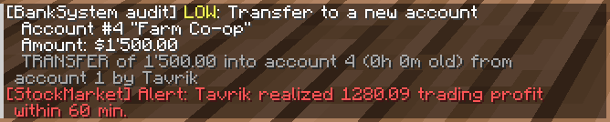

# Alarme und Verdachtsmarkierungen { #alerts-and-suspicion-flags }

Beide Mods achten auf Muster, die oft auf Cheating oder einen Exploit hindeuten, und warnen die Admins im Chat. Ein Alarm ist ein Hinweis, genauer hinzusehen, kein Beweis. Keine der beiden Mods sperrt von sich aus einen Spieler oder nimmt etwas zurück.

<figure markdown="span">
  { width="600" }
</figure>

## Markierungen von BankSystem { #banksystem-flags }

Der Master-Server prüft jede Einzahlung, Abhebung und Überweisung, auch die auf Slave-Servern. Ein Treffer setzt eine **Markierung** auf das Konto. Die Markierungen 1 bis 5 betreffen nur Geld. Du kannst sie unter **Verdächtige Aktivität** in den [Mod Settings](../banksystem/settings.md#suspicious-activity) einstellen, mit Beträgen in ganzen Dollar. Die Markierungen 6 bis 9 sind immer aktiv.

| # | Markierung | Wird gesetzt, wenn |
|---:|---|---|
| 1 | **Banknoten-Wäsche** | Jemand zahlt mindestens $1,000,000 in Banknoten ein, hat aber in den letzten 24 Stunden selbst weniger abgehoben. Typischer Fall: Ein Spieler hebt Banknoten ab, ein anderer zahlt sie ein. |
| 2 | **Große Abhebung** | Ein Spieler hebt auf einmal mindestens $10,000,000 von einem Konto ab. Abhebungen, die weniger als 30 Sekunden auseinanderliegen, zählen als eine. |
| 3 | **Vermögenssprung** | Das Vermögen eines Kontos wächst innerhalb einer Stunde auf mehr als das Doppelte **und** um mehr als $1,000,000. Geprüft wird alle 10 Minuten, höchstens einmal alle 6 Stunden pro Konto. Zum Vermögen zählen Items zu Marktpreisen, also kann auch ein Preissprung die Markierung auslösen. Die Markierung zeigt die Änderung beim Bargeld, damit du das unterscheiden kannst. Braucht StockMarket für die Preise. |
| 4 | **Überweisung auf ein neues Konto** | Mindestens $1,000,000 kommen auf einem Konto an, das jünger als 24 Stunden ist, per Überweisung, Auszahlung oder Dividende. |
| 5 | **Wachstum der Geldmenge** | Das gesamte Geld auf dem Server wächst innerhalb einer Stunde um mehr als 10 % **und** um mehr als $10,000,000. Diese Markierung gilt für den ganzen Server, nicht für ein Konto. In der ersten Stunde einer neuen Welt bleibt sie still. |
| 6 | **Ausgang der Übertragung unbekannt** | In einem Netzwerk wurden Werte an einen Slave-Server geschickt, und es kam keine Antwort zurück. Niemand weiß also, ob sie angekommen sind. Nichts wird erstattet. Frag beim Spieler nach und korrigiere den Kontostand von Hand, wenn die Items nie angekommen sind. |
| 7 | **Währungsbindung gesperrt** | Eine [Währungsbindung](../../banksystem/currency-bindings.md) zeigt auf ein Numismatics- oder Lightman's-Konto, das der Besitzer oder die Verwalter des Kontos nicht binden dürfen. Siehe unten. |
| 8 | **Mehr Aktien als gestempelt** | In den Banken liegen mehr Aktien eines Unternehmens, als je geprägt wurden. Die Dividenden des Unternehmens pausieren. Siehe [Aktien-Integrität](../banksystem/companies.md#share-integrity). |
| 9 | **Aktien ohne Stempler erzeugt** | Ein Spieler hat geprägte Aktien über `/give` oder das Kreativinventar bekommen. |

Die Zahlen in der Tabelle sind die Standardwerte. Jede Markierung hat einen Schweregrad: LOW, MEDIUM oder HIGH.

### Gesperrte Währungsbindungen { #suspended-currency-bindings }

Spieler können ein Bankkonto nur an ein Währungskonto binden, das ihnen gehört oder, bei einem gemeinsamen Konto, einem seiner Verwalter. Bindungen aus älteren Versionen wurden nicht geprüft, deshalb prüft der Master jede Bindung einmal bei jedem Start. Eine Bindung, die gegen die Regel verstößt, wird **gesperrt**: Sie behält ihr Geld, aber nichts fließt durch sie, bis du entscheidest.

- **Die Bindung ist in Ordnung** (zum Beispiel gehört das Währungskonto einem früheren Verwalter): Stelle sie auf dem Master-Server wieder her mit

    ```text
    /banksystem restorebinding <account number> [item]
    ```

    Ohne Item werden alle gesperrten Bindungen des Kontos wiederhergestellt. Eine wiederhergestellte Bindung wird nicht erneut geprüft.

- **Die Bindung ist nicht in Ordnung**: Lass sie gesperrt, oder lösche die Bank oder das Konto. Das Geld, das BankSystem für sie gehalten hat, wird dann aufgezeichnet und nicht ausgezahlt.

## Alarme von StockMarket { #stockmarket-alerts }

Der Master-Server beobachtet den Handel der Spieler. Orders von Bots werden nicht geprüft.

| Alarm | Wird ausgelöst, wenn | Einstellungen (Standard) |
|---|---|---|
| **Gewinnalarm** | Der realisierte Handelsgewinn eines Spielers (Verkäufe minus Käufe über alle Märkte) steigt innerhalb des Zeitfensters über die Schwelle. Einmal pro Zeitfenster. Auch der Verkauf von Items, die vor langer Zeit gekauft wurden, zählt mit. | **Gewinnalarm-Schwelle** (1,000,000, `0` = aus), **Gewinnalarm-Fenster (min)** (60) |
| **Pump** | Ein Kauf eines Spielers per Market-Order hat den Preis um mehr als den eingestellten Prozentsatz steigen lassen, während derselbe Spieler eine Verkaufsorder über dem alten Preis offen hat. | **Pump-and-Dump-Erkennung** (an), **Pump-Preissprung (%)** (20, `0` = aus) |
| **Kauf-Verkauf-Zyklus** | Ein Spieler verkauft innerhalb des Zeitfensters ein Item, das er auf demselben Markt gekauft hat, mit einem Gewinn über der Schwelle. | **Kauf-Verkauf-Zyklus (min)** (30), **Zyklus-Gewinnschwelle** (100,000, `0` = aus) |

Alle Einstellungen liegen in der Gruppe „Markt“ der [Mod-Einstellungen](../stockmarket/mod-settings.md) von StockMarket und wirken sofort. Die Zeitfenster werden nur im Speicher gehalten, ein Neustart beginnt also neue.

## Wer die Alarme bekommt { #who-gets-the-alerts }

| | BankSystem | StockMarket |
|---|---|---|
| Chat | Jeder BankSystem-Admin, der online ist, auf dem Master und auf den Slaves | Spieler auf dem Master, die online sind und die Berechtigung `stockmarket.admin.notify` haben (ohne Berechtigungs-Mod: Operator-Level 2) |
| Chat für dich selbst ausschalten | `/banksystem alerts off` (`on` schaltet ihn wieder ein) | `/stockmarket alerts off` (`on`), nur auf dem Master |
| Standard für Admins, die den Befehl nie benutzt haben | **Admin-Benachrichtigungen standardmäßig an** (an) | **Alarm-Chat standardmäßig an** (an) |
| Wird immer geschrieben in | Die tägliche Audit-Datei, siehe [Täglicher Bericht und Berichte](reports.md) | Das Server-Log, die Zeilen beginnen mit `[StockMarket Alert]` |

Deine Wahl wird gespeichert und bleibt über Neustarts erhalten. Das Ausschalten betrifft nur den Chat: Dateien, Logs und der [Discord-Feed](../discord.md) bekommen weiterhin jeden Alarm.

BankSystem schickt außerdem jede Admin-Aktion in den Chat, zum Beispiel *AdminName hat $500.00 zu Konto #7 hinzugefügt*. So sehen Admins die Änderungen der anderen.

## Verwandte Seiten { #related-pages }

- [Im Spiel untersuchen](investigating.md): ein markiertes Konto untersuchen.
- [Konten verwalten](../banksystem/accounts.md): ein Konto einfrieren oder einen Kontostand korrigieren.
- [Täglicher Bericht und Berichte](reports.md): alle Markierungen eines Tages in einer Datei.
