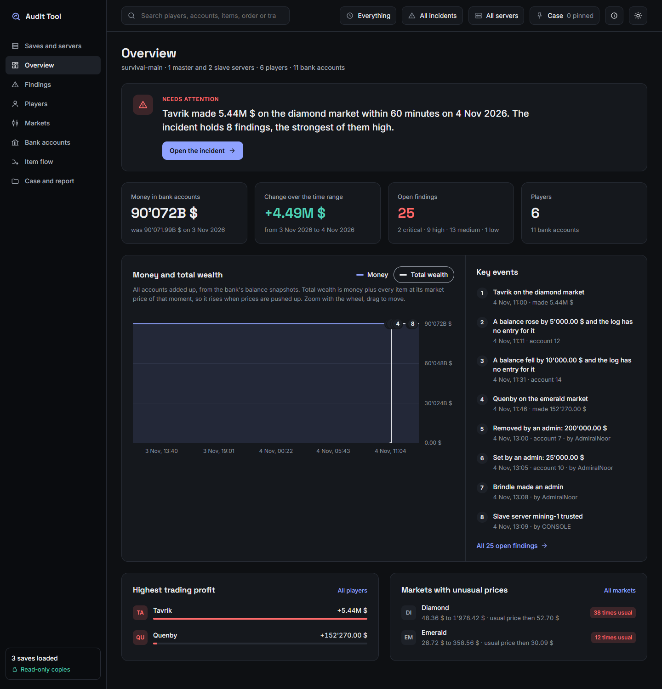
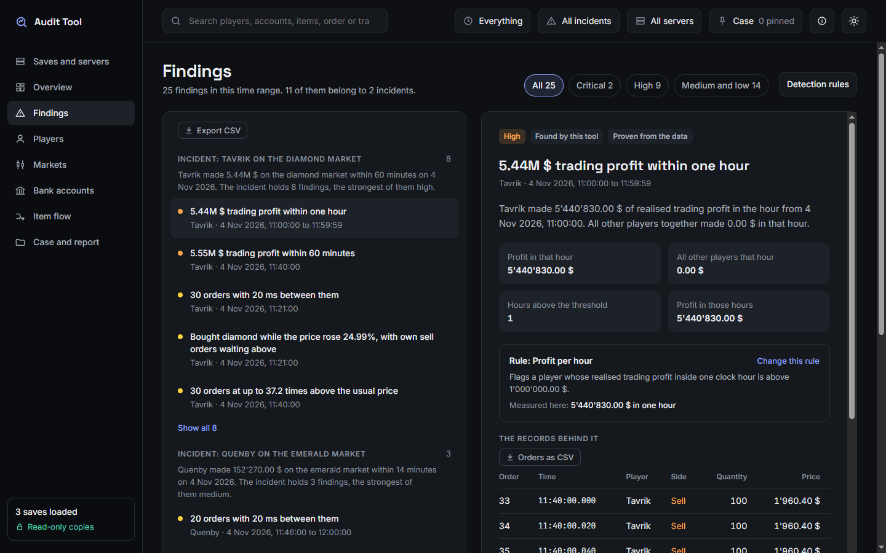
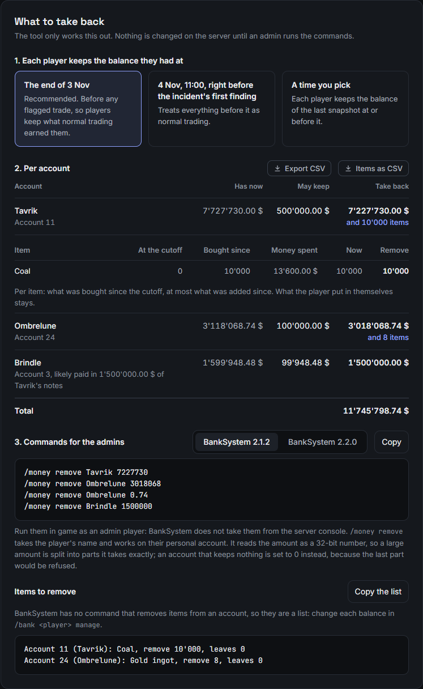

# Audit Tool { #audit-tool }

Das Audit Tool ist ein eigenes Windows-Programm für größere Untersuchungen. Es lädt Kopien der Speicherstände deines Master-Servers und deiner Slave-Server, findet Anzeichen für Exploits und Cheating, verfolgt das Geld und schreibt einen Bericht: wer was gewonnen hat, wie und was du zurücknehmen solltest.

Es liest nur. Es arbeitet mit Kopien, schreibt nie in einen Speicherstand und verbindet sich nie mit einem Server.

## Herunterladen und installieren { #download-and-install }

Lade es von der [Release-Seite des Audit Tools](https://github.com/KROIA/BS_SM_AuditTool/releases) herunter. Es läuft unter Windows 10 oder 11, 64-Bit, und braucht sonst nichts.

- **Installer** (`Audit Tool Setup <version>.exe`): installiert für deinen Windows-Benutzer, ohne Administratorrechte, und legt einen Eintrag im Startmenü an.
- **Ohne Installation** (`Audit Tool-<version>-win.zip`): Entpacke es an einem beliebigen Ort und starte `Audit Tool.exe`.

Die Dateien sind nicht signiert, deshalb warnt Windows beim ersten Start vielleicht. Klicke auf **Weitere Informationen** und dann auf **Trotzdem ausführen**.

Das Tool liest Speicherstände ab BankSystem 2.1.2. Neuere Versionen zeichnen mehr auf, daher sind manche Antworten nur mit ihren Speicherständen möglich.

## Vom Server zum Bericht { #from-a-server-to-a-report }

### 1. Die Speicherstände holen { #1-get-the-saves }

Führe das auf jedem Server des Netzwerks aus:

```text
/banksystem backup export [name]
```

Der Befehl schreibt eine konsistente Kopie der Mod-Daten nach `<world>/audit_exports/`, als Ordner und als Zip, während der Server weiterläuft. Was darin steckt, steht in [Datendateien und Backups](../backups.md).

!!! warning "Keine laufende Welt kopieren"
    Wenn du stattdessen den Weltordner von Hand kopierst, stoppe vorher den Server. Eine Kopie von einem laufenden Server ist oft beschädigt.

### 2. Gemeinsam öffnen { #2-open-them-together }

Starte das Tool und öffne die Speicherstände des Masters und seiner Slaves, als Ordner oder als Zip. Du kannst sie auch in das Fenster ziehen. Das Tool ordnet sie über ihre Server-IDs einander zu. Das erste Einlesen eines großen Speicherstands dauert eine Weile.

### 3. Den Befunden folgen { #3-follow-the-findings }

Die Ansicht **Overview** zeigt, ob etwas deine Aufmerksamkeit braucht: den stärksten Vorfall, das Geld in der Bank, offene Befunde und die wichtigsten Ereignisse der Reihe nach.

<figure markdown="span">
  { width="600" }
</figure>

**Findings** listet, was die Erkennungsregeln markiert haben, gruppiert in Vorfälle. Jeder Befund sagt, was gemessen wurde, welche Regel angeschlagen hat und welche Orders oder Log-Zeilen dahinterstehen. Du kannst jede Regel anpassen oder abschalten.

<figure markdown="span">
  { width="600" }
</figure>

Weitere Ansichten zeigen die Details:

- **Players**, **Markets** und **Bank accounts** zeigen, was passiert ist und wer gewonnen hat.
- **Markets** zeichnet den Preis eines Items als Kerzen. Du kannst Spieler in den Chart legen, um zu sehen, wo sie gekauft und verkauft haben.
- **Item flow** zeigt, woher das Geld oder die Items eines Vorfalls kamen, wer sie bekommen hat und wo sie jetzt sind.

Wähle in der oberen Leiste einen Vorfall, dann zeigt jede Ansicht nur noch seine Spieler und Konten, von 30 Minuten davor bis 30 Minuten danach. Hefte an, was für den Fall wichtig ist.

Banknoten in Truhen und anderen Blöcken findet nur der vollständige Welt-Scan, den du im Tab **World scan** von Hand startest. Spielerinventare und Endertruhen werden immer gelesen.

### 4. Entscheiden und berichten { #4-decide-and-report }

**Case and report** ermittelt ab einem Zeitpunkt, den du wählst, was jedes Konto behalten darf und was du zurücknehmen solltest. Die Ansicht gibt die Befehle aus, die du ausführen musst, und listet die Items, die du von Hand entfernen musst. Exportiere den Bericht als HTML oder PDF, auf Englisch oder Deutsch. Jede Tabelle lässt sich außerdem als CSV exportieren.

<figure markdown="span">
  { width="600" }
</figure>

Auf einem Server ändert sich nichts, bis du die Befehle selbst ausführst.

## Verwandte Seiten { #related-pages }

- [Im Spiel untersuchen](investigating.md): schnelle Prüfungen, ohne das Spiel zu verlassen.
- [Datendateien und Backups](../backups.md): das Exportpaket.
- [Alarme und Verdachtsmarkierungen](alerts.md): was die Mods von sich aus markieren.
