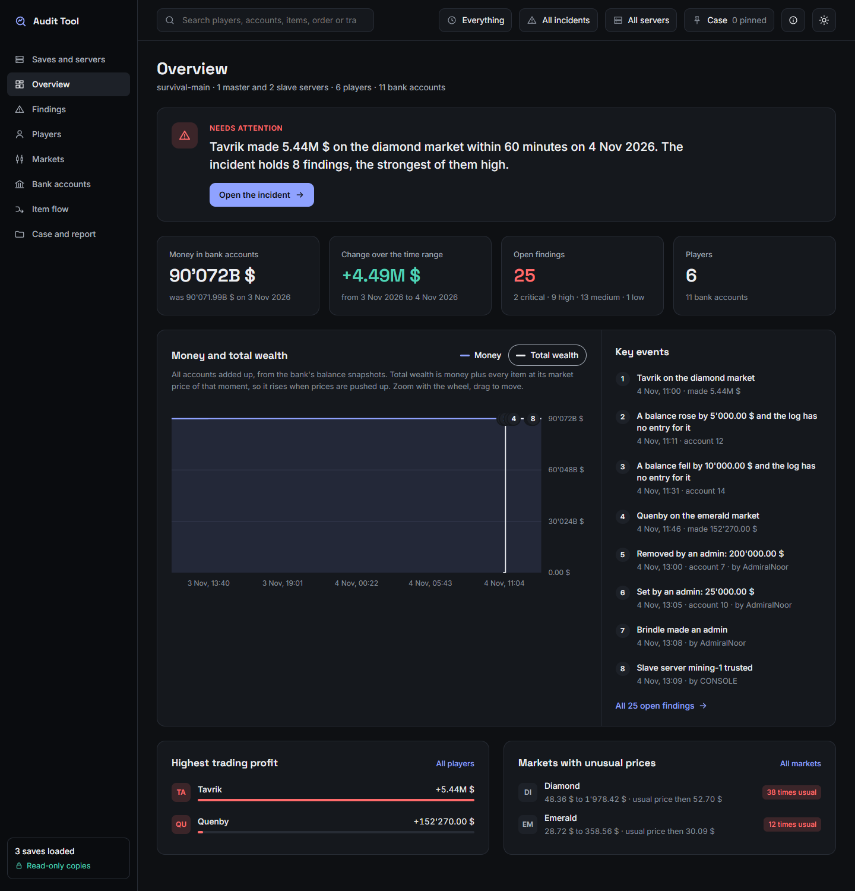
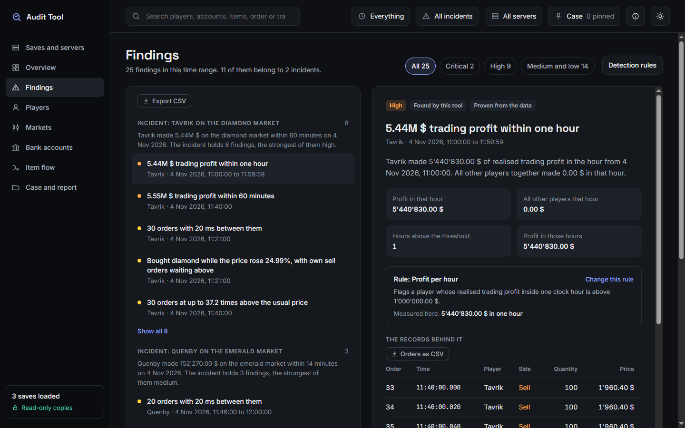
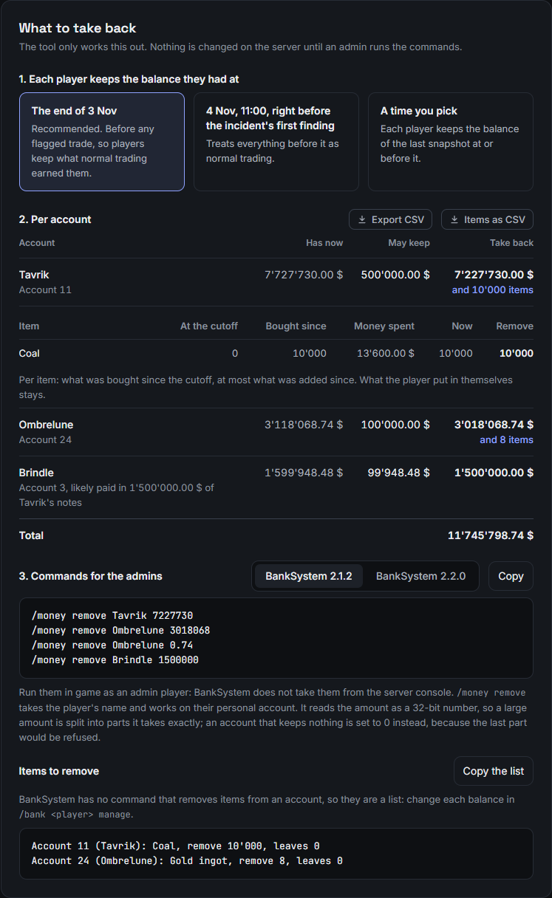

# Audit Tool

The Audit Tool is a separate Windows program for bigger investigations. It loads copies of the saves of your master and slave servers, finds signs of exploits and cheating, follows the money, and writes a report: who gained what, how, and what to take back.

It only reads. It works on copies, never writes into a save and never connects to a server.

## Download and install

Download it from the [Audit Tool releases page](https://github.com/KROIA/BS_SM_AuditTool/releases). It runs on Windows 10 or 11, 64-bit, and needs nothing else.

- **Installer** (`Audit Tool Setup <version>.exe`): installs for your Windows user, without admin rights, and adds a Start menu entry.
- **Without installing** (`Audit Tool-<version>-win.zip`): unpack it anywhere and start `Audit Tool.exe`.

The files are not signed, so Windows may warn on the first start. Click **More info**, then **Run anyway**.

The tool reads saves of BankSystem 2.1.2 and newer. Newer versions record more, so some answers are only possible with their saves.

## From a server to a report

### 1. Get the saves

Run this on every server of the network:

```text
/banksystem backup export [name]
```

It writes a consistent copy of the mod data to `<world>/audit_exports/`, as a folder and as a zip, while the server keeps running. See [Data files and backups](../backups.md) for what is inside.

!!! warning "Don't copy a running world"
    If you copy the world folder by hand instead, stop the server first. A copy taken from a running server is often damaged.

### 2. Open them together

Start the tool and open the saves of the master and its slaves, as folders or zips. You can also drag them into the window. The tool matches them by their server ids. The first read of a large save takes a while.

### 3. Follow the findings

The **Overview** says whether something needs attention: the strongest incident, the money in the bank, open findings and the key events in order.

<figure markdown="span">
  { width="600" }
</figure>

**Findings** lists what the detection rules flagged, grouped into incidents. Each finding says what was measured, which rule fired, and which orders or log rows are behind it. You can tune or switch off each rule.

<figure markdown="span">
  { width="600" }
</figure>

More screens show the details:

- **Players**, **Markets** and **Bank accounts** show what happened and who gained.
- **Markets** draws an item's price as candles; you can put players on the chart to see where they bought and sold.
- **Item flow** shows where the money or items of an incident came from, who got them and where they are now.

Pick an incident in the top bar, and every screen shows only its players and accounts, from 30 minutes before to 30 minutes after. Pin what matters to the case.

Banknotes in chests and other blocks are only found by the full world scan, which you start by hand on the **World scan** tab. Player inventories and ender chests are always read.

### 4. Decide and report

**Case and report** works out, from a time you choose, what each account may keep and what to take back. It prints the commands for you to run and lists the items to remove by hand. Export the report as HTML or PDF, in English or German. Every table can also be exported as CSV.

<figure markdown="span">
  { width="600" }
</figure>

Nothing changes on a server until you run the commands yourself.

## Related pages

- [Investigating in game](investigating.md): quick checks without leaving the game.
- [Data files and backups](../backups.md): the export package.
- [Alerts and suspicion flags](alerts.md): what the mods flag on their own.
