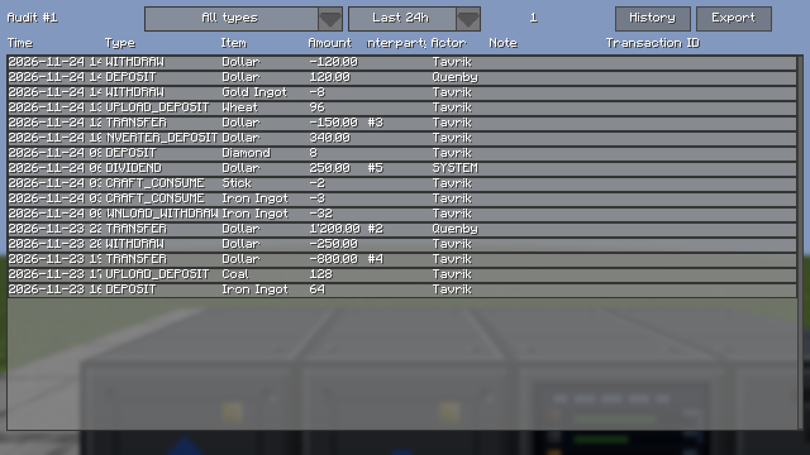
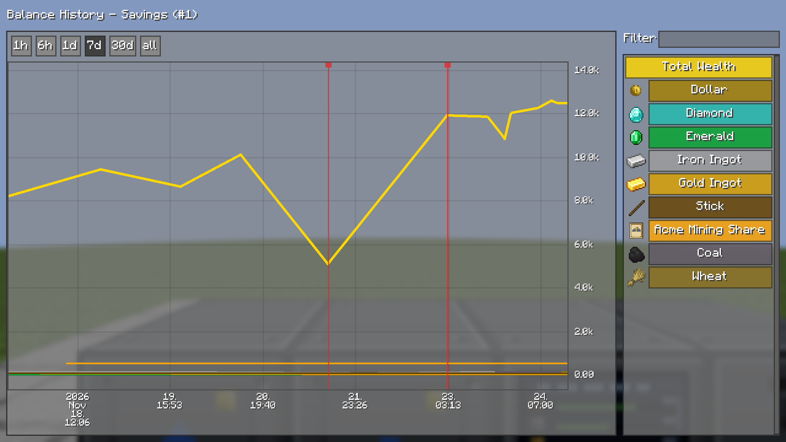
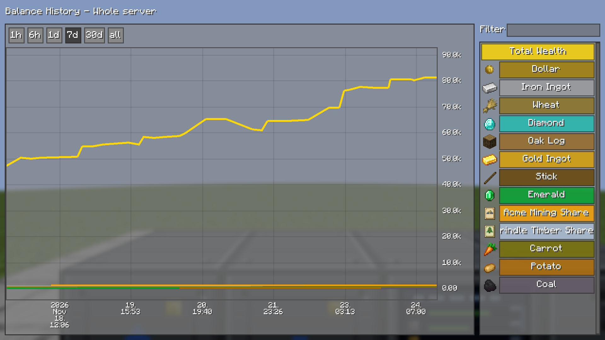

# Im Spiel untersuchen { #investigating-in-game }

Wenn ein [Alarm](alerts.md) eingeht oder ein Spieler etwas Seltsames meldet, zeigen diese Fenster, was passiert ist. Sie sind nur für BankSystem-Admins. Auf einem Slave-Server, der nicht vertrauenswürdig ist, zeigt das Audit-Fenster *Zugriff verweigert*, und die anderen Fenster bleiben leer.

## Das Audit-Fenster { #the-audit-screen }

Das Audit-Fenster listet jede Änderung des Kontostands eines Kontos, die neueste zuerst. Öffne es mit

```text
/banksystem audit <player or account number>
```

oder mit **Audit** im [Verwaltungsfenster](../banksystem/accounts.md) eines Kontos. Ein Spielername öffnet sein persönliches Konto.

<figure markdown="span">
  { width="600" }
</figure>

| Spalte | Zeigt |
|---|---|
| **Zeit** | Wann es passiert ist. |
| **Typ** | Was passiert ist: Einzahlung, Abhebung, Überweisung, Admin-Änderung, Auszahlung, Handel und so weiter. |
| **Item** | Welches Item oder Geld. |
| **Betrag** | Wie viel. Negativ, wenn es das Konto verlassen hat. |
| **Gegenkonto** | Das andere Konto einer Überweisung. |
| **Akteur** | Wer es verursacht hat: ein Spieler, ein Admin, die Konsole, der Server selbst oder StockMarket. |
| **Notiz** | Zusätzliche Details. |
| **Transaktions-ID** | Verbindet Zeilen, die zusammengehören, etwa beide Seiten einer Überweisung. |

Die oberste Zeile enthält die Bedienelemente:

- **Alle Typen** filtert nach der Art des Eintrags.
- **Letzte Stunde**, **Letzte 24h**, **Letzte 7 Tage** oder **Gesamte Zeit** wählt den Zeitraum.
- **<** und **>** blättern um. Jede Seite zeigt 100 Einträge.
- **Verlauf** öffnet den Kontoverlauf des Kontos (siehe unten).
- **Exportieren** speichert jeden Eintrag, der zu den Filtern passt, bis zu den neuesten 10,000, als CSV-Datei auf deinem Computer.

Fahre mit der Maus über eine Zeile, um sie vollständig zu sehen. Klicke auf eine Zeile, um sie in die Zwischenablage zu kopieren.

Einträge, die an einem Block entstanden sind (Bank Terminal, Geldautomat, Automatisierungsblöcke, Aktien-Prägestation), speichern auch, wo der Block steht. In einem Netzwerk sagen Einträge von Slave-Servern, von welchem Server sie kamen.

## Kontoverlauf mit Markierungen { #balance-history-with-flags }

```text
/banksystem history <player or account number>
```

öffnet das Kontostandsdiagramm eines beliebigen Kontos. Es ist dasselbe Diagramm, das Spieler sehen, mit seiner Linie für das Gesamtvermögen. Die Verdachtsmarkierungen des Kontos erscheinen als rote Marker. Fahre mit der Maus über einen Marker, um zu sehen, was markiert wurde.

<figure markdown="span">
  { width="600" }
</figure>

## Der ganze Server { #the-whole-server }

**Serververlauf** oben im Fenster „Bank Einstellungen“ (`/banksystem manage`) zeigt den Kontoverlauf aller Konten zusammengerechnet, pro Item. Markierungen zur Geldmenge erscheinen als Marker. Damit siehst du, wann Geld oder Items auf dem Server aufgetaucht sind.

<figure markdown="span">
  { width="600" }
</figure>

## Eine typische Prüfung { #a-typical-check }

1. Öffne das markierte Konto mit `/banksystem audit <account>` und stelle den Zeitraum auf die Zeit der Markierung.
2. Sieh dir die Spalten **Akteur** und **Gegenkonto** an: Woher kam das Geld, und wohin ist es gegangen?
3. Verfolge das Geld: Öffne das Gegenkonto auf dieselbe Weise.
4. Während du das untersuchst, [friere](../banksystem/accounts.md#freezing-an-account) die beteiligten Konten ein, damit sich nichts bewegt.
5. Korrigiere die Kontostände im [Verwaltungsfenster](../banksystem/accounts.md) oder mit `/money` und taue die Konten danach wieder auf.

Für einen Fall über mehrere Server oder einen langen Zeitraum exportierst du die Speicherstände und nutzt das [Audit Tool](audit-tool.md).

## Verwandte Seiten { #related-pages }

- [Alarme und Verdachtsmarkierungen](alerts.md): was jede Markierung bedeutet.
- [Konten verwalten](../banksystem/accounts.md): Konten einfrieren und korrigieren.
- [Täglicher Bericht und Berichte](reports.md): eine Zusammenfassung eines Tages oder der letzten Stunden.
