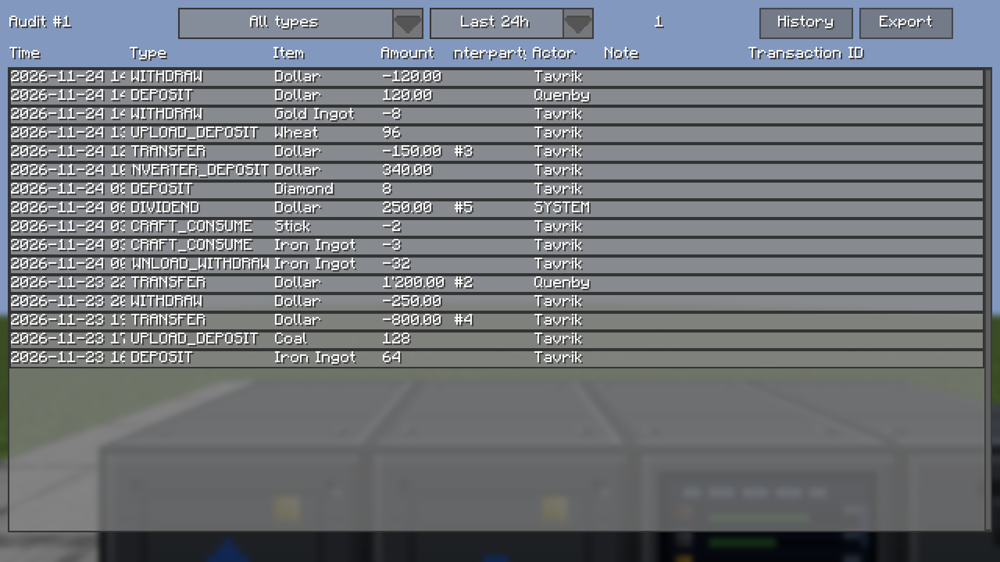
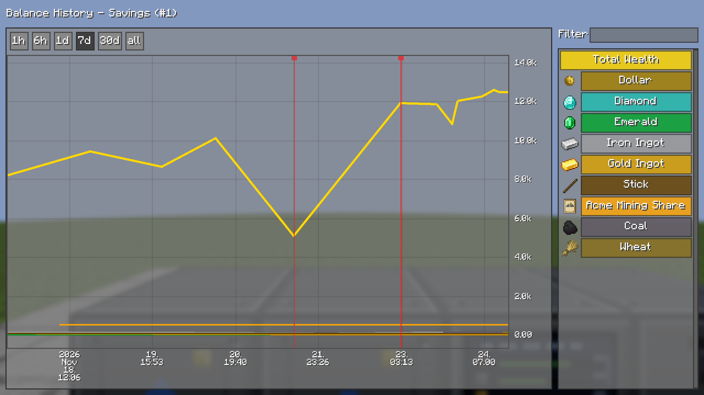
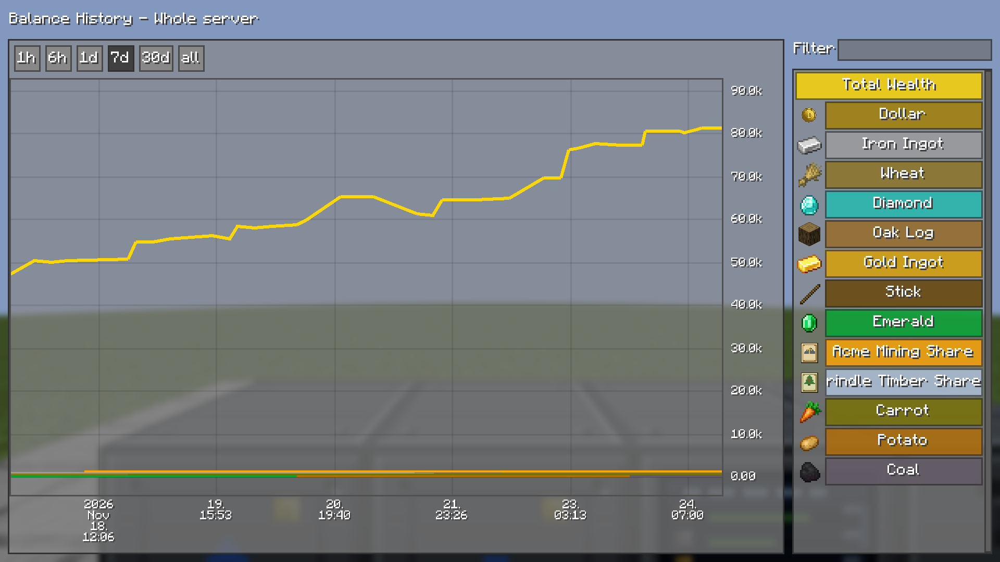

# Investigating in game

When an [alert](alerts.md) comes in or a player reports something odd, these screens show what happened. They are for BankSystem admins only. On a slave server that isn't trusted, the Audit screen shows *Access denied* and the other screens stay empty.

## The Audit screen

The Audit screen lists every balance change of one account, newest first. Open it with

```text
/banksystem audit <player or account number>
```

or with **Audit** in the [management screen](../banksystem/accounts.md) of an account. A player name opens their personal account.

<figure markdown="span">
  { width="600" }
</figure>

| Column | Shows |
|---|---|
| **Time** | When it happened. |
| **Type** | What happened: deposit, withdrawal, transfer, admin edit, payout, trade and so on. |
| **Item** | Which item or money. |
| **Amount** | How much. Negative when it left the account. |
| **Counterparty** | The other account of a transfer. |
| **Actor** | Who caused it: a player, an admin, the console, the server itself or StockMarket. |
| **Note** | Extra details. |
| **Transaction ID** | Links rows that belong together, such as both sides of a transfer. |

The top row holds the controls:

- **All types** filters by entry type.
- **Last hour**, **Last 24h**, **Last 7 days** or **All time** picks the time range.
- **<** and **>** turn the pages. Each page shows 100 entries.
- **History** opens the account's balance history (see below).
- **Export** saves every entry that matches the filters, up to the newest 10,000, as a CSV file on your computer.

Hover a row to see it in full. Click a row to copy it to the clipboard.

Entries made at a block (Bank Terminal, ATM, automation blocks, Share Stamper) also store where the block is. On a network, entries from slave servers say which server they came from.

## Balance history with flags

```text
/banksystem history <player or account number>
```

opens the balance chart of any account, the same chart players see, with its total wealth line. The account's suspicion flags show as red markers. Hover a marker to see what was flagged.

<figure markdown="span">
  { width="600" }
</figure>

## The whole server

**Server history** at the top of the Bank Settings screen (`/banksystem manage`) shows the balance history of all accounts added up, per item. Money supply flags show as markers. Use it to see when money or items appeared on the server.

<figure markdown="span">
  { width="600" }
</figure>

## A typical check

1. Open the flagged account with `/banksystem audit <account>` and set the range to the time of the flag.
2. Look at the **Actor** and **Counterparty** columns: where did the money come from, and where did it go?
3. Follow the money: open the counterparty account the same way.
4. While you look into it, [freeze](../banksystem/accounts.md#freezing-an-account) the accounts involved so nothing moves.
5. Correct balances in the [management screen](../banksystem/accounts.md) or with `/money`, then unfreeze.

For a case across several servers or a long time span, export the saves and use the [Audit Tool](audit-tool.md).

## Related pages

- [Alerts and suspicion flags](alerts.md): what each flag means.
- [Managing accounts](../banksystem/accounts.md): freeze and correct accounts.
- [Daily digest and reports](reports.md): a summary of a day or of the last hours.
