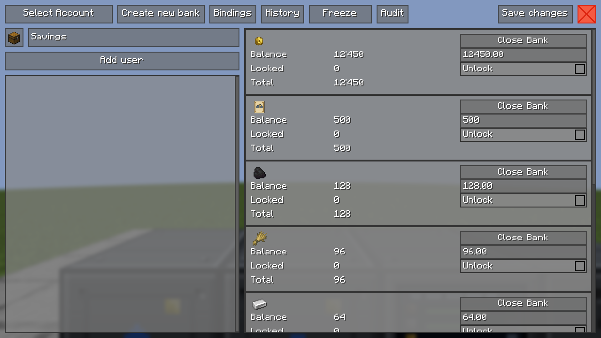

# Konten verwalten { #managing-accounts }

Als BankSystem-Admin kannst du jedes Bankkonto öffnen und ändern, was darin ist. Du brauchst das BankSystem-Admin-Flag, siehe [Admins und Berechtigungen](../permissions.md).

## Ein Konto öffnen { #opening-an-account }

Du hast diese Möglichkeiten:

- `/bank <player> manage` öffnet das persönliche Konto des Spielers.
- Wähle im Fenster [Bank Einstellungen](bankable-items.md#the-bank-settings-screen) ein Item aus und klicke neben einem Konto auf **Verwalten**.
- Klicke im Kreativmodus mit **Banking Software** in der Hand mit der rechten Maustaste auf einen Spieler. Dafür brauchst du zusätzlich die Berechtigung `banksystem.admin.software`.

Das Fenster ist dasselbe [Verwaltungsfenster](../../banksystem/bank-accounts.md#the-management-screen), das Spieler sehen, mit zusätzlichen Bedienelementen für Admins. Um nur einen Kontostand anzusehen, nutze `/bank <player> show`.

<figure markdown="span">
  { width="600" }
</figure>

## Was du ändern kannst { #what-you-can-change }

Jedes Item im Konto hat eine Zeile mit **Kontostand**, **Reserviert** und **Total**.

| Ziel | So geht es | Gespeichert |
|---|---|---|
| Einen Kontostand ändern | Tippe den neuen Betrag in das Feld für den Kontostand. | Bei **Änderungen speichern** |
| Ein Item zum Konto hinzufügen | Klicke auf **Bankkonto eröffnen** und wähle das Item. | Sofort |
| Ein Item aus dem Konto entfernen | Klicke in seiner Zeile auf **Bank schließen**. Die Zeile wird rot. Der Spieler verliert dieses Item vollständig. | Bei **Änderungen speichern** |
| Einen reservierten Betrag freigeben | Setze in der Zeile das Häkchen bei **Freigeben**. Der reservierte Betrag wird wieder zu freiem Kontostand. | Bei **Änderungen speichern** |
| Einfrieren oder auftauen | Klicke im Kopfbereich auf **Einfrieren** (oder **Auftauen**). Ein **\*** markiert die ungespeicherte Änderung. | Bei **Änderungen speichern** |
| Den Verlauf des Kontos ansehen | Klicke auf **Audit**. Siehe [Im Spiel untersuchen](../audit/investigating.md). | |

Aktienbestände von Unternehmen kannst du nur verringern, in ganzen Aktien und nicht unter den reservierten Betrag. Die entfernten Aktien werden vernichtet. Siehe [Unternehmen und Aktien](companies.md).

## Reservierte Beträge { #locked-amounts }

Ein Teil eines Kontostands kann **reserviert** sein: zurückgelegt und nicht ausgebbar. Zwei Dinge reservieren Beträge:

- **StockMarket** reserviert das Geld oder die Items offener Orders, bis sie ausgeführt oder storniert sind.
- **BankSystem** reserviert einen Betrag für einen Moment, während ein Bank Terminal, ein Download Block oder das Craften ihn entnimmt. Wenn die Mod nicht feststellen kann, ob die Items geliefert wurden, zum Beispiel weil der Master-Server nicht geantwortet hat, bleibt der Betrag reserviert. Ihn blind freizugeben könnte dieselben Items zweimal auszahlen.

!!! warning "Finde vor dem Freigeben heraus, warum"
    Wenn du einen Betrag freigibst, den eine offene Order oder eine laufende Übertragung noch braucht, kann das diese Order kaputtmachen oder einem Spieler Items doppelt geben.

Bevor du das Häkchen bei **Freigeben** setzt:

1. Führe `/banksystem audit <player>` aus und sieh dir die Einträge aus der Zeit an, als der Betrag reserviert wurde. Eine Abhebung über denselben Betrag bedeutet, dass die Items geliefert und bezahlt wurden.
2. Durchsuche das Server-Log nach `left locked for the admin`, `Un-debited craft` oder `unknown outcome`. Diese Zeilen nennen das Konto, das Item und den Betrag.
3. Wenn StockMarket installiert ist, prüfe die offenen Orders des Spielers. Ihre Beträge sind ebenfalls reserviert.

## Ein Konto einfrieren { #freezing-an-account }

Ein eingefrorenes Konto behält alles, was darin ist, aber nichts kommt hinein oder hinaus: keine Einzahlungen, keine Abhebungen, kein Bargeld, keine Überweisungen, keine Automatisierungsblöcke, kein Craften mit Bank-Items, keine Auszahlungen und keine Dividenden. Spieler bekommen eine Chatnachricht, und das Konto zeigt die graue Anzeige **Eingefroren**. Deine Admin-Änderungen funktionieren weiterhin. Wenn StockMarket installiert ist, storniert das Einfrieren außerdem jede offene Order des Kontos, auch Item/Item-Orders. Das Geld und die Items, die diese Orders reserviert hatten, gehen zurück auf das Konto. Neue Orders werden abgelehnt, bis du das Konto wieder auftaust.

Friere ein Konto im Verwaltungsfenster ein oder per Befehl:

```text
/banksystem freeze <account number> [on|off]
```

Ohne `on` oder `off` schaltet der Befehl den Zustand um. Er funktioniert auch in der Konsole des Master-Servers. Jedes Einfrieren und Auftauen wird im [Transaktionsbuch](../audit/index.md) aufgezeichnet.

## Geld-Befehle { #money-commands }

| Befehl | Was er bewirkt |
|---|---|
| `/money add [player] <amount>` | Fügt dem persönlichen Konto eines Spielers Geld hinzu, oder deinem eigenen. |
| `/money remove [player] <amount>` | Entfernt Geld. |
| `/money set [player] <amount>` | Setzt den Kontostand. |
| `/bank <player> show` | Zeigt die Kontostände eines Spielers im Chat. |

Beträge sind in Dollar, zum Beispiel `12.50`.

## Verwandte Seiten { #related-pages }

- [Im Spiel untersuchen](../audit/investigating.md): herausfinden, was in einem Konto passiert ist.
- [Bankfähige Items](bankable-items.md): das Fenster Bank Einstellungen.
- [Bankkonten](../../banksystem/bank-accounts.md): Konten aus Sicht der Spieler.
