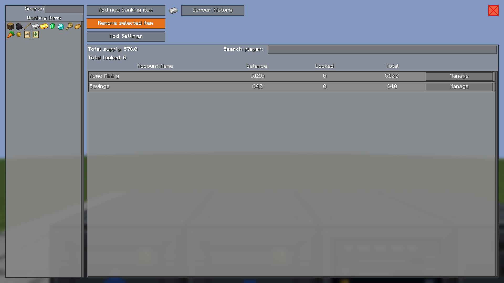

# Bankfähige Items { #bankable-items }

Spieler können nur Items in die Bank legen, die du erlaubst. Eine neue Welt erlaubt Geld, Eisenbarren, Goldbarren, Diamanten, Smaragde und Kohle. Wenn du einen [StockMarket-Markt](../stockmarket/markets.md) für ein Item anlegst, wird dieses Item ebenfalls erlaubt.

Für alles auf dieser Seite brauchst du das BankSystem-Admin-Flag, siehe [Admins und Berechtigungen](../permissions.md).

## Das Fenster Bank Einstellungen { #the-bank-settings-screen }

Führe `/banksystem manage` aus. Das Fenster **Bank Einstellungen** öffnet sich.

<figure markdown="span">
  { width="600" }
</figure>

- **Banking Items** links listet jedes erlaubte Item. Klicke auf eines, um seine **Gesamte Zirkulation** (alle Kontostände der Spieler zusammen) und **Gesamt reserviert** (in offenen Orders am Markt reserviert) zu sehen, und jedes Konto, das es hält.
- **Neues Banking Item hinzufügen** öffnet eine Item-Auswahl. Wähle ein Item, um es zu erlauben.
- **Ausgewähltes Item entfernen** entfernt das ausgewählte Item nach einer Bestätigung aus der Bank.
- **Mod Settings** öffnet die [Mod Settings](settings.md).

## Befehle { #commands }

| Befehl | Was er bewirkt |
|---|---|
| `/banksystem allowItem <item id>` | Erlaubt das Item, zum Beispiel `minecraft:copper_ingot`. |
| `/banksystem allowItemInHand` | Erlaubt das Item in deiner Haupthand, mit seinen genauen Daten. |
| `/banksystem disallowItem <item id>` | Entfernt das Item aus der Bank. |
| `/banksystem disallowItemInHand` | Entfernt das Item in deiner Haupthand aus der Bank. |

!!! danger "Entfernen löscht das Item aus jedem Konto"
    Wenn du ein Item entfernst, wird sein Kontostand aus dem Konto jedes Spielers gelöscht. Die Spieler bekommen die Items nicht zurück. Das lässt sich nicht rückgängig machen. Bitte die Spieler, das Item vorher herauszunehmen.

## Alle Items erlauben { #allowing-all-items }

Große Modpacks haben zu viele Items, um sie einzeln zu erlauben. Schalte **Allow all items** in den [Mod Settings](settings.md#bank) ein. Dann kann jedes Item in die Bank, außer denen auf einer eingebauten Sperrliste: Grundgestein, Barrieren, Konstruktionsleeren, Befehlsblöcke, der Debug-Stab, das Buch des Wissens, die Münzen unter einem Euro und jede Banknote von 5 Euro bis 1'000'000 Euro. Die Sperrliste gilt immer. Items, die du aus der Bank entfernt hast, bleiben ebenfalls gesperrt, bis du sie wieder erlaubst.

Deine Liste der erlaubten Items bleibt gespeichert. Wenn du die Einstellung wieder ausschaltest, gilt wieder die alte Liste.

## Items mit zusätzlichen Daten { #items-with-extra-data }

Die Bank unterscheidet Items anhand ihrer Daten, zum Beispiel eines Namens, der in einem Amboss vergeben wurde. Ein umbenanntes Item ist ein anderes Bank-Item als das einfache und braucht deshalb einen eigenen Eintrag: Halte es in der Hand und führe `/banksystem allowItemInHand` aus. Beschädigte oder verzauberte Items können gar nicht in die Bank. Das Bank Terminal und der Upload Block überspringen sie.

Damit Spieler die Item-Liste nicht vollstopfen, kann jeder Spieler zwischen zwei Serverstarts höchstens 256 neue Item-Varianten hinzufügen. Einfache Items zählen nicht, und Admins haben kein Limit. Wenn ein Spieler das Limit erreicht, vermerkt das Server-Log das einmal.

## Items, deren Daten sich ändern { #items-whose-data-changes }

Manche Mods ändern die Daten eines Items mit der Zeit von selbst. TerraFirmaCraft gibt zum Beispiel jedem Nahrungsmittel ein Erstellungsdatum, das den Verfall steuert, und jedem erhitzten Item eine Temperatur. Für die Bank wäre jeder Fisch, der eine Minute später gefangen wurde, ein neues Item.

BankSystem löst das mit zwei Listen von **Item-Komponenten** (den Teilen der Daten eines Items):

- **Flüchtige Komponenten** werden ignoriert, wenn die Bank Items vergleicht. Wenn ein Spieler das Item herausnimmt, fügt die Mod wieder frische Daten hinzu. Nahrung aus TerraFirmaCraft kommt mit einem frischen Erstellungsdatum heraus.
- **Einzahlungsgeprüfte Komponenten** werden genauso ignoriert, aber die Bank prüft sie bei der Einzahlung: Ein Item wird nur angenommen, wenn es dem entspricht, was die Bank zurückgeben würde. So können Spieler kein verdorbenes Essen einzahlen und frisches herausnehmen. Ein abgelehntes Item bleibt, wo es war, und der Spieler sieht *Der Zustand von … verhindert das Einlagern in der Bank*.

BankSystem deckt TerraFirmaCraft bereits ab: `tfc:food` und `tfc:heat` sind flüchtig, und `tfc:food` ist zusätzlich einzahlungsgeprüft. Füge sie nicht noch einmal hinzu.

!!! note "Daten gehen beim Herausnehmen verloren"
    Eine ignorierte Komponente wird nicht gespeichert. Ein abgehobenes Item ist eine Kopie des Items, das die Bank gespeichert hat. Alles, was in dieser Komponente stand, ist also weg.

### Komponenten hinzufügen { #adding-components }

Du kannst Komponenten auf zwei Wegen hinzufügen. Beide Wege werden zusammengeführt.

**In den Mod Settings** gibst du die Komponenten-IDs, durch Kommas getrennt, unter **Additional volatile components** und **Additional deposit-gated components** ein. Stelle sie auf dem Master-Server ein: Die Slaves übernehmen die Listen vom Master.

**In einem Datapack** fügst du die IDs den Tags `banksystem:volatile_item_components` und `banksystem:deposit_gated_components` hinzu. Die Tag-Dateien müssen im Namespace `banksystem` liegen:

```text
my_datapack/data/banksystem/tags/data_component_type/volatile_item_components.json
my_datapack/data/banksystem/tags/data_component_type/deposit_gated_components.json
```

```json
{
  "values": [
    { "id": "somemod:some_component", "required": false }
  ]
}
```

`"required": false` lässt das Datapack auch dann laden, wenn die andere Mod fehlt. Nutze kein `"replace": true`, das würde die eigenen Einträge von BankSystem verwerfen. In einem Netzwerk installierst du das Datapack auf dem Master und auf jedem Slave.

### Welche Komponenten du eintragen solltest { #which-components-to-list }

| Komponente | Sie als flüchtig einzutragen bedeutet | Empfehlung |
|---|---|---|
| `minecraft:custom_name` | Umbenannte und einfache Items werden zu einem Item. Der Name geht beim Abheben verloren. | Nur, wenn es die Spieler nicht stört. |
| `minecraft:lore` | Items, die sich nur in der Lore unterscheiden, werden zu einem. Die Lore geht verloren. | Vorsicht: Manche Mods kennzeichnen besondere Items mit Lore. |
| `minecraft:custom_data` | Items, die sich nur in Mod-Daten unterscheiden, werden zu einem. Die Daten gehen verloren. | Nur für Experten. Manche Mods speichern dort die ganze Bedeutung eines Items. |
| `minecraft:repair_cost` | Die Mehrkosten am Amboss werden beim Abheben zurückgesetzt. | Nicht eintragen. |

Schaden und Verzauberungen gehören nicht in die Listen: Beschädigte oder verzauberte Items werden ohnehin abgelehnt.

Um zu sehen, welche Komponenten ein Item hat, halte es in der Hand und führe `/data get entity @s SelectedItem` aus. Führe den Befehl zweimal im Abstand von ein paar Minuten aus: Ein Wert, der sich von selbst geändert hat, gehört zu einer flüchtigen Komponente.

### Die Listen in einer genutzten Welt ändern { #changing-the-lists-on-a-world-in-use }

Wenn sich die Listen ändern, werden Items, die jetzt gleich aussehen, zu einem Bank-Item **zusammengeführt**, und ihre Kontostände werden addiert. Das lässt sich nicht rückgängig machen, auch wenn du die Komponente später wieder entfernst. Sichere vorher die Welt, siehe [Datendateien und Backups](../backups.md).

Wenn die Änderung Items zusammenführen würde, die wirklich verschieden sind, zum Beispiel ein beschädigtes und ein neues Werkzeug, **verweigert der Master-Server den Start** und schreibt einen Bericht über die Zusammenführung ins Log. Nichts wird geändert oder gespeichert. Dann kannst du entweder:

- deine Änderung an den Listen rückgängig machen und neu starten, oder
- die Welt sichern, **Confirm pending item merge (one-shot)** in `settings.json` einschalten und neu starten. Die Zusammenführung läuft einmal, und die Einstellung schaltet sich selbst aus.

Die Tags des Datapacks mit `/reload` auf einem laufenden Server zu ändern, wird abgelehnt. Die neuen Tags werden beim nächsten Neustart geprüft.

## Verwandte Seiten { #related-pages }

- [Mod Settings](settings.md): **Allow all items** und die Komponentenlisten.
- [Konten verwalten](accounts.md): die Kontostände einzelner Spieler ändern.
- [Fehlerbehebung](../troubleshooting.md): ein Server, der den Start verweigert.
