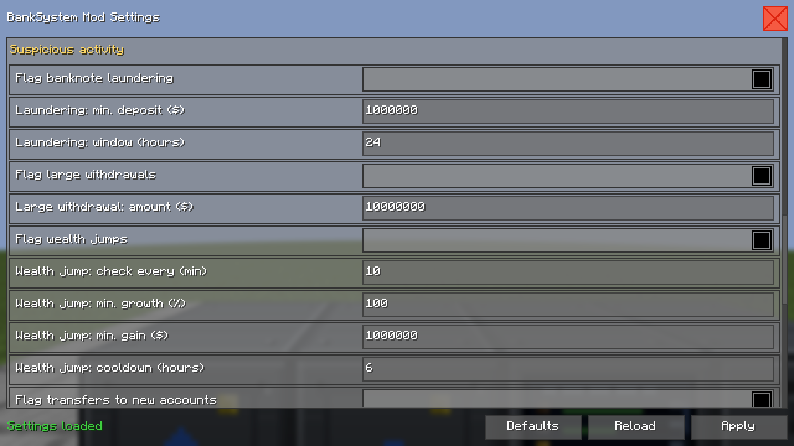

# Mod Settings { #mod-settings }

BankSystem speichert seine Servereinstellungen in einer Datei pro Welt. Du änderst sie im Spiel im Fenster **BankSystem Mod Settings** oder in der Datei, während der Server gestoppt ist.

## Das Fenster öffnen { #opening-the-screen }

1. Führe `/banksystem manage` aus. Du brauchst das BankSystem-Admin-Flag und Operator-Level 2, siehe [Admins und Berechtigungen](../permissions.md).
2. Klicke auf **Mod Settings**.
3. Ändere die Werte und klicke auf **Apply**.

Der Knopf erscheint nur auf dem Master-Server eines [Netzwerks](../multi-server.md) und nur für Spieler mit Operator-Level 2. Einstellungen wirken sofort, außer denen, die im Fenster mit **⟳ Restart required** markiert sind. **Defaults** trägt die Standardwerte ein, und **Reload** liest die gespeicherten Werte neu ein. Beide speichern nichts, bis du auf **Apply** klickst. Wenn du das Fenster mit Änderungen schließt, die du nicht übernommen hast, fragt ein Popup, ob du sie **Speichern** oder **Verwerfen** willst.

<figure markdown="span">
  { width="600" }
</figure>

## Die Einstellungsdatei { #the-settings-file }

Die Datei ist `<world>/data/BankSystem/settings.json`. Der Server legt sie mit Standardwerten an, wenn die Welt zum ersten Mal geladen wird.

!!! warning "Bearbeite die Datei nur, während der Server gestoppt ist"
    Der Server schreibt die Datei alle paar Sekunden neu, während er läuft. Änderungen, die du von Hand machst, gehen dann verloren. Halte das JSON gültig: Wenn die Datei nicht gelesen werden kann, ersetzt BankSystem sie durch eine frische Datei mit Standardwerten.

Werte außerhalb ihres Bereichs werden beim Laden auf den nächsten erlaubten Wert gesetzt. Das Server-Log bekommt für jeden geänderten Wert eine Zeile, die mit *settings.json value out of range, corrected* beginnt.

Jeder Server eines Netzwerks hat seine eigene Datei. Das Fenster bearbeitet nur die Datei des Masters. Um die Datei eines Slaves zu ändern, stoppe den Slave und bearbeite sie von Hand. Die Listen der Item-Komponenten werden vom Master übernommen.

## Utilities { #utilities }

| Einstellung | Schlüssel | Standard | Bereich | Was sie bewirkt |
|---|---|---|---|---|
| **Autosave interval (seconds)** | `SAVE_INTERVAL_SECONDS` | `5` | 1 bis 86'400 | Wie oft BankSystem seine Daten speichert, während Spieler online sind. Ein kurzes Intervall hält die Zeitspanne klein, in der ein Absturz abgehobene Items verdoppeln könnte. |
| **Balance snapshot interval (minutes)** | `BALANCE_SNAPSHOT_INTERVAL_MINUTES` | `1` | 0 bis 10'080 | Wie oft der Kontoverlauf aller Konten aufgezeichnet wird. Eine Zeile wird nur geschrieben, wenn sich ein Kontostand geändert hat. `0` = aus. |
| **Balance snapshot heartbeat (minutes)** | `BALANCE_SNAPSHOT_HEARTBEAT_MINUTES` | `60` | 0 oder mehr | Für Konten, die sich nicht ändern: Mindestens so oft wird eine Zeile geschrieben, damit ihre Linie im Diagramm sichtbar bleibt. `0` = aus. |
| **History retention sweep (minutes)** | `BALANCE_HISTORY_RETENTION_SWEEP_MINUTES` | `60` | 0 oder mehr | Wie oft alter Verlauf ausgedünnt wird. `0` = kein regelmäßiges Ausdünnen. Alter Verlauf wird dann nur einmal bei jedem Serverstart ausgedünnt. |
| **Enable info logging** | `LOGGING_ENABLE_INFO` | an | | Info-Meldungen im Server-Log. |
| **Enable warning logging** | `LOGGING_ENABLE_WARNING` | an | | Warnungen im Server-Log. |
| **Enable error logging** | `LOGGING_ENABLE_ERROR` | an | | Fehler im Server-Log. |
| **Enable debug logging** | `LOGGING_ENABLE_DEBUG` | aus | | Debug-Meldungen im Server-Log. Sehr viele Zeilen. |
| **Admin-Benachrichtigungen standardmäßig an** | `ALERTS_DEFAULT_ON` | an | | Chat-Alarme für Admins, die nie `/banksystem alerts on|off` ausgeführt haben. Siehe [Alarme und Verdachtsmarkierungen](../audit/alerts.md). |

Beim Ausdünnen bleibt jede Zeile der letzten 24 Stunden erhalten, bis 7 Tage eine Zeile pro 15 Minuten, bis 30 Tage eine pro Stunde und bis zu einem Jahr eine pro Tag. Ältere Zeilen werden gelöscht.

## Player { #player }

| Einstellung | Schlüssel | Standard | Bereich | Was sie bewirkt |
|---|---|---|---|---|
| **Starting balance (cents)** | `STARTING_BALANCE` | `0` | 0 bis 10^12 | Geld, das ein neuer Spieler auf seinem persönlichen Konto bekommt, in Cent: `100` = 1 Dollar. |
| **Max. Bankkonten pro Spieler** | `MAX_BANK_ACCOUNTS_PER_PLAYER` | `3` | −1 bis 100'000 | Wie viele Konten ein Spieler anlegen darf. Das persönliche Konto und Konten, zu denen ein Spieler hinzugefügt wurde, zählen nicht. Ein Unternehmen zu gründen belegt eines. `-1` = kein Limit, `0` = keine. |
| **Max. Firmen pro Spieler** | `MAX_COMPANIES_PER_PLAYER` | `3` | −1 bis 100'000 | Wie viele Unternehmen ein Spieler gründen darf. `-1` = kein Limit, `0` = keine. |

Wenn du ein Limit senkst, werden Konten oder Unternehmen, die schon existieren, nicht entfernt.

## Bank { #bank }

| Einstellung | Schlüssel | Standard | Bereich | Was sie bewirkt |
|---|---|---|---|---|
| **Allow all items** | `ALLOW_ALL_ITEMS` | aus | | An: Jedes Item kann in die Bank, außer denen auf der eingebauten Sperrliste (Grundgestein, Barriere, Befehlsblöcke, Münzen unter einem Euro und ein paar weitere). Aus: nur die Items auf deiner Liste der erlaubten Items. Siehe [Bankfähige Items](bankable-items.md). |
| **Additional volatile components** | `ADDITIONAL_VOLATILE_COMPONENTS` | leer | | Item-Daten, die die Bank ignoriert, durch Kommas getrennt, zum Beispiel `tfc:food`. Braucht einen Neustart. Siehe [Bankfähige Items](bankable-items.md#items-whose-data-changes). |
| **Additional deposit-gated components** | `ADDITIONAL_DEPOSIT_GATED_COMPONENTS` | leer | | Item-Daten, die die Bank ignoriert, aber bei der Einzahlung prüft. Braucht einen Neustart. Gleiche Seite. |
| **Download block update interval (ticks)** | `BANK_DOWNLOAD_BLOCK_UPDATE_TICK_INTERVAL` | `20` | 1 bis 1'200 | Zeit zwischen zwei Nachfüllungen eines Bank Download Block. 20 Ticks = 1 Sekunde. |
| **Upload block update interval (ticks)** | `BANK_UPLOAD_BLOCK_UPDATE_TICK_INTERVAL` | `20` | 1 bis 1'200 | Zeit zwischen zwei Uploads eines Bank Upload Block. |
| **Confirm pending item merge (one-shot)** | `CONFIRM_ITEMID_MERGE` | aus | | Genehmigt eine Zusammenführung von Bank-Items, die der Server beim Start verweigert hat. Wird beim nächsten Start angewendet, danach schaltet sich die Einstellung selbst aus. |
| **Confirm pending world repair (one-shot)** | `CONFIRM_ITEMID_REPAIR` | aus | | Genehmigt eine Reparatur der Item-Registry, die der Server beim Start verweigert hat. Wird beim nächsten Start angewendet, danach schaltet sich die Einstellung selbst aus. |
| **Items fehlender Mods entfernen (einmalig)** | `CONFIRM_ITEMID_REMOVE_MISSING` | aus | | Entfernt beim nächsten Start die Kontostände von Items, deren Mod fehlt, aus jedem Konto. BankSystem sichert vorher seine Daten. Danach schaltet sich die Einstellung selbst aus. |

Schalte eine einmalige Einstellung nur ein, wenn das Server-Log dich dazu auffordert. Siehe [Fehlerbehebung](../troubleshooting.md).

## Verdächtige Aktivität { #suspicious-activity }

Diese Einstellungen steuern die Verdachtsmarkierungen und den täglichen Bericht. Sie werden nur auf dem Master-Server gelesen. Geldbeträge sind in **ganzen Dollar** angegeben, nicht in Cent. Was jede Markierung bedeutet, steht in [Alarme und Verdachtsmarkierungen](../audit/alerts.md).

| Einstellung | Schlüssel | Standard | Bereich |
|---|---|---|---|
| **Banknoten-Wäsche markieren** | `LAUNDERING_FLAG_ENABLED` | an | |
| **Wäsche: min. Einzahlung ($)** | `LAUNDERING_MIN_AMOUNT` | `1000000` | 0 bis 10^12 |
| **Wäsche: Zeitfenster (Stunden)** | `LAUNDERING_WINDOW_HOURS` | `24` | 1 bis 8'760 |
| **Große Abhebungen markieren** | `LARGE_NOTE_WITHDRAWAL_FLAG_ENABLED` | an | |
| **Große Abhebung: Betrag ($)** | `LARGE_NOTE_WITHDRAWAL_AMOUNT` | `10000000` | 0 bis 10^12 |
| **Vermögenssprünge markieren** | `WEALTH_JUMP_FLAG_ENABLED` | an | |
| **Vermögenssprung: Prüfung alle (Min.)** | `WEALTH_SWEEP_MINUTES` | `10` | 0 bis 1'440 (`0` = nie) |
| **Vermögenssprung: min. Wachstum (%)** | `WEALTH_JUMP_PERCENT` | `100` | 1 bis 100'000 |
| **Vermögenssprung: min. Gewinn ($)** | `WEALTH_JUMP_AMOUNT` | `1000000` | 0 bis 10^12 |
| **Vermögenssprung: Sperrzeit (Stunden)** | `WEALTH_JUMP_COOLDOWN_HOURS` | `6` | 0 bis 8'760 |
| **Überweisungen an neue Konten markieren** | `NEW_ACCOUNT_TRANSFER_FLAG_ENABLED` | an | |
| **Neues Konto: min. Betrag ($)** | `NEW_ACCOUNT_TRANSFER_AMOUNT` | `1000000` | 0 bis 10^12 |
| **Neues Konto: max. Alter (Stunden)** | `NEW_ACCOUNT_AGE_HOURS` | `24` | 1 bis 8'760 |
| **Geldmengenwachstum markieren** | `MONEY_SUPPLY_FLAG_ENABLED` | an | |
| **Geldmenge: min. Wachstum (%)** | `MONEY_SUPPLY_GROWTH_PERCENT` | `10` | 1 bis 100'000 |
| **Geldmenge: min. Wachstum ($)** | `MONEY_SUPPLY_GROWTH_AMOUNT` | `10000000` | 0 bis 10^12 |
| **Geldmenge: Sperrzeit (Stunden)** | `MONEY_SUPPLY_COOLDOWN_HOURS` | `6` | 0 bis 8'760 |
| **Täglicher Audit-Bericht** | `DAILY_DIGEST_ENABLED` | an | |
| **Bericht: größte Gewinner** | `DIGEST_TOP_N` | `10` | 1 bis 100 |

## Integrationen { #integrations }

Im Fenster ist jede Integration ein Abschnitt mit einem Ein/Aus-Kästchen in seiner Kopfzeile. Solange eine Integration aus ist, sind ihre Einstellungen ausgegraut.

| Einstellung | Schlüssel | Standard | Bereich | Was sie bewirkt |
|---|---|---|---|---|
| **Platzhalter aktiviert** | `PLACEHOLDERS_ENABLED` | an | | Platzhalter für TAB und Placeholder API. Braucht einen Neustart. Siehe [Platzhalter](../placeholders.md). |
| **Aktualisierung Spieler-Platzhalter (ms)** | `PLAYER_REFRESH_MS` | `1000` | 100 bis 86'400'000 | Wie oft die Werte pro Spieler aktualisiert werden. |
| **Aktualisierung Server-Platzhalter (ms)** | `SERVER_REFRESH_MS` | `30000` | 100 bis 86'400'000 | Wie oft die serverweiten Werte aktualisiert werden, etwa die reichsten Spieler. |
| **Größe der Bestenliste** | `TOP_COUNT` | `10` | 0 bis 100 | Wie viele Plätze die Liste der reichsten Spieler hat. Braucht einen Neustart. |
| **Geldformat** | `MONEY_FORMAT` | `$%s` | | Wie Geld in Platzhaltern angezeigt wird. `%s` steht für die Zahl, zum Beispiel `%s €`. Ein Wert ohne `%s` fällt auf den Standard zurück. |
| **Admin-Flag mit LuckPerms synchronisieren** | `SYNC_ADMIN_FLAG_WITH_PERMISSION` | aus | | Hält das BankSystem-Admin-Flag und den LuckPerms-Berechtigungs-Node `banksystem.admin` auf demselben Stand. Siehe [Admins und Berechtigungen](../permissions.md). |
| **Numismatics-Integration** | `NUMISMATICS_ENABLED` | an | | Lässt Spieler Konten an Numismatics [binden](../../banksystem/currency-bindings.md). Aus: Gebundenes Geld bleibt in Numismatics und kann sich nicht bewegen, bis du die Integration wieder einschaltest. |
| **Lightman's-Currency-Integration** | `LIGHTMANS_CURRENCY_ENABLED` | an | | Dasselbe für Lightman's Currency. |
| **Discord-Feed** | `DISCORD_ENABLED` | aus | | Postet Bank-Ereignisse in Discord. Siehe [Discord-Feed](../discord.md). |

## Verwandte Seiten { #related-pages }

- [Bankfähige Items](bankable-items.md): welche Items die Bank annimmt.
- [Alarme und Verdachtsmarkierungen](../audit/alerts.md): was die Einstellungen unter Verdächtige Aktivität bewirken.
- [Funktionen, die du ein- und ausschalten kannst](../features.md): jeder Schalter beider Mods an einem Ort.
