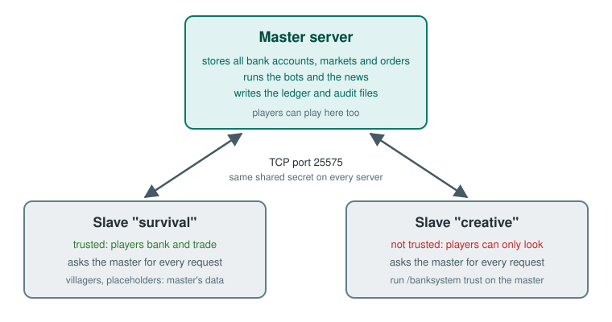

# Master- und Slave-Server { #master-and-slave-servers }

Mehrere Server, zum Beispiel ein Survival- und ein Kreativserver, können sich eine Wirtschaft teilen. Ein **Master**-Server hält alle Bankkonten und Märkte. Jeder **Slave**-Server leitet die Anfragen seiner Spieler an den Master weiter. Ein Spieler hat auf jedem Server dasselbe Konto und sieht dieselben Märkte.

<figure markdown="span">
  { width="600" }
</figure>

Ein einzelner Server braucht nichts davon. Er funktioniert sofort allein.

## Bevor du anfängst { #before-you-start }

- **Überall dieselben Versionen.** Der Master, jeder Slave und jeder Client müssen dieselben Versionen von BankSystem und StockMarket verwenden.
- **Am besten dieselben Mods.** Fehlt einem Slave eine Mod, die der Master hat, blendet er die Märkte für die Items dieser Mod aus. Seine Spieler können sie dort nicht handeln.
- **Ein Port.** Der Master wartet auf einem TCP-Port auf Slaves, standardmäßig 25575. Die Slaves müssen ihn erreichen können.

!!! warning "Port 25575 ist auch der RCON-Port"
    RCON von Minecraft verwendet standardmäßig ebenfalls 25575. Wenn du RCON auf dem Master verwendest, wähle einen anderen Port für die Slaves.

## Die Server verbinden { #connecting-the-servers }

Bearbeite auf jedem Server `config/modutilities/MultiServerConfig.json` im Serverordner und starte ihn danach neu. Der Server legt die Datei bei seinem ersten Start an.

**Master:**

```json
{
  "enable": true,
  "isMaster": true,
  "sharedSecret": "a long secret only you know",
  "masterTcpPort": 25575
}
```

**Slave:**

```json
{
  "enable": true,
  "isMaster": false,
  "sharedSecret": "a long secret only you know",
  "slaveID": "survival",
  "masterHost": "192.168.1.10",
  "masterTcpPort": 25575
}
```

| Schlüssel | Was er tut |
|---|---|
| `enable` | `true` schaltet das Netzwerk ein. `false` (Standard): Der Server arbeitet allein. |
| `isMaster` | `true` auf dem Master, `false` auf jedem Slave. |
| `sharedSecret` | Ein Passwort, das Slaves kennen müssen, um sich zu verbinden. Auf allen Servern gleich. **Ändere den Standardwert** `change-me-please`. |
| `slaveID` | Ein eindeutiger Name für jeden Slave. Mit ihm stufst du den Slave als vertrauenswürdig ein. Auf dem Master ignoriert. |
| `masterHost` | Hostname oder IP-Adresse des Masters. Auf dem Master ignoriert. |
| `masterTcpPort` | Der Port, auf dem der Master wartet. Auf allen Servern gleich. |

## Vertrauenswürdige Slaves { #trusted-slaves }

Ein neuer Slave ist **nicht vertrauenswürdig**. Der Master kann nicht prüfen, von welchem Spieler eine Anfrage von einem Slave wirklich kommt. Deshalb lässt er Spieler auf einem nicht vertrauenswürdigen Slave nur ihre eigenen Konten und die öffentlichen Marktdaten ansehen. Alles andere lehnt er ab: Einzahlungen, Abhebungen, Überweisungen, Handel, Admin-Aktionen.

Spieler auf einem nicht vertrauenswürdigen Slave sehen einen Hinweis, und die Kontobildschirme sind schreibgeschützt. Stufe jeden Slave, auf dem Spieler spielen sollen, auf dem Master als vertrauenswürdig ein:

```text
/banksystem trust <slave id>
```

Der Befehl schlägt die verbundenen Slaves vor. `/banksystem untrust <slave id>` nimmt das Vertrauen wieder weg. Die Vertrauensliste wird auf dem Master gespeichert und übersteht Neustarts.

!!! danger "Vertraue nur Servern, die du kontrollierst"
    Ein vertrauenswürdiger Slave kann alles mit der Bank machen, auch Items einzahlen, die er gar nicht hat. Vertraue nur Servern, die du selbst betreibst. Sogar ein nicht vertrauenswürdiger Slave könnte die Konten eines Spielers lesen, indem er sich als dieser Spieler ausgibt. Verbinde also nur Server, die du kennst.

So prüfst du das Netzwerk:

- `/banksystem serverInfo` zeigt die Rolle des Servers, auf dem du bist, und, auf einem Slave, ob er vertrauenswürdig ist.
- `/banksystem serverNetworkInfo` listet alle verbundenen Server und ihren Vertrauensstatus auf (nur Admins).

## Was wo läuft { #what-runs-where }

| | Master | Slave |
|---|---|---|
| Bankkonten, Märkte, Orders, Bots, News | Hier gespeichert und ausgeführt | Fragt den Master |
| Transaktionsbuch, Verdachtsmarkierungen, Audit-Dateien, Bericht | Hier geschrieben, für jeden Server | — |
| Discord-Feed, Handelsalarme von StockMarket | Von hier gesendet | — |
| Chat-Alarme von BankSystem | An Admins auf dem Master | Auch an Admins auf dem Slave |
| Admin-Flags beider Mods | Hier gespeichert | Gelten auch hier |
| `settings.json` von BankSystem | Seine eigene; der Bildschirm Mod Settings bearbeitet diese | Seine eigene Datei. Die Listen der Item-Komponenten kommen vom Master. |
| Einstellungen von StockMarket | Seine eigenen; der Bildschirm Mod-Einstellungen bearbeitet diese | Nicht verwendet |
| Dorfbewohner-Handel | Ja | Ja, mit den Preisen des Masters |
| Platzhalter | Ja | Ja, mit Werten vom Master |
| Handelszeiten und Kerzen | Uhr des Masters | Uhr des Masters |

Die meisten Admin-Befehle funktionieren auf einem Slave und werden an den Master weitergeleitet. Einige funktionieren nur auf dem Master selbst; [Admin-Befehle](commands.md) kennzeichnet sie.

## Wenn der Master nicht antwortet { #when-the-master-doesnt-answer }

Ein Slave wartet bis zu 30 Sekunden auf jede Antwort des Masters. Kommt keine, schlägt die Anfrage fehl, aber der Master hat die Arbeit vielleicht trotzdem erledigt. Beide Mods sind dafür gebaut:

- **Nichts passiert zweimal.** Der Master führt dieselbe Übertragung nie zweimal aus.
- **Erst prüfen, dann erstatten.** Bevor ein Slave etwas zurückgibt, fragt er den Master, ob die Übertragung durchgegangen ist. Items kommen nur zurück, wenn der Master sagt, dass sie nicht durchgegangen ist.
- **Unbekannt bleibt unbekannt.** Wenn sogar diese Prüfung fehlschlägt, wird nichts erstattet und nichts doppelt abgebucht. Der Betrag kann auf dem Konto [reserviert](banksystem/accounts.md#locked-amounts) bleiben, und Banknoten, die an einem Geldautomaten ausgezahlt wurden, lösen eine Markierung *Ausgang der Übertragung unbekannt* aus, die du prüfen solltest.

Spieler sehen eine Meldung wie *Request to the master server failed or timed out; check the result before retrying.* (diese Meldung zeigt das Spiel nur auf Englisch) Eine Order an der Börse wurde vielleicht trotzdem aufgegeben. Spieler sollten also ihre offenen Orders prüfen, bevor sie sie noch einmal aufgeben.

Solange die Verbindung unterbrochen ist, können Spieler auf dem Slave weder die Bank verwenden noch handeln. Offene Orders laufen auf dem Master weiter. Die Verbindung stellt sich von selbst wieder her.

## Fehlerbehebung { #troubleshooting }

| Problem | Lösung |
|---|---|
| Log des Slaves: *Slave has been waiting more than 30 seconds for SyncItemIDsPacket from master* | Der Slave erreicht den Master nicht. Prüfe, dass der Master läuft, `masterHost` und `masterTcpPort` stimmen, der Port offen ist und `sharedSecret` gleich ist. |
| Spieler auf einem Slave können nur schauen, aber nicht einzahlen oder handeln | Der Slave ist nicht vertrauenswürdig. Führe `/banksystem trust <slave id>` auf dem Master aus. |
| Platzhalter oder Bank Anzeigen sind auf einem Server leer | Dieser Slave ist nicht vertrauenswürdig. |
| Ein Betrag bleibt nach einer fehlgeschlagenen Übertragung reserviert | Lies [Reservierte Beträge](banksystem/accounts.md#locked-amounts), bevor du ihn freigibst. |
| Währungsbindungen funktionieren auf einem Slave nicht | Numismatics oder Lightman's Currency muss auch auf dem Master installiert sein. |

## Verwandte Seiten { #related-pages }

- [Admin-Befehle](commands.md): welche Befehle auf Slaves funktionieren.
- [Admins und Berechtigungen](permissions.md): die LuckPerms-Synchronisierung über mehrere Server.
- [Datendateien und Backups](backups.md): was jeder Server speichert.
