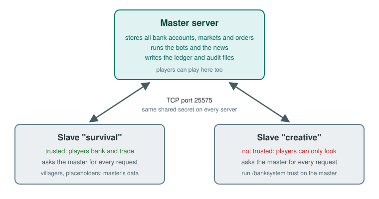

# Master and slave servers

Several servers, for example a survival and a creative server, can share one economy. One **master** server holds all bank accounts and markets. Every **slave** server forwards its players' requests to the master. A player has the same account and sees the same markets on every server.

<figure markdown="span">
  { width="600" }
</figure>

A single server needs none of this. It works on its own out of the box.

## Before you start

- **Same versions everywhere.** The master, every slave and every client must run the same versions of BankSystem and StockMarket.
- **Same mods, ideally.** A slave without a mod the master has hides the markets for that mod's items. Its players can't trade them there.
- **A port.** The master listens for slaves on a TCP port, 25575 by default. Slaves must be able to reach it.

!!! warning "Port 25575 is also the RCON port"
    Minecraft's RCON uses 25575 by default too. If you use RCON on the master, pick another port for the slaves.

## Connecting the servers

Edit `config/modutilities/MultiServerConfig.json` in the server folder of each server, then restart it. The server creates the file at its first start.

**Master:**

```json
{
  "enable": true,
  "isMaster": true,
  "sharedSecret": "a long secret only you know",
  "masterTcpPort": 25575
}
```

**Slave:**

```json
{
  "enable": true,
  "isMaster": false,
  "sharedSecret": "a long secret only you know",
  "slaveID": "survival",
  "masterHost": "192.168.1.10",
  "masterTcpPort": 25575
}
```

| Key | What it does |
|---|---|
| `enable` | `true` turns the network on. `false` (default): the server works on its own. |
| `isMaster` | `true` on the master, `false` on every slave. |
| `sharedSecret` | A password that slaves must know to connect. The same on all servers. **Change the default** `change-me-please`. |
| `slaveID` | A unique name for each slave. You use it to trust the slave. Ignored on the master. |
| `masterHost` | Host name or IP address of the master. Ignored on the master. |
| `masterTcpPort` | The port the master listens on. The same on all servers. |

## Trusted slaves

A new slave is **untrusted**. The master can't check which player a request from a slave really comes from, so it lets players on an untrusted slave only look at their own accounts and the public market data. Everything else is refused: deposits, withdrawals, transfers, trading, admin actions.

Players on an untrusted slave see a notice, and the account screens are read-only. Trust every slave on which players should play, on the master:

```text
/banksystem trust <slave id>
```

The command suggests the connected slaves. `/banksystem untrust <slave id>` takes the trust away. The trust list is stored on the master and survives restarts.

!!! danger "Only trust servers you control"
    A trusted slave can do anything with the bank, also deposit items it doesn't have. Only trust servers you run yourself. Even an untrusted slave could read a player's accounts by pretending to be them, so only connect servers you know.

To check the network:

- `/banksystem serverInfo` shows the role of the server you are on and, on a slave, whether it is trusted.
- `/banksystem serverNetworkInfo` lists all connected servers and their trust (admins only).

## What runs where

| | Master | Slave |
|---|---|---|
| Bank accounts, markets, orders, bots, news | Stored and run here | Asks the master |
| Ledger, flags, audit files, digest | Written here, for every server | — |
| Discord feed, StockMarket trading alerts | Sent from here | — |
| BankSystem chat alerts | To admins on the master | To admins on the slave too |
| Admin flags of both mods | Stored here | Apply here as well |
| BankSystem `settings.json` | Its own; the Mod Settings screen edits this one | Its own file. The item component lists come from the master. |
| StockMarket settings | Its own; the Mod Settings screen edits this one | Not used |
| Villager trading | Yes | Yes, with the master's prices |
| Placeholders | Yes | Yes, with values from the master |
| Trading hours and candles | Master's clock | Master's clock |

Most admin commands work on a slave and are forwarded to the master. A few only work on the master itself; [Admin commands](commands.md) marks them.

## When the master doesn't answer

A slave waits up to 30 seconds for each answer from the master. If none comes, the request fails, but the master may still have done the work. Both mods are built for that:

- **Nothing happens twice.** The master never applies the same transfer twice.
- **Check before refund.** Before a slave gives anything back, it asks the master whether the transfer went through. Items come back only if the master says it didn't.
- **Unknown stays unknown.** If even that check fails, nothing is refunded and nothing is charged twice. The amount may stay [locked](banksystem/accounts.md#locked-amounts) on the account, and banknotes paid out at an ATM raise a *Transfer outcome unknown* flag for you to check.

Players see a message such as *Request to the master server failed or timed out; check the result before retrying.* An order on the stock market may have been placed anyway, so players should check their open orders before placing it again.

While the link is down, players on the slave can't use the bank or trade. Open orders keep running on the master. The link reconnects on its own.

## Troubleshooting

| Problem | Fix |
|---|---|
| Slave log: *Slave has been waiting more than 30 seconds for SyncItemIDsPacket from master* | The slave can't reach the master. Check that the master runs, `masterHost` and `masterTcpPort` are right, the port is open, and `sharedSecret` is the same. |
| Players on a slave can only look, not deposit or trade | The slave is not trusted. Run `/banksystem trust <slave id>` on the master. |
| Placeholders or Bank Displays are empty on one server | That slave is not trusted. |
| An amount stays locked after a failed transfer | Read [Locked amounts](banksystem/accounts.md#locked-amounts) before you unlock it. |
| Currency bindings don't work on a slave | Numismatics or Lightman's Currency must be installed on the master too. |

## Related pages

- [Admin commands](commands.md): which commands work on slaves.
- [Admins and permissions](permissions.md): the LuckPerms sync across servers.
- [Data files and backups](backups.md): what each server stores.
