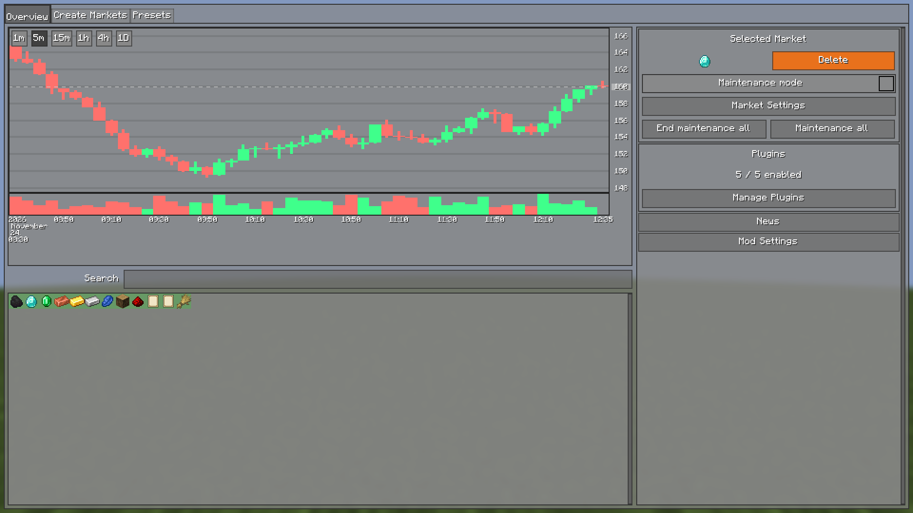
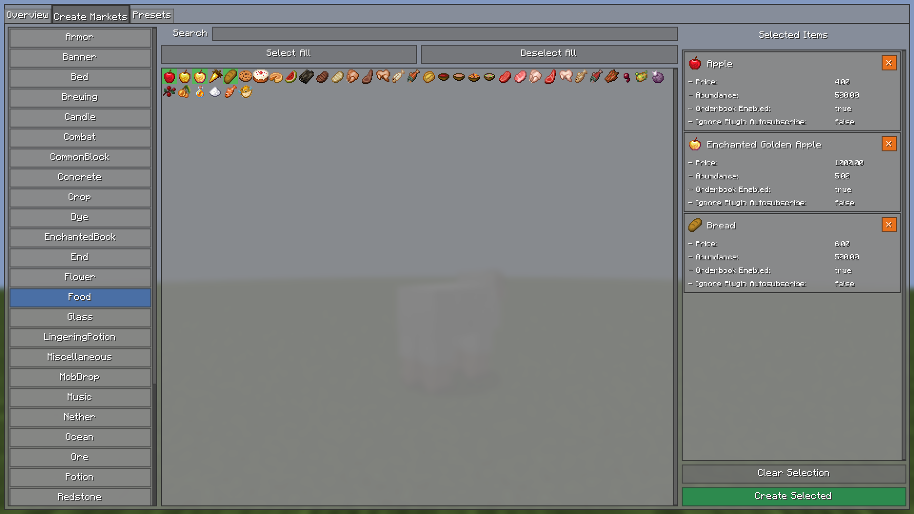
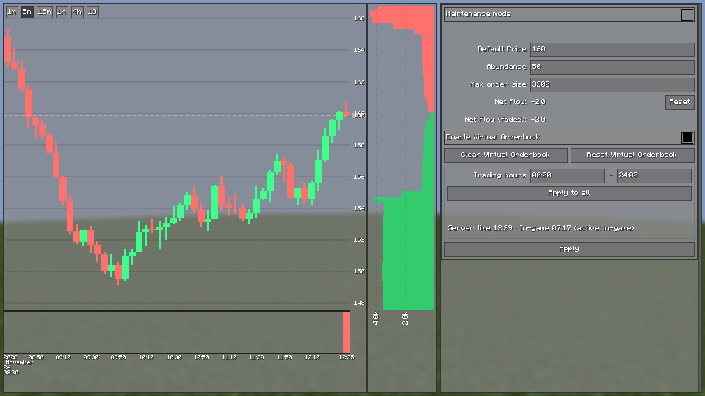

# Märkte erstellen und verwalten { #creating-and-managing-markets }

Auf einem Markt handeln Spieler ein Item gegen Geld. Du erstellst und verwaltest die Märkte im Fenster **Aktienmarkt-Verwaltung**. Öffne es mit `/stockmarket manage`. Du brauchst dafür das StockMarket-Admin-Flag, siehe [Admins und Berechtigungen](../permissions.md).

Das Fenster hat drei Tabs: **Übersicht**, **Märkte erstellen** und **Voreinstellungen**.

## Der Tab „Übersicht“ { #the-overview-tab }

<figure markdown="span">
  { width="600" }
</figure>

Links siehst du alle Märkte in einem Raster mit einem Suchfeld. Klicke auf einen Markt, um sein Preischart zu sehen. Unter **Ausgewählter Markt** findest du:

- **Markt-Einstellungen**: die Einstellungen dieses Markts, siehe unten.
- **Wartungsmodus**: stoppt den Spielerhandel auf diesem Markt, siehe unten.
- **Löschen**: löscht den Markt nach einer Bestätigung. Offene Orders von Spielern werden geschlossen und erstattet.

Rechts:

- **Alle Märkte**: **Alle in Wartung**, **Wartung beenden (alle)**, **Preisverlauf zurücksetzen** und **Alle Märkte löschen**. Die letzten beiden fragen vorher nach.
- **Plugins verwalten**: die [Plugins](plugins/index.md), die Preise bewegen und Bot-Orders hinzufügen.
- **Mod-Einstellungen**: die [Server-Einstellungen](mod-settings.md). Nur auf dem Master-Server.
- **Nachrichten**: die [News-Ereignisse](news/index.md).

**Preisverlauf zurücksetzen** löscht den Preisverlauf aller Märkte: Jedes Chart beginnt wieder beim aktuellen Preis. **Alle Märkte löschen** entfernt jeden Markt mit seinen Daten. Beides lässt sich nicht rückgängig machen.

## Märkte erstellen { #creating-markets }

<figure markdown="span">
  { width="600" }
</figure>

1. Öffne den Tab **Märkte erstellen**.
2. Wähle links eine Kategorie. Die Kategorien kommen aus den [Voreinstellungen](presets.md).
3. Klicke Items im Raster an, um sie zu **Ausgewählte Items** hinzuzufügen. **Alle auswählen** nimmt die ganze Kategorie. Items, die schon einen Markt haben, sind mit *Markt existiert bereits* markiert.
4. Prüfe **Preis** und **Häufigkeit** jedes ausgewählten Items. Die Voreinstellung trägt sie ein.
5. Wähle für jedes Item:
    - **Orderbuch aktiv**: Der Markt startet mit Bot-Orders aus dem virtuellen Orderbuch. Aus: Nur Spieler handeln.
    - **Plugin-Autosubscribe ignorieren**: Plugins, die sich selbst zu neuen Märkten hinzufügen, lassen diesen Markt aus.
6. Klicke auf **Auswahl erstellen**.

Jeder neue Markt startet bei seinem Preis und ist sofort für den Handel offen, innerhalb seiner [Handelszeiten](trading-hours.md). Ab dann lässt sich sein Item auch auf ein Bankkonto einzahlen.

!!! tip "Nutze den Wartungsmodus beim Einrichten"
    Änderungen am Preis und an den Bots können den Preis springen lassen. Spieler, die das zuerst sehen, können davon profitieren. Schalte den **Wartungsmodus** ein, bevor du einen Markt änderst, und beende ihn, wenn du fertig bist.

## Markt-Einstellungen { #market-settings }

<figure markdown="span">
  { width="600" }
</figure>

Wähle auf dem Tab **Übersicht** einen Markt und klicke auf **Markt-Einstellungen**.

| Einstellung | Was sie bewirkt |
|---|---|
| **Standardpreis** | Der normale Preis des Markts. Preis-Plugins und News-Ereignisse nutzen ihn als Basis. |
| **Häufigkeit** | Wie häufig das Item ist. Ein höherer Wert bedeutet mehr Bot-Orders, ein größeres Standard-Orderlimit und dass Spieler mehr handeln müssen, um den Preis zu bewegen. |
| **Max. Ordergröße** | Die größte Zahl an Items, die eine einzelne Spieler-Order kaufen oder verkaufen darf. `0` = kein Limit. Bots sind nicht begrenzt. |
| **Handelszeiten** | Wann Spieler handeln können. **Auf alle anwenden** kopiert sie auf alle Märkte. Siehe [Handelszeiten](trading-hours.md). |
| **Wartungsmodus** | Derselbe Schalter wie auf dem Tab „Übersicht“. |
| **Virtuelles Orderbuch aktiv** | Aus: Die Preis-Plugins lassen diesen Markt komplett aus. Keine Bot-Orders, keine Preissteuerung. |
| **Virtuelles Orderbuch zurücksetzen** | Füllt die Bot-Orders wieder nach der Standardverteilung auf. |
| **Virtuelles Orderbuch leeren** | Entfernt alle Bot-Orders und hält sie bei null, auch wenn sich der Preis bewegt. **Zurücksetzen** macht das rückgängig. |
| **Nettofluss**, **Nettofluss (verblassend)** | Wie viele Items Spieler an den Markt verkauft haben, minus wie viele sie gekauft haben. **Zurücksetzen** setzt beide auf null. Siehe [Nettofluss-Plugin](plugins/net-flow.md). |

Die **Max. Ordergröße** ist standardmäßig der **Faktor max. Ordergröße** aus den [Mod-Einstellungen](mod-settings.md) (Standard 64) mal die Häufigkeit, aber mindestens der Faktor. Bei Häufigkeit 5 sind das 320 Items.

## Wartungsmodus { #maintenance-mode }

Ein Markt im Wartungsmodus stoppt den Spielerhandel:

- Spieler können keine Orders platzieren.
- Alle ihre offenen Orders auf dem Markt werden storniert und erstattet, auch Item-gegen-Item-Orders.
- Bots und Plugins handeln weiter.

Der Zustand wird gespeichert und übersteht einen Neustart. Er ist unabhängig von den Handelszeiten: Ein Markt kann laut seinen Zeiten offen und trotzdem in Wartung sein. Mit **Alle in Wartung** stoppst du den gesamten Spielerhandel auf einmal, zum Beispiel wenn etwas schiefgeht.

## Befehle { #commands }

| Befehl | Was er bewirkt |
|---|---|
| `/stockmarket manage` | Öffnet das Verwaltungsfenster. |
| `/stockmarket open "<market>"`, `/stockmarket close "<market>"` | Öffnet oder schließt einen Markt bis zum nächsten Wechsel seiner Handelszeiten. |
| `/stockmarket "<market>" remove` | Löscht einen Markt. |

Alle Befehle findest du unter [Admin-Befehle](../commands.md).

## Verwandte Seiten { #related-pages }

- [Voreinstellungen](presets.md): die Preise und Kategorien für neue Märkte.
- [Preis-Plugins](plugins/index.md): was die Preise bewegt.
- [Handelszeiten](trading-hours.md): wann ein Markt offen ist.
