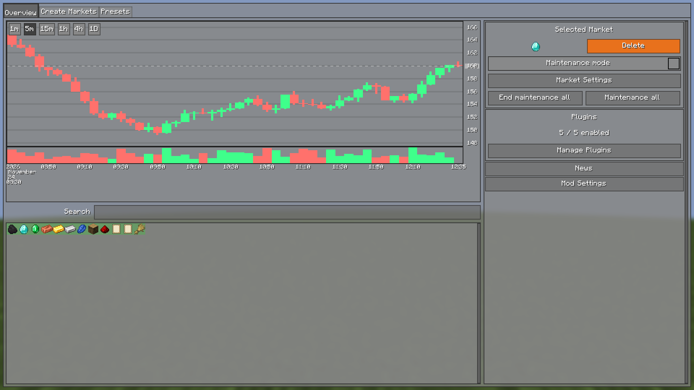
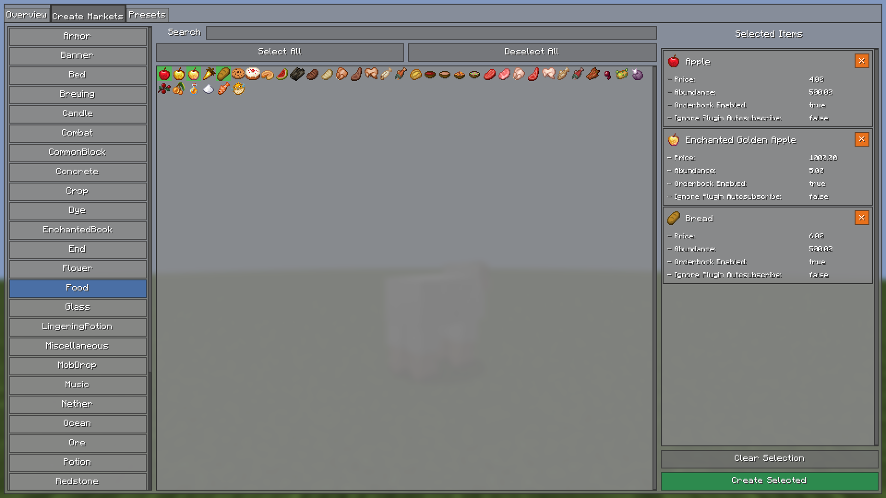
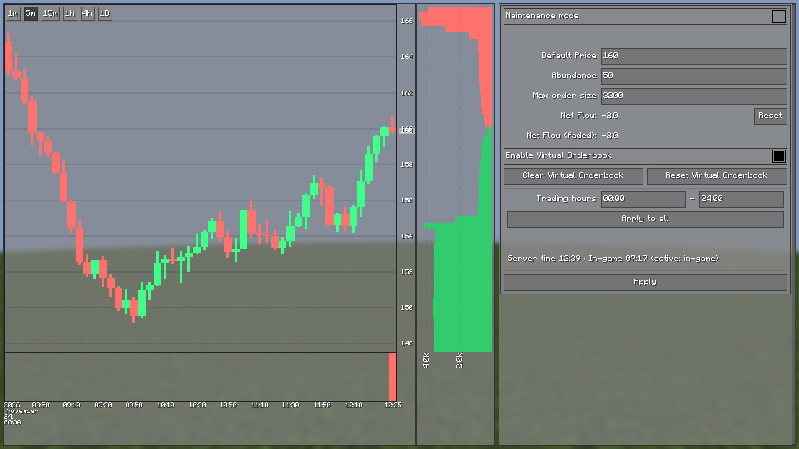

# Creating and managing markets

A market lets players trade one item for money. You create and manage the markets in the **Stock Market Management** screen. Run `/stockmarket manage` to open it. You need the StockMarket admin flag, see [Admins and permissions](../permissions.md).

The screen has three tabs: **Overview**, **Create Markets** and **Presets**.

## The Overview tab

<figure markdown="span">
  { width="600" }
</figure>

The left side shows every market in a grid with a search box. Click a market to see its price chart. Under **Selected Market** you have:

- **Market Settings**: the settings of this market, see below.
- **Maintenance mode**: stops player trading on this market, see below.
- **Delete**: deletes the market after a confirmation. Open player orders are closed and refunded.

On the right:

- **All Markets**: **Maintenance all**, **End maintenance all**, **Reset Price Chart** and **Delete all Markets**. The last two ask first.
- **Manage Plugins**: the [plugins](plugins/index.md) that move prices and add bot orders.
- **Mod Settings**: the [server settings](mod-settings.md). Only on the master server.
- **News**: the [news events](news/index.md).

**Reset Price Chart** clears the price history of all markets: every chart starts again at the current price. **Delete all Markets** removes every market with its data. Neither can be undone.

## Creating markets

<figure markdown="span">
  { width="600" }
</figure>

1. Open the **Create Markets** tab.
2. Choose a category on the left. The categories come from the [presets](presets.md).
3. Click items in the grid to add them to **Selected Items**. **Select All** takes the whole category. Items that already have a market are marked *Market already exists*.
4. Check the **Price** and **Abundance** of each selected item. The preset fills them in.
5. Choose for each item:
    - **Orderbook Enabled**: the market starts with bot orders from the virtual order book. Off: only players trade.
    - **Ignore Plugin Autosubscribe**: plugins that add themselves to new markets skip this one.
6. Click **Create Selected**.

Each new market starts at its price and is open for trading right away, within its [trading hours](trading-hours.md). Its item can also be put into the bank from then on.

!!! tip "Use maintenance mode while you set up"
    Price and bot changes can make a price jump. Players who see it first can profit. Turn on **Maintenance mode** before you change a market, and end it when you are done.

## Market settings

<figure markdown="span">
  { width="600" }
</figure>

Select a market on the **Overview** tab and click **Market Settings**.

| Setting | What it does |
|---|---|
| **Default Price** | The market's normal price. Price plugins and news events use it as their base. |
| **Abundance** | How common the item is. A higher value means more bot orders, a larger default order limit, and that players must trade more to move the price. |
| **Max order size** | The most items one player order may buy or sell. `0` = no limit. Bots are not limited. |
| **Trading hours** | When players can trade. **Apply to all** copies them to every market. See [Trading hours](trading-hours.md). |
| **Maintenance mode** | The same switch as on the Overview tab. |
| **Enable Virtual Orderbook** | Off: price plugins skip this market completely. No bot orders, no price steering. |
| **Reset Virtual Orderbook** | Fills the bot orders again from the default distribution. |
| **Clear Virtual Orderbook** | Removes all bot orders and keeps them at zero, even when the price moves. **Reset** undoes it. |
| **Net Flow**, **Net Flow (faded)** | How many items players sold into the market minus how many they bought. **Reset** sets both to zero. See [Net flow plugin](plugins/net-flow.md). |

The default **Max order size** is the **Max order size factor** from the [Mod Settings](mod-settings.md) (default 64) times the abundance, but at least the factor. With abundance 5 that is 320 items.

## Maintenance mode

A market in maintenance mode stops player trading:

- Players can't place orders.
- All their open orders on the market are cancelled and refunded, also item-for-item orders.
- Bots and plugins keep trading.

The state is saved and survives a restart. It is separate from the trading hours: a market can be open by its hours and still be in maintenance. Use **Maintenance all** to stop all player trading at once, for example when something goes wrong.

## Commands

| Command | What it does |
|---|---|
| `/stockmarket manage` | Opens the management screen. |
| `/stockmarket open "<market>"`, `/stockmarket close "<market>"` | Opens or closes a market until the next change of its trading hours. |
| `/stockmarket "<market>" remove` | Deletes a market. |

See [Admin commands](../commands.md) for all commands.

## Related pages

- [Presets](presets.md): the prices and categories for new markets.
- [Price plugins](plugins/index.md): what moves the prices.
- [Trading hours](trading-hours.md): when a market is open.
