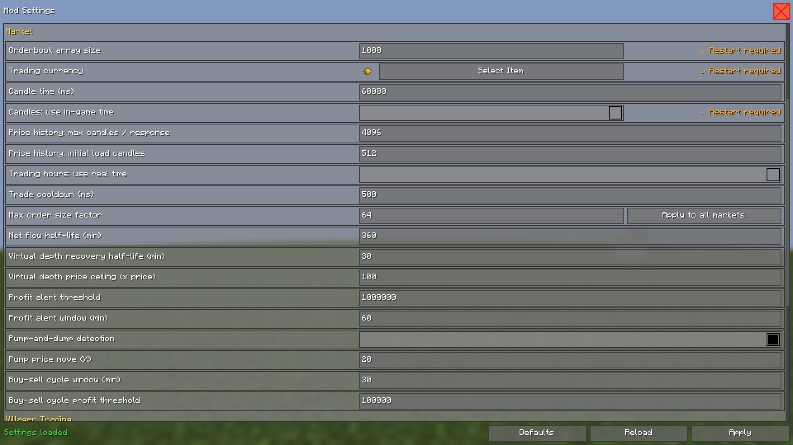

# Mod-Einstellungen { #mod-settings }

StockMarket speichert seine Server-Einstellungen in einer Datei pro Welt. Im Spiel änderst du sie im Fenster **Mod-Einstellungen**. Einstellungen einzelner Märkte, etwa ihr Preis oder ihre Handelszeiten, stehen nicht hier: Sie stehen in den [Markt-Einstellungen](markets.md#market-settings) des jeweiligen Markts.

## Das Fenster öffnen { #opening-the-screen }

1. Führe `/stockmarket manage` aus. Du brauchst das StockMarket-Admin-Flag, siehe [Admins und Berechtigungen](../permissions.md).
2. Klicke auf dem Tab **Übersicht** auf **Mod-Einstellungen**.
3. Ändere die Werte und klicke auf **Anwenden**.

Der Knopf erscheint nur auf dem Master-Server eines [Netzwerks](../multi-server.md). Einstellungen wirken sofort, außer denen mit **⟳ Neustart erforderlich**: Sie werden gespeichert, aber erst nach einem Neustart verwendet. **Standardwerte** trägt die Standardwerte ein, und **Neu laden** liest die gespeicherten Werte erneut; beide speichern nichts, bis du auf **Anwenden** klickst.

<figure markdown="span">
  { width="600" }
</figure>

Antwortet der Server nicht, zeigt das Fenster *Keine Antwort vom Server - die Änderung wurde eventuell übernommen. Zum Prüfen neu öffnen.* Öffne das Fenster erneut, um zu sehen, was gespeichert wurde.

## Die Einstellungsdatei { #the-settings-file }

Die Datei ist `<world>/data/StockMarket/settings.json`. Werte außerhalb ihres Bereichs werden auf den nächsten erlaubten Wert gesetzt.

!!! warning "Nutze das Fenster, nicht die Datei"
    Der Server schreibt die Datei bei jedem Autosave neu. Änderungen, die du von Hand machst, während er läuft, gehen deshalb verloren. Wenn du die Datei bearbeiten musst, stoppe vorher den Server.

Slaves verwenden keine Einstellungsdatei. Der Master betreibt die Märkte und schickt den Slaves, was sie brauchen, zum Beispiel die Dorfbewohner-Preise.

## Allgemein { #utilities }

| Einstellung | Schlüssel | Standard | Bereich | Was sie bewirkt |
|---|---|---|---|---|
| **Autospeicher-Intervall (Minuten)** | `SAVE_INTERVAL_MINUTES` | `5` | 1 bis 1'440 | Wie oft StockMarket seine Daten speichert. |
| **Info-Meldungen loggen** | `LOGGING_ENABLE_INFO` | an | | |
| **Warnungen loggen** | `LOGGING_ENABLE_WARNING` | an | | |
| **Fehler loggen** | `LOGGING_ENABLE_ERROR` | an | | |
| **Debug-Meldungen loggen** | `LOGGING_ENABLE_DEBUG` | aus | | Schreibt sehr viel. Nur für die Fehlersuche. |
| **Alarm-Chat standardmäßig an** | `ALERTS_DEFAULT_ON` | an | | Chat-Alarme für Admins, die nie `/stockmarket alerts on|off` ausgeführt haben. Siehe [Alarme und Verdachtsmarkierungen](../audit/alerts.md#stockmarket-alerts). |

## Markt { #market }

Gruppe `ServerMarket` in der Datei.

| Einstellung | Schlüssel | Standard | Bereich | Was sie bewirkt |
|---|---|---|---|---|
| **Orderbuch-Arraygröße** | `VIRTUAL_ORDERBOOK_DEFAULT_ARRAY_SIZE` | `1000` | 100 bis 1'000'000 | Wie viele Preisstufen das Bot-Orderbuch hat. Nur neue Märkte verwenden einen geänderten Wert. Neustart erforderlich. |
| **Handelswährung** | `CURRENCY` | BankSystem-Geld | | Das Item, mit dem jeder Handel bezahlt wird. Lege es fest, bevor du Märkte erstellst. Neustart erforderlich. |
| **Kerzenzeit (ms)** | `CANDLE_TIME` | `60000` | 1'000 bis 86'400'000 | Länge einer Preiskerze. `60000` = 1 Minute. Gilt nur, solange die Spielzeit-Kerzen aus sind. |
| **Kerzen: Spielzeit verwenden** | `CANDLE_USE_GAME_TIME` | aus | | Stattdessen eine Kerze pro Spielstunde. Siehe [Spielzeit-Kerzen](#in-game-candles). Neustart erforderlich. |
| **Preisverlauf: max. Kerzen pro Antwort** | `PRICE_HISTORY_MAX_CANDLES_PER_RESPONSE` | `4096` | 16 bis 65'536 | Höchstens so viele Kerzen schickt der Server auf einmal. Für weitere fragt ein Chart erneut an. |
| **Preisverlauf: initiale Kerzenzahl** | `PRICE_HISTORY_INITIAL_LOAD_CANDLES` | `512` | 16 bis 8'192 | Wie viele Kerzen ein Chart beim Öffnen lädt und pro Schritt, wenn ein Spieler zurückscrollt. |
| **Handelszeiten: Echtzeit** | `TRADING_HOURS_USE_REAL_TIME` | aus | | Die Handelszeiten folgen der echten Uhr des Masters statt der Spielzeit. Siehe [Handelszeiten](trading-hours.md). |
| **Handels-Cooldown (ms)** | `TRADE_COOLDOWN_MS` | `500` | 0 bis 60'000 | Die kürzeste Zeit zwischen zwei Orders eines Spielers, über alle Märkte. Stoppt Autoklicker. `0` = aus. Bots sind nicht betroffen. |
| **Faktor max. Ordergröße** | `MAX_ORDER_VOLUME_FACTOR` | `64` | 1 oder mehr | Das Standard-Orderlimit eines Markts ist dieser Faktor mal seine Häufigkeit, aber mindestens der Faktor. Gilt für neue Märkte und Voreinstellungen. |
| **Halbwertszeit Nettofluss (min)** | `NET_FLOW_HALF_LIFE_MINUTES` | `360` | 0 bis 10'080 | Wie schnell der verblassende Nettofluss auf null zurückgeht. Siehe [Nettofluss-Plugin](plugins/net-flow.md). `0` = kein Verblassen. |
| **Halbwertszeit Erholung virtuelle Tiefe (min)** | `VIRTUAL_DEPTH_RECOVERY_HALF_LIFE_MINUTES` | `30` | 0 bis 10'080 | Bot-Orders, die Spieler weit weg vom Preis gekauft oder verkauft haben, kommen langsam zurück. Nach dieser Zeit ist die Hälfte der Lücke gefüllt. `0` = aus. |
| **Preisobergrenze virtuelle Tiefe (x Preis)** | `VIRTUAL_DEPTH_MAX_PRICE_MULTIPLIER` | `100` | 2 bis 10'000 | Über diesem Vielfachen des aktuellen Preises bieten Bots nichts an. Ein großer Kauf endet dort; der Rest wird storniert. |
| **Gewinnalarm-Schwelle** | `PROFIT_ALERT_THRESHOLD` | `1000000` | 0 oder mehr | Siehe [Alarme](../audit/alerts.md#stockmarket-alerts). `0` = aus. |
| **Gewinnalarm-Fenster (min)** | `PROFIT_ALERT_WINDOW_MINUTES` | `60` | 1 bis 10'080 | |
| **Pump-and-Dump-Erkennung** | `PUMP_DUMP_ENABLED` | an | | Löst nur Alarme aus; sie blockiert nie einen Handel. |
| **Pump-Preissprung (%)** | `PUMP_DUMP_PRICE_MOVE_PERCENT` | `20` | 0 oder mehr | `0` = aus. |
| **Kauf-Verkauf-Zyklus (min)** | `PUMP_DUMP_CYCLE_MINUTES` | `30` | 1 bis 10'080 | |
| **Zyklus-Gewinnschwelle** | `PUMP_DUMP_CYCLE_PROFIT` | `100000` | 0 oder mehr | `0` = aus. |

Neben **Faktor max. Ordergröße** setzt **Auf alle Märkte anwenden** das Orderlimit jedes Markts neu aus seiner Häufigkeit und dem gespeicherten Faktor. Von Hand gesetzte Limits, auch `0` = kein Limit, werden überschrieben. Wenn du den Faktor geändert hast, klicke zuerst auf **Anwenden**.

### Spielzeit-Kerzen { #in-game-candles }

Ist **Kerzen: Spielzeit verwenden** an, deckt eine Kerze eine Spielstunde in der Oberwelt des Masters ab. Die Charts bieten dann Spielzeit-Kerzen zu 1h, 4h, 1D und 1W an, beschriftet mit `Day N` und `hh:00`.

- Übersprungene Stunden, zum Beispiel durch Schlafen, haben keine Kerzen.
- Ist der Tageszyklus angehalten, schließt stattdessen alle 1000 Ticks eine Kerze (etwa 50 Sekunden).
- `/time set` auf eine andere Stunde schließt die laufende Kerze. Die Tageszahl kann dabei zurückspringen.
- Jede Kerze speichert beide Zeiten, daher geht beim Hin- und Herschalten kein Verlauf verloren.
- Platzhalter zählen ihre 24 Stunden weiterhin in Echtzeit.

Das ist unabhängig von der Uhr der Handelszeiten: Die Handelszeiten können der Echtzeit folgen, während die Kerzen dem Spiel folgen.

## Dorfbewohner-Handel { #villager-trading }

Gruppe `VillagerTrading`. Wie die Preise entstehen, steht unter [Dorfbewohner-Handel](villager-trading.md). Änderungen erreichen alle Slaves sofort.

| Einstellung | Schlüssel | Standard | Bereich | Was sie bewirkt |
|---|---|---|---|---|
| **Dorfbewohner-Handel aktiviert** | `ENABLED` | an | | Die Preise der Dorfbewohner folgen den Märkten. |
| **Preisaktualisierung (Minuten)** | `PRICE_REFRESH_INTERVAL_MINUTES` | `20` | 1 bis 10'080 | Wie oft die Dorfbewohner-Preise aktualisiert werden, in echten Minuten. |
| **Dorfbewohner-Kaufmarge** | `VILLAGER_BUY_MARGIN` | `0.8` | 0.01 bis 100 | Ein Dorfbewohner zahlt diesen Wert mal den Marktpreis, wenn er von einem Spieler kauft. |
| **Dorfbewohner-Verkaufsmarge** | `VILLAGER_SELL_MARGIN` | `1.2` | 0.01 bis 100 | Ein Dorfbewohner verlangt diesen Wert mal den Marktpreis, wenn er an einen Spieler verkauft. |
| **Smaragde bei nicht gelisteten Items ersetzen** | `REPLACE_EMERALDS_FOR_UNLISTED` | aus | | Angebote für Items ohne Markt werden ebenfalls in Geld bezahlt, zum Marktpreis von Smaragd. Braucht einen Smaragd-Markt. |
| **Preset-Preise für Dorfbewohner verwenden** | `USE_PRESET_PRICES_FOR_VILLAGERS` | aus | | Nur zusammen mit der Einstellung darüber: Diese Angebote verwenden stattdessen den Preis aus der [Voreinstellung](presets.md) des Items. |

## Integrationen { #integrations }

Jede Integration ist ein Abschnitt mit einem An/Aus-Kästchen in seiner Kopfzeile.

| Einstellung | Schlüssel | Standard | Was sie bewirkt |
|---|---|---|---|
| **Platzhalter (TAB / Placeholder API)** | `PLACEHOLDERS_ENABLED` | an | Siehe [Platzhalter](../placeholders.md). Neustart erforderlich. |
| **Admin-Flag mit LuckPerms synchronisieren** | `SYNC_ADMIN_FLAG_WITH_PERMISSION` | aus | Hält das Admin-Flag und den Node `stockmarket.admin` im Gleichstand. Siehe [Admins und Berechtigungen](../permissions.md#syncing-the-admin-flag-with-luckperms). Neustart erforderlich. |
| **Discord-Feed (Trades und Warnungen)** | `DISCORD_ENABLED` | aus | Siehe [Discord-Feed](../discord.md). |
| **Web-Oberfläche (nur lesen)** | `WEB_INTERFACE_ENABLED` | aus | Siehe [Web-Oberfläche](../web-interface.md). |
| **Port** | `WEB_INTERFACE_PORT` | `8090` | Der Port der Web-Oberfläche, 1024 bis 65535. |

## Verwandte Seiten { #related-pages }

- [Märkte erstellen und verwalten](markets.md): die Einstellungen jedes Markts.
- [Funktionen zum Ein- und Ausschalten](../features.md): jeder Schalter beider Mods.
- [Mod Settings von BankSystem](../banksystem/settings.md): die Einstellungen der Bank.
