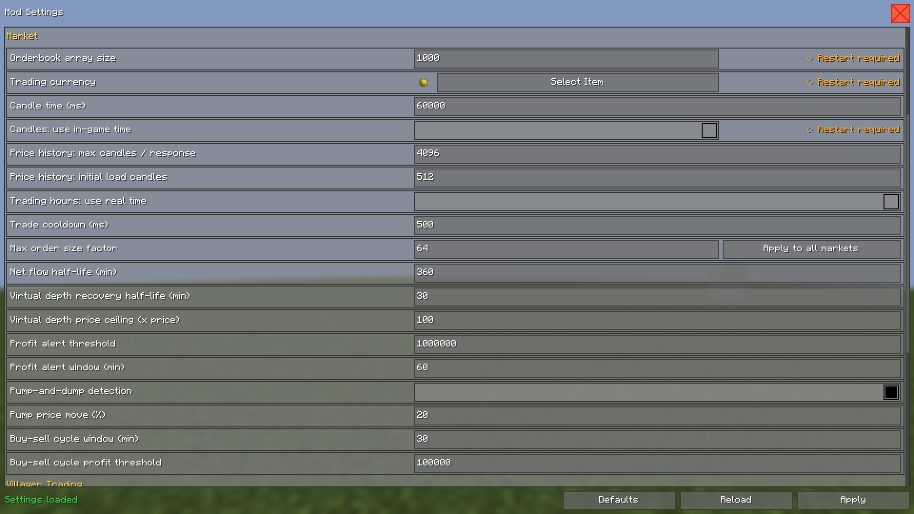

# Mod Settings

StockMarket keeps its server settings in one file per world. You change them in game in the **Mod Settings** screen. Settings of single markets, such as their price or trading hours, are not here: they are in each market's [Market Settings](markets.md#market-settings).

## Opening the screen

1. Run `/stockmarket manage`. You need the StockMarket admin flag, see [Admins and permissions](../permissions.md).
2. On the **Overview** tab, click **Mod Settings**.
3. Change the values and click **Apply**.

The button only shows on the master server of a [network](../multi-server.md). Settings take effect at once, except those marked **⟳ Restart required**: they are saved, but only used after a restart. **Defaults** fills in the default values and **Reload** reads the saved values again; neither saves anything until you click **Apply**.

<figure markdown="span">
  { width="600" }
</figure>

If the server doesn't answer, the screen says *No answer from the server - the change may have been applied. Reopen to check.* Open the screen again to see what was saved.

## The settings file

The file is `<world>/data/StockMarket/settings.json`. Values outside their range are set to the nearest allowed value.

!!! warning "Use the screen, not the file"
    The server rewrites the file at every autosave, so changes made by hand while it runs are lost. If you must edit the file, stop the server first.

Slaves don't use a settings file. The master runs the markets and sends what the slaves need, such as villager prices.

## Utilities

| Setting | Key | Default | Range | What it does |
|---|---|---|---|---|
| **Autosave interval (minutes)** | `SAVE_INTERVAL_MINUTES` | `5` | 1 to 1,440 | How often StockMarket saves its data. |
| **Log info messages** | `LOGGING_ENABLE_INFO` | on | | |
| **Log warnings** | `LOGGING_ENABLE_WARNING` | on | | |
| **Log errors** | `LOGGING_ENABLE_ERROR` | on | | |
| **Log debug messages** | `LOGGING_ENABLE_DEBUG` | off | | Very chatty. Only for finding a problem. |
| **Alert chat on by default** | `ALERTS_DEFAULT_ON` | on | | Chat alerts for admins who never ran `/stockmarket alerts on|off`. See [Alerts and suspicion flags](../audit/alerts.md#stockmarket-alerts). |

## Market

Group `ServerMarket` in the file.

| Setting | Key | Default | Range | What it does |
|---|---|---|---|---|
| **Orderbook array size** | `VIRTUAL_ORDERBOOK_DEFAULT_ARRAY_SIZE` | `1000` | 100 to 1,000,000 | How many price steps the bot order book has. Only new markets use a changed value. Restart required. |
| **Trading currency** | `CURRENCY` | BankSystem money | | The item all trades are paid in. Set it before you create markets. Restart required. |
| **Candle time (ms)** | `CANDLE_TIME` | `60000` | 1,000 to 86,400,000 | Length of one price candle. `60000` = 1 minute. Only used while in-game candles are off. |
| **Candles: use in-game time** | `CANDLE_USE_GAME_TIME` | off | | One candle per in-game hour instead. See [In-game candles](#in-game-candles). Restart required. |
| **Price history: max candles / response** | `PRICE_HISTORY_MAX_CANDLES_PER_RESPONSE` | `4096` | 16 to 65,536 | The most candles the server sends at once. A chart asks again for more. |
| **Price history: initial load candles** | `PRICE_HISTORY_INITIAL_LOAD_CANDLES` | `512` | 16 to 8,192 | How many candles a chart loads when it opens, and per step when a player scrolls back. |
| **Trading hours: use real time** | `TRADING_HOURS_USE_REAL_TIME` | off | | Trading hours follow the master's real clock instead of the in-game time. See [Trading hours](trading-hours.md). |
| **Trade cooldown (ms)** | `TRADE_COOLDOWN_MS` | `500` | 0 to 60,000 | The shortest time between two orders of one player, over all markets. Stops autoclickers. `0` = off. Bots are not affected. |
| **Max order size factor** | `MAX_ORDER_VOLUME_FACTOR` | `64` | 1 or more | The default order limit of a market is this factor times its abundance, but at least the factor. Used for new markets and presets. |
| **Net flow half-life (min)** | `NET_FLOW_HALF_LIFE_MINUTES` | `360` | 0 to 10,080 | How fast the faded net flow goes back to zero. See [Net flow plugin](plugins/net-flow.md). `0` = no fading. |
| **Virtual depth recovery half-life (min)** | `VIRTUAL_DEPTH_RECOVERY_HALF_LIFE_MINUTES` | `30` | 0 to 10,080 | Bot orders that players bought or sold far from the price come back slowly. After this time half of the gap is filled. `0` = off. |
| **Virtual depth price ceiling (x price)** | `VIRTUAL_DEPTH_MAX_PRICE_MULTIPLIER` | `100` | 2 to 10,000 | Bots offer nothing above this multiple of the current price. A large buy stops there; the rest is cancelled. |
| **Profit alert threshold** | `PROFIT_ALERT_THRESHOLD` | `1000000` | 0 or more | See [Alerts](../audit/alerts.md#stockmarket-alerts). `0` = off. |
| **Profit alert window (min)** | `PROFIT_ALERT_WINDOW_MINUTES` | `60` | 1 to 10,080 | |
| **Pump-and-dump detection** | `PUMP_DUMP_ENABLED` | on | | Only raises alerts; it never blocks a trade. |
| **Pump price move (%)** | `PUMP_DUMP_PRICE_MOVE_PERCENT` | `20` | 0 or more | `0` = off. |
| **Buy-sell cycle window (min)** | `PUMP_DUMP_CYCLE_MINUTES` | `30` | 1 to 10,080 | |
| **Buy-sell cycle profit threshold** | `PUMP_DUMP_CYCLE_PROFIT` | `100000` | 0 or more | `0` = off. |

Next to **Max order size factor**, **Apply to all markets** sets the order limit of every market again from its abundance and the saved factor. Limits you set by hand, also `0` = no limit, are overwritten. If you changed the factor, click **Apply** first.

### In-game candles

With **Candles: use in-game time** on, one candle covers one in-game hour of the master's overworld. The charts then offer 1h, 4h, 1D and 1W in-game candles, labelled `Day N` and `hh:00`.

- Skipped hours, for example by sleeping, have no candles.
- With the daylight cycle frozen, a candle closes every 1000 ticks instead (about 50 seconds).
- `/time set` to another hour closes the running candle. The day number can jump back.
- Every candle stores both times, so switching back and forth loses no history.
- Placeholders still count their 24 hours in real time.

This is separate from the trading hours clock: trading hours can follow real time while candles follow the game.

## Villager Trading

Group `VillagerTrading`. See [Villager trading](villager-trading.md) for how the prices are made. Changes reach all slaves at once.

| Setting | Key | Default | Range | What it does |
|---|---|---|---|---|
| **Villager trading enabled** | `ENABLED` | on | | Villager prices follow the markets. |
| **Price refresh interval (minutes)** | `PRICE_REFRESH_INTERVAL_MINUTES` | `20` | 1 to 10,080 | How often villager prices are updated, in real minutes. |
| **Villager buy margin** | `VILLAGER_BUY_MARGIN` | `0.8` | 0.01 to 100 | A villager pays this times the market price when it buys from a player. |
| **Villager sell margin** | `VILLAGER_SELL_MARGIN` | `1.2` | 0.01 to 100 | A villager asks this times the market price when it sells to a player. |
| **Replace emeralds for unlisted items** | `REPLACE_EMERALDS_FOR_UNLISTED` | off | | Trades of items without a market are paid in money too, at the emerald market price. Needs an emerald market. |
| **Use preset prices for villagers** | `USE_PRESET_PRICES_FOR_VILLAGERS` | off | | Only with the setting above: those trades use the item's [preset](presets.md) price instead. |

## Integrations

Each integration is a section with an on/off box in its header.

| Setting | Key | Default | What it does |
|---|---|---|---|
| **Placeholders (TAB / Placeholder API)** | `PLACEHOLDERS_ENABLED` | on | See [Placeholders](../placeholders.md). Restart required. |
| **Sync admin flag with LuckPerms** | `SYNC_ADMIN_FLAG_WITH_PERMISSION` | off | Keeps the admin flag and the node `stockmarket.admin` in step. See [Admins and permissions](../permissions.md#syncing-the-admin-flag-with-luckperms). Restart required. |
| **Discord feed (trades and alerts)** | `DISCORD_ENABLED` | off | See [Discord feed](../discord.md). |
| **Web interface (read-only)** | `WEB_INTERFACE_ENABLED` | off | See [Web interface](../web-interface.md). |
| **Port** | `WEB_INTERFACE_PORT` | `8090` | The web interface's port, 1024 to 65535. |

## Related pages

- [Creating and managing markets](markets.md): the settings of each market.
- [Features you can turn on and off](../features.md): every switch of both mods.
- [BankSystem Mod Settings](../banksystem/settings.md): the bank's settings.
