# Mitgelieferte Ereignisse { #default-events }

StockMarket liefert 73 News-Ereignisse mit. Beim ersten Start werden sie nach `config/StockMarket/news/DefaultEvents/` geschrieben, eine Datei pro Ereignis, jedes mit einem Bild in `pictures/`. Jedes Ereignis hat seine Texte auf Englisch, Deutsch und vereinfachtem Chinesisch. Wie du eines davon änderst oder abschaltest, steht unter [Ein mitgeliefertes Ereignis ändern](config-files.md#changing-a-shipped-event).

## So liest du die Tabellen { #reading-the-tables }

Die Ereignisse sind nach ihrer `category` gruppiert. Für jedes Ereignis gibt es:

- **Bild:** das Bild, das die News im Spiel zeigt. Klicke darauf, um es in voller Größe zu sehen.
- **Schlagzeile:** die deutsche Schlagzeile.
- **ID:** die `id` des Ereignisses, für die Befehle und für deine eigenen Ketten und Bedingungen.
- **JSON:** der Knopf unter der ID öffnet die Datei des Ereignisses so, wie sie mitgeliefert wird. Kopiere sie als Anfang für dein eigenes Ereignis, siehe [Referenz der Ereignisdatei](event-reference.md).
- **Märkte:** die Items, die es bewegt, jedes mit seinem Icon. `#` kennzeichnet einen Tag, `*` ein Muster, siehe [Märkte](event-reference.md#markets); ihr Icon zeigt ein Beispiel-Item. Eine Zahl nach `×` ist der `weightFactor`. Eine negative Zahl bewegt diesen Markt in die andere Richtung.
- **Wirkung:** ein kleines Chart des Ereignistyps, Pfeile für Richtung und Stärke und der Höchstwert, wie er in der Datei steht. Grüne Pfeile: Der Preis steigt. Rote Pfeile: Er fällt. Ein Pfeil bedeutet unter 25 %, zwei bedeuten 25 % bis 39 %, drei bedeuten 40 % oder mehr.

Die Charts zeigen die typische Form jedes Ereignistyps. Einzelne Ereignisse können eigene Zeiten setzen, die echte Kurve kann also länger oder kürzer sein:

| Typ | Preis steigt | Preis fällt | Was der Preis macht |
|---|---|---|---|
| `shock` | { .effect-chart .no-zoom width="64" } | { .effect-chart .no-zoom width="64" } | Springt sofort, hält kurz und geht dann schnell zurück. |
| `trend` | { .effect-chart .no-zoom width="64" } | { .effect-chart .no-zoom width="64" } | Steigt langsam an, hält lange und geht dann langsam zurück. |
| `crash` | { .effect-chart .no-zoom width="64" } | { .effect-chart .no-zoom width="64" } | Springt sofort, hält kurz und erholt sich dann sehr langsam. |
| *dauerhaft* | { .effect-chart .no-zoom width="64" } | { .effect-chart .no-zoom width="64" } | Geht auf ein neues Niveau und bleibt dort. |
| *Geschichte* | { .effect-chart .no-zoom width="64" } | | Läuft in mehreren Schritten, die nach oben und unten gehen können. Die Namen nach *Geschichte* sind ihre Varianten. |

Die Höchstwerte sind die Werte in den Dateien. Die mitgelieferte [scheduler.json](config-files.md#schedulerjson) halbiert jede Wirkung und macht jedes Ereignis dreimal so lang. Ein Ereignis mit `+40%` bewegt den Preis im Spiel also um etwa 20 %.

Die Hinweise unter der Wirkung bedeuten:

- *nur für Admins:* feuert nie zufällig, nur mit `trigger`.
- *Bedingungen:* feuert nur, wenn frühere Ereignisse es erlauben, siehe [Bedingungen](advanced-events.md#requirements).
- *Kette:* kann ein Folgeereignis starten.
- *Gewicht 0:* startet nur als Folgeereignis oder mit `trigger`.
- *News vor / nach der Preisbewegung:* Das Ereignis hat eine Ankündigungsverzögerung.

## Die Ereignisse { #the-events }

### Rohstoffe (26) { #commodities-26 }

<table markdown>
<thead>
<tr><th>Bild</th><th>Schlagzeile</th><th>ID</th><th>Märkte</th><th>Wirkung</th></tr>
</thead>
<tbody markdown>
<tr markdown>
<td markdown="span">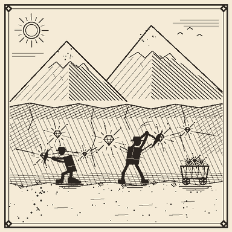{ .news-pic width="96" loading="lazy" }</td>
<td markdown="span">Diamantenrausch in den nördlichen Bergen!</td>
<td markdown="span">`diamond_rush`<br><details class="json-toggle"><summary>JSON</summary></details></td>
<td markdown="span">{ .item-icon .no-zoom width="32" } `diamond`<br>{ .item-icon .no-zoom width="32" } `diamond_block`<br>{ .item-icon .no-zoom width="32" } `#c:ores` ×0.3<br>{ .item-icon .no-zoom width="32" } `emerald` ×−0.4</td>
<td markdown="span">{ .effect-chart .no-zoom width="64" }<br>:material-arrow-down-bold:{ .news-down }:material-arrow-down-bold:{ .news-down } −35% trend<br>News vor der Preisbewegung</td>
</tr>
<tr class="event-json" markdown>
<td colspan="5" markdown="block">

```json
{
  "id": "diamond_rush",
  "picture": "diamond_rush.png",
  "headline": {
    "en_us": "Diamond rush in the northern mountains!",
    "zh_cn": "北部山脉掀起钻石淘金热！",
    "de_de": "Diamantenrausch in den nördlichen Bergen!"
  },
  "text": {
    "en_us": "Prospectors report huge diamond veins in the northern mountains. Experts expect supply to surge within days, putting pressure on prices across the ore market. Emerald traders are already rerouting caravans towards the new claims.",
    "zh_cn": "勘探者在北部山脉发现巨型钻石矿脉。专家预计供给将在数日内激增，令整个矿石市场的价格承压。绿宝石商人已开始将商队改道前往新矿区。",
    "de_de": "Schürfer melden riesige Diamantvorkommen in den nördlichen Bergen. Experten erwarten, dass das Angebot innerhalb weniger Tage stark steigt und die Preise am Erzmarkt unter Druck geraten. Smaragdhändler leiten ihre Karawanen bereits zu den neuen Claims um."
  },
  "category": "commodities",
  "weight": 10,
  "cooldownSeconds": 7200,
  "adminOnly": false,
  "announceDelayMs": { "min": 0, "max": 60000 },
  "impact": {
    "type": "trend",
    "peakFactor": -0.35,
    "rampUpSeconds": 600,
    "durationSeconds": 3000,
    "reversal": "exponential",
    "reversalSeconds": 4500,
    "noise": 0.05
  },
  "markets": [
    { "item": "minecraft:diamond",       "weightFactor": 1.0 },
    { "item": "minecraft:diamond_block", "weightFactor": 1.0 },
    { "item": "#c:ores",                 "weightFactor": 0.3 },
    { "item": "minecraft:emerald",       "weightFactor": -0.4 }
  ]
}
```

</td>
</tr>
<tr markdown>
<td markdown="span">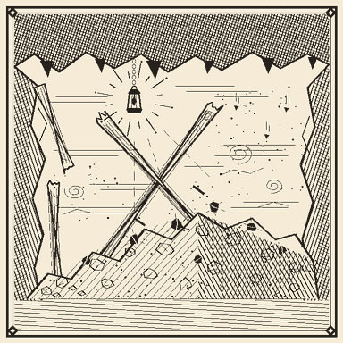{ .news-pic width="96" loading="lazy" }</td>
<td markdown="span">Minenunglück stoppt die Eisenproduktion!</td>
<td markdown="span">`iron_supply_disruption`<br><details class="json-toggle"><summary>JSON</summary></details></td>
<td markdown="span">{ .item-icon .no-zoom width="32" } `iron_ingot`<br>{ .item-icon .no-zoom width="32" } `iron_block`<br>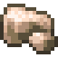{ .item-icon .no-zoom width="32" } `raw_iron` ×0.8</td>
<td markdown="span">{ .effect-chart .no-zoom width="64" }<br>:material-arrow-up-bold:{ .news-up }:material-arrow-up-bold:{ .news-up }:material-arrow-up-bold:{ .news-up } +45% shock</td>
</tr>
<tr class="event-json" markdown>
<td colspan="5" markdown="block">

```json
{
  "id": "iron_supply_disruption",
  "picture": "iron_supply_disruption.png",
  "headline": {
    "en_us": "Mine collapse halts iron production!",
    "zh_cn": "矿井塌方，铁矿石生产停滞！",
    "de_de": "Minenunglück stoppt die Eisenproduktion!"
  },
  "text": {
    "en_us": "A major mine collapse has cut off several iron shafts. Smelteries warn of delivery delays and traders are stockpiling ingots while repairs are underway.",
    "zh_cn": "一座大型矿井发生塌方，数条铁矿竖井被切断。冶炼厂警告交货将延迟，商人们则在抢修期间囤积铁锭。",
    "de_de": "Ein schwerer Mineneinsturz hat mehrere Eisenschächte abgeschnitten. Hütten warnen vor Lieferverzögerungen und Händler horten Barren, während die Reparaturen laufen."
  },
  "category": "commodities",
  "weight": 12,
  "cooldownSeconds": 5400,
  "impact": {
    "type": "shock",
    "peakFactor": 0.45,
    "durationSeconds": 1200,
    "reversalSeconds": 2100
  },
  "markets": [
    { "item": "minecraft:iron_ingot", "weightFactor": 1.0 },
    { "item": "minecraft:iron_block", "weightFactor": 1.0 },
    { "item": "minecraft:raw_iron",   "weightFactor": 0.8 }
  ]
}
```

</td>
</tr>
<tr markdown>
<td markdown="span">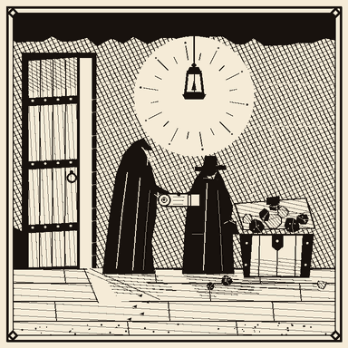{ .news-pic width="96" loading="lazy" }</td>
<td markdown="span">Geleakt: Expedition sichert riesigen Fund an antikem Schrott</td>
<td markdown="span">`netherite_insider_leak`<br><details class="json-toggle"><summary>JSON</summary></details></td>
<td markdown="span">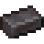{ .item-icon .no-zoom width="32" } `netherite_ingot`<br>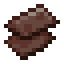{ .item-icon .no-zoom width="32" } `netherite_scrap` ×0.8<br>{ .item-icon .no-zoom width="32" } `ancient_debris` ×0.8</td>
<td markdown="span">{ .effect-chart .no-zoom width="64" }<br>:material-arrow-down-bold:{ .news-down }:material-arrow-down-bold:{ .news-down } −30% shock<br>News nach der Preisbewegung</td>
</tr>
<tr class="event-json" markdown>
<td colspan="5" markdown="block">

```json
{
  "id": "netherite_insider_leak",
  "picture": "netherite_insider_leak.png",
  "headline": {
    "en_us": "Leaked: expedition secures massive ancient debris hoard",
    "zh_cn": "泄露：探险队已囤积大量远古残骸",
    "de_de": "Geleakt: Expedition sichert riesigen Fund an antikem Schrott"
  },
  "text": {
    "en_us": "Documents leaked tonight reveal that a private expedition already secured a massive hoard of ancient debris days ago - and quietly sold ahead of the announcement. The market moved before the public ever knew.",
    "zh_cn": "今夜泄露的文件显示，一支私人探险队数日前就已囤下大批远古残骸，并在公告发布前悄然抛售。市场在公众知情之前便已异动。",
    "de_de": "Heute Nacht geleakte Dokumente zeigen, dass eine private Expedition bereits vor Tagen einen riesigen Fund an antikem Schrott gesichert hat - und noch vor der Bekanntgabe still verkauft hat. Der Markt bewegte sich, bevor die Öffentlichkeit davon erfuhr."
  },
  "category": "commodities",
  "weight": 3,
  "cooldownSeconds": 28800,
  "announceDelayMs": { "min": -45000, "max": -15000 },
  "impact": {
    "type": "shock",
    "peakFactor": -0.3,
    "durationSeconds": 1500,
    "reversalSeconds": 3000
  },
  "markets": [
    { "item": "minecraft:netherite_ingot", "weightFactor": 1.0 },
    { "item": "minecraft:netherite_scrap", "weightFactor": 0.8 },
    { "item": "minecraft:ancient_debris",  "weightFactor": 0.8 }
  ]
}
```

</td>
</tr>
<tr markdown>
<td markdown="span">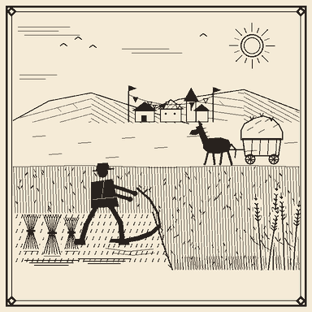{ .news-pic width="96" loading="lazy" }</td>
<td markdown="span">Erntefest treibt die Getreidenachfrage in die Höhe!</td>
<td markdown="span">`wheat_harvest_festival`<br><details class="json-toggle"><summary>JSON</summary></details></td>
<td markdown="span">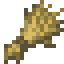{ .item-icon .no-zoom width="32" } `wheat`<br>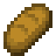{ .item-icon .no-zoom width="32" } `bread` ×0.6</td>
<td markdown="span">{ .effect-chart .no-zoom width="64" }<br>:material-arrow-up-bold:{ .news-up } +22% trend</td>
</tr>
<tr class="event-json" markdown>
<td colspan="5" markdown="block">

```json
{
  "id": "wheat_harvest_festival",
  "picture": "wheat_harvest_festival.png",
  "headline": {
    "en_us": "Harvest festival drives up grain demand!",
    "zh_cn": "丰收节推高谷物需求！",
    "de_de": "Erntefest treibt die Getreidenachfrage in die Höhe!"
  },
  "text": {
    "en_us": "Villages across the land are preparing for the annual harvest festival. Bakeries stockpile flour, brewers order barley in bulk, and prices for wheat and bread climb ahead of the celebrations.",
    "zh_cn": "各地村庄正在筹备一年一度的丰收节。面包坊囤积面粉，酿酒师大批订购大麦，小麦与面包价格在庆典前节节攀升。",
    "de_de": "Überall bereiten sich die Dörfer auf das jährliche Erntefest vor. Bäckereien horten Mehl, Brauer bestellen Gerste in großen Mengen, und die Preise für Weizen und Brot steigen vor den Feierlichkeiten."
  },
  "category": "commodities",
  "weight": 5,
  "cooldownSeconds": 5400,
  "impact": {
    "type": "trend",
    "peakFactor": 0.22,
    "rampUpSeconds": 900,
    "durationSeconds": 2400,
    "reversal": "ramp",
    "reversalSeconds": 2700,
    "noise": 0.04
  },
  "markets": [
    { "item": "minecraft:wheat", "weightFactor": 1.0 },
    { "item": "minecraft:bread", "weightFactor": 0.6 }
  ]
}
```

</td>
</tr>
<tr markdown>
<td markdown="span">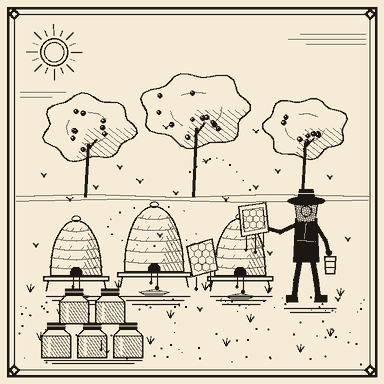{ .news-pic width="96" loading="lazy" }</td>
<td markdown="span">Bienenvölker im Höhenflug - Honig überschwemmt den Markt</td>
<td markdown="span">`honey_bumper_season`<br><details class="json-toggle"><summary>JSON</summary></details></td>
<td markdown="span">{ .item-icon .no-zoom width="32" } `honey_bottle`<br>{ .item-icon .no-zoom width="32" } `honeycomb` ×0.8<br>{ .item-icon .no-zoom width="32" } `sweet_berries` ×0.5</td>
<td markdown="span">{ .effect-chart .no-zoom width="64" }<br>:material-arrow-down-bold:{ .news-down } −22% trend</td>
</tr>
<tr class="event-json" markdown>
<td colspan="5" markdown="block">

```json
{
  "id": "honey_bumper_season",
  "picture": "honey_bumper_season.png",
  "headline": {
    "en_us": "Bee colonies boom - honey floods the market",
    "zh_cn": "蜂群繁盛——蜂蜜大量涌入市场",
    "de_de": "Bienenvölker im Höhenflug - Honig überschwemmt den Markt"
  },
  "text": {
    "en_us": "Beekeepers report an extraordinary season - hives are overflowing and orchards buzzing with pollinators. With honey, honeycombs and sweet berries piling up in warehouses, prices are drifting down as sellers compete for buyers.",
    "zh_cn": "养蜂人报告了一个异常丰产的季节——蜂箱满溢，果园里授粉昆虫嗡嗡作响。蜂蜜、蜜脾与甜浆果在仓库堆积，卖家争抢买家，价格持续走低。",
    "de_de": "Imker melden eine außergewöhnliche Saison - die Stöcke laufen über, die Obstgärten summen vor Bestäubern. Da sich Honig, Waben und Süßbeeren in den Lagern stapeln, geben die Preise nach, während Verkäufer um Käufer buhlen."
  },
  "category": "commodities",
  "weight": 6,
  "cooldownSeconds": 5400,
  "impact": {
    "type": "trend",
    "peakFactor": -0.22,
    "rampUpSeconds": 900,
    "durationSeconds": 2700,
    "reversal": "ramp",
    "reversalSeconds": 2400,
    "noise": 0.03
  },
  "markets": [
    { "item": "minecraft:honey_bottle",  "weightFactor": 1.0 },
    { "item": "minecraft:honeycomb",     "weightFactor": 0.8 },
    { "item": "minecraft:sweet_berries", "weightFactor": 0.5 }
  ]
}
```

</td>
</tr>
<tr markdown>
<td markdown="span">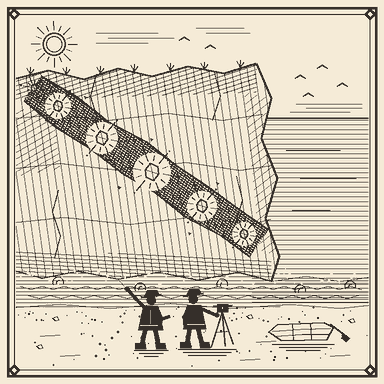{ .news-pic width="96" loading="lazy" }</td>
<td markdown="span">Gewaltige Kupferader in den Küstenklippen erschlossen!</td>
<td markdown="span">`copper_seam_discovery`<br><details class="json-toggle"><summary>JSON</summary></details></td>
<td markdown="span">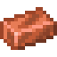{ .item-icon .no-zoom width="32" } `copper_ingot`<br>{ .item-icon .no-zoom width="32" } `copper_block`<br>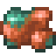{ .item-icon .no-zoom width="32" } `raw_copper` ×0.8</td>
<td markdown="span">{ .effect-chart .no-zoom width="64" }<br>:material-arrow-down-bold:{ .news-down }:material-arrow-down-bold:{ .news-down } −25%, dauerhaft</td>
</tr>
<tr class="event-json" markdown>
<td colspan="5" markdown="block">

```json
{
  "id": "copper_seam_discovery",
  "picture": "copper_seam_discovery.png",
  "headline": {
    "en_us": "Massive copper seam opened in coastal cliffs!",
    "zh_cn": "沿海崖壁开出一处巨型铜矿脉！",
    "de_de": "Gewaltige Kupferader in den Küstenklippen erschlossen!"
  },
  "text": {
    "en_us": "Surveyors have opened up a huge new copper seam running along the coastal cliffs. Foundries are queuing wagons for the fresh raw ore, and traders warn that ingots, blocks, and raw copper will all cheapen permanently as the new seam ramps up.",
    "zh_cn": "勘测者在沿海崖壁开辟出一处巨大的新铜矿脉。铸造厂排起运矿车的长队，商人警告：随着新矿脉逐步投产，铜锭、铜块与粗铜的价格将永久性走低。",
    "de_de": "Vermesser haben eine gewaltige neue Kupferader entlang der Küstenklippen erschlossen. Gießereien schicken Wagen um Wagen zu den frischen Rohvorkommen, und Händler warnen, dass Barren, Blöcke und Rohkupfer dauerhaft billiger werden, sobald die Ader in Produktion geht."
  },
  "category": "commodities",
  "weight": 8,
  "cooldownSeconds": 5400,
  "impact": {
    "type": "trend",
    "peakFactor": -0.25,
    "rampUpSeconds": 1200,
    "durationSeconds": 3000,
    "reversal": "none"
  },
  "markets": [
    { "item": "minecraft:copper_ingot", "weightFactor": 1.0 },
    { "item": "minecraft:copper_block", "weightFactor": 1.0 },
    { "item": "minecraft:raw_copper",   "weightFactor": 0.8 }
  ]
}
```

</td>
</tr>
<tr markdown>
<td markdown="span">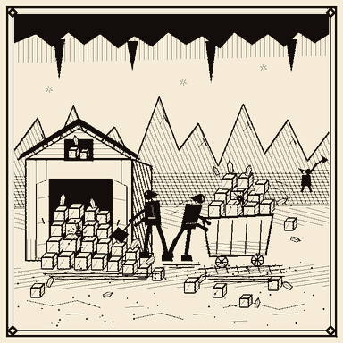{ .news-pic width="96" loading="lazy" }</td>
<td markdown="span">Netherquarz-Schwemme erdrückt den Markt!</td>
<td markdown="span">`nether_quartz_glut`<br><details class="json-toggle"><summary>JSON</summary></details></td>
<td markdown="span">{ .item-icon .no-zoom width="32" } `quartz`<br>{ .item-icon .no-zoom width="32" } `quartz_block` ×0.8</td>
<td markdown="span">{ .effect-chart .no-zoom width="64" }<br>:material-arrow-down-bold:{ .news-down }:material-arrow-down-bold:{ .news-down } −28% trend</td>
</tr>
<tr class="event-json" markdown>
<td colspan="5" markdown="block">

```json
{
  "id": "nether_quartz_glut",
  "picture": "nether_quartz_glut.png",
  "headline": {
    "en_us": "Nether quartz glut buries the market!",
    "zh_cn": "下界石英过剩，压垮市场！",
    "de_de": "Netherquarz-Schwemme erdrückt den Markt!"
  },
  "text": {
    "en_us": "Fresh prospecting camps in the crimson wastes have flooded the caravans with nether quartz. Smelteries report warehouses filled to the rafters, and traders warn that the price of quartz and cut blocks will keep sliding for as long as the digging holds. Overmined and oversupplied, the shine has gone off the market.",
    "zh_cn": "绯红废土上新开的勘探营地让下界石英涌入商队。冶炼厂报告仓库已堆至屋梁，商人警告只要开采持续，石英与石英砖的价格就会一路下滑。过度开采、供给过剩，市场的光泽已然褪去。",
    "de_de": "Neue Schürfcamps in den karmesinroten Ödländern haben die Karawanen mit Netherquarz überschwemmt. Hütten melden bis unters Dach gefüllte Lagerhallen, und Händler warnen, dass die Preise für Quarz und geschnittene Blöcke weiter fallen, solange der Abbau anhält. Überfördert und überversorgt, ist der Glanz vom Markt verschwunden."
  },
  "category": "commodities",
  "weight": 8,
  "cooldownSeconds": 7200,
  "impact": {
    "type": "trend",
    "peakFactor": -0.28,
    "rampUpSeconds": 900,
    "durationSeconds": 2700,
    "reversal": "ramp",
    "reversalSeconds": 2700,
    "noise": 0.04
  },
  "markets": [
    {
      "item": "minecraft:quartz",
      "weightFactor": 1.0
    },
    {
      "item": "minecraft:quartz_block",
      "weightFactor": 0.8
    }
  ]
}
```

</td>
</tr>
<tr markdown>
<td markdown="span">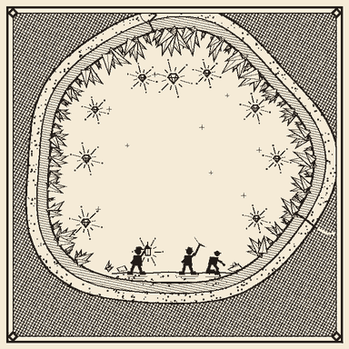{ .news-pic width="96" loading="lazy" }</td>
<td markdown="span">Gewaltige Geode aufgebrochen - überall Amethyst!</td>
<td markdown="span">`amethyst_geode_discovery`<br><details class="json-toggle"><summary>JSON</summary></details></td>
<td markdown="span">{ .item-icon .no-zoom width="32" } `amethyst_shard`</td>
<td markdown="span">{ .effect-chart .no-zoom width="64" }<br>:material-arrow-down-bold:{ .news-down }:material-arrow-down-bold:{ .news-down } −30%, dauerhaft</td>
</tr>
<tr class="event-json" markdown>
<td colspan="5" markdown="block">

```json
{
  "id": "amethyst_geode_discovery",
  "picture": "amethyst_geode_discovery.png",
  "headline": {
    "en_us": "Colossal geode cracked open - amethyst everywhere!",
    "zh_cn": "巨型晶洞被凿开——紫水晶遍地！",
    "de_de": "Gewaltige Geode aufgebrochen - überall Amethyst!"
  },
  "text": {
    "en_us": "Miners in the deep caverns have broken into a geode the size of a village hall, its walls solid with amethyst clusters. So much crystal is now reaching the caravans that jewelers expect the glut to be permanent - the days of scarce amethyst are simply over, and the price will settle at a new, lower level for good.",
    "zh_cn": "深穴矿工凿开了一座足有村礼堂大小的晶洞，洞壁满布紫水晶簇。涌入商队的晶体之多，令珠宝商认为这次过剩将是永久的——紫水晶稀缺的时代就此结束，价格将长期停留在新的低位。",
    "de_de": "Bergleute in den tiefen Höhlen sind in eine Geode so groß wie eine Dorfhalle vorgedrungen, deren Wände dicht mit Amethystdrusen besetzt sind. So viel Kristall erreicht nun die Karawanen, dass Juweliere von einem dauerhaften Überangebot ausgehen - die Zeiten des knappen Amethysts sind schlicht vorbei, und der Preis pendelt sich auf einem neuen, tieferen Niveau ein."
  },
  "category": "commodities",
  "weight": 4,
  "cooldownSeconds": 43200,
  "impact": {
    "type": "trend",
    "peakFactor": -0.3,
    "rampUpSeconds": 1200,
    "durationSeconds": 3000,
    "reversal": "none"
  },
  "markets": [
    {
      "item": "minecraft:amethyst_shard",
      "weightFactor": 1.0
    }
  ]
}
```

</td>
</tr>
<tr markdown>
<td markdown="span">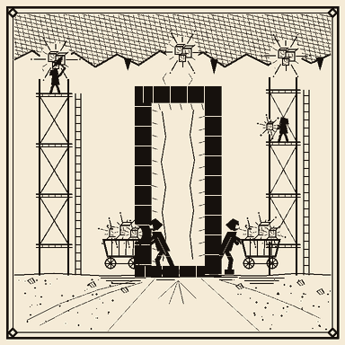{ .news-pic width="96" loading="lazy" }</td>
<td markdown="span">Glowstone-Farmen überschwemmen den Markt mit Licht!</td>
<td markdown="span">`glowstone_farm_boom`<br><details class="json-toggle"><summary>JSON</summary></details></td>
<td markdown="span">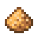{ .item-icon .no-zoom width="32" } `glowstone_dust`<br>{ .item-icon .no-zoom width="32" } `glowstone` ×0.8</td>
<td markdown="span">{ .effect-chart .no-zoom width="64" }<br>:material-arrow-down-bold:{ .news-down }:material-arrow-down-bold:{ .news-down } −25% trend</td>
</tr>
<tr class="event-json" markdown>
<td colspan="5" markdown="block">

```json
{
  "id": "glowstone_farm_boom",
  "picture": "glowstone_farm_boom.png",
  "headline": {
    "en_us": "Glowstone farms flood the market with light!",
    "zh_cn": "荧石农场让光明充斥市场！",
    "de_de": "Glowstone-Farmen überschwemmen den Markt mit Licht!"
  },
  "text": {
    "en_us": "Enterprising builders have set up sprawling glowstone harvesting operations across the nether ceilings, and the dust is now pouring back through the portals by the cartload. With supply outrunning even the busiest lamp-makers, the price of glowstone dust and blocks is drifting steadily downward.",
    "zh_cn": "有眼光的建造者在下界顶部建起大片荧石采集场，荧石粉正成车地穿过传送门运回。供给已超过最忙碌的灯具匠所能消化，荧石粉与荧石块的价格持续走低。",
    "de_de": "Findige Baumeister haben unter den Netherdecken weitläufige Glowstone-Ernteanlagen errichtet, und der Staub strömt nun karrenweise durch die Portale zurück. Da das Angebot selbst die fleißigsten Lampenbauer übersteigt, geben die Preise für Glowstone-Staub und -Blöcke stetig nach."
  },
  "category": "commodities",
  "weight": 8,
  "cooldownSeconds": 7200,
  "impact": {
    "type": "trend",
    "peakFactor": -0.25,
    "rampUpSeconds": 900,
    "durationSeconds": 2400,
    "reversal": "ramp",
    "reversalSeconds": 2400,
    "noise": 0.03
  },
  "markets": [
    {
      "item": "minecraft:glowstone_dust",
      "weightFactor": 1.0
    },
    {
      "item": "minecraft:glowstone",
      "weightFactor": 0.8
    }
  ]
}
```

</td>
</tr>
<tr markdown>
<td markdown="span">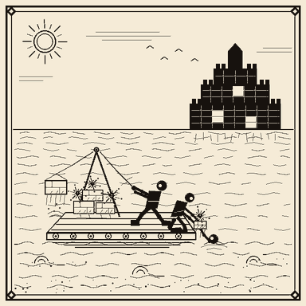{ .news-pic width="96" loading="lazy" }</td>
<td markdown="span">Ozeanmonument leergeräumt - Prismarin überflutet den Markt!</td>
<td markdown="span">`prismarine_monument_raid`<br><details class="json-toggle"><summary>JSON</summary></details></td>
<td markdown="span">{ .item-icon .no-zoom width="32" } `prismarine_shard`<br>{ .item-icon .no-zoom width="32" } `prismarine_crystals` ×0.9<br>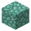{ .item-icon .no-zoom width="32" } `prismarine` ×0.6</td>
<td markdown="span">{ .effect-chart .no-zoom width="64" }<br>:material-arrow-down-bold:{ .news-down }:material-arrow-down-bold:{ .news-down } −35% shock</td>
</tr>
<tr class="event-json" markdown>
<td colspan="5" markdown="block">

```json
{
  "id": "prismarine_monument_raid",
  "picture": "prismarine_monument_raid.png",
  "headline": {
    "en_us": "Ocean monument stripped bare - prismarine floods in!",
    "zh_cn": "海底神殿被洗劫一空——海晶石涌入！",
    "de_de": "Ozeanmonument leergeräumt - Prismarin überflutet den Markt!"
  },
  "text": {
    "en_us": "A guild of divers has stormed a great ocean monument and hauled its walls to the surface overnight. Prismarine shards and crystals hit the caravans all at once, and the sudden wall of supply has sent prices plunging before sellers can even set a fair rate.",
    "zh_cn": "一支潜水者公会突袭了一座大型海底神殿，一夜之间把它的墙体搬上了水面。海晶碎片与海晶结晶同时涌入商队，突如其来的供给洪流让价格在卖家定价之前就已崩塌。",
    "de_de": "Eine Taucherzunft hat ein großes Ozeanmonument gestürmt und seine Wände über Nacht an die Oberfläche geschafft. Prismarinscherben und -kristalle treffen mit einem Schlag auf die Karawanen, und die plötzliche Angebotswand lässt die Preise abstürzen, noch ehe die Verkäufer einen fairen Kurs festlegen können."
  },
  "category": "commodities",
  "weight": 5,
  "cooldownSeconds": 14400,
  "impact": {
    "type": "shock",
    "peakFactor": -0.35,
    "durationSeconds": 1500,
    "reversal": "exponential",
    "reversalSeconds": 3600,
    "noise": 0.05
  },
  "markets": [
    {
      "item": "minecraft:prismarine_shard",
      "weightFactor": 1.0
    },
    {
      "item": "minecraft:prismarine_crystals",
      "weightFactor": 0.9
    },
    {
      "item": "minecraft:prismarine",
      "weightFactor": 0.6
    }
  ]
}
```

</td>
</tr>
<tr markdown>
<td markdown="span">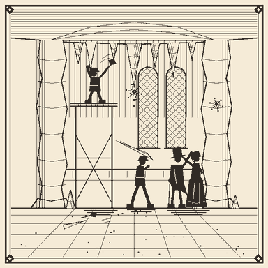{ .news-pic width="96" loading="lazy" }</td>
<td markdown="span">Tropfstein wird zur neuen Mode in den Prunkhallen!</td>
<td markdown="span">`dripstone_cavern_rush`<br><details class="json-toggle"><summary>JSON</summary></details></td>
<td markdown="span">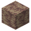{ .item-icon .no-zoom width="32" } `dripstone_block`<br>{ .item-icon .no-zoom width="32" } `pointed_dripstone` ×0.7</td>
<td markdown="span">{ .effect-chart .no-zoom width="64" }<br>:material-arrow-up-bold:{ .news-up }:material-arrow-up-bold:{ .news-up } +28% trend</td>
</tr>
<tr class="event-json" markdown>
<td colspan="5" markdown="block">

```json
{
  "id": "dripstone_cavern_rush",
  "picture": "dripstone_cavern_rush.png",
  "headline": {
    "en_us": "Dripstone the new fashion in grand halls!",
    "zh_cn": "滴水石成为厅堂新时尚！",
    "de_de": "Tropfstein wird zur neuen Mode in den Prunkhallen!"
  },
  "text": {
    "en_us": "Master builders have taken to lining grand halls with dripstone columns, and every noble house wants the dramatic cavern look for its own. Demand for dripstone blocks and pointed spikes is climbing steadily as masons compete for the fashionable stone.",
    "zh_cn": "建筑大师们开始用滴水石柱装饰宏伟厅堂，每个贵族府邸都想要那种戏剧性的洞窟质感。石匠争抢这种时髦石料，滴水石块与滴水石锥的需求稳步攀升。",
    "de_de": "Baumeister haben begonnen, Prunkhallen mit Tropfsteinsäulen auszukleiden, und jedes Adelshaus will den dramatischen Höhlenlook für sich. Die Nachfrage nach Tropfsteinblöcken und spitzem Tropfstein steigt stetig, während Steinmetze um das modische Gestein wetteifern."
  },
  "category": "commodities",
  "weight": 7,
  "cooldownSeconds": 7200,
  "impact": {
    "type": "trend",
    "peakFactor": 0.28,
    "rampUpSeconds": 900,
    "durationSeconds": 2400,
    "reversal": "ramp",
    "reversalSeconds": 2700,
    "noise": 0.03
  },
  "markets": [
    {
      "item": "minecraft:dripstone_block",
      "weightFactor": 1.0
    },
    {
      "item": "minecraft:pointed_dripstone",
      "weightFactor": 0.7
    }
  ]
}
```

</td>
</tr>
<tr markdown>
<td markdown="span">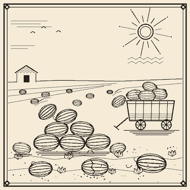{ .news-pic width="96" loading="lazy" }</td>
<td markdown="span">Rekordsommer überschwemmt den Markt mit Melonen</td>
<td markdown="span">`melon_summer_glut`<br><details class="json-toggle"><summary>JSON</summary></details></td>
<td markdown="span">{ .item-icon .no-zoom width="32" } `melon_slice`<br>{ .item-icon .no-zoom width="32" } `melon` ×0.7</td>
<td markdown="span">{ .effect-chart .no-zoom width="64" }<br>:material-arrow-down-bold:{ .news-down } −22% trend</td>
</tr>
<tr class="event-json" markdown>
<td colspan="5" markdown="block">

```json
{
  "id": "melon_summer_glut",
  "picture": "melon_summer_glut.png",
  "headline": {
    "en_us": "Bumper summer floods the market with melons",
    "zh_cn": "盛夏丰收，西瓜淹没市场",
    "de_de": "Rekordsommer überschwemmt den Markt mit Melonen"
  },
  "text": {
    "en_us": "A long, warm summer has left the melon patches groaning under the weight of the harvest. Carts of fruit arrive at market faster than the stalls can sell them, and with warehouses stuffed to the rafters the price of melons and melon slices is sliding lower by the day.",
    "zh_cn": "漫长炎热的夏季让瓜田被沉甸甸的收成压弯。运瓜车到市的速度快过摊位卖出的速度，仓库堆至屋梁，西瓜与西瓜片的价格逐日下滑。",
    "de_de": "Ein langer, warmer Sommer hat die Melonenfelder unter der Last der Ernte ächzen lassen. Wagen um Wagen voller Früchte erreicht den Markt schneller, als die Stände sie verkaufen können, und da die Lager bis unter das Dach gefüllt sind, rutscht der Preis für Melonen und Melonenscheiben von Tag zu Tag tiefer."
  },
  "category": "commodities",
  "weight": 6,
  "cooldownSeconds": 21600,
  "impact": {
    "type": "trend",
    "peakFactor": -0.22,
    "rampUpSeconds": 900,
    "durationSeconds": 2700,
    "reversal": "ramp",
    "reversalSeconds": 2400,
    "noise": 0.03
  },
  "markets": [
    {
      "item": "minecraft:melon_slice",
      "weightFactor": 1.0
    },
    {
      "item": "minecraft:melon",
      "weightFactor": 0.7
    }
  ]
}
```

</td>
</tr>
<tr markdown>
<td markdown="span">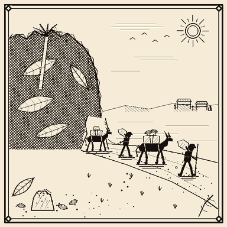{ .news-pic width="96" loading="lazy" }</td>
<td markdown="span">Südliche Handelsroute öffnet die Kakaoschleusen</td>
<td markdown="span">`cocoa_trade_route_opens`<br><details class="json-toggle"><summary>JSON</summary></details></td>
<td markdown="span">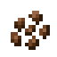{ .item-icon .no-zoom width="32" } `cocoa_beans`</td>
<td markdown="span">{ .effect-chart .no-zoom width="64" }<br>:material-arrow-down-bold:{ .news-down }:material-arrow-down-bold:{ .news-down } −28% trend</td>
</tr>
<tr class="event-json" markdown>
<td colspan="5" markdown="block">

```json
{
  "id": "cocoa_trade_route_opens",
  "picture": "cocoa_trade_route_opens.png",
  "headline": {
    "en_us": "Southern trade route opens the cocoa floodgates",
    "zh_cn": "南方商路打通，可可闸门大开",
    "de_de": "Südliche Handelsroute öffnet die Kakaoschleusen"
  },
  "text": {
    "en_us": "A new caravan route through the southern jungles has finally been secured, and the first shipments of cocoa beans are pouring into the northern markets. With supply suddenly abundant, cocoa prices are drifting lower as chocolatiers stock up while the going is cheap.",
    "zh_cn": "穿越南部丛林的新商队路线终于打通，首批可可豆正涌入北方市场。供给骤然充裕，趁价格低廉囤货的巧克力师们推动可可价格持续走低。",
    "de_de": "Eine neue Karawanenroute durch die südlichen Dschungel ist endlich gesichert, und die ersten Ladungen Kakaobohnen strömen in die nördlichen Märkte. Da das Angebot plötzlich reichlich ist, geben die Kakaopreise nach, während sich die Chocolatiers eindecken, solange es günstig ist."
  },
  "category": "commodities",
  "weight": 7,
  "cooldownSeconds": 10800,
  "impact": {
    "type": "trend",
    "peakFactor": -0.28,
    "rampUpSeconds": 900,
    "durationSeconds": 2400,
    "reversal": "ramp",
    "reversalSeconds": 2700,
    "noise": 0.03
  },
  "markets": [
    {
      "item": "minecraft:cocoa_beans",
      "weightFactor": 1.0
    }
  ]
}
```

</td>
</tr>
<tr markdown>
<td markdown="span">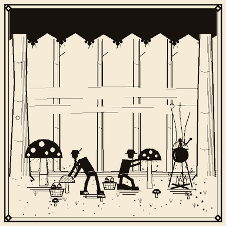{ .news-pic width="96" loading="lazy" }</td>
<td markdown="span">Sammelfieber treibt die Pilzpreise nach oben</td>
<td markdown="span">`mushroom_foraging_craze`<br><details class="json-toggle"><summary>JSON</summary></details></td>
<td markdown="span">{ .item-icon .no-zoom width="32" } `red_mushroom`<br>{ .item-icon .no-zoom width="32" } `brown_mushroom`<br>{ .item-icon .no-zoom width="32" } `mushroom_stew` ×0.6<br>{ .item-icon .no-zoom width="32" } `bread` ×−0.2</td>
<td markdown="span">{ .effect-chart .no-zoom width="64" }<br>:material-arrow-up-bold:{ .news-up } +24% trend</td>
</tr>
<tr class="event-json" markdown>
<td colspan="5" markdown="block">

```json
{
  "id": "mushroom_foraging_craze",
  "picture": "mushroom_foraging_craze.png",
  "headline": {
    "en_us": "Foraging craze sends mushroom prices soaring",
    "zh_cn": "采菇热潮推高蘑菇价格",
    "de_de": "Sammelfieber treibt die Pilzpreise nach oben"
  },
  "text": {
    "en_us": "A craze for wild mushroom stew has gripped the villages, and every innkeeper wants red and brown caps by the basketful. Prices for both mushrooms and ready-made stew are climbing fast, while the bakers grumble that villagers off foraging in the woods are buying far less bread.",
    "zh_cn": "一股野生蘑菇炖菜的风潮席卷村庄，每个旅店老板都想要成筐的红菇与褐菇。蘑菇与现成炖菜的价格快速上涨，而面包师则抱怨进林采菇的村民买走的面包少了许多。",
    "de_de": "Ein Fieber nach Waldpilzeintopf hat die Dörfer erfasst, und jeder Wirt will rote und braune Kappen körbeweise. Die Preise für beide Pilzsorten und für fertigen Eintopf steigen rasch, während die Bäcker murren, dass die Dorfbewohner beim Pilzesammeln im Wald weit weniger Brot kaufen."
  },
  "category": "commodities",
  "weight": 6,
  "cooldownSeconds": 7200,
  "impact": {
    "type": "trend",
    "peakFactor": 0.24,
    "rampUpSeconds": 900,
    "durationSeconds": 2400,
    "reversal": "ramp",
    "reversalSeconds": 2700,
    "noise": 0.04
  },
  "markets": [
    {
      "item": "minecraft:red_mushroom",
      "weightFactor": 1.0
    },
    {
      "item": "minecraft:brown_mushroom",
      "weightFactor": 1.0
    },
    {
      "item": "minecraft:mushroom_stew",
      "weightFactor": 0.6
    },
    {
      "item": "minecraft:bread",
      "weightFactor": -0.2
    }
  ]
}
```

</td>
</tr>
<tr markdown>
<td markdown="span">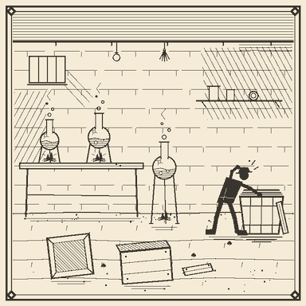{ .news-pic width="96" loading="lazy" }</td>
<td markdown="span">Brauer räumen die Netherwarzen-Lager leer!</td>
<td markdown="span">`netherwart_brewing_shortage`<br><details class="json-toggle"><summary>JSON</summary></details></td>
<td markdown="span">{ .item-icon .no-zoom width="32" } `nether_wart`<br>{ .item-icon .no-zoom width="32" } `sugar` ×−0.2<br>{ .item-icon .no-zoom width="32" } `glowstone_dust` ×−0.15</td>
<td markdown="span">{ .effect-chart .no-zoom width="64" }<br>:material-arrow-up-bold:{ .news-up }:material-arrow-up-bold:{ .news-up }:material-arrow-up-bold:{ .news-up } +42% shock</td>
</tr>
<tr class="event-json" markdown>
<td colspan="5" markdown="block">

```json
{
  "id": "netherwart_brewing_shortage",
  "picture": "netherwart_brewing_shortage.png",
  "headline": {
    "en_us": "Brewers empty the nether wart stocks!",
    "zh_cn": "酿造师扫空下界疣库存！",
    "de_de": "Brauer räumen die Netherwarzen-Lager leer!"
  },
  "text": {
    "en_us": "A surge in potion demand has seen the brewers' guild buy up every last crate of nether wart, and the fortress caravans cannot resupply fast enough. Nether wart prices have spiked overnight, while sugar and glowstone dust sag as half-finished brews sit idle without their base ingredient.",
    "zh_cn": "药水需求激增，酿造师公会买下了每一箱下界疣，要塞商队已来不及补货。下界疣价格一夜暴涨，而糖与荧石粉则因半成品药水缺少主料停摆而走低。",
    "de_de": "Ein sprunghaft gestiegener Trankbedarf hat die Brauergilde jede letzte Kiste Netherwarzen aufkaufen lassen, und die Festungskarawanen kommen mit dem Nachschub nicht hinterher. Die Netherwarzenpreise sind über Nacht in die Höhe geschnellt, während Zucker und Leuchtsteinstaub nachgeben, weil halbfertige Gebräue ohne ihre Grundzutat brachliegen."
  },
  "category": "commodities",
  "weight": 5,
  "cooldownSeconds": 10800,
  "impact": {
    "type": "shock",
    "peakFactor": 0.42,
    "durationSeconds": 1500,
    "reversal": "exponential",
    "reversalSeconds": 3600,
    "noise": 0.05
  },
  "markets": [
    {
      "item": "minecraft:nether_wart",
      "weightFactor": 1.0
    },
    {
      "item": "minecraft:sugar",
      "weightFactor": -0.2
    },
    {
      "item": "minecraft:glowstone_dust",
      "weightFactor": -0.15
    }
  ]
}
```

</td>
</tr>
<tr markdown>
<td markdown="span">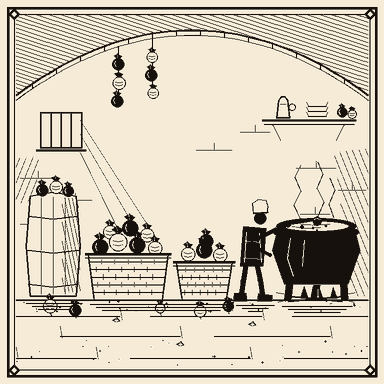{ .news-pic width="96" loading="lazy" }</td>
<td markdown="span">Rekord-Rübenernte drückt die Preise</td>
<td markdown="span">`beetroot_harvest_surplus`<br><details class="json-toggle"><summary>JSON</summary></details></td>
<td markdown="span">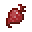{ .item-icon .no-zoom width="32" } `beetroot`<br>{ .item-icon .no-zoom width="32" } `beetroot_soup` ×0.6</td>
<td markdown="span">{ .effect-chart .no-zoom width="64" }<br>:material-arrow-down-bold:{ .news-down } −20% trend</td>
</tr>
<tr class="event-json" markdown>
<td colspan="5" markdown="block">

```json
{
  "id": "beetroot_harvest_surplus",
  "picture": "beetroot_harvest_surplus.png",
  "headline": {
    "en_us": "Record beetroot harvest weighs on prices",
    "zh_cn": "甜菜根创纪录丰收压制价格",
    "de_de": "Rekord-Rübenernte drückt die Preise"
  },
  "text": {
    "en_us": "Growers report a record beetroot harvest this year, with cellars overflowing and soup kitchens spoiled for choice. As the surplus works its way through the market, prices for beetroot and beetroot soup are easing steadily lower.",
    "zh_cn": "种植者报告今年甜菜根产量创下纪录，地窖满溢，施汤所挑花了眼。随着过剩货源流入市场，甜菜根与甜菜汤的价格稳步走低。",
    "de_de": "Die Anbauer melden in diesem Jahr eine Rekordernte an Roten Rüben, die Keller quellen über und die Suppenküchen haben die Qual der Wahl. Während sich der Überschuss durch den Markt arbeitet, geben die Preise für Rote Rüben und Rübensuppe stetig nach."
  },
  "category": "commodities",
  "weight": 6,
  "cooldownSeconds": 7200,
  "impact": {
    "type": "trend",
    "peakFactor": -0.2,
    "rampUpSeconds": 900,
    "durationSeconds": 2700,
    "reversal": "ramp",
    "reversalSeconds": 2400,
    "noise": 0.03
  },
  "markets": [
    {
      "item": "minecraft:beetroot",
      "weightFactor": 1.0
    },
    {
      "item": "minecraft:beetroot_soup",
      "weightFactor": 0.6
    }
  ]
}
```

</td>
</tr>
<tr markdown>
<td markdown="span">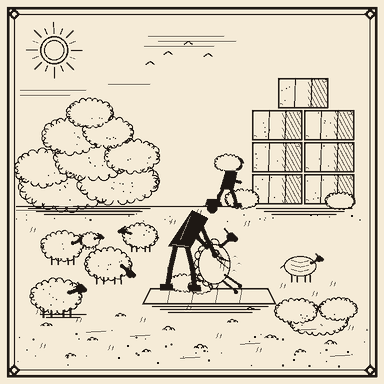{ .news-pic width="96" loading="lazy" }</td>
<td markdown="span">Frühjahrsschur überschwemmt den Wollmarkt</td>
<td markdown="span">`spring_shearing_glut`<br><details class="json-toggle"><summary>JSON</summary></details></td>
<td markdown="span">{ .item-icon .no-zoom width="32" } `string` ×0.5<br>{ .item-icon .no-zoom width="32" } `#minecraft:wool`<br>{ .item-icon .no-zoom width="32" } `leather` ×−0.3</td>
<td markdown="span">{ .effect-chart .no-zoom width="64" }<br>:material-arrow-down-bold:{ .news-down } −24% trend</td>
</tr>
<tr class="event-json" markdown>
<td colspan="5" markdown="block">

```json
{
  "id": "spring_shearing_glut",
  "picture": "spring_shearing_glut.png",
  "headline": {
    "en_us": "Spring shearing floods the wool market",
    "zh_cn": "春季剪毛淹没羊毛市场",
    "de_de": "Frühjahrsschur überschwemmt den Wollmarkt"
  },
  "text": {
    "en_us": "The first warm days brought every shepherd's flock to the shears at once, and bales of fresh fleece are piling up faster than the weavers can spin them. Wool and raw thread are drifting cheaper by the day as sellers undercut one another at the gate. Tanners, meanwhile, note that buyers are quietly turning back to leather for their finer garments.",
    "zh_cn": "头几个暖日让所有牧羊人同时开剪，新羊毛成捆堆积的速度快过织工纺线的速度。卖家在门口互相压价，羊毛与线的价格逐日走低。与此同时，制革匠注意到买家正悄然转回皮革，用以制作更精细的衣物。",
    "de_de": "Die ersten warmen Tage haben die Herden aller Schäfer zugleich unter die Schere gebracht, und Ballen frischer Wolle stapeln sich schneller, als die Weber sie verspinnen können. Wolle und Rohgarn werden von Tag zu Tag billiger, während die Verkäufer sich am Tor gegenseitig unterbieten. Gerber wiederum bemerken, dass sich die Käufer für ihre feineren Gewänder still wieder dem Leder zuwenden."
  },
  "category": "commodities",
  "weight": 6,
  "cooldownSeconds": 7200,
  "impact": {
    "type": "trend",
    "peakFactor": -0.24,
    "rampUpSeconds": 900,
    "durationSeconds": 2400,
    "reversal": "ramp",
    "reversalSeconds": 2700,
    "noise": 0.04
  },
  "markets": [
    {
      "item": "minecraft:string",
      "weightFactor": 0.5
    },
    {
      "item": "#minecraft:wool",
      "weightFactor": 1.0
    },
    {
      "item": "minecraft:leather",
      "weightFactor": -0.3
    }
  ]
}
```

</td>
</tr>
<tr markdown>
<td markdown="span">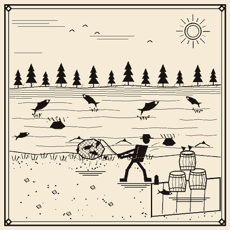{ .news-pic width="96" loading="lazy" }</td>
<td markdown="span">Großer Lachszug füllt die Netze</td>
<td markdown="span">`salmon_spawning_run`<br><details class="json-toggle"><summary>JSON</summary></details></td>
<td markdown="span">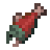{ .item-icon .no-zoom width="32" } `salmon`<br>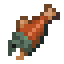{ .item-icon .no-zoom width="32" } `cooked_salmon` ×0.6</td>
<td markdown="span">{ .effect-chart .no-zoom width="64" }<br>:material-arrow-down-bold:{ .news-down }:material-arrow-down-bold:{ .news-down } −25% trend</td>
</tr>
<tr class="event-json" markdown>
<td colspan="5" markdown="block">

```json
{
  "id": "salmon_spawning_run",
  "picture": "salmon_spawning_run.png",
  "headline": {
    "en_us": "Great salmon run fills the nets",
    "zh_cn": "鲑鱼大洄游装满渔网",
    "de_de": "Großer Lachszug füllt die Netze"
  },
  "text": {
    "en_us": "The rivers are thick with the seasonal salmon run, and the fishing fleets are hauling in more than the smokehouses can cure. Barrels of fresh and cooked salmon are stacking up on every quay, and prices are sliding as the catch outpaces demand. Old hands know the glut lasts only as long as the fish keep running.",
    "zh_cn": "河中鲑鱼成群，正值洄游季，渔船捕获量已超出熏制作坊的处理能力。各码头堆满鲜鲑鱼与熟鲑鱼的木桶，捕捞速度超过需求，价格随之下滑。老手都清楚，这波过剩只能持续到鱼群停止洄游为止。",
    "de_de": "Die Flüsse sind dicht vom jahreszeitlichen Lachszug, und die Fischerflotten holen mehr ein, als die Räuchereien pökeln können. Fässer mit frischem und gebratenem Lachs stapeln sich an jedem Kai, und die Preise rutschen, da der Fang die Nachfrage übertrifft. Alte Hasen wissen, dass die Schwemme nur so lange anhält, wie die Fische ziehen."
  },
  "category": "commodities",
  "weight": 6,
  "cooldownSeconds": 5400,
  "impact": {
    "type": "trend",
    "peakFactor": -0.25,
    "rampUpSeconds": 900,
    "durationSeconds": 2700,
    "reversal": "ramp",
    "reversalSeconds": 2400,
    "noise": 0.04
  },
  "markets": [
    {
      "item": "minecraft:salmon",
      "weightFactor": 1.0
    },
    {
      "item": "minecraft:cooked_salmon",
      "weightFactor": 0.6
    }
  ]
}
```

</td>
</tr>
<tr markdown>
<td markdown="span">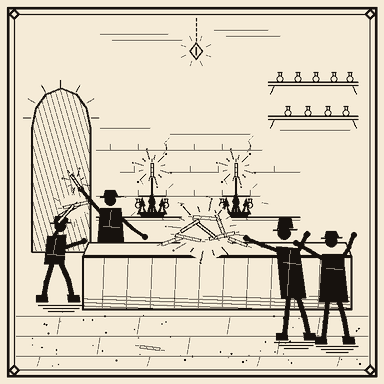{ .news-pic width="96" loading="lazy" }</td>
<td markdown="span">Alchemistengilde leert die Lohenruten-Stände!</td>
<td markdown="span">`blaze_rod_brewing_rush`<br><details class="json-toggle"><summary>JSON</summary></details></td>
<td markdown="span">{ .item-icon .no-zoom width="32" } `blaze_rod`<br>{ .item-icon .no-zoom width="32" } `blaze_powder` ×0.7</td>
<td markdown="span">{ .effect-chart .no-zoom width="64" }<br>:material-arrow-up-bold:{ .news-up }:material-arrow-up-bold:{ .news-up } +32% trend</td>
</tr>
<tr class="event-json" markdown>
<td colspan="5" markdown="block">

```json
{
  "id": "blaze_rod_brewing_rush",
  "picture": "blaze_rod_brewing_rush.png",
  "headline": {
    "en_us": "Alchemists' guild empties the blaze-rod stalls!",
    "zh_cn": "炼金师公会扫空烈焰棒摊位！",
    "de_de": "Alchemistengilde leert die Lohenruten-Stände!"
  },
  "text": {
    "en_us": "The alchemists' guild has placed a standing order for every blaze rod the delvers can drag back from the Nether. Brewing stands are firing day and night, and rod and powder alike are climbing as the guild's buyers outbid one another.",
    "zh_cn": "炼金师公会已对探险者能从下界带回的每一根烈焰棒下长期订单。酿造台昼夜不熄，公会买家互相抬价，烈焰棒与烈焰粉价格齐涨。",
    "de_de": "Die Alchemistengilde hat eine Dauerbestellung auf jede Lohenrute aufgegeben, die die Delver aus dem Nether schleppen können. Die Braustände laufen Tag und Nacht, und sowohl Ruten als auch Staub steigen, während sich die Einkäufer der Gilde gegenseitig überbieten."
  },
  "category": "commodities",
  "weight": 6,
  "cooldownSeconds": 10800,
  "impact": {
    "type": "trend",
    "peakFactor": 0.32,
    "rampUpSeconds": 900,
    "durationSeconds": 2400,
    "reversal": "ramp",
    "reversalSeconds": 2700,
    "noise": 0.04
  },
  "markets": [
    {
      "item": "minecraft:blaze_rod",
      "weightFactor": 1.0
    },
    {
      "item": "minecraft:blaze_powder",
      "weightFactor": 0.7
    }
  ]
}
```

</td>
</tr>
<tr markdown>
<td markdown="span">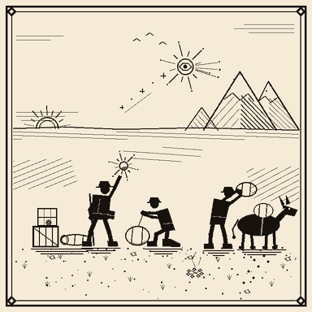{ .news-pic width="96" loading="lazy" }</td>
<td markdown="span">Expeditionsfieber treibt die Nachfrage nach Enderperlen in die Höhe</td>
<td markdown="span">`ender_pearl_expedition_boom`<br><details class="json-toggle"><summary>JSON</summary></details></td>
<td markdown="span">{ .item-icon .no-zoom width="32" } `ender_pearl`<br>{ .item-icon .no-zoom width="32" } `ender_eye` ×0.6</td>
<td markdown="span">{ .effect-chart .no-zoom width="64" }<br>:material-arrow-up-bold:{ .news-up }:material-arrow-up-bold:{ .news-up } +28% trend</td>
</tr>
<tr class="event-json" markdown>
<td colspan="5" markdown="block">

```json
{
  "id": "ender_pearl_expedition_boom",
  "picture": "ender_pearl_expedition_boom.png",
  "headline": {
    "en_us": "Expedition fever drives ender-pearl demand sky-high",
    "zh_cn": "探险热潮将末影珍珠需求推至天际",
    "de_de": "Expeditionsfieber treibt die Nachfrage nach Enderperlen in die Höhe"
  },
  "text": {
    "en_us": "A wave of frontier expeditions is setting out for the far reaches, and every party wants pearls for the leap home. With ender eyes needed to chart the way, brokers report pearls and eyes alike snapped up faster than the delvers can gather them.",
    "zh_cn": "一波边疆探险队正开赴远方，每支队伍都需要珍珠以便跃回故乡。绘制路线离不开末影之眼，经纪商称珍珠与末影之眼被抢购的速度快过探险者的采集速度。",
    "de_de": "Eine Welle von Grenzland-Expeditionen bricht in die fernen Weiten auf, und jede Gruppe will Perlen für den Sprung nach Hause. Da auch Enderaugen zum Kartieren des Weges gebraucht werden, melden Makler, dass Perlen und Augen schneller vergriffen sind, als die Delver sie sammeln können."
  },
  "category": "commodities",
  "weight": 6,
  "cooldownSeconds": 10800,
  "impact": {
    "type": "trend",
    "peakFactor": 0.28,
    "rampUpSeconds": 900,
    "durationSeconds": 2100,
    "reversal": "ramp",
    "reversalSeconds": 2700,
    "noise": 0.04
  },
  "markets": [
    {
      "item": "minecraft:ender_pearl",
      "weightFactor": 1.0
    },
    {
      "item": "minecraft:ender_eye",
      "weightFactor": 0.6
    }
  ]
}
```

</td>
</tr>
<tr markdown>
<td markdown="span">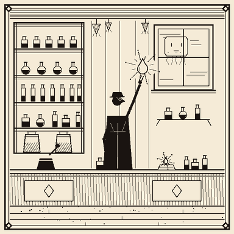{ .news-pic width="96" loading="lazy" }</td>
<td markdown="span">Apotheker treiben die Preise für Ghast-Tränen für Heiltränke hoch!</td>
<td markdown="span">`ghast_tear_apothecary_craze`<br><details class="json-toggle"><summary>JSON</summary></details></td>
<td markdown="span">{ .item-icon .no-zoom width="32" } `ghast_tear`</td>
<td markdown="span">{ .effect-chart .no-zoom width="64" }<br>:material-arrow-up-bold:{ .news-up }:material-arrow-up-bold:{ .news-up }:material-arrow-up-bold:{ .news-up } +40% shock</td>
</tr>
<tr class="event-json" markdown>
<td colspan="5" markdown="block">

```json
{
  "id": "ghast_tear_apothecary_craze",
  "picture": "ghast_tear_apothecary_craze.png",
  "headline": {
    "en_us": "Apothecaries bid up ghast tears for healing tonics!",
    "zh_cn": "药剂师为治疗药剂哄抬恶魂之泪！",
    "de_de": "Apotheker treiben die Preise für Ghast-Tränen für Heiltränke hoch!"
  },
  "text": {
    "en_us": "A sudden craze for regeneration tonics has the apothecaries' guild bidding furiously on every ghast tear that reaches the market. Brave delvers who face the wailing beasts of the Nether are being paid a king's ransom, and prices have spiked overnight.",
    "zh_cn": "一股对生命恢复药剂的骤然热捧，让药剂师公会对每一滴上市恶魂之泪疯狂竞价。敢于直面下界哀嚎恶兽的勇士获得国王级的报酬，价格一夜暴涨。",
    "de_de": "Ein plötzlicher Rausch um Regenerationstränke lässt die Apothekergilde erbittert um jede Ghast-Träne bieten, die den Markt erreicht. Mutige Delver, die sich den heulenden Bestien des Nethers stellen, werden fürstlich entlohnt, und die Preise sind über Nacht in die Höhe geschossen."
  },
  "category": "commodities",
  "weight": 4,
  "cooldownSeconds": 14400,
  "impact": {
    "type": "shock",
    "peakFactor": 0.4,
    "durationSeconds": 1500,
    "reversal": "exponential",
    "reversalSeconds": 3600,
    "noise": 0.05
  },
  "markets": [
    {
      "item": "minecraft:ghast_tear",
      "weightFactor": 1.0
    }
  ]
}
```

</td>
</tr>
<tr markdown>
<td markdown="span">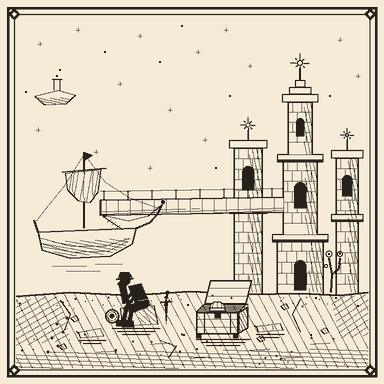{ .news-pic width="96" loading="lazy" }</td>
<td markdown="span">End-Raubzüge stocken - Shulker-Schalen dauerhaft knapp</td>
<td markdown="span">`shulker_shell_shortage`<br><details class="json-toggle"><summary>JSON</summary></details></td>
<td markdown="span">{ .item-icon .no-zoom width="32" } `shulker_shell`</td>
<td markdown="span">{ .effect-chart .no-zoom width="64" }<br>:material-arrow-up-bold:{ .news-up }:material-arrow-up-bold:{ .news-up } +30%, dauerhaft</td>
</tr>
<tr class="event-json" markdown>
<td colspan="5" markdown="block">

```json
{
  "id": "shulker_shell_shortage",
  "picture": "shulker_shell_shortage.png",
  "headline": {
    "en_us": "End raids stall - shulker shells scarce for good",
    "zh_cn": "末地突袭停滞——潜影壳永久稀缺",
    "de_de": "End-Raubzüge stocken - Shulker-Schalen dauerhaft knapp"
  },
  "text": {
    "en_us": "The raiding parties that once stripped the End cities have stalled, and the flow of shulker shells has all but dried up. With no new supply in sight, traders warn that the shortage is structural - the elevated price is here to stay.",
    "zh_cn": "曾洗劫末地城的突袭队陷入停滞，潜影壳的供给几近干涸。看不到新增供给，商人警告这次短缺是结构性的——高价位将长期维持。",
    "de_de": "Die Raubzüge, die einst die End-Städte plünderten, sind ins Stocken geraten, und der Nachschub an Shulker-Schalen ist so gut wie versiegt. Da kein neues Angebot in Sicht ist, warnen Händler, dass die Knappheit struktureller Natur ist - der erhöhte Preis bleibt."
  },
  "category": "commodities",
  "weight": 3,
  "cooldownSeconds": 43200,
  "impact": {
    "type": "trend",
    "peakFactor": 0.3,
    "rampUpSeconds": 1200,
    "durationSeconds": 3000,
    "reversal": "none"
  },
  "markets": [
    {
      "item": "minecraft:shulker_shell",
      "weightFactor": 1.0
    }
  ]
}
```

</td>
</tr>
<tr markdown>
<td markdown="span">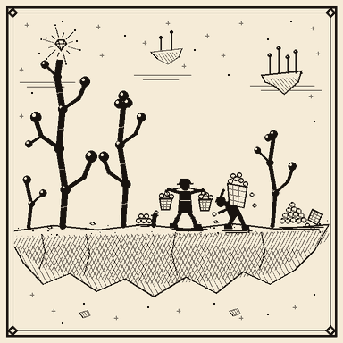{ .news-pic width="96" loading="lazy" }</td>
<td markdown="span">Äußere Inseln bringen eine Chorusfrucht-Schwemme</td>
<td markdown="span">`chorus_fruit_bumper_harvest`<br><details class="json-toggle"><summary>JSON</summary></details></td>
<td markdown="span">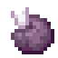{ .item-icon .no-zoom width="32" } `chorus_fruit`<br>{ .item-icon .no-zoom width="32" } `popped_chorus_fruit` ×0.7</td>
<td markdown="span">{ .effect-chart .no-zoom width="64" }<br>:material-arrow-down-bold:{ .news-down }:material-arrow-down-bold:{ .news-down } −25% trend</td>
</tr>
<tr class="event-json" markdown>
<td colspan="5" markdown="block">

```json
{
  "id": "chorus_fruit_bumper_harvest",
  "picture": "chorus_fruit_bumper_harvest.png",
  "headline": {
    "en_us": "Outer islands yield a chorus-fruit glut",
    "zh_cn": "外岛紫颂果大丰收，市场过剩",
    "de_de": "Äußere Inseln bringen eine Chorusfrucht-Schwemme"
  },
  "text": {
    "en_us": "The chorus plants of the outer End islands have grown wild this season, and returning delvers are hauling back more fruit than the markets can absorb. With popped chorus fruit piling up beside it in the warehouses, prices are drifting steadily lower.",
    "zh_cn": "本季末地外岛的紫颂植株疯长，返航的探险者带回的果实超出市场消化能力。爆裂紫颂果在仓库里堆积，价格持续走低。",
    "de_de": "Die Choruspflanzen der äußeren End-Inseln sind in dieser Saison wild gewuchert, und heimkehrende Delver bringen mehr Früchte zurück, als die Märkte aufnehmen können. Da sich geplatzte Chorusfrüchte daneben in den Lagern stapeln, geben die Preise stetig nach."
  },
  "category": "commodities",
  "weight": 5,
  "cooldownSeconds": 7200,
  "impact": {
    "type": "trend",
    "peakFactor": -0.25,
    "rampUpSeconds": 900,
    "durationSeconds": 2700,
    "reversal": "ramp",
    "reversalSeconds": 2400,
    "noise": 0.03
  },
  "markets": [
    {
      "item": "minecraft:chorus_fruit",
      "weightFactor": 1.0
    },
    {
      "item": "minecraft:popped_chorus_fruit",
      "weightFactor": 0.7
    }
  ]
}
```

</td>
</tr>
<tr markdown>
<td markdown="span">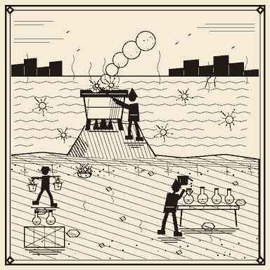{ .news-pic width="96" loading="lazy" }</td>
<td markdown="span">Feuerresistenz-Brauerei treibt die Magmacreme-Nachfrage</td>
<td markdown="span">`magma_cream_alchemy_demand`<br><details class="json-toggle"><summary>JSON</summary></details></td>
<td markdown="span">{ .item-icon .no-zoom width="32" } `magma_cream`</td>
<td markdown="span">{ .effect-chart .no-zoom width="64" }<br>:material-arrow-up-bold:{ .news-up }:material-arrow-up-bold:{ .news-up } +26% trend</td>
</tr>
<tr class="event-json" markdown>
<td colspan="5" markdown="block">

```json
{
  "id": "magma_cream_alchemy_demand",
  "picture": "magma_cream_alchemy_demand.png",
  "headline": {
    "en_us": "Fire-resistance brewing drives magma-cream demand",
    "zh_cn": "抗火药水酿造拉动岩浆膏需求",
    "de_de": "Feuerresistenz-Brauerei treibt die Magmacreme-Nachfrage"
  },
  "text": {
    "en_us": "With expeditions pushing ever deeper into the lava seas, brewers cannot mix fire-resistance potions fast enough. Magma cream is the key ingredient, and the alchemists' guild is buying every batch the slime-and-blaze hunters can render down.",
    "zh_cn": "探险队不断深入熔岩海，酿造师调配抗火药水的速度根本跟不上。岩浆膏是关键原料，炼金师公会正收购猎手们熬制的每一批货。",
    "de_de": "Da Expeditionen immer tiefer in die Lavameere vordringen, kommen die Brauer mit dem Mischen von Feuerresistenz-Tränken nicht hinterher. Magmacreme ist die Schlüsselzutat, und die Alchemistengilde kauft jede Charge auf, die die Schleim- und Lohenjäger auslassen können."
  },
  "category": "commodities",
  "weight": 6,
  "cooldownSeconds": 10800,
  "impact": {
    "type": "trend",
    "peakFactor": 0.26,
    "rampUpSeconds": 750,
    "durationSeconds": 2400,
    "reversal": "ramp",
    "reversalSeconds": 2700,
    "noise": 0.04
  },
  "markets": [
    {
      "item": "minecraft:magma_cream",
      "weightFactor": 1.0
    }
  ]
}
```

</td>
</tr>
<tr markdown>
<td markdown="span">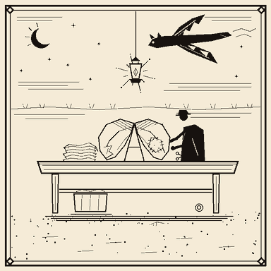{ .news-pic width="96" loading="lazy" }</td>
<td markdown="span">Ansturm auf Elytren-Reparaturen leert die Membranvorräte</td>
<td markdown="span">`phantom_membrane_repair_run`<br><details class="json-toggle"><summary>JSON</summary></details></td>
<td markdown="span">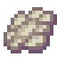{ .item-icon .no-zoom width="32" } `phantom_membrane`</td>
<td markdown="span">{ .effect-chart .no-zoom width="64" }<br>:material-arrow-up-bold:{ .news-up }:material-arrow-up-bold:{ .news-up } +30% trend</td>
</tr>
<tr class="event-json" markdown>
<td colspan="5" markdown="block">

```json
{
  "id": "phantom_membrane_repair_run",
  "picture": "phantom_membrane_repair_run.png",
  "headline": {
    "en_us": "Rush to repair elytra empties membrane stocks",
    "zh_cn": "鞘翅抢修潮扫空幻翼膜库存",
    "de_de": "Ansturm auf Elytren-Reparaturen leert die Membranvorräte"
  },
  "text": {
    "en_us": "After a season of hard flying, every glider-pilot in the realm is scrambling to patch worn elytra - and only phantom membrane will do the job. Night-hunters cannot down the phantoms fast enough, and membrane prices are climbing with every torn wing.",
    "zh_cn": "一季高强度飞行之后，境内每位滑翔者都在急着修补磨损的鞘翅——而只有幻翼膜管用。夜猎者击杀幻翼的速度赶不上需求，每多一片破损的翅膀，幻翼膜价格就再涨一分。",
    "de_de": "Nach einer Saison harten Fliegens versucht jeder Gleiter-Pilot des Reiches, abgenutzte Elytren zu flicken - und nur Phantommembranen taugen dafür. Die Nachtjäger können die Phantome nicht schnell genug erlegen, und die Membranpreise klettern mit jedem zerrissenen Flügel."
  },
  "category": "commodities",
  "weight": 5,
  "cooldownSeconds": 10800,
  "impact": {
    "type": "trend",
    "peakFactor": 0.3,
    "rampUpSeconds": 900,
    "durationSeconds": 2100,
    "reversal": "ramp",
    "reversalSeconds": 2700,
    "noise": 0.04
  },
  "markets": [
    {
      "item": "minecraft:phantom_membrane",
      "weightFactor": 1.0
    }
  ]
}
```

</td>
</tr>
<tr markdown>
<td markdown="span">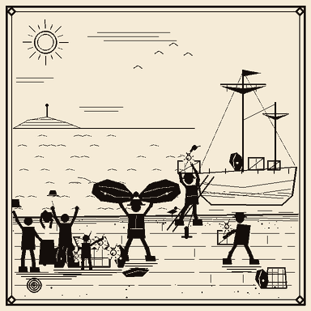{ .news-pic width="96" loading="lazy" }</td>
<td markdown="span">Triumphale End-Expedition überschwemmt den Markt mit Relikten!</td>
<td markdown="span">`end_expedition_returns`<br><details class="json-toggle"><summary>JSON</summary></details></td>
<td markdown="span">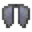{ .item-icon .no-zoom width="32" } `elytra`<br>{ .item-icon .no-zoom width="32" } `dragon_breath` ×0.6</td>
<td markdown="span">{ .effect-chart .no-zoom width="64" }<br>:material-arrow-down-bold:{ .news-down }:material-arrow-down-bold:{ .news-down }:material-arrow-down-bold:{ .news-down } −40% crash<br>Bedingungen</td>
</tr>
<tr class="event-json" markdown>
<td colspan="5" markdown="block">

```json
{
  "id": "end_expedition_returns",
  "picture": "end_expedition_returns.png",
  "headline": {
    "en_us": "Triumphant End expedition floods the market with relics!",
    "zh_cn": "末地远征凯旋，遗迹之物涌入市场！",
    "de_de": "Triumphale End-Expedition überschwemmt den Markt mit Relikten!"
  },
  "text": {
    "en_us": "A great expedition has returned from the End in triumph, its ships laden with elytra and vials of dragon's breath. The sudden flood of once-priceless relics has sent prices crashing as buyers realize the scarcity is broken - at least for now.",
    "zh_cn": "一支大型探险队自末地凯旋，船上满载鞘翅与龙息瓶。曾经无价的遗迹之物骤然涌入，买家意识到稀缺已被打破，价格应声暴跌——至少眼下如此。",
    "de_de": "Eine große Expedition ist im Triumph aus dem End zurückgekehrt, ihre Schiffe beladen mit Elytren und Fläschchen voll Drachenatem. Die plötzliche Schwemme einst unbezahlbarer Relikte hat die Preise abstürzen lassen, als den Käufern klar wurde, dass die Knappheit gebrochen ist - zumindest vorerst."
  },
  "category": "commodities",
  "weight": 2,
  "cooldownSeconds": 86400,
  "impact": {
    "type": "crash",
    "peakFactor": -0.4,
    "rampUpSeconds": 300,
    "durationSeconds": 1200,
    "reversal": "exponential",
    "reversalSeconds": 6000,
    "noise": 0.05
  },
  "markets": [
    {
      "item": "minecraft:elytra",
      "weightFactor": 1.0
    },
    {
      "item": "minecraft:dragon_breath",
      "weightFactor": 0.6
    }
  ],
  "requires": [
    {
      "type": "notFired",
      "eventId": "end_expedition_returns"
    }
  ],
  "records": {
    "frontier": "end_breached"
  }
}
```

</td>
</tr>
</tbody>
</table>

### Märkte (3) { #markets-3 }

<table markdown>
<thead>
<tr><th>Bild</th><th>Schlagzeile</th><th>ID</th><th>Märkte</th><th>Wirkung</th></tr>
</thead>
<tbody markdown>
<tr markdown>
<td markdown="span">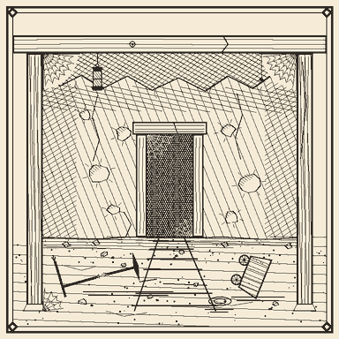{ .news-pic width="96" loading="lazy" }</td>
<td markdown="span">Erzblase geplatzt - Bergbauwerte im freien Fall!</td>
<td markdown="span">`ore_market_crash`<br><details class="json-toggle"><summary>JSON</summary></details></td>
<td markdown="span">{ .item-icon .no-zoom width="32" } `*_ore`<br>{ .item-icon .no-zoom width="32" } `raw_*` ×0.7</td>
<td markdown="span">{ .effect-chart .no-zoom width="64" }<br>:material-arrow-down-bold:{ .news-down }:material-arrow-down-bold:{ .news-down }:material-arrow-down-bold:{ .news-down } −50% crash</td>
</tr>
<tr class="event-json" markdown>
<td colspan="5" markdown="block">

```json
{
  "id": "ore_market_crash",
  "picture": "ore_market_crash.png",
  "headline": {
    "en_us": "Ore bubble bursts - mining stocks in free fall!",
    "zh_cn": "矿石泡沫破裂——矿类资产断崖下跌！",
    "de_de": "Erzblase geplatzt - Bergbauwerte im freien Fall!"
  },
  "text": {
    "en_us": "After months of speculation the ore bubble has finally burst. Panic selling grips every ore market as overleveraged traders liquidate their positions. Analysts expect a slow recovery.",
    "zh_cn": "历经数月炒作，矿石泡沫终于破裂。恐慌性抛售席卷每一个矿石市场，杠杆过高的交易者被迫平仓。分析师预计复苏将十分缓慢。",
    "de_de": "Nach Monaten der Spekulation ist die Erzblase endlich geplatzt. Panikverkäufe erfassen alle Erzmärkte, während überhebelte Händler ihre Positionen auflösen. Analysten erwarten eine langsame Erholung."
  },
  "category": "markets",
  "weight": 4,
  "cooldownSeconds": 21600,
  "impact": {
    "type": "crash",
    "peakFactor": -0.5,
    "durationSeconds": 900,
    "reversal": "exponential",
    "reversalSeconds": 6000
  },
  "markets": [
    { "item": "minecraft:*_ore", "weightFactor": 1.0 },
    { "item": "minecraft:raw_*", "weightFactor": 0.7 }
  ]
}
```

</td>
</tr>
<tr markdown>
<td markdown="span">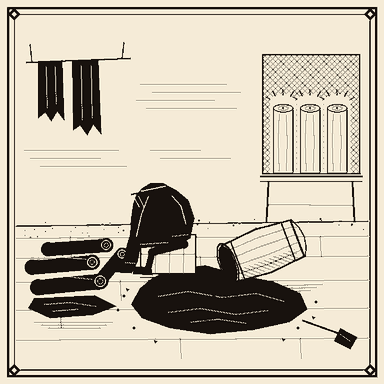{ .news-pic width="96" loading="lazy" }</td>
<td markdown="span">Handel mit Schwarzfärbemitteln bricht ein, als die Mode ins Helle kippt</td>
<td markdown="span">`ink_dye_market_crash`<br><details class="json-toggle"><summary>JSON</summary></details></td>
<td markdown="span">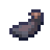{ .item-icon .no-zoom width="32" } `ink_sac`<br>{ .item-icon .no-zoom width="32" } `black_dye` ×0.8<br>{ .item-icon .no-zoom width="32" } `white_dye` ×−0.3</td>
<td markdown="span">{ .effect-chart .no-zoom width="64" }<br>:material-arrow-down-bold:{ .news-down }:material-arrow-down-bold:{ .news-down }:material-arrow-down-bold:{ .news-down } −40% crash</td>
</tr>
<tr class="event-json" markdown>
<td colspan="5" markdown="block">

```json
{
  "id": "ink_dye_market_crash",
  "picture": "ink_dye_market_crash.png",
  "headline": {
    "en_us": "Black-dye trade collapses as fashion turns pale",
    "zh_cn": "时尚转淡，黑色染料贸易崩塌",
    "de_de": "Handel mit Schwarzfärbemitteln bricht ein, als die Mode ins Helle kippt"
  },
  "text": {
    "en_us": "The season's taste has swung hard toward pale and undyed cloth, and the once-coveted black dye has fallen out of favour overnight. Warehouses full of ink sacs and finished black dye have lost their buyers, and dyers are dumping stock at any price. Pale and white dyes, by contrast, are suddenly the colour everyone wants.",
    "zh_cn": "本季审美急剧转向浅色与本色布料，曾备受追捧的黑色染料一夜失宠。堆满墨囊与成品黑色染料的仓库失去了买家，染工不惜任何价格抛售存货。相比之下，浅色与白色染料骤然成为人人争抢的颜色。",
    "de_de": "Der Geschmack der Saison ist hart zu blassem und ungefärbtem Tuch umgeschwenkt, und das einst begehrte Schwarz ist über Nacht aus der Mode gefallen. Lagerhäuser voller Tintenbeutel und fertigem Schwarzfärbemittel haben ihre Käufer verloren, und die Färber verramschen ihre Bestände zu jedem Preis. Blasse und weiße Farben hingegen sind mit einem Mal das, was alle wollen."
  },
  "category": "markets",
  "weight": 4,
  "cooldownSeconds": 14400,
  "impact": {
    "type": "crash",
    "peakFactor": -0.4,
    "durationSeconds": 900,
    "reversal": "exponential",
    "reversalSeconds": 6000,
    "noise": 0.04
  },
  "markets": [
    {
      "item": "minecraft:ink_sac",
      "weightFactor": 1.0
    },
    {
      "item": "minecraft:black_dye",
      "weightFactor": 0.8
    },
    {
      "item": "minecraft:white_dye",
      "weightFactor": -0.3
    }
  ]
}
```

</td>
</tr>
<tr markdown>
<td markdown="span">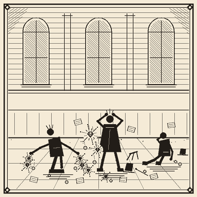{ .news-pic width="96" loading="lazy" }</td>
<td markdown="span">Nachschussforderungen radieren überhebelte Händler in einer Kettenreaktion aus!</td>
<td markdown="span">`margin_call_crash`<br><details class="json-toggle"><summary>JSON</summary></details></td>
<td markdown="span">{ .item-icon .no-zoom width="32" } `diamond`<br>{ .item-icon .no-zoom width="32" } `emerald` ×0.8<br>{ .item-icon .no-zoom width="32" } `gold_ingot` ×0.6</td>
<td markdown="span">{ .effect-chart .no-zoom width="64" }<br>:material-arrow-down-bold:{ .news-down }:material-arrow-down-bold:{ .news-down }:material-arrow-down-bold:{ .news-down } −45% crash<br>Bedingungen; Gewicht 0</td>
</tr>
<tr class="event-json" markdown>
<td colspan="5" markdown="block">

```json
{
  "id": "margin_call_crash",
  "picture": "margin_call_crash.png",
  "headline": {
    "en_us": "Margin calls wipe out overleveraged traders in a cascade!",
    "zh_cn": "追加保证金连锁爆发，高杠杆交易者全线覆灭！",
    "de_de": "Nachschussforderungen radieren überhebelte Händler in einer Kettenreaktion aus!"
  },
  "text": {
    "en_us": "The lenders have called in their loans all at once, and traders who bought the mania on borrowed coin cannot pay. Forced liquidations are feeding on themselves - every sale drives the price lower, triggering the next margin call - and diamonds, emeralds and gold are cascading downward with no floor in sight.",
    "zh_cn": "放贷方同时催收贷款，靠借来的钱追涨的交易者无力偿付。强制平仓自我强化——每一笔抛售都压低价格，触发下一轮追保——钻石、绿宝石与黄金一路坠落，看不到底。",
    "de_de": "Die Geldverleiher haben ihre Kredite alle auf einmal fällig gestellt, und Händler, die den Rausch auf Pump gekauft haben, können nicht zahlen. Zwangsverkäufe nähren sich selbst - jeder Verkauf drückt den Preis tiefer und löst die nächste Nachschussforderung aus -, und Diamanten, Smaragde und Gold stürzen kaskadenartig ins Bodenlose."
  },
  "category": "markets",
  "weight": 0,
  "cooldownSeconds": 14400,
  "impact": {
    "type": "crash",
    "peakFactor": -0.45,
    "durationSeconds": 900,
    "reversal": "exponential",
    "reversalSeconds": 6000,
    "noise": 0.05
  },
  "markets": [
    {
      "item": "minecraft:diamond",
      "weightFactor": 1.0
    },
    {
      "item": "minecraft:emerald",
      "weightFactor": 0.8
    },
    {
      "item": "minecraft:gold_ingot",
      "weightFactor": 0.6
    }
  ],
  "requires": [
    {
      "type": "firedBefore",
      "eventId": "speculation_mania",
      "minSecondsAgo": 60
    }
  ]
}
```

</td>
</tr>
</tbody>
</table>

### Politik (7) { #politics-7 }

<table markdown>
<thead>
<tr><th>Bild</th><th>Schlagzeile</th><th>ID</th><th>Märkte</th><th>Wirkung</th></tr>
</thead>
<tbody markdown>
<tr markdown>
<td markdown="span">{ .news-pic width="96" loading="lazy" }</td>
<td markdown="span">Handelsrat führt den Goldstandard ein!</td>
<td markdown="span">`gold_reserve_standard`<br><details class="json-toggle"><summary>JSON</summary></details></td>
<td markdown="span">{ .item-icon .no-zoom width="32" } `gold_ingot`</td>
<td markdown="span">{ .effect-chart .no-zoom width="64" }<br>:material-arrow-up-bold:{ .news-up }:material-arrow-up-bold:{ .news-up } +25%, dauerhaft<br>Bedingungen; Kette → `gold_rush_rumor`</td>
</tr>
<tr class="event-json" markdown>
<td colspan="5" markdown="block">

```json
{
  "id": "gold_reserve_standard",
  "picture": "gold_reserve_standard.png",
  "headline": {
    "en_us": "Trade council adopts the gold standard!",
    "zh_cn": "贸易议会确立金本位！",
    "de_de": "Handelsrat führt den Goldstandard ein!"
  },
  "text": {
    "en_us": "The trade council has voted to back all inter-village trade with gold reserves. Demand for gold is expected to remain permanently elevated - a structural shift, not a passing rally.",
    "zh_cn": "贸易议会已投票通过，以黄金储备为所有村庄间贸易提供支撑。黄金需求预计将永久性走高——这是结构性转变，而非一时涨势。",
    "de_de": "Der Handelsrat hat beschlossen, den gesamten Handel zwischen den Dörfern mit Goldreserven zu decken. Die Goldnachfrage dürfte dauerhaft erhöht bleiben - ein struktureller Wandel, keine kurzfristige Rally."
  },
  "category": "politics",
  "weight": 2,
  "cooldownSeconds": 86400,
  "impact": {
    "type": "trend",
    "peakFactor": 0.25,
    "rampUpSeconds": 1500,
    "durationSeconds": 3000,
    "reversal": "none"
  },
  "markets": [
    { "item": "minecraft:gold_ingot", "weightFactor": 1.0 }
  ],
  "requires": [
    { "type": "notFired", "eventId": "gold_reserve_standard" }
  ],
  "records": { "era": "gold_standard" },
  "chains": [
    { "eventId": "gold_rush_rumor", "on": "step", "step": "hold", "chance": 0.5, "delaySeconds": { "min": 300, "max": 900 } }
  ]
}
```

</td>
</tr>
<tr markdown>
<td markdown="span">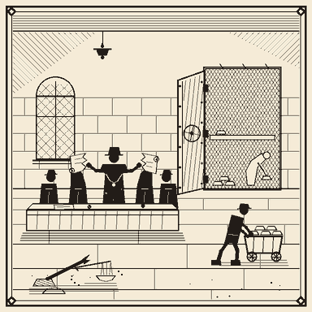{ .news-pic width="96" loading="lazy" }</td>
<td markdown="span">Handelsrat schafft den Goldstandard ab!</td>
<td markdown="span">`end_of_gold_standard`<br><details class="json-toggle"><summary>JSON</summary></details></td>
<td markdown="span">{ .item-icon .no-zoom width="32" } `gold_ingot`</td>
<td markdown="span">{ .effect-chart .no-zoom width="64" }<br>:material-arrow-down-bold:{ .news-down } −20%, dauerhaft<br>Bedingungen</td>
</tr>
<tr class="event-json" markdown>
<td colspan="5" markdown="block">

```json
{
  "id": "end_of_gold_standard",
  "picture": "end_of_gold_standard.png",
  "headline": {
    "en_us": "Trade council abandons the gold standard!",
    "zh_cn": "贸易议会放弃金本位！",
    "de_de": "Handelsrat schafft den Goldstandard ab!"
  },
  "text": {
    "en_us": "After years of gold-backed trade the council has voted to untie inter-village commerce from its gold reserves. The structural demand that propped up the gold price is gone, and analysts expect the old premium to unwind for good.",
    "zh_cn": "在多年以黄金支撑贸易之后，议会投票决定将村庄间商贸与黄金储备脱钩。曾经支撑金价的结构性需求已然消失，分析师预计旧有的溢价将彻底回吐。",
    "de_de": "Nach Jahren goldgedeckten Handels hat der Rat beschlossen, den Handel zwischen den Dörfern von den Goldreserven zu lösen. Die strukturelle Nachfrage, die den Goldpreis stützte, ist damit Geschichte, und Analysten erwarten, dass sich der alte Aufschlag dauerhaft abbaut."
  },
  "category": "politics",
  "weight": 2,
  "cooldownSeconds": 86400,
  "impact": {
    "type": "crash",
    "peakFactor": -0.2,
    "rampUpSeconds": 300,
    "durationSeconds": 1500,
    "reversal": "none"
  },
  "markets": [
    { "item": "minecraft:gold_ingot", "weightFactor": 1.0 }
  ],
  "requires": [
    { "type": "firedBefore", "eventId": "gold_reserve_standard", "minSecondsAgo": 10800 },
    { "type": "notFired",    "eventId": "end_of_gold_standard" },
    { "type": "keyEquals",   "key": "era", "value": "gold_standard" }
  ],
  "records": { "era": "fiat" }
}
```

</td>
</tr>
<tr markdown>
<td markdown="span">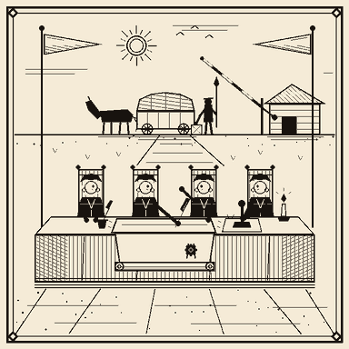{ .news-pic width="96" loading="lazy" }</td>
<td markdown="span">Handelsrat unterzeichnet umfassenden Einfuhrzoll-Vertrag</td>
<td markdown="span">`import_tariff_treaty`<br><details class="json-toggle"><summary>JSON</summary></details></td>
<td markdown="span">{ .item-icon .no-zoom width="32" } `iron_ingot`<br>{ .item-icon .no-zoom width="32" } `gold_ingot` ×0.8</td>
<td markdown="span">{ .effect-chart .no-zoom width="64" }<br>:material-arrow-up-bold:{ .news-up } +18%, dauerhaft<br>Bedingungen</td>
</tr>
<tr class="event-json" markdown>
<td colspan="5" markdown="block">

```json
{
  "id": "import_tariff_treaty",
  "picture": "import_tariff_treaty.png",
  "headline": {
    "en_us": "Trade council signs sweeping import tariff treaty",
    "zh_cn": "贸易议会签署全面进口关税协定",
    "de_de": "Handelsrat unterzeichnet umfassenden Einfuhrzoll-Vertrag"
  },
  "text": {
    "en_us": "After months of negotiation the trade council has signed a sweeping import tariff treaty on foreign metals. Cross-border shipments of iron and gold will carry a permanent surcharge - analysts expect the premium to become the new normal price.",
    "zh_cn": "经过数月谈判，贸易议会就外国金属签署了一项全面的进口关税协定。铁与金的跨境运输将被永久加征费用——分析师预计该溢价将成为新的常态价格。",
    "de_de": "Nach monatelangen Verhandlungen hat der Handelsrat einen umfassenden Einfuhrzoll-Vertrag auf ausländische Metalle unterzeichnet. Grenzüberschreitende Lieferungen von Eisen und Gold tragen künftig einen dauerhaften Aufschlag - Analysten erwarten, dass der Zuschlag zum neuen Normalpreis wird."
  },
  "category": "politics",
  "weight": 1,
  "cooldownSeconds": 86400,
  "impact": {
    "type": "trend",
    "peakFactor": 0.18,
    "rampUpSeconds": 1200,
    "durationSeconds": 2400,
    "reversal": "none"
  },
  "markets": [
    { "item": "minecraft:iron_ingot", "weightFactor": 1.0 },
    { "item": "minecraft:gold_ingot", "weightFactor": 0.8 }
  ],
  "requires": [
    { "type": "notFired", "eventId": "import_tariff_treaty" }
  ]
}
```

</td>
</tr>
<tr markdown>
<td markdown="span">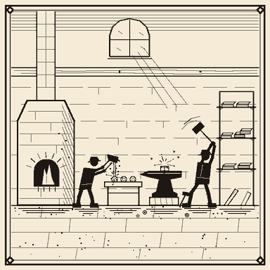{ .news-pic width="96" loading="lazy" }</td>
<td markdown="span">Die Münze prägt das Reichsgeld neu!</td>
<td markdown="span">`mint_recoinage_reform`<br><details class="json-toggle"><summary>JSON</summary></details></td>
<td markdown="span">{ .item-icon .no-zoom width="32" } `gold_ingot`<br>{ .item-icon .no-zoom width="32" } `iron_ingot` ×0.6</td>
<td markdown="span">{ .effect-chart .no-zoom width="64" }<br>:material-arrow-up-bold:{ .news-up }:material-arrow-up-bold:{ .news-up } +28%, dauerhaft<br>Bedingungen</td>
</tr>
<tr class="event-json" markdown>
<td colspan="5" markdown="block">

```json
{
  "id": "mint_recoinage_reform",
  "picture": "mint_recoinage_reform.png",
  "headline": {
    "en_us": "The mint recoins the realm's currency!",
    "zh_cn": "铸币厂重铸全国通货！",
    "de_de": "Die Münze prägt das Reichsgeld neu!"
  },
  "text": {
    "en_us": "By decree of the trade council the royal mint has begun recoining every coin in circulation to a heavier gold-and-iron standard. Every old piece must be melted and struck anew, and the mint's insatiable demand for metal is expected to keep prices structurally elevated for good.",
    "zh_cn": "依贸易议会法令，皇家铸币厂开始将流通中的每一枚钱币按更重的金铁标准重铸。所有旧币必须熔毁重打，铸币厂对金属的贪求预计将把价格永久性地维持在高位。",
    "de_de": "Auf Erlass des Handelsrats hat die königliche Münze begonnen, jede umlaufende Münze auf einen schwereren Gold-und-Eisen-Standard umzuprägen. Jedes alte Stück muss eingeschmolzen und neu geschlagen werden, und der unstillbare Metallhunger der Münze dürfte die Preise dauerhaft strukturell erhöht halten."
  },
  "category": "politics",
  "weight": 2,
  "cooldownSeconds": 86400,
  "impact": {
    "type": "trend",
    "peakFactor": 0.28,
    "rampUpSeconds": 1500,
    "durationSeconds": 3000,
    "reversal": "none"
  },
  "markets": [
    {
      "item": "minecraft:gold_ingot",
      "weightFactor": 1.0
    },
    {
      "item": "minecraft:iron_ingot",
      "weightFactor": 0.6
    }
  ],
  "requires": [
    {
      "type": "notFired",
      "eventId": "mint_recoinage_reform"
    }
  ],
  "records": {
    "currency": "reformed"
  }
}
```

</td>
</tr>
<tr markdown>
<td markdown="span">{ .news-pic width="96" loading="lazy" }</td>
<td markdown="span">Handelsrat verhängt Embargo auf alle ausländischen Metalle!</td>
<td markdown="span">`metals_export_embargo`<br><details class="json-toggle"><summary>JSON</summary></details></td>
<td markdown="span">{ .item-icon .no-zoom width="32" } `iron_ingot`<br>{ .item-icon .no-zoom width="32" } `copper_ingot` ×0.8<br>{ .item-icon .no-zoom width="32" } `gold_ingot` ×0.6</td>
<td markdown="span">{ .effect-chart .no-zoom width="64" }<br>:material-arrow-up-bold:{ .news-up } +24%, dauerhaft</td>
</tr>
<tr class="event-json" markdown>
<td colspan="5" markdown="block">

```json
{
  "id": "metals_export_embargo",
  "picture": "metals_export_embargo.png",
  "headline": {
    "en_us": "Trade council embargoes all foreign metals!",
    "zh_cn": "贸易议会禁运所有外国金属！",
    "de_de": "Handelsrat verhängt Embargo auf alle ausländischen Metalle!"
  },
  "text": {
    "en_us": "In a bid to protect the home foundries the trade council has slammed an embargo on every foreign metal crossing the border. With cheap imports cut off, domestic iron, copper and gold lose their foreign competition - analysts expect home prices to settle permanently higher.",
    "zh_cn": "为保护本土铸造业，贸易议会已对所有跨境的外国金属实施禁运。廉价进口被切断，本国铁、铜与金失去外来竞争——分析师预计国内价格将永久性走高。",
    "de_de": "Um die heimischen Gießereien zu schützen, hat der Handelsrat ein Embargo auf jedes ausländische Metall verhängt, das die Grenze überquert. Da die billigen Einfuhren wegfallen, verlieren heimisches Eisen, Kupfer und Gold ihre ausländische Konkurrenz - Analysten erwarten dauerhaft höhere Inlandspreise."
  },
  "category": "politics",
  "weight": 2,
  "cooldownSeconds": 86400,
  "impact": {
    "type": "trend",
    "peakFactor": 0.24,
    "rampUpSeconds": 1200,
    "durationSeconds": 2700,
    "reversal": "none"
  },
  "markets": [
    {
      "item": "minecraft:iron_ingot",
      "weightFactor": 1.0
    },
    {
      "item": "minecraft:copper_ingot",
      "weightFactor": 0.8
    },
    {
      "item": "minecraft:gold_ingot",
      "weightFactor": 0.6
    }
  ]
}
```

</td>
</tr>
<tr markdown>
<td markdown="span">{ .news-pic width="96" loading="lazy" }</td>
<td markdown="span">Rat erhebt saftige Luxussteuer auf Edelsteine und Gold</td>
<td markdown="span">`luxury_goods_tax`<br><details class="json-toggle"><summary>JSON</summary></details></td>
<td markdown="span">{ .item-icon .no-zoom width="32" } `diamond`<br>{ .item-icon .no-zoom width="32" } `emerald` ×0.8<br>{ .item-icon .no-zoom width="32" } `gold_ingot` ×0.6</td>
<td markdown="span">{ .effect-chart .no-zoom width="64" }<br>:material-arrow-down-bold:{ .news-down } −20%, dauerhaft<br>Bedingungen</td>
</tr>
<tr class="event-json" markdown>
<td colspan="5" markdown="block">

```json
{
  "id": "luxury_goods_tax",
  "picture": "luxury_goods_tax.png",
  "headline": {
    "en_us": "Council levies steep luxury tax on gems and gold",
    "zh_cn": "议会对宝石与黄金课以重税",
    "de_de": "Rat erhebt saftige Luxussteuer auf Edelsteine und Gold"
  },
  "text": {
    "en_us": "To fill the war chest the trade council has slapped a punishing luxury tax on every sale of diamonds, emeralds and gold. Buyers are balking at the new surcharge, demand for finery is cooling sharply, and analysts expect the chill on luxury prices to last for as long as the tax stays on the books.",
    "zh_cn": "为充实战备金库，贸易议会对钻石、绿宝石与黄金的每笔交易课以惩罚性奢侈税。买家面对新增费用望而却步，奢侈品需求急剧降温，分析师预计只要这项税收仍在实施，这轮寒潮就会一直持续。",
    "de_de": "Um die Kriegskasse zu füllen, hat der Handelsrat eine drückende Luxussteuer auf jeden Verkauf von Diamanten, Smaragden und Gold verhängt. Käufer schrecken vor dem neuen Aufschlag zurück, die Nachfrage nach Prunk kühlt merklich ab, und Analysten erwarten, dass die Preisdämpfung im Luxussegment anhält, solange die Steuer in Kraft bleibt."
  },
  "category": "politics",
  "weight": 2,
  "cooldownSeconds": 86400,
  "impact": {
    "type": "trend",
    "peakFactor": -0.2,
    "rampUpSeconds": 1200,
    "durationSeconds": 2700,
    "reversal": "none"
  },
  "markets": [
    {
      "item": "minecraft:diamond",
      "weightFactor": 1.0
    },
    {
      "item": "minecraft:emerald",
      "weightFactor": 0.8
    },
    {
      "item": "minecraft:gold_ingot",
      "weightFactor": 0.6
    }
  ],
  "requires": [
    { "type": "keyNotEquals", "key": "luxury_tax", "value": "active" }
  ],
  "records": { "luxury_tax": "active" }
}
```

</td>
</tr>
<tr markdown>
<td markdown="span">{ .news-pic width="96" loading="lazy" }</td>
<td markdown="span">Rat schafft die Luxussteuer auf Edelsteine und Gold ab</td>
<td markdown="span">`luxury_tax_repealed`<br><details class="json-toggle"><summary>JSON</summary></details></td>
<td markdown="span">{ .item-icon .no-zoom width="32" } `diamond`<br>{ .item-icon .no-zoom width="32" } `emerald` ×0.8<br>{ .item-icon .no-zoom width="32" } `gold_ingot` ×0.6</td>
<td markdown="span">{ .effect-chart .no-zoom width="64" }<br>:material-arrow-up-bold:{ .news-up } +22%, dauerhaft<br>Bedingungen; hebt `luxury_goods_tax` auf</td>
</tr>
<tr class="event-json" markdown>
<td colspan="5" markdown="block">

```json
{
  "id": "luxury_tax_repealed",
  "picture": "luxury_tax_repealed.png",
  "headline": {
    "en_us": "Council scraps the luxury tax on gems and gold",
    "zh_cn": "议会废除宝石与黄金奢侈税",
    "de_de": "Rat schafft die Luxussteuer auf Edelsteine und Gold ab"
  },
  "text": {
    "en_us": "After months of empty jewellers' shops and loud protests from the guilds, the trade council has repealed the luxury tax on diamonds, emeralds and gold. Merchants are dusting off their display cases, and buyers who held back are expected to return to the market.",
    "zh_cn": "在珠宝店门可罗雀数月、行会抗议声浪不断之后，贸易议会废除了对钻石、绿宝石与黄金征收的奢侈税。商人们正擦去展柜上的灰尘，此前持币观望的买家预计将重返市场。",
    "de_de": "Nach Monaten leerer Juweliergeschäfte und lautstarker Proteste der Gilden hat der Handelsrat die Luxussteuer auf Diamanten, Smaragde und Gold aufgehoben. Die Händler stauben ihre Vitrinen ab, und Käufer, die sich zurückgehalten haben, dürften an den Markt zurückkehren."
  },
  "category": "politics",
  "weight": 2,
  "cooldownSeconds": 86400,
  "impact": {
    "type": "trend",
    "peakFactor": 0.22,
    "rampUpSeconds": 1200,
    "durationSeconds": 2700,
    "reversal": "none"
  },
  "markets": [
    {
      "item": "minecraft:diamond",
      "weightFactor": 1.0
    },
    {
      "item": "minecraft:emerald",
      "weightFactor": 0.8
    },
    {
      "item": "minecraft:gold_ingot",
      "weightFactor": 0.6
    }
  ],
  "requires": [
    { "type": "firedBefore", "eventId": "luxury_goods_tax", "minSecondsAgo": 172800 },
    { "type": "keyEquals",   "key": "luxury_tax", "value": "active" }
  ],
  "records": { "luxury_tax": "repealed" },
  "undoes": "luxury_goods_tax"
}
```

</td>
</tr>
</tbody>
</table>

### Gerüchte (3) { #rumors-3 }

<table markdown>
<thead>
<tr><th>Bild</th><th>Schlagzeile</th><th>ID</th><th>Märkte</th><th>Wirkung</th></tr>
</thead>
<tbody markdown>
<tr markdown>
<td markdown="span">{ .news-pic width="96" loading="lazy" }</td>
<td markdown="span">Gerüchte über riesigen Goldfund fegen über das Parkett!</td>
<td markdown="span">`gold_rush_rumor`<br><details class="json-toggle"><summary>JSON</summary></details></td>
<td markdown="span">{ .item-icon .no-zoom width="32" } `gold_ingot`</td>
<td markdown="span">{ .effect-chart .no-zoom width="64" }<br>Geschichte: `pump_and_dump` oder `fizzle`</td>
</tr>
<tr class="event-json" markdown>
<td colspan="5" markdown="block">

```json
{
  "id": "gold_rush_rumor",
  "picture": "gold_rush_rumor.png",
  "headline": {
    "en_us": "Rumors of a massive gold strike sweep the trading floor!",
    "zh_cn": "巨额金矿传闻席卷交易大厅！",
    "de_de": "Gerüchte über riesigen Goldfund fegen über das Parkett!"
  },
  "text": {
    "en_us": "Whispers of an enormous gold vein have traders piling into gold. Nobody has actually seen the nugget yet - seasoned brokers warn that rumors like this often collapse as fast as they spread, punishing whoever buys the top.",
    "zh_cn": "坊间盛传发现巨型金矿，交易者纷纷涌入黄金。然而至今无人真正见过那块金块——资深经纪人警告，此类传闻往往传播得多快、崩塌得就多快，追高者将付出代价。",
    "de_de": "Geflüster über eine gewaltige Goldader treibt die Händler in den Goldmarkt. Gesehen hat den Fund bisher niemand - erfahrene Makler warnen, dass solche Gerüchte oft so schnell zusammenbrechen, wie sie sich verbreiten, und den Letzten beißen die Hunde."
  },
  "category": "rumors",
  "weight": 6,
  "cooldownSeconds": 10800,
  "sequences": [
    {
      "name": "pump_and_dump",
      "weight": 2,
      "steps": [
        { "name": "hype",     "durationSeconds": { "min": 450, "max": 1200 }, "targetFactor": 0.4,   "curve": "linear",      "noise": 0.05 },
        { "name": "peak",     "durationSeconds": { "min": 300, "max": 600 },                        "curve": "hold",        "noise": 0.08 },
        { "name": "sell_off", "durationSeconds": { "min": 100, "max": 300 },  "targetFactor": -0.15, "curve": "exponential", "noise": 0.04,
          "markets": [
            { "item": "minecraft:gold_ingot", "weightFactor": 1.0 },
            { "item": "minecraft:raw_gold",   "weightFactor": 0.6 }
          ] },
        { "name": "recover",  "durationSeconds": 1500, "targetFactor": 0.0, "curve": "linear" }
      ]
    },
    {
      "name": "fizzle",
      "weight": 1,
      "steps": [
        { "name": "stir",   "durationSeconds": { "min": 300, "max": 600 }, "targetFactor": 0.15, "curve": "linear", "noise": 0.04 },
        { "name": "denial", "durationSeconds": { "min": 300, "max": 900 }, "targetFactor": 0.0,  "curve": "exponential" }
      ]
    }
  ],
  "markets": [
    { "item": "minecraft:gold_ingot", "weightFactor": 1.0 }
  ]
}
```

</td>
</tr>
<tr markdown>
<td markdown="span">{ .news-pic width="96" loading="lazy" }</td>
<td markdown="span">Spekulanten stürzen sich auf Amethyst - wilde Gerüchte!</td>
<td markdown="span">`amethyst_speculation`<br><details class="json-toggle"><summary>JSON</summary></details></td>
<td markdown="span">{ .item-icon .no-zoom width="32" } `amethyst_shard`</td>
<td markdown="span">{ .effect-chart .no-zoom width="64" }<br>Geschichte: `pump_and_dump` oder `fizzle`</td>
</tr>
<tr class="event-json" markdown>
<td colspan="5" markdown="block">

```json
{
  "id": "amethyst_speculation",
  "picture": "amethyst_speculation.png",
  "headline": {
    "en_us": "Speculators pile into amethyst on wild rumors!",
    "zh_cn": "投机者凭离奇传闻涌入紫水晶！",
    "de_de": "Spekulanten stürzen sich auf Amethyst - wilde Gerüchte!"
  },
  "text": {
    "en_us": "Whispers of a secret royal amethyst commission have traders bidding the crystal up hard, though nobody can name a source. Seasoned brokers caution that speculation like this often peaks in a frenzy and collapses just as fast - and sometimes the story never gets off the ground at all.",
    "zh_cn": "传闻王室有一笔秘密紫水晶采购，交易者据此大举推高价格，却无人能说清消息来源。资深经纪人告诫，这类投机往往在狂热中见顶、又以同样的速度崩塌——有时故事压根就没开始过。",
    "de_de": "Gerüchte über einen geheimen königlichen Amethyst-Auftrag treiben die Händler dazu, den Kristall kräftig hochzubieten, auch wenn niemand eine Quelle nennen kann. Erfahrene Makler warnen, dass solche Spekulationen oft in einem Rausch gipfeln und ebenso schnell zusammenbrechen - und manchmal kommt die Geschichte gar nicht erst in Fahrt."
  },
  "category": "rumors",
  "weight": 6,
  "cooldownSeconds": 10800,
  "sequences": [
    {
      "name": "pump_and_dump",
      "weight": 2,
      "steps": [
        {
          "name": "hype",
          "durationSeconds": {
            "min": 450,
            "max": 1200
          },
          "targetFactor": 0.4,
          "curve": "linear",
          "noise": 0.05
        },
        {
          "name": "peak",
          "durationSeconds": {
            "min": 300,
            "max": 600
          },
          "curve": "hold",
          "noise": 0.08
        },
        {
          "name": "sell_off",
          "durationSeconds": {
            "min": 100,
            "max": 300
          },
          "targetFactor": -0.15,
          "curve": "exponential",
          "noise": 0.04
        },
        {
          "name": "recover",
          "durationSeconds": 1500,
          "targetFactor": 0.0,
          "curve": "linear"
        }
      ]
    },
    {
      "name": "fizzle",
      "weight": 1,
      "steps": [
        {
          "name": "stir",
          "durationSeconds": {
            "min": 300,
            "max": 600
          },
          "targetFactor": 0.15,
          "curve": "linear",
          "noise": 0.04
        },
        {
          "name": "denial",
          "durationSeconds": {
            "min": 300,
            "max": 900
          },
          "targetFactor": 0.0,
          "curve": "exponential"
        }
      ]
    }
  ],
  "markets": [
    {
      "item": "minecraft:amethyst_shard",
      "weightFactor": 1.0
    }
  ]
}
```

</td>
</tr>
<tr markdown>
<td markdown="span">{ .news-pic width="96" loading="lazy" }</td>
<td markdown="span">Spekulationsrausch erfasst das Parkett!</td>
<td markdown="span">`speculation_mania`<br><details class="json-toggle"><summary>JSON</summary></details></td>
<td markdown="span">{ .item-icon .no-zoom width="32" } `diamond`<br>{ .item-icon .no-zoom width="32" } `emerald` ×0.8<br>{ .item-icon .no-zoom width="32" } `gold_ingot` ×0.6</td>
<td markdown="span">{ .effect-chart .no-zoom width="64" }<br>Geschichte: `euphoria` oder `cooler_heads`<br>Kette → `margin_call_crash`</td>
</tr>
<tr class="event-json" markdown>
<td colspan="5" markdown="block">

```json
{
  "id": "speculation_mania",
  "picture": "speculation_mania.png",
  "headline": {
    "en_us": "Speculative mania grips the trading floor!",
    "zh_cn": "投机狂热笼罩交易大厅！",
    "de_de": "Spekulationsrausch erfasst das Parkett!"
  },
  "text": {
    "en_us": "A frenzy has seized the trading floor - clerks and courtiers alike are borrowing against their homes to pile into diamonds, emeralds and gold. Seasoned brokers mutter that manias like this always end the same way, but for now the only word on every tongue is 'buy'.",
    "zh_cn": "交易大厅陷入狂热——书记员与廷臣纷纷抵押房产，涌入钻石、绿宝石与黄金。资深经纪人低声说，这类狂热结局总是相同，但眼下人人挂在嘴边的只有一个词：买。",
    "de_de": "Ein Rausch hat das Parkett gepackt - Schreiber wie Höflinge beleihen ihre Häuser, um sich in Diamanten, Smaragde und Gold zu stürzen. Erfahrene Makler murmeln, dass solche Manien immer gleich enden, doch vorerst kennt jeder Mund nur ein Wort: 'kaufen'."
  },
  "category": "rumors",
  "weight": 4,
  "cooldownSeconds": 14400,
  "sequences": [
    {
      "name": "euphoria",
      "weight": 2,
      "steps": [
        {
          "name": "buildup",
          "durationSeconds": {
            "min": 600,
            "max": 1500
          },
          "targetFactor": 0.35,
          "curve": "linear",
          "noise": 0.05
        },
        {
          "name": "blowoff",
          "durationSeconds": {
            "min": 300,
            "max": 750
          },
          "curve": "hold",
          "noise": 0.08
        },
        {
          "name": "crash",
          "durationSeconds": {
            "min": 150,
            "max": 450
          },
          "targetFactor": -0.25,
          "curve": "exponential",
          "noise": 0.06
        },
        {
          "name": "settle",
          "durationSeconds": 1500,
          "targetFactor": 0.0,
          "curve": "linear"
        }
      ]
    },
    {
      "name": "cooler_heads",
      "weight": 1,
      "steps": [
        {
          "name": "rally",
          "durationSeconds": {
            "min": 450,
            "max": 900
          },
          "targetFactor": 0.18,
          "curve": "linear",
          "noise": 0.04
        },
        {
          "name": "fade",
          "durationSeconds": {
            "min": 600,
            "max": 1200
          },
          "targetFactor": 0.0,
          "curve": "exponential"
        }
      ]
    }
  ],
  "markets": [
    {
      "item": "minecraft:diamond",
      "weightFactor": 1.0
    },
    {
      "item": "minecraft:emerald",
      "weightFactor": 0.8
    },
    {
      "item": "minecraft:gold_ingot",
      "weightFactor": 0.6
    }
  ],
  "chains": [
    {
      "eventId": "margin_call_crash",
      "on": "completion",
      "chance": 0.6,
      "delaySeconds": {
        "min": 300,
        "max": 900
      }
    }
  ]
}
```

</td>
</tr>
</tbody>
</table>

### Kriminalität (4) { #crime-4 }

<table markdown>
<thead>
<tr><th>Bild</th><th>Schlagzeile</th><th>ID</th><th>Märkte</th><th>Wirkung</th></tr>
</thead>
<tbody markdown>
<tr markdown>
<td markdown="span">{ .news-pic width="96" loading="lazy" }</td>
<td markdown="span">Gefälschte Smaragde überschwemmen den Markt!</td>
<td markdown="span">`emerald_counterfeit_scandal`<br><details class="json-toggle"><summary>JSON</summary></details></td>
<td markdown="span">{ .item-icon .no-zoom width="32" } `emerald`<br>{ .item-icon .no-zoom width="32" } `emerald_block`</td>
<td markdown="span">{ .effect-chart .no-zoom width="64" }<br>:material-arrow-down-bold:{ .news-down }:material-arrow-down-bold:{ .news-down }:material-arrow-down-bold:{ .news-down } −40% crash<br>nur für Admins</td>
</tr>
<tr class="event-json" markdown>
<td colspan="5" markdown="block">

```json
{
  "id": "emerald_counterfeit_scandal",
  "picture": "emerald_counterfeit_scandal.png",
  "headline": {
    "en_us": "Counterfeit emeralds flood the market!",
    "zh_cn": "假绿宝石充斥市场！",
    "de_de": "Gefälschte Smaragde überschwemmen den Markt!"
  },
  "text": {
    "en_us": "Inspectors have uncovered a large-scale counterfeiting ring. Confidence in emerald certificates has collapsed and villagers are refusing payment in gems until audits conclude.",
    "zh_cn": "稽查人员破获一个大规模造假团伙。绿宝石鉴定证书的信誉已然崩塌，在审计结束之前，村民拒绝以宝石支付。",
    "de_de": "Inspektoren haben einen groß angelegten Fälscherring aufgedeckt. Das Vertrauen in Smaragdzertifikate ist eingebrochen, und Dorfbewohner verweigern Edelstein-Zahlungen, bis die Prüfungen abgeschlossen sind."
  },
  "category": "crime",
  "weight": 5,
  "cooldownSeconds": 14400,
  "adminOnly": true,
  "impact": {
    "type": "crash",
    "peakFactor": -0.4,
    "reversalSeconds": 4500
  },
  "markets": [
    { "item": "minecraft:emerald",       "weightFactor": 1.0 },
    { "item": "minecraft:emerald_block", "weightFactor": 1.0 }
  ]
}
```

</td>
</tr>
<tr markdown>
<td markdown="span">{ .news-pic width="96" loading="lazy" }</td>
<td markdown="span">Kartell verknappt den Quarz - Preise unter Druck!</td>
<td markdown="span">`quartz_cartel_squeeze`<br><details class="json-toggle"><summary>JSON</summary></details></td>
<td markdown="span">{ .item-icon .no-zoom width="32" } `quartz`</td>
<td markdown="span">{ .effect-chart .no-zoom width="64" }<br>:material-arrow-up-bold:{ .news-up }:material-arrow-up-bold:{ .news-up }:material-arrow-up-bold:{ .news-up } +45% shock<br>nur für Admins</td>
</tr>
<tr class="event-json" markdown>
<td colspan="5" markdown="block">

```json
{
  "id": "quartz_cartel_squeeze",
  "picture": "quartz_cartel_squeeze.png",
  "headline": {
    "en_us": "Cartel corners quartz supply - prices squeezed!",
    "zh_cn": "卡特尔垄断石英供给——价格被挤压！",
    "de_de": "Kartell verknappt den Quarz - Preise unter Druck!"
  },
  "text": {
    "en_us": "Word from the back rooms is that a ring of merchants has quietly bought up every quartz shipment leaving the nether portals. With the supply locked in their vaults and buyers left scrambling, the price has been squeezed sharply upward overnight - a manipulation the trade council is said to be investigating.",
    "zh_cn": "据密室消息，一个商人集团已悄然买下所有运出下界传送门的石英。供给被锁进他们的金库，买家四处奔走，价格一夜之间被大幅推高——据说贸易议会正在调查这起操纵行为。",
    "de_de": "Aus den Hinterzimmern heißt es, ein Ring von Händlern habe still und heimlich jede Quarzlieferung aufgekauft, die die Netherportale verlässt. Da der Nachschub in ihren Gewölben liegt und die Käufer im Regen stehen, wurde der Preis über Nacht scharf nach oben getrieben - eine Manipulation, gegen die der Handelsrat angeblich bereits ermittelt."
  },
  "category": "crime",
  "weight": 3,
  "cooldownSeconds": 28800,
  "adminOnly": true,
  "impact": {
    "type": "shock",
    "peakFactor": 0.45,
    "durationSeconds": 1500,
    "reversal": "exponential",
    "reversalSeconds": 3000,
    "noise": 0.05
  },
  "markets": [
    {
      "item": "minecraft:quartz",
      "weightFactor": 1.0
    }
  ]
}
```

</td>
</tr>
<tr markdown>
<td markdown="span">{ .news-pic width="96" loading="lazy" }</td>
<td markdown="span">Gefälschte Goldmünzen überschwemmen den Markt - das Vertrauen bricht ein!</td>
<td markdown="span">`counterfeit_coin_scandal`<br><details class="json-toggle"><summary>JSON</summary></details></td>
<td markdown="span">{ .item-icon .no-zoom width="32" } `gold_ingot`</td>
<td markdown="span">{ .effect-chart .no-zoom width="64" }<br>:material-arrow-down-bold:{ .news-down }:material-arrow-down-bold:{ .news-down }:material-arrow-down-bold:{ .news-down } −42% crash<br>nur für Admins</td>
</tr>
<tr class="event-json" markdown>
<td colspan="5" markdown="block">

```json
{
  "id": "counterfeit_coin_scandal",
  "picture": "counterfeit_coin_scandal.png",
  "headline": {
    "en_us": "Counterfeit gold coin floods the market - trust collapses!",
    "zh_cn": "假金币涌入市场——信任崩塌！",
    "de_de": "Gefälschte Goldmünzen überschwemmen den Markt - das Vertrauen bricht ein!"
  },
  "text": {
    "en_us": "A smuggling ring has flooded the realm with expertly forged gold coin, and no one can tell true metal from lead-cored fakes. Assayers are refusing gold at the counter until every hoard is tested, and the panic to dump suspect coin has sent the gold market into free fall.",
    "zh_cn": "一个走私团伙把工艺精湛的伪金币灌入境内，无人能分辨真金与铅芯假货。验金师在逐批检验之前拒收黄金，恐慌性抛售可疑钱币令黄金市场直线坠落。",
    "de_de": "Ein Schmugglerring hat das Reich mit meisterhaft gefälschten Goldmünzen überschwemmt, und niemand kann echtes Metall von bleigefüllten Fälschungen unterscheiden. Prüfmeister verweigern Gold am Tresen, bis jeder Hort geprüft ist, und die Panik, verdächtige Münzen abzustoßen, hat den Goldmarkt in den freien Fall gestürzt."
  },
  "category": "crime",
  "weight": 3,
  "cooldownSeconds": 21600,
  "adminOnly": true,
  "impact": {
    "type": "crash",
    "peakFactor": -0.42,
    "durationSeconds": 900,
    "reversal": "exponential",
    "reversalSeconds": 5000,
    "noise": 0.05
  },
  "markets": [
    {
      "item": "minecraft:gold_ingot",
      "weightFactor": 1.0
    }
  ]
}
```

</td>
</tr>
<tr markdown>
<td markdown="span">{ .news-pic width="96" loading="lazy" }</td>
<td markdown="span">Kühner Tresorraub leert die Edelsteinbörse!</td>
<td markdown="span">`gemstone_heist`<br><details class="json-toggle"><summary>JSON</summary></details></td>
<td markdown="span">{ .item-icon .no-zoom width="32" } `diamond`<br>{ .item-icon .no-zoom width="32" } `emerald` ×0.8</td>
<td markdown="span">{ .effect-chart .no-zoom width="64" }<br>:material-arrow-up-bold:{ .news-up }:material-arrow-up-bold:{ .news-up }:material-arrow-up-bold:{ .news-up } +40% shock<br>News nach der Preisbewegung</td>
</tr>
<tr class="event-json" markdown>
<td colspan="5" markdown="block">

```json
{
  "id": "gemstone_heist",
  "picture": "gemstone_heist.png",
  "headline": {
    "en_us": "Daring vault heist empties the gem exchange!",
    "zh_cn": "大胆金库劫案掏空宝石交易所！",
    "de_de": "Kühner Tresorraub leert die Edelsteinbörse!"
  },
  "text": {
    "en_us": "Thieves cracked the gem exchange's deepest vault overnight and made off with its entire diamond and emerald reserve. By the time the theft was announced, prices had already lurched upward - insiders, it seems, knew the stones were gone before the watch ever raised the alarm.",
    "zh_cn": "窃贼一夜之间撬开宝石交易所最深处的金库，卷走了全部钻石与绿宝石储备。等到失窃公告发布，价格早已跳涨——看来内部人士在守卫拉响警报之前就已知道宝石不翼而飞。",
    "de_de": "Diebe knackten über Nacht das tiefste Gewölbe der Edelsteinbörse und machten sich mit ihrer gesamten Diamant- und Smaragdreserve davon. Als der Diebstahl bekannt gegeben wurde, waren die Preise bereits nach oben gesprungen - Eingeweihte wussten offenbar vom Verschwinden der Steine, bevor die Wache überhaupt Alarm schlug."
  },
  "category": "crime",
  "weight": 4,
  "cooldownSeconds": 14400,
  "announceDelayMs": {
    "min": -45000,
    "max": -15000
  },
  "impact": {
    "type": "shock",
    "peakFactor": 0.4,
    "durationSeconds": 1500,
    "reversal": "exponential",
    "reversalSeconds": 3600,
    "noise": 0.05
  },
  "markets": [
    {
      "item": "minecraft:diamond",
      "weightFactor": 1.0
    },
    {
      "item": "minecraft:emerald",
      "weightFactor": 0.8
    }
  ]
}
```

</td>
</tr>
</tbody>
</table>

### Technologie (2) { #technology-2 }

<table markdown>
<thead>
<tr><th>Bild</th><th>Schlagzeile</th><th>ID</th><th>Märkte</th><th>Wirkung</th></tr>
</thead>
<tbody markdown>
<tr markdown>
<td markdown="span">{ .news-pic width="96" loading="lazy" }</td>
<td markdown="span">Technischer Durchbruch verdoppelt Redstone-Effizienz!</td>
<td markdown="span">`redstone_breakthrough`<br><details class="json-toggle"><summary>JSON</summary></details></td>
<td markdown="span">{ .item-icon .no-zoom width="32" } `redstone`</td>
<td markdown="span">{ .effect-chart .no-zoom width="64" }<br>:material-arrow-up-bold:{ .news-up }:material-arrow-up-bold:{ .news-up } +30% trend<br>News vor der Preisbewegung</td>
</tr>
<tr class="event-json" markdown>
<td colspan="5" markdown="block">

```json
{
  "id": "redstone_breakthrough",
  "picture": "redstone_breakthrough.png",
  "headline": {
    "en_us": "Engineering breakthrough doubles redstone efficiency!",
    "zh_cn": "工程学突破：红石效率翻倍！",
    "de_de": "Technischer Durchbruch verdoppelt Redstone-Effizienz!"
  },
  "text": {
    "en_us": "A guild of engineers has published a compact circuit design that halves the redstone needed for common contraptions. Workshops across the land are ordering dust in bulk to retool.",
    "zh_cn": "一个工程师公会公布了紧凑型电路设计，使常见机械所需的红石减半。各地工坊正大批订购红石粉以改造设备。",
    "de_de": "Eine Ingenieursgilde hat ein kompaktes Schaltungsdesign veröffentlicht, das den Redstone-Bedarf gängiger Konstruktionen halbiert. Werkstätten im ganzen Land bestellen Staub in großen Mengen für die Umrüstung."
  },
  "category": "technology",
  "weight": 8,
  "cooldownSeconds": 10800,
  "announceDelayMs": { "min": 15000, "max": 90000 },
  "impact": {
    "type": "trend",
    "peakFactor": 0.3,
    "rampUpSeconds": 900,
    "durationSeconds": 2400,
    "reversal": "ramp",
    "reversalSeconds": 3000
  },
  "markets": [
    { "item": "minecraft:redstone", "weightFactor": 1.0 }
  ]
}
```

</td>
</tr>
<tr markdown>
<td markdown="span">{ .news-pic width="96" loading="lazy" }</td>
<td markdown="span">Verzauberungs-Manie treibt die Lapis-Nachfrage in die Höhe!</td>
<td markdown="span">`lapis_enchanting_craze`<br><details class="json-toggle"><summary>JSON</summary></details></td>
<td markdown="span">{ .item-icon .no-zoom width="32" } `lapis_lazuli`<br>{ .item-icon .no-zoom width="32" } `lapis_block` ×0.8</td>
<td markdown="span">{ .effect-chart .no-zoom width="64" }<br>:material-arrow-up-bold:{ .news-up }:material-arrow-up-bold:{ .news-up } +30% trend<br>News vor der Preisbewegung</td>
</tr>
<tr class="event-json" markdown>
<td colspan="5" markdown="block">

```json
{
  "id": "lapis_enchanting_craze",
  "picture": "lapis_enchanting_craze.png",
  "headline": {
    "en_us": "Enchanting craze sends lapis demand soaring!",
    "zh_cn": "附魔热潮令青金石需求暴涨！",
    "de_de": "Verzauberungs-Manie treibt die Lapis-Nachfrage in die Höhe!"
  },
  "text": {
    "en_us": "A new fashion for enchanted gear has swept the guild halls, and every apprentice wants a stocked enchanting table. Lapis lazuli is suddenly the ingredient nobody can keep on the shelf, and traders who read the newspaper early may position themselves before the buying frenzy fully hits the market.",
    "zh_cn": "附魔装备的新风尚席卷公会大厅，每个学徒都想要一台备货充足的附魔台。青金石骤然成为无人能囤住货的原料，早早读到报纸的交易者或许能在抢购全面爆发前完成布局。",
    "de_de": "Eine neue Mode für verzauberte Ausrüstung hat die Gildenhallen erfasst, und jeder Lehrling will einen gut bestückten Zaubertisch. Lapislazuli ist plötzlich die Zutat, die niemand mehr im Regal halten kann, und wer die Zeitung früh liest, kann sich womöglich in Stellung bringen, bevor der Kaufrausch den Markt voll erfasst."
  },
  "category": "technology",
  "weight": 7,
  "cooldownSeconds": 10800,
  "announceDelayMs": {
    "min": 15000,
    "max": 90000
  },
  "impact": {
    "type": "trend",
    "peakFactor": 0.3,
    "rampUpSeconds": 900,
    "durationSeconds": 2400,
    "reversal": "ramp",
    "reversalSeconds": 3000,
    "noise": 0.04
  },
  "markets": [
    {
      "item": "minecraft:lapis_lazuli",
      "weightFactor": 1.0
    },
    {
      "item": "minecraft:lapis_block",
      "weightFactor": 0.8
    }
  ]
}
```

</td>
</tr>
</tbody>
</table>

### Wirtschaft (5) { #economy-5 }

<table markdown>
<thead>
<tr><th>Bild</th><th>Schlagzeile</th><th>ID</th><th>Märkte</th><th>Wirkung</th></tr>
</thead>
<tbody markdown>
<tr markdown>
<td markdown="span">{ .news-pic width="96" loading="lazy" }</td>
<td markdown="span">Bauboom treibt Holznachfrage auf Rekordhöhen</td>
<td markdown="span">`lumber_construction_boom`<br><details class="json-toggle"><summary>JSON</summary></details></td>
<td markdown="span">{ .item-icon .no-zoom width="32" } `#minecraft:logs`<br>{ .item-icon .no-zoom width="32" } `*_planks` ×0.6<br>{ .item-icon .no-zoom width="32" } `stone` ×−0.15</td>
<td markdown="span">{ .effect-chart .no-zoom width="64" }<br>:material-arrow-up-bold:{ .news-up }:material-arrow-up-bold:{ .news-up } +35% trend</td>
</tr>
<tr class="event-json" markdown>
<td colspan="5" markdown="block">

```json
{
  "id": "lumber_construction_boom",
  "picture": "lumber_construction_boom.png",
  "headline": {
    "en_us": "Construction boom drives lumber demand to record highs",
    "zh_cn": "建筑热潮推动木材需求创下新高",
    "de_de": "Bauboom treibt Holznachfrage auf Rekordhöhen"
  },
  "text": {
    "en_us": "Villages everywhere are expanding and carpenters cannot keep up. Sawmills report record order books, lifting prices across every kind of log while stone suppliers see orders quietly slip away.",
    "zh_cn": "各地村庄纷纷扩建，木匠已难以应付。锯木厂订单簿创下纪录，各类原木价格齐涨，而石料供应商则眼看着订单悄然流失。",
    "de_de": "Überall wachsen die Dörfer, und die Zimmerleute kommen nicht hinterher. Sägewerke melden Rekordaufträge, was die Preise für alle Holzarten steigen lässt, während Steinlieferanten stillschweigend Aufträge verlieren."
  },
  "category": "economy",
  "weight": 9,
  "cooldownSeconds": 7200,
  "impact": {
    "type": "trend",
    "peakFactor": 0.35,
    "rampUpSeconds": 750,
    "durationSeconds": 2250,
    "reversal": "ramp",
    "reversalSeconds": 2250,
    "noise": 0.03
  },
  "markets": [
    { "item": "#minecraft:logs",     "weightFactor": 1.0 },
    { "item": "minecraft:*_planks",  "weightFactor": 0.6 },
    { "item": "minecraft:stone",     "weightFactor": -0.15 }
  ]
}
```

</td>
</tr>
<tr markdown>
<td markdown="span">{ .news-pic width="96" loading="lazy" }</td>
<td markdown="span">Tiefer Steinbruch erschlossen - Tiefengestein dauerhaft billig</td>
<td markdown="span">`deepslate_quarry_expansion`<br><details class="json-toggle"><summary>JSON</summary></details></td>
<td markdown="span">{ .item-icon .no-zoom width="32" } `cobbled_deepslate`<br>{ .item-icon .no-zoom width="32" } `deepslate` ×0.8</td>
<td markdown="span">{ .effect-chart .no-zoom width="64" }<br>:material-arrow-down-bold:{ .news-down } −20%, dauerhaft</td>
</tr>
<tr class="event-json" markdown>
<td colspan="5" markdown="block">

```json
{
  "id": "deepslate_quarry_expansion",
  "picture": "deepslate_quarry_expansion.png",
  "headline": {
    "en_us": "Deep quarry opens - deepslate cheap for good",
    "zh_cn": "深部采石场开工——深板岩永久廉价",
    "de_de": "Tiefer Steinbruch erschlossen - Tiefengestein dauerhaft billig"
  },
  "text": {
    "en_us": "The trade council has bankrolled a vast quarry sunk to the deep stone layers, and cobbled deepslate now arrives in quantities the market has never seen. Analysts call it a structural shift, not a passing surplus - with the quarry running for years to come, cheap deepslate is simply the new normal.",
    "zh_cn": "贸易议会出资开凿了一座直抵深层岩的巨大采石场，深板岩圆石正以市场前所未见的规模流入。分析师称之为结构性转变而非一时过剩——采石场将运转多年，廉价深板岩就是新的常态。",
    "de_de": "Der Handelsrat hat einen gewaltigen Steinbruch bis in die tiefen Gesteinsschichten finanziert, und Bruch-Tiefengestein trifft nun in nie gekannten Mengen ein. Analysten sprechen von einem strukturellen Wandel, nicht von einem vorübergehenden Überschuss - da der Steinbruch noch jahrelang läuft, ist billiges Tiefengestein schlicht der neue Normalzustand."
  },
  "category": "economy",
  "weight": 5,
  "cooldownSeconds": 43200,
  "impact": {
    "type": "trend",
    "peakFactor": -0.2,
    "rampUpSeconds": 1200,
    "durationSeconds": 3000,
    "reversal": "none"
  },
  "markets": [
    {
      "item": "minecraft:cobbled_deepslate",
      "weightFactor": 1.0
    },
    {
      "item": "minecraft:deepslate",
      "weightFactor": 0.8
    }
  ]
}
```

</td>
</tr>
<tr markdown>
<td markdown="span">{ .news-pic width="96" loading="lazy" }</td>
<td markdown="span">Neue Flussplantagen machen Zuckerrohr dauerhaft billig</td>
<td markdown="span">`sugarcane_plantation_boom`<br><details class="json-toggle"><summary>JSON</summary></details></td>
<td markdown="span">{ .item-icon .no-zoom width="32" } `sugar_cane`<br>{ .item-icon .no-zoom width="32" } `sugar` ×0.8<br>{ .item-icon .no-zoom width="32" } `paper` ×0.4</td>
<td markdown="span">{ .effect-chart .no-zoom width="64" }<br>:material-arrow-down-bold:{ .news-down }:material-arrow-down-bold:{ .news-down } −25%, dauerhaft</td>
</tr>
<tr class="event-json" markdown>
<td colspan="5" markdown="block">

```json
{
  "id": "sugarcane_plantation_boom",
  "picture": "sugarcane_plantation_boom.png",
  "headline": {
    "en_us": "New river plantations turn sugar cane cheap for good",
    "zh_cn": "新建河畔种植园让甘蔗永久廉价",
    "de_de": "Neue Flussplantagen machen Zuckerrohr dauerhaft billig"
  },
  "text": {
    "en_us": "Vast new sugar-cane plantations have been established along the great river deltas, and the first barges are already arriving. The trade council expects the flood of cane to hold indefinitely, pressing the prices of sugar cane, refined sugar, and paper down to a permanently lower level.",
    "zh_cn": "大河流域新建起大片甘蔗种植园，首批驳船已经抵达。贸易议会预计这股甘蔗洪流将长期持续，把甘蔗、糖与纸的价格压至永久性低位。",
    "de_de": "Entlang der großen Flussdeltas sind weite neue Zuckerrohrplantagen entstanden, und die ersten Kähne treffen bereits ein. Der Handelsrat rechnet damit, dass die Rohrschwemme auf Dauer anhält, und drückt die Preise für Zuckerrohr, raffinierten Zucker und Papier auf ein dauerhaft niedrigeres Niveau."
  },
  "category": "economy",
  "weight": 5,
  "cooldownSeconds": 86400,
  "impact": {
    "type": "trend",
    "peakFactor": -0.25,
    "rampUpSeconds": 1200,
    "durationSeconds": 3000,
    "reversal": "none"
  },
  "markets": [
    {
      "item": "minecraft:sugar_cane",
      "weightFactor": 1.0
    },
    {
      "item": "minecraft:sugar",
      "weightFactor": 0.8
    },
    {
      "item": "minecraft:paper",
      "weightFactor": 0.4
    }
  ]
}
```

</td>
</tr>
<tr markdown>
<td markdown="span">{ .news-pic width="96" loading="lazy" }</td>
<td markdown="span">Neue Gerbereien lösen einen Ansturm auf Leder aus</td>
<td markdown="span">`leather_tannery_boom`<br><details class="json-toggle"><summary>JSON</summary></details></td>
<td markdown="span">{ .item-icon .no-zoom width="32" } `leather`<br>{ .item-icon .no-zoom width="32" } `#minecraft:wool` ×−0.25</td>
<td markdown="span">{ .effect-chart .no-zoom width="64" }<br>:material-arrow-up-bold:{ .news-up }:material-arrow-up-bold:{ .news-up } +30% trend</td>
</tr>
<tr class="event-json" markdown>
<td colspan="5" markdown="block">

```json
{
  "id": "leather_tannery_boom",
  "picture": "leather_tannery_boom.png",
  "headline": {
    "en_us": "New tanneries drive a run on leather",
    "zh_cn": "新制革坊引发皮革抢购",
    "de_de": "Neue Gerbereien lösen einen Ansturm auf Leder aus"
  },
  "text": {
    "en_us": "A cluster of new tanneries has opened along the river, and their appetite for hides is reshaping the whole leather trade. Saddlers, bookbinders and armourers are all bidding against one another, and prices are climbing steadily. Wool merchants grumble that the fashion for tooled leather is pulling custom away from their looms.",
    "zh_cn": "沿河新开了一批制革坊，它们对生皮的胃口正在重塑整个皮革贸易。马鞍匠、装订匠与甲匠彼此竞价，价格稳步攀升。羊毛商人抱怨，压花皮革的风尚正把客源从他们的织机上拉走。",
    "de_de": "Entlang des Flusses hat eine Reihe neuer Gerbereien eröffnet, und ihr Hunger nach Häuten krempelt den gesamten Lederhandel um. Sattler, Buchbinder und Waffenschmiede überbieten sich gegenseitig, und die Preise klettern stetig. Wollhändler murren, dass die Mode für gepunztes Leder ihnen die Kundschaft von den Webstühlen zieht."
  },
  "category": "economy",
  "weight": 7,
  "cooldownSeconds": 7200,
  "impact": {
    "type": "trend",
    "peakFactor": 0.3,
    "rampUpSeconds": 750,
    "durationSeconds": 2400,
    "reversal": "ramp",
    "reversalSeconds": 2700,
    "noise": 0.03
  },
  "markets": [
    {
      "item": "minecraft:leather",
      "weightFactor": 1.0
    },
    {
      "item": "#minecraft:wool",
      "weightFactor": -0.25
    }
  ]
}
```

</td>
</tr>
<tr markdown>
<td markdown="span">{ .news-pic width="96" loading="lazy" }</td>
<td markdown="span">Königliche Schatzkammer überschwemmt den Markt mit frischem Geld</td>
<td markdown="span">`treasury_stimulus_windfall`<br><details class="json-toggle"><summary>JSON</summary></details></td>
<td markdown="span">{ .item-icon .no-zoom width="32" } `diamond`<br>{ .item-icon .no-zoom width="32" } `gold_ingot` ×0.8<br>{ .item-icon .no-zoom width="32" } `emerald` ×0.8<br>{ .item-icon .no-zoom width="32" } `iron_ingot` ×0.6</td>
<td markdown="span">{ .effect-chart .no-zoom width="64" }<br>:material-arrow-up-bold:{ .news-up }:material-arrow-up-bold:{ .news-up } +30% trend<br>News vor der Preisbewegung</td>
</tr>
<tr class="event-json" markdown>
<td colspan="5" markdown="block">

```json
{
  "id": "treasury_stimulus_windfall",
  "picture": "treasury_stimulus_windfall.png",
  "headline": {
    "en_us": "Royal treasury floods the market with fresh coin",
    "zh_cn": "王室金库向市场倾注新币",
    "de_de": "Königliche Schatzkammer überschwemmt den Markt mit frischem Geld"
  },
  "text": {
    "en_us": "The royal treasury has opened its vaults, pouring newly minted coin into the markets to spur trade after a long lean season. With coin suddenly cheap and plentiful, merchants are rushing into hard assets - gems and gold above all - to preserve their wealth before the money loses its shine.",
    "zh_cn": "王室金库打开库门，把新铸钱币投入市场，以在漫长歉收季后刺激贸易。钱币骤然廉价且充裕，商人争相涌入硬资产——尤以宝石与黄金为甚——以求在货币失去光泽前保住财富。",
    "de_de": "Die königliche Schatzkammer hat ihre Gewölbe geöffnet und schüttet frisch geprägtes Geld in die Märkte, um den Handel nach einer langen mageren Zeit anzukurbeln. Da Münzen plötzlich billig und reichlich vorhanden sind, flüchten Händler in Sachwerte - vor allem Edelsteine und Gold -, um ihr Vermögen zu sichern, bevor das Geld seinen Glanz verliert."
  },
  "category": "economy",
  "weight": 6,
  "cooldownSeconds": 14400,
  "announceDelayMs": {
    "min": 30000,
    "max": 90000
  },
  "impact": {
    "type": "trend",
    "peakFactor": 0.3,
    "rampUpSeconds": 900,
    "durationSeconds": 2400,
    "reversal": "ramp",
    "reversalSeconds": 3000,
    "noise": 0.04
  },
  "markets": [
    {
      "item": "minecraft:diamond",
      "weightFactor": 1.0
    },
    {
      "item": "minecraft:gold_ingot",
      "weightFactor": 0.8
    },
    {
      "item": "minecraft:emerald",
      "weightFactor": 0.8
    },
    {
      "item": "minecraft:iron_ingot",
      "weightFactor": 0.6
    }
  ]
}
```

</td>
</tr>
</tbody>
</table>

### Katastrophen (8) { #disaster-8 }

<table markdown>
<thead>
<tr><th>Bild</th><th>Schlagzeile</th><th>ID</th><th>Märkte</th><th>Wirkung</th></tr>
</thead>
<tbody markdown>
<tr markdown>
<td markdown="span">{ .news-pic width="96" loading="lazy" }</td>
<td markdown="span">Heuschreckenschwarm verwüstet Felder - Grundnahrungsmittel werden knapp!</td>
<td markdown="span">`crop_pest_outbreak`<br><details class="json-toggle"><summary>JSON</summary></details></td>
<td markdown="span">{ .item-icon .no-zoom width="32" } `wheat`<br>{ .item-icon .no-zoom width="32" } `potato` ×0.9<br>{ .item-icon .no-zoom width="32" } `carrot` ×0.9<br>{ .item-icon .no-zoom width="32" } `bread` ×0.5</td>
<td markdown="span">{ .effect-chart .no-zoom width="64" }<br>:material-arrow-up-bold:{ .news-up }:material-arrow-up-bold:{ .news-up } +38% shock</td>
</tr>
<tr class="event-json" markdown>
<td colspan="5" markdown="block">

```json
{
  "id": "crop_pest_outbreak",
  "picture": "crop_pest_outbreak.png",
  "headline": {
    "en_us": "Locust swarm ravages farmland - staple crops in short supply!",
    "zh_cn": "蝗群肆虐农田——主粮供应告急！",
    "de_de": "Heuschreckenschwarm verwüstet Felder - Grundnahrungsmittel werden knapp!"
  },
  "text": {
    "en_us": "A massive locust swarm has descended on the central farmlands, devouring rows of wheat, potatoes, and carrots. With the fall harvest threatened, prices for staple crops are spiking as households and merchants scramble to secure supplies.",
    "zh_cn": "一场大规模蝗灾降临中部农区，成排的小麦、马铃薯与胡萝卜被啃食殆尽。秋收受到威胁，民众与商贩争相抢购，主粮价格急剧飙升。",
    "de_de": "Ein gewaltiger Heuschreckenschwarm hat sich über die zentralen Felder hergemacht und Weizen, Kartoffeln und Karotten kahlgefressen. Die Herbsternte steht auf der Kippe, und die Preise für Grundnahrungsmittel schießen nach oben, während Haushalte und Händler ihre Vorräte sichern."
  },
  "category": "disaster",
  "weight": 4,
  "cooldownSeconds": 7200,
  "impact": {
    "type": "shock",
    "peakFactor": 0.38,
    "durationSeconds": 1500,
    "reversal": "exponential",
    "reversalSeconds": 4500,
    "noise": 0.05
  },
  "markets": [
    { "item": "minecraft:wheat",  "weightFactor": 1.0 },
    { "item": "minecraft:potato", "weightFactor": 0.9 },
    { "item": "minecraft:carrot", "weightFactor": 0.9 },
    { "item": "minecraft:bread",  "weightFactor": 0.5 }
  ]
}
```

</td>
</tr>
<tr markdown>
<td markdown="span">{ .news-pic width="96" loading="lazy" }</td>
<td markdown="span">Vulkan bricht aus - Dörfer verschanzen sich gegen den Ascheregen!</td>
<td markdown="span">`volcanic_eruption`<br><details class="json-toggle"><summary>JSON</summary></details></td>
<td markdown="span">{ .item-icon .no-zoom width="32" } `obsidian`<br>{ .item-icon .no-zoom width="32" } `basalt` ×0.8<br>{ .item-icon .no-zoom width="32" } `blackstone` ×0.7</td>
<td markdown="span">{ .effect-chart .no-zoom width="64" }<br>:material-arrow-up-bold:{ .news-up }:material-arrow-up-bold:{ .news-up }:material-arrow-up-bold:{ .news-up } +48% shock<br>nur für Admins</td>
</tr>
<tr class="event-json" markdown>
<td colspan="5" markdown="block">

```json
{
  "id": "volcanic_eruption",
  "picture": "volcanic_eruption.png",
  "headline": {
    "en_us": "Volcano erupts - villages fortify against ashfall!",
    "zh_cn": "火山喷发——村庄加固以抵御火山灰！",
    "de_de": "Vulkan bricht aus - Dörfer verschanzen sich gegen den Ascheregen!"
  },
  "text": {
    "en_us": "A dormant volcano roared back to life overnight, blanketing the eastern reaches in ash. Villages are ordering obsidian, basalt and blackstone in bulk to reinforce shelters and dampen embers - defensive-stone traders have never seen a rush like this.",
    "zh_cn": "一座休眠火山一夜之间复苏，东部边陲被火山灰覆盖。村庄大批订购黑曜石、玄武岩与黑石以加固掩体、阻隔余烬——防护石料商人从未见过如此抢购。",
    "de_de": "Ein schlafender Vulkan ist über Nacht wieder erwacht und hat den Osten unter einer Ascheschicht begraben. Dörfer bestellen Obsidian, Basalt und Blackstone in großen Mengen, um Unterstände zu verstärken und Glutnester zu ersticken - Händler mit Verteidigungsgestein haben so einen Ansturm noch nie erlebt."
  },
  "category": "disaster",
  "weight": 2,
  "cooldownSeconds": 21600,
  "adminOnly": true,
  "impact": {
    "type": "shock",
    "peakFactor": 0.48,
    "durationSeconds": 2100,
    "reversal": "exponential",
    "reversalSeconds": 6000,
    "noise": 0.06
  },
  "markets": [
    { "item": "minecraft:obsidian",   "weightFactor": 1.0 },
    { "item": "minecraft:basalt",     "weightFactor": 0.8 },
    { "item": "minecraft:blackstone", "weightFactor": 0.7 }
  ]
}
```

</td>
</tr>
<tr markdown>
<td markdown="span">{ .news-pic width="96" loading="lazy" }</td>
<td markdown="span">Waldbrände fegen durch die Taiga - Holzpreise schnellen hoch!</td>
<td markdown="span">`great_forest_fire`<br><details class="json-toggle"><summary>JSON</summary></details></td>
<td markdown="span">{ .item-icon .no-zoom width="32" } `#minecraft:logs`<br>{ .item-icon .no-zoom width="32" } `*_planks` ×0.6</td>
<td markdown="span">{ .effect-chart .no-zoom width="64" }<br>Geschichte: `wildfire`<br>Kette → `great_forest_fire_recovery`</td>
</tr>
<tr class="event-json" markdown>
<td colspan="5" markdown="block">

```json
{
  "id": "great_forest_fire",
  "picture": "great_forest_fire.png",
  "headline": {
    "en_us": "Wildfires sweep the taiga - lumber prices spike!",
    "zh_cn": "野火席卷针叶林——木材价格飙升！",
    "de_de": "Waldbrände fegen durch die Taiga - Holzpreise schnellen hoch!"
  },
  "text": {
    "en_us": "Wildfires touched off by a dry lightning storm are racing through the northern taiga, consuming acres of timber a day. Sawmills warn of severe log shortages while the flames burn and orders are already being redirected to distant forests.",
    "zh_cn": "干旱雷暴引发的野火正在北部针叶林蔓延，每日吞噬大片林地。锯木厂警告原木将严重短缺，订单已在转向远方林区。",
    "de_de": "Waldbrände, ausgelöst durch ein trockenes Gewitter, rasen durch die nördliche Taiga und fressen täglich hektarweise Bauholz. Sägewerke warnen vor massiven Engpässen bei Baumstämmen, während die Flammen lodern, und Aufträge werden bereits in entfernte Wälder umgeleitet."
  },
  "category": "disaster",
  "weight": 3,
  "cooldownSeconds": 14400,
  "sequences": [
    {
      "name": "wildfire",
      "weight": 1,
      "steps": [
        { "name": "spark",     "durationSeconds": { "min": 300, "max": 600 },  "targetFactor": 0.15, "curve": "linear",      "noise": 0.03 },
        { "name": "spread",    "durationSeconds": { "min": 600, "max": 1200 }, "targetFactor": 0.40, "curve": "linear",      "noise": 0.05 },
        { "name": "inferno",   "durationSeconds": { "min": 450,  "max": 900 },                       "curve": "hold",        "noise": 0.07 },
        { "name": "contained", "durationSeconds": { "min": 600, "max": 1200 }, "targetFactor": 0.20, "curve": "exponential", "noise": 0.04 },
        { "name": "settle",    "durationSeconds": 1500, "targetFactor": 0.0, "curve": "linear" }
      ]
    }
  ],
  "markets": [
    { "item": "#minecraft:logs",    "weightFactor": 1.0 },
    { "item": "minecraft:*_planks", "weightFactor": 0.6 }
  ],
  "chains": [
    { "eventId": "great_forest_fire_recovery", "on": "completion", "chance": 0.7, "delaySeconds": { "min": 600, "max": 1800 } }
  ]
}
```

</td>
</tr>
<tr markdown>
<td markdown="span">{ .news-pic width="96" loading="lazy" }</td>
<td markdown="span">Krautfäule kehrt auf die Kartoffelfelder zurück!</td>
<td markdown="span">`potato_blight_return`<br><details class="json-toggle"><summary>JSON</summary></details></td>
<td markdown="span">{ .item-icon .no-zoom width="32" } `potato`<br>{ .item-icon .no-zoom width="32" } `baked_potato` ×0.6</td>
<td markdown="span">{ .effect-chart .no-zoom width="64" }<br>:material-arrow-up-bold:{ .news-up }:material-arrow-up-bold:{ .news-up }:material-arrow-up-bold:{ .news-up } +40% shock</td>
</tr>
<tr class="event-json" markdown>
<td colspan="5" markdown="block">

```json
{
  "id": "potato_blight_return",
  "picture": "potato_blight_return.png",
  "headline": {
    "en_us": "Blight returns to the potato fields!",
    "zh_cn": "枯萎病重返马铃薯田！",
    "de_de": "Krautfäule kehrt auf die Kartoffelfelder zurück!"
  },
  "text": {
    "en_us": "The dreaded blight has crept back into the potato fields overnight, blackening entire rows before the farmers could react. With the storehouses barely half full, prices for potatoes and baked potatoes are shooting up as households rush to secure what little remains.",
    "zh_cn": "可怕的枯萎病一夜之间重回马铃薯田，成排作物在农夫反应过来之前就已发黑。粮仓尚不满半，家家户户争抢所剩无几的存货，马铃薯与烤马铃薯价格骤涨。",
    "de_de": "Über Nacht hat sich die gefürchtete Krautfäule zurück auf die Kartoffelfelder geschlichen und ganze Reihen geschwärzt, ehe die Bauern reagieren konnten. Da die Vorratshäuser kaum halb voll sind, schießen die Preise für Kartoffeln und Ofenkartoffeln in die Höhe, während die Haushalte sich um die letzten Reste reißen."
  },
  "category": "disaster",
  "weight": 4,
  "cooldownSeconds": 7200,
  "impact": {
    "type": "shock",
    "peakFactor": 0.4,
    "durationSeconds": 1500,
    "reversal": "exponential",
    "reversalSeconds": 3600,
    "noise": 0.05
  },
  "markets": [
    {
      "item": "minecraft:potato",
      "weightFactor": 1.0
    },
    {
      "item": "minecraft:baked_potato",
      "weightFactor": 0.6
    }
  ]
}
```

</td>
</tr>
<tr markdown>
<td markdown="span">{ .news-pic width="96" loading="lazy" }</td>
<td markdown="span">Große Dürre verdorrt das Ackerland!</td>
<td markdown="span">`great_drought`<br><details class="json-toggle"><summary>JSON</summary></details></td>
<td markdown="span">{ .item-icon .no-zoom width="32" } `wheat`<br>{ .item-icon .no-zoom width="32" } `potato` ×0.9<br>{ .item-icon .no-zoom width="32" } `carrot` ×0.9<br>{ .item-icon .no-zoom width="32" } `beetroot` ×0.8</td>
<td markdown="span">{ .effect-chart .no-zoom width="64" }<br>:material-arrow-up-bold:{ .news-up }:material-arrow-up-bold:{ .news-up }:material-arrow-up-bold:{ .news-up } +40% shock<br>Kette → `grain_relief_convoy`</td>
</tr>
<tr class="event-json" markdown>
<td colspan="5" markdown="block">

```json
{
  "id": "great_drought",
  "picture": "great_drought.png",
  "headline": {
    "en_us": "Great drought scorches the croplands!",
    "zh_cn": "大旱炙烤农田！",
    "de_de": "Große Dürre verdorrt das Ackerland!"
  },
  "text": {
    "en_us": "Weeks without rain have turned the croplands to dust, and the wells are running dangerously low. Wheat wilts in the fields, root crops shrivel underground, and prices for every staple are surging as farmers and merchants brace for a hungry season.",
    "zh_cn": "数周无雨让农田化作尘土，水井水位低得危险。小麦在田里枯萎，块根作物在地下干瘪，农夫与商人都在为饥荒季节做准备，各类主粮价格全面飙升。",
    "de_de": "Wochen ohne Regen haben das Ackerland zu Staub werden lassen, und die Brunnen versiegen bedenklich. Der Weizen verwelkt auf den Feldern, die Wurzelfrüchte verkümmern im Boden, und die Preise für alle Grundnahrungsmittel schnellen empor, während sich Bauern und Händler auf eine hungrige Zeit einstellen."
  },
  "category": "disaster",
  "weight": 3,
  "cooldownSeconds": 21600,
  "impact": {
    "type": "shock",
    "peakFactor": 0.4,
    "durationSeconds": 1800,
    "reversal": "exponential",
    "reversalSeconds": 4500,
    "noise": 0.05
  },
  "markets": [
    {
      "item": "minecraft:wheat",
      "weightFactor": 1.0
    },
    {
      "item": "minecraft:potato",
      "weightFactor": 0.9
    },
    {
      "item": "minecraft:carrot",
      "weightFactor": 0.9
    },
    {
      "item": "minecraft:beetroot",
      "weightFactor": 0.8
    }
  ],
  "records": {
    "climate": "drought"
  },
  "chains": [
    {
      "eventId": "grain_relief_convoy",
      "on": "completion",
      "chance": 0.7,
      "delaySeconds": {
        "min": 600,
        "max": 1800
      }
    }
  ]
}
```

</td>
</tr>
<tr markdown>
<td markdown="span">{ .news-pic width="96" loading="lazy" }</td>
<td markdown="span">Rinderseuche rafft die Herden dahin - Fleisch und Häute werden knapp!</td>
<td markdown="span">`cattle_plague_outbreak`<br><details class="json-toggle"><summary>JSON</summary></details></td>
<td markdown="span">{ .item-icon .no-zoom width="32" } `beef`<br>{ .item-icon .no-zoom width="32" } `milk_bucket` ×0.7<br>{ .item-icon .no-zoom width="32" } `leather` ×0.5</td>
<td markdown="span">{ .effect-chart .no-zoom width="64" }<br>:material-arrow-up-bold:{ .news-up }:material-arrow-up-bold:{ .news-up }:material-arrow-up-bold:{ .news-up } +42% shock<br>nur für Admins</td>
</tr>
<tr class="event-json" markdown>
<td colspan="5" markdown="block">

```json
{
  "id": "cattle_plague_outbreak",
  "picture": "cattle_plague_outbreak.png",
  "headline": {
    "en_us": "Cattle plague fells the herds - meat and hides grow scarce!",
    "zh_cn": "牛瘟击倒畜群——肉与皮日益稀缺！",
    "de_de": "Rinderseuche rafft die Herden dahin - Fleisch und Häute werden knapp!"
  },
  "text": {
    "en_us": "A murrain sweeping the pasturelands has felled entire herds within days, and drovers are burning carcasses to halt its spread. With beef, milk and hides all vanishing from the stalls at once, prices have lurched upward and butchers are turning buyers away. Herders warn the shortage will bite hardest before the surviving stock can recover.",
    "zh_cn": "一场席卷牧场的牛瘟在数日内击倒了整群牲畜，赶牛人焚烧尸体以阻止扩散。牛肉、牛奶与皮革同时从摊位上消失，价格骤然上扬，屠夫开始劝退买家。牧人警告，在幸存畜群恢复之前，短缺将最为难熬。",
    "de_de": "Eine Viehseuche fegt über die Weidegründe und hat binnen Tagen ganze Herden dahingerafft; Treiber verbrennen die Kadaver, um ihre Ausbreitung zu stoppen. Da Rindfleisch, Milch und Häute zugleich aus den Ständen verschwinden, sind die Preise nach oben gesprungen, und Metzger weisen ihre Kundschaft ab. Hirten warnen, dass die Knappheit am härtesten zuschlägt, bevor sich der überlebende Bestand erholen kann."
  },
  "category": "disaster",
  "weight": 3,
  "cooldownSeconds": 21600,
  "adminOnly": true,
  "impact": {
    "type": "shock",
    "peakFactor": 0.42,
    "durationSeconds": 1800,
    "reversal": "exponential",
    "reversalSeconds": 4500,
    "noise": 0.05
  },
  "markets": [
    {
      "item": "minecraft:beef",
      "weightFactor": 1.0
    },
    {
      "item": "minecraft:milk_bucket",
      "weightFactor": 0.7
    },
    {
      "item": "minecraft:leather",
      "weightFactor": 0.5
    }
  ]
}
```

</td>
</tr>
<tr markdown>
<td markdown="span">{ .news-pic width="96" loading="lazy" }</td>
<td markdown="span">Überfischung lässt die Dorschgründe für immer zusammenbrechen</td>
<td markdown="span">`cod_overfishing_crisis`<br><details class="json-toggle"><summary>JSON</summary></details></td>
<td markdown="span">{ .item-icon .no-zoom width="32" } `cod`<br>{ .item-icon .no-zoom width="32" } `cooked_cod` ×0.6</td>
<td markdown="span">{ .effect-chart .no-zoom width="64" }<br>:material-arrow-up-bold:{ .news-up }:material-arrow-up-bold:{ .news-up } +30%, dauerhaft</td>
</tr>
<tr class="event-json" markdown>
<td colspan="5" markdown="block">

```json
{
  "id": "cod_overfishing_crisis",
  "picture": "cod_overfishing_crisis.png",
  "headline": {
    "en_us": "Overfishing collapses the cod grounds for good",
    "zh_cn": "过度捕捞使鳕鱼场永久崩溃",
    "de_de": "Überfischung lässt die Dorschgründe für immer zusammenbrechen"
  },
  "text": {
    "en_us": "Years of dragging the shoals dry have finally emptied the great cod grounds, and this season the fleets returned with holds barely half full. Fishmongers say the collapse is no passing lean spell but a lasting one - the breeding stock is simply gone. Prices for cod, fresh and cooked, have settled onto a permanently higher shelf.",
    "zh_cn": "多年拖网已将大鳕鱼场捞空，本季船队返航时船舱尚不满半。鱼贩说这次崩溃不是一时歉收，而是永久性的——繁殖种群已经消失。鳕鱼、生鳕鱼与熟鳕鱼的价格已站上永久性的高位。",
    "de_de": "Jahrelanges Leerfischen der Schwärme hat die großen Dorschgründe endgültig ausgezehrt, und diese Saison kehrten die Flotten mit kaum halb gefüllten Laderäumen zurück. Fischhändler sagen, der Zusammenbruch sei keine vorübergehende Flaute, sondern von Dauer - der Laichbestand ist schlicht dahin. Die Preise für Dorsch, frisch wie gebraten, haben sich auf einem dauerhaft höheren Niveau eingependelt."
  },
  "category": "disaster",
  "weight": 3,
  "cooldownSeconds": 86400,
  "impact": {
    "type": "trend",
    "peakFactor": 0.3,
    "rampUpSeconds": 1200,
    "durationSeconds": 3000,
    "reversal": "none"
  },
  "markets": [
    {
      "item": "minecraft:cod",
      "weightFactor": 1.0
    },
    {
      "item": "minecraft:cooked_cod",
      "weightFactor": 0.6
    }
  ]
}
```

</td>
</tr>
<tr markdown>
<td markdown="span">{ .news-pic width="96" loading="lazy" }</td>
<td markdown="span">Hühnerstallbrand vernichtet die Legescharen - Eier verschwinden!</td>
<td markdown="span">`henhouse_fire_egg_shortage`<br><details class="json-toggle"><summary>JSON</summary></details></td>
<td markdown="span">{ .item-icon .no-zoom width="32" } `egg`</td>
<td markdown="span">{ .effect-chart .no-zoom width="64" }<br>:material-arrow-up-bold:{ .news-up }:material-arrow-up-bold:{ .news-up }:material-arrow-up-bold:{ .news-up } +40% shock<br>News nach der Preisbewegung</td>
</tr>
<tr class="event-json" markdown>
<td colspan="5" markdown="block">

```json
{
  "id": "henhouse_fire_egg_shortage",
  "picture": "henhouse_fire_egg_shortage.png",
  "headline": {
    "en_us": "Henhouse fire wipes out laying flocks - eggs vanish!",
    "zh_cn": "鸡舍失火，蛋鸡全军覆没——鸡蛋绝迹！",
    "de_de": "Hühnerstallbrand vernichtet die Legescharen - Eier verschwinden!"
  },
  "text": {
    "en_us": "A fire that tore through the district's henhouses overnight has left the laying flocks in ashes, and baskets stood empty at market before word of the blaze had even spread. Bakers scrambling for eggs found prices already leaping, as if the shortage had been felt before it was announced. It will be weeks before new pullets come into lay.",
    "zh_cn": "一场夜间大火烧毁了本区的鸡舍，蛋鸡尽成灰烬；消息尚未传开，市集上的蛋筐已经空了。抢购鸡蛋的面包师发现价格早已跳涨，仿佛短缺在公告之前就已被感知。新一批小母鸡开产还需数周。",
    "de_de": "Ein Feuer, das über Nacht durch die Hühnerställe des Viertels raste, hat die Legescharen in Asche gelegt, und die Körbe standen schon leer am Markt, ehe sich die Kunde vom Brand überhaupt verbreitet hatte. Bäcker, die nach Eiern jagten, fanden die Preise bereits im Sprung vor, als hätte man die Knappheit gespürt, bevor sie verkündet wurde. Es wird Wochen dauern, bis neue Junghennen zu legen beginnen."
  },
  "category": "disaster",
  "weight": 4,
  "cooldownSeconds": 7200,
  "announceDelayMs": {
    "min": -45000,
    "max": -15000
  },
  "impact": {
    "type": "shock",
    "peakFactor": 0.4,
    "durationSeconds": 1500,
    "reversal": "exponential",
    "reversalSeconds": 3600,
    "noise": 0.05
  },
  "markets": [
    {
      "item": "minecraft:egg",
      "weightFactor": 1.0
    }
  ]
}
```

</td>
</tr>
</tbody>
</table>

### Arbeit (2) { #labor-2 }

<table markdown>
<thead>
<tr><th>Bild</th><th>Schlagzeile</th><th>ID</th><th>Märkte</th><th>Wirkung</th></tr>
</thead>
<tbody markdown>
<tr markdown>
<td markdown="span">{ .news-pic width="96" loading="lazy" }</td>
<td markdown="span">Kohlekumpel legen die Arbeit nieder - Öfen bleiben kalt!</td>
<td markdown="span">`coal_miners_strike`<br><details class="json-toggle"><summary>JSON</summary></details></td>
<td markdown="span">{ .item-icon .no-zoom width="32" } `#minecraft:coals`</td>
<td markdown="span">{ .effect-chart .no-zoom width="64" }<br>:material-arrow-up-bold:{ .news-up }:material-arrow-up-bold:{ .news-up } +36% shock</td>
</tr>
<tr class="event-json" markdown>
<td colspan="5" markdown="block">

```json
{
  "id": "coal_miners_strike",
  "picture": "coal_miners_strike.png",
  "headline": {
    "en_us": "Coal miners walk out - furnaces run cold!",
    "zh_cn": "煤矿工人罢工——炉火渐冷！",
    "de_de": "Kohlekumpel legen die Arbeit nieder - Öfen bleiben kalt!"
  },
  "text": {
    "en_us": "Coal miners across the region have walked off the job in protest over unsafe shafts. Furnaces are running cold, smiths are hoarding what fuel they have, and the price of coal and charcoal is climbing by the hour.",
    "zh_cn": "全区煤矿工人因矿井安全隐患停工抗议。高炉渐冷，铁匠们囤积手头仅有的燃料，煤炭与木炭价格每小时都在上涨。",
    "de_de": "Kohlekumpel in der ganzen Region haben aus Protest gegen unsichere Schächte die Arbeit niedergelegt. Die Öfen bleiben kalt, Schmiede horten ihren letzten Brennstoff, und die Preise für Kohle und Holzkohle klettern stündlich."
  },
  "category": "labor",
  "weight": 6,
  "cooldownSeconds": 7200,
  "impact": {
    "type": "shock",
    "peakFactor": 0.36,
    "durationSeconds": 1800,
    "reversal": "exponential",
    "reversalSeconds": 3600,
    "noise": 0.04
  },
  "markets": [
    { "item": "#minecraft:coals", "weightFactor": 1.0 }
  ]
}
```

</td>
</tr>
<tr markdown>
<td markdown="span">{ .news-pic width="96" loading="lazy" }</td>
<td markdown="span">Hafenarbeiter legen die Arbeit nieder - die Krane stehen still!</td>
<td markdown="span">`dockworkers_strike`<br><details class="json-toggle"><summary>JSON</summary></details></td>
<td markdown="span">{ .item-icon .no-zoom width="32" } `iron_ingot`<br>{ .item-icon .no-zoom width="32" } `copper_ingot` ×0.8<br>{ .item-icon .no-zoom width="32" } `#minecraft:planks` ×0.4</td>
<td markdown="span">{ .effect-chart .no-zoom width="64" }<br>:material-arrow-up-bold:{ .news-up }:material-arrow-up-bold:{ .news-up }:material-arrow-up-bold:{ .news-up } +40% shock</td>
</tr>
<tr class="event-json" markdown>
<td colspan="5" markdown="block">

```json
{
  "id": "dockworkers_strike",
  "picture": "dockworkers_strike.png",
  "headline": {
    "en_us": "Dockworkers walk out - harbor cranes fall silent!",
    "zh_cn": "码头工人罢工——港口吊机沉寂！",
    "de_de": "Hafenarbeiter legen die Arbeit nieder - die Krane stehen still!"
  },
  "text": {
    "en_us": "The dockworkers' guild has downed tools over withheld wages, and not a single crate now moves across the wharves. Metal and timber shipments are stranded on the quays, and merchants are already bidding up whatever iron, copper and planks remain inside the city walls.",
    "zh_cn": "码头工人工会因欠薪停工，如今码头上一个货箱也动不了。金属与木材运输滞留在码头，商人已开始哄抬城墙内剩余的每一份铁、铜与木板。",
    "de_de": "Die Zunft der Hafenarbeiter hat wegen einbehaltener Löhne die Arbeit niedergelegt, und keine einzige Kiste bewegt sich mehr über die Kais. Metall- und Holzlieferungen stranden an den Anlegern, und Händler treiben bereits die Preise für alles Eisen, Kupfer und Bauholz in die Höhe, das noch innerhalb der Stadtmauern liegt."
  },
  "category": "labor",
  "weight": 6,
  "cooldownSeconds": 10800,
  "impact": {
    "type": "shock",
    "peakFactor": 0.4,
    "durationSeconds": 1800,
    "reversal": "exponential",
    "reversalSeconds": 3600,
    "noise": 0.05
  },
  "markets": [
    {
      "item": "minecraft:iron_ingot",
      "weightFactor": 1.0
    },
    {
      "item": "minecraft:copper_ingot",
      "weightFactor": 0.8
    },
    {
      "item": "#minecraft:planks",
      "weightFactor": 0.4
    }
  ]
}
```

</td>
</tr>
</tbody>
</table>

### Erholung (2) { #recovery-2 }

<table markdown>
<thead>
<tr><th>Bild</th><th>Schlagzeile</th><th>ID</th><th>Märkte</th><th>Wirkung</th></tr>
</thead>
<tbody markdown>
<tr markdown>
<td markdown="span">{ .news-pic width="96" loading="lazy" }</td>
<td markdown="span">Katastrophenhilfe schwemmt den Holzmarkt</td>
<td markdown="span">`great_forest_fire_recovery`<br><details class="json-toggle"><summary>JSON</summary></details></td>
<td markdown="span">{ .item-icon .no-zoom width="32" } `#minecraft:logs`<br>{ .item-icon .no-zoom width="32" } `*_planks` ×0.6</td>
<td markdown="span">{ .effect-chart .no-zoom width="64" }<br>:material-arrow-down-bold:{ .news-down } −18% trend<br>Bedingungen</td>
</tr>
<tr class="event-json" markdown>
<td colspan="5" markdown="block">

```json
{
  "id": "great_forest_fire_recovery",
  "picture": "great_forest_fire_recovery.png",
  "headline": {
    "en_us": "Disaster relief planks flood the lumber market",
    "zh_cn": "救灾木板涌入木材市场",
    "de_de": "Katastrophenhilfe schwemmt den Holzmarkt"
  },
  "text": {
    "en_us": "Emergency shipments of planks and salvaged logs from unaffected regions are pouring into the burned lands. Sawmills are running around the clock and the shortage-driven premium on lumber is unwinding rapidly.",
    "zh_cn": "来自未受灾地区的木板与打捞原木正紧急运往过火地带。锯木厂昼夜不停，由短缺推高的木材溢价正迅速消退。",
    "de_de": "Notlieferungen von Brettern und geborgenen Stämmen aus unversehrten Regionen strömen in die Brandgebiete. Sägewerke laufen rund um die Uhr, und der knappheitsbedingte Aufschlag auf Bauholz baut sich rasch ab."
  },
  "category": "recovery",
  "weight": 4,
  "cooldownSeconds": 21600,
  "impact": {
    "type": "trend",
    "peakFactor": -0.18,
    "rampUpSeconds": 1200,
    "durationSeconds": 2400,
    "reversal": "ramp",
    "reversalSeconds": 2700,
    "noise": 0.03
  },
  "markets": [
    { "item": "#minecraft:logs",    "weightFactor": 1.0 },
    { "item": "minecraft:*_planks", "weightFactor": 0.6 }
  ],
  "requires": [
    { "type": "firedBefore", "eventId": "great_forest_fire", "minSecondsAgo": 60 }
  ]
}
```

</td>
</tr>
<tr markdown>
<td markdown="span">{ .news-pic width="96" loading="lazy" }</td>
<td markdown="span">Hilfskarawanen schütten Getreide in die notleidenden Märkte</td>
<td markdown="span">`grain_relief_convoy`<br><details class="json-toggle"><summary>JSON</summary></details></td>
<td markdown="span">{ .item-icon .no-zoom width="32" } `wheat`<br>{ .item-icon .no-zoom width="32" } `potato` ×0.9<br>{ .item-icon .no-zoom width="32" } `carrot` ×0.9<br>{ .item-icon .no-zoom width="32" } `beetroot` ×0.8</td>
<td markdown="span">{ .effect-chart .no-zoom width="64" }<br>:material-arrow-down-bold:{ .news-down } −20% trend<br>Bedingungen; Gewicht 0</td>
</tr>
<tr class="event-json" markdown>
<td colspan="5" markdown="block">

```json
{
  "id": "grain_relief_convoy",
  "picture": "grain_relief_convoy.png",
  "headline": {
    "en_us": "Relief caravans pour grain into the stricken markets",
    "zh_cn": "救济商队向受灾市场倾运谷物",
    "de_de": "Hilfskarawanen schütten Getreide in die notleidenden Märkte"
  },
  "text": {
    "en_us": "Long relief caravans from the untouched river provinces are rolling into the drought-stricken markets, their wagons heavy with grain and root crops. As the sacks pile up on the market squares, the shortage premium on staples is unwinding and prices are settling back toward normal.",
    "zh_cn": "来自未受旱情影响河省的漫长救济商队正驶入受灾市场，车上满载谷物与块根作物。随着麻袋在市集广场堆起，主粮的短缺溢价正在消退，价格向常态回落。",
    "de_de": "Lange Hilfskarawanen aus den verschonten Flussprovinzen rollen in die von der Dürre gezeichneten Märkte, die Wagen schwer beladen mit Getreide und Wurzelfrüchten. Während sich die Säcke auf den Marktplätzen stapeln, baut sich der knappheitsbedingte Aufschlag auf Grundnahrungsmittel ab, und die Preise pendeln sich wieder auf normalem Niveau ein."
  },
  "category": "recovery",
  "weight": 0,
  "cooldownSeconds": 21600,
  "impact": {
    "type": "trend",
    "peakFactor": -0.2,
    "rampUpSeconds": 1200,
    "durationSeconds": 2400,
    "reversal": "ramp",
    "reversalSeconds": 2700,
    "noise": 0.03
  },
  "markets": [
    {
      "item": "minecraft:wheat",
      "weightFactor": 1.0
    },
    {
      "item": "minecraft:potato",
      "weightFactor": 0.9
    },
    {
      "item": "minecraft:carrot",
      "weightFactor": 0.9
    },
    {
      "item": "minecraft:beetroot",
      "weightFactor": 0.8
    }
  ],
  "requires": [
    {
      "type": "firedBefore",
      "eventId": "great_drought",
      "minSecondsAgo": 60
    }
  ]
}
```

</td>
</tr>
</tbody>
</table>

### Kultur (8) { #cultural-8 }

<table markdown>
<thead>
<tr><th>Bild</th><th>Schlagzeile</th><th>ID</th><th>Märkte</th><th>Wirkung</th></tr>
</thead>
<tbody markdown>
<tr markdown>
<td markdown="span">{ .news-pic width="96" loading="lazy" }</td>
<td markdown="span">Wintersonnenwende-Schenkzeit beflügelt Süßwaren und Textilien</td>
<td markdown="span">`winter_solstice_gifting`<br><details class="json-toggle"><summary>JSON</summary></details></td>
<td markdown="span">{ .item-icon .no-zoom width="32" } `cake`<br>{ .item-icon .no-zoom width="32" } `cookie` ×0.8<br>{ .item-icon .no-zoom width="32" } `#minecraft:wool` ×0.5</td>
<td markdown="span">{ .effect-chart .no-zoom width="64" }<br>:material-arrow-up-bold:{ .news-up }:material-arrow-up-bold:{ .news-up } +28% trend<br>Kette → `post_solstice_slump`</td>
</tr>
<tr class="event-json" markdown>
<td colspan="5" markdown="block">

```json
{
  "id": "winter_solstice_gifting",
  "picture": "winter_solstice_gifting.png",
  "headline": {
    "en_us": "Winter solstice gifting season lifts sweets and textiles",
    "zh_cn": "冬至赠礼季提振甜点与织物",
    "de_de": "Wintersonnenwende-Schenkzeit beflügelt Süßwaren und Textilien"
  },
  "text": {
    "en_us": "The winter solstice gifting season is in full swing. Bakeries can barely keep cakes and cookies on the shelves, and dyed wool orders are stacking up in every village hall as households prepare gifts and decorations.",
    "zh_cn": "冬至赠礼季正酣。面包坊的蛋糕与曲奇几乎上不了架，各村庄礼堂堆满了染色羊毛订单，家家户户都在准备礼物与装饰。",
    "de_de": "Die Schenkzeit zur Wintersonnenwende ist in vollem Gang. Bäckereien bekommen kaum genug Kuchen und Kekse ins Regal, und Bestellungen für gefärbte Wolle stapeln sich in jeder Dorfhalle, während Haushalte Geschenke und Schmuck vorbereiten."
  },
  "category": "cultural",
  "weight": 4,
  "cooldownSeconds": 43200,
  "impact": {
    "type": "trend",
    "peakFactor": 0.28,
    "rampUpSeconds": 1050,
    "durationSeconds": 2700,
    "reversal": "ramp",
    "reversalSeconds": 2400,
    "noise": 0.04
  },
  "markets": [
    { "item": "minecraft:cake",   "weightFactor": 1.0 },
    { "item": "minecraft:cookie", "weightFactor": 0.8 },
    { "item": "#minecraft:wool",  "weightFactor": 0.5 }
  ],
  "chains": [
    { "eventId": "post_solstice_slump", "on": "completion", "chance": 0.6, "delaySeconds": { "min": 600, "max": 1800 }, "sameMarkets": true }
  ]
}
```

</td>
</tr>
<tr markdown>
<td markdown="span">{ .news-pic width="96" loading="lazy" }</td>
<td markdown="span">Nach der Sonnenwende: Nachfrage im Geschenkmarkt bricht ein</td>
<td markdown="span">`post_solstice_slump`<br><details class="json-toggle"><summary>JSON</summary></details></td>
<td markdown="span">{ .item-icon .no-zoom width="32" } `cake`<br>{ .item-icon .no-zoom width="32" } `cookie` ×0.8<br>{ .item-icon .no-zoom width="32" } `#minecraft:wool` ×0.5</td>
<td markdown="span">{ .effect-chart .no-zoom width="64" }<br>:material-arrow-down-bold:{ .news-down }:material-arrow-down-bold:{ .news-down } −28% crash</td>
</tr>
<tr class="event-json" markdown>
<td colspan="5" markdown="block">

```json
{
  "id": "post_solstice_slump",
  "picture": "post_solstice_slump.png",
  "headline": {
    "en_us": "After the solstice: gift-market demand collapses",
    "zh_cn": "冬至过后：礼品市场需求崩塌",
    "de_de": "Nach der Sonnenwende: Nachfrage im Geschenkmarkt bricht ein"
  },
  "text": {
    "en_us": "With the gifting season over, households are done buying and warehouses are still stuffed. Cakes go stale on the shelves, cookie tins gather dust, and dyed wool is discounted aggressively as merchants offload year-end stock.",
    "zh_cn": "赠礼季结束，家家户户停止采购，仓库却仍堆得满满。蛋糕在架上放陈，曲奇罐积起灰尘，染色羊毛被大幅折价。",
    "de_de": "Mit dem Ende der Schenkzeit sind die Haushalte durch, und die Lager sind noch immer voll. Kuchen werden im Regal alt, Keksdosen setzen Staub an, und gefärbte Wolle wird aggressiv verramscht, während die Händler ihre Jahresendbestände loswerden."
  },
  "category": "cultural",
  "weight": 3,
  "cooldownSeconds": 43200,
  "impact": {
    "type": "crash",
    "peakFactor": -0.28,
    "durationSeconds": 1200,
    "reversal": "exponential",
    "reversalSeconds": 4500,
    "noise": 0.04
  },
  "markets": [
    { "item": "minecraft:cake",   "weightFactor": 1.0 },
    { "item": "minecraft:cookie", "weightFactor": 0.8 },
    { "item": "#minecraft:wool",  "weightFactor": 0.5 }
  ]
}
```

</td>
</tr>
<tr markdown>
<td markdown="span">{ .news-pic width="96" loading="lazy" }</td>
<td markdown="span">Tuff-und-Kalzit-Fassaden erobern die Stadthäuser</td>
<td markdown="span">`tuff_facade_fashion`<br><details class="json-toggle"><summary>JSON</summary></details></td>
<td markdown="span">{ .item-icon .no-zoom width="32" } `tuff`<br>{ .item-icon .no-zoom width="32" } `calcite` ×0.8<br>{ .item-icon .no-zoom width="32" } `cobblestone` ×−0.15</td>
<td markdown="span">{ .effect-chart .no-zoom width="64" }<br>:material-arrow-up-bold:{ .news-up }:material-arrow-up-bold:{ .news-up } +30% trend</td>
</tr>
<tr class="event-json" markdown>
<td colspan="5" markdown="block">

```json
{
  "id": "tuff_facade_fashion",
  "picture": "tuff_facade_fashion.png",
  "headline": {
    "en_us": "Tuff-and-calcite facades sweep the townhouses",
    "zh_cn": "凝灰岩与方解石外墙风靡联排宅邸",
    "de_de": "Tuff-und-Kalzit-Fassaden erobern die Stadthäuser"
  },
  "text": {
    "en_us": "A wave of taste for pale tuff-and-calcite facades has swept the townhouses, and masons cannot cut the mottled stone fast enough. As tuff and calcite climb, plain cobblestone is quietly falling out of favor - the humble grey walls now read as old-fashioned and their price drifts lower.",
    "zh_cn": "一股偏爱浅色凝灰岩与方解石外墙的风潮席卷联排宅邸，石匠切不出足够快的斑驳石料。凝灰岩与方解石走高之际，普通圆石悄然失宠——朴素灰墙如今被视为过时，价格随之下滑。",
    "de_de": "Eine Modewelle für helle Tuff-und-Kalzit-Fassaden hat die Stadthäuser erfasst, und die Steinmetze kommen mit dem Zuschneiden des gesprenkelten Gesteins kaum nach. Während Tuff und Kalzit steigen, gerät schlichtes Kopfsteinpflaster still aus der Mode - die biederen grauen Mauern gelten nun als altbacken, und ihr Preis gibt nach."
  },
  "category": "cultural",
  "weight": 6,
  "cooldownSeconds": 10800,
  "impact": {
    "type": "trend",
    "peakFactor": 0.3,
    "rampUpSeconds": 900,
    "durationSeconds": 2400,
    "reversal": "ramp",
    "reversalSeconds": 2700,
    "noise": 0.03
  },
  "markets": [
    {
      "item": "minecraft:tuff",
      "weightFactor": 1.0
    },
    {
      "item": "minecraft:calcite",
      "weightFactor": 0.8
    },
    {
      "item": "minecraft:cobblestone",
      "weightFactor": -0.15
    }
  ]
}
```

</td>
</tr>
<tr markdown>
<td markdown="span">{ .news-pic width="96" loading="lazy" }</td>
<td markdown="span">Herbstfest belebt den Kürbishandel!</td>
<td markdown="span">`pumpkin_autumn_festival`<br><details class="json-toggle"><summary>JSON</summary></details></td>
<td markdown="span">{ .item-icon .no-zoom width="32" } `pumpkin`<br>{ .item-icon .no-zoom width="32" } `pumpkin_pie` ×0.7<br>{ .item-icon .no-zoom width="32" } `carved_pumpkin` ×0.5<br>{ .item-icon .no-zoom width="32" } `cake` ×−0.15</td>
<td markdown="span">{ .effect-chart .no-zoom width="64" }<br>:material-arrow-up-bold:{ .news-up }:material-arrow-up-bold:{ .news-up } +25% trend</td>
</tr>
<tr class="event-json" markdown>
<td colspan="5" markdown="block">

```json
{
  "id": "pumpkin_autumn_festival",
  "picture": "pumpkin_autumn_festival.png",
  "headline": {
    "en_us": "Autumn festival lifts the pumpkin trade!",
    "zh_cn": "秋日庆典提振南瓜交易！",
    "de_de": "Herbstfest belebt den Kürbishandel!"
  },
  "text": {
    "en_us": "The annual autumn festival is upon us and every village square is being decked out with lanterns and pies. Bakers cannot bake pumpkin pie fast enough, carvers are besieged for jack-o'-lanterns, and prices for pumpkins climb steadily through the season while the ordinary cake stalls stand quiet.",
    "zh_cn": "一年一度的秋日庆典将至，各个村庄广场都挂起了灯笼、摆出了馅饼。面包坊赶制南瓜派赶不过来，雕匠被追着要南瓜灯，南瓜价格整个季节稳步上涨，而寻常蛋糕摊则门可罗雀。",
    "de_de": "Das alljährliche Herbstfest steht vor der Tür, und auf jedem Dorfplatz werden Laternen und Kuchen ausgestellt. Die Bäcker kommen mit dem Kürbiskuchen nicht hinterher, die Schnitzer werden nach Kürbislaternen belagert, und die Kürbispreise klettern die Saison über stetig, während die gewöhnlichen Kuchenstände leer bleiben."
  },
  "category": "cultural",
  "weight": 5,
  "cooldownSeconds": 43200,
  "impact": {
    "type": "trend",
    "peakFactor": 0.25,
    "rampUpSeconds": 1050,
    "durationSeconds": 2400,
    "reversal": "ramp",
    "reversalSeconds": 2700,
    "noise": 0.04
  },
  "markets": [
    {
      "item": "minecraft:pumpkin",
      "weightFactor": 1.0
    },
    {
      "item": "minecraft:pumpkin_pie",
      "weightFactor": 0.7
    },
    {
      "item": "minecraft:carved_pumpkin",
      "weightFactor": 0.5
    },
    {
      "item": "minecraft:cake",
      "weightFactor": -0.15
    }
  ]
}
```

</td>
</tr>
<tr markdown>
<td markdown="span">{ .news-pic width="96" loading="lazy" }</td>
<td markdown="span">Aquarienmode packt die Wohlhabenden</td>
<td markdown="span">`tropical_fish_aquarium_fad`<br><details class="json-toggle"><summary>JSON</summary></details></td>
<td markdown="span">{ .item-icon .no-zoom width="32" } `tropical_fish`</td>
<td markdown="span">{ .effect-chart .no-zoom width="64" }<br>:material-arrow-up-bold:{ .news-up }:material-arrow-up-bold:{ .news-up } +32% trend</td>
</tr>
<tr class="event-json" markdown>
<td colspan="5" markdown="block">

```json
{
  "id": "tropical_fish_aquarium_fad",
  "picture": "tropical_fish_aquarium_fad.png",
  "headline": {
    "en_us": "Aquarium fad grips the wealthy",
    "zh_cn": "水族箱风潮席卷豪富之家",
    "de_de": "Aquarienmode packt die Wohlhabenden"
  },
  "text": {
    "en_us": "A craze for glass tanks of glittering tropical fish has swept the manor houses, and no gentry parlour is complete without one. Collectors are paying dizzying sums for the brightest specimens, and divers cannot bring them ashore fast enough. Prices for tropical fish are climbing as fast as the fashion spreads.",
    "zh_cn": "一股在玻璃缸中饲养艳丽热带鱼的风潮席卷庄园宅第，没有哪间士绅客厅能缺了它。收藏者为最亮眼的个体一掷千金，潜水者来不及把它们送上岸。随着风尚蔓延，热带鱼价格同样快速攀升。",
    "de_de": "Eine Begeisterung für gläserne Becken mit schillernden tropischen Fischen hat die Herrenhäuser erfasst, und kein Salon der feinen Leute kommt mehr ohne eines aus. Sammler zahlen schwindelerregende Summen für die prächtigsten Exemplare, und die Taucher bringen sie kaum schnell genug an Land. Die Preise für tropische Fische klettern so rasch, wie sich die Mode verbreitet."
  },
  "category": "cultural",
  "weight": 5,
  "cooldownSeconds": 10800,
  "impact": {
    "type": "trend",
    "peakFactor": 0.32,
    "rampUpSeconds": 900,
    "durationSeconds": 2400,
    "reversal": "ramp",
    "reversalSeconds": 2700,
    "noise": 0.04
  },
  "markets": [
    {
      "item": "minecraft:tropical_fish",
      "weightFactor": 1.0
    }
  ]
}
```

</td>
</tr>
<tr markdown>
<td markdown="span">{ .news-pic width="96" loading="lazy" }</td>
<td markdown="span">Winterrausch um Kanincheneintopf leert die Bauten</td>
<td markdown="span">`rabbit_stew_winter_craze`<br><details class="json-toggle"><summary>JSON</summary></details></td>
<td markdown="span">{ .item-icon .no-zoom width="32" } `rabbit`<br>{ .item-icon .no-zoom width="32" } `cooked_rabbit` ×0.7<br>{ .item-icon .no-zoom width="32" } `rabbit_hide` ×0.4<br>{ .item-icon .no-zoom width="32" } `mutton` ×−0.25</td>
<td markdown="span">{ .effect-chart .no-zoom width="64" }<br>:material-arrow-up-bold:{ .news-up }:material-arrow-up-bold:{ .news-up } +30% trend</td>
</tr>
<tr class="event-json" markdown>
<td colspan="5" markdown="block">

```json
{
  "id": "rabbit_stew_winter_craze",
  "picture": "rabbit_stew_winter_craze.png",
  "headline": {
    "en_us": "Winter craze for rabbit stew empties the warrens",
    "zh_cn": "冬季兔肉煲热潮掏空兔穴",
    "de_de": "Winterrausch um Kanincheneintopf leert die Bauten"
  },
  "text": {
    "en_us": "A hard frost and a fashion for hot rabbit stew have set every inn and household clamouring for coneys, and the warrens can scarcely keep up. Rabbit, cooked meat and even hides for winter linings are all fetching more by the week. Mutton sellers complain that the stewpots have stolen their custom for the season.",
    "zh_cn": "严霜加上热兔肉煲的风尚，让每家旅店与农户都嚷着要兔子，兔穴几乎供不上。兔肉、熟兔肉乃至做冬衣衬里的兔皮，价格每周都在上涨。羊贩抱怨炖锅在这个季节抢走了他们的生意。",
    "de_de": "Ein strenger Frost und die Mode für heißen Kanincheneintopf haben jedes Wirtshaus und jeden Haushalt nach Karnickeln lärmen lassen, und die Bauten kommen kaum nach. Kaninchen, gebratenes Fleisch und selbst Felle für Winterfütterungen erzielen Woche für Woche mehr. Hammelverkäufer beklagen, dass ihnen die Eintopftöpfe für diese Saison die Kundschaft gestohlen haben."
  },
  "category": "cultural",
  "weight": 4,
  "cooldownSeconds": 43200,
  "impact": {
    "type": "trend",
    "peakFactor": 0.3,
    "rampUpSeconds": 1050,
    "durationSeconds": 2700,
    "reversal": "ramp",
    "reversalSeconds": 2400,
    "noise": 0.04
  },
  "markets": [
    {
      "item": "minecraft:rabbit",
      "weightFactor": 1.0
    },
    {
      "item": "minecraft:cooked_rabbit",
      "weightFactor": 0.7
    },
    {
      "item": "minecraft:rabbit_hide",
      "weightFactor": 0.4
    },
    {
      "item": "minecraft:mutton",
      "weightFactor": -0.25
    }
  ]
}
```

</td>
</tr>
<tr markdown>
<td markdown="span">{ .news-pic width="96" loading="lazy" }</td>
<td markdown="span">Seelenanker werden zum Muss - Weinender Obsidian schießt hoch</td>
<td markdown="span">`crying_obsidian_anchor_fad`<br><details class="json-toggle"><summary>JSON</summary></details></td>
<td markdown="span">{ .item-icon .no-zoom width="32" } `crying_obsidian`<br>{ .item-icon .no-zoom width="32" } `*_bed` ×−0.15</td>
<td markdown="span">{ .effect-chart .no-zoom width="64" }<br>:material-arrow-up-bold:{ .news-up }:material-arrow-up-bold:{ .news-up } +28% trend</td>
</tr>
<tr class="event-json" markdown>
<td colspan="5" markdown="block">

```json
{
  "id": "crying_obsidian_anchor_fad",
  "picture": "crying_obsidian_anchor_fad.png",
  "headline": {
    "en_us": "Respawn anchors become the must-have - crying obsidian soars",
    "zh_cn": "重生锚成必备之物——哭泣的黑曜石飙升",
    "de_de": "Seelenanker werden zum Muss - Weinender Obsidian schießt hoch"
  },
  "text": {
    "en_us": "No frontier camp is complete without a respawn anchor this season, and the craze has sent crying obsidian to dizzy heights. With everyone abandoning their old beds for the glowing anchors, bed-makers are watching demand quietly slip away.",
    "zh_cn": "本季没有重生锚的边疆营地都不算完整，这股热潮把哭泣的黑曜石推到令人目眩的高位。众人弃旧床而投发光锚，制床匠眼看着需求悄然流失。",
    "de_de": "Kein Grenzlager gilt in dieser Saison als vollständig ohne Seelenanker, und die Mode hat Weinenden Obsidian in schwindelerregende Höhen getrieben. Da alle ihre alten Betten für die leuchtenden Anker aufgeben, sehen die Bettmacher zu, wie ihnen die Nachfrage stillschweigend entgleitet."
  },
  "category": "cultural",
  "weight": 5,
  "cooldownSeconds": 10800,
  "impact": {
    "type": "trend",
    "peakFactor": 0.28,
    "rampUpSeconds": 900,
    "durationSeconds": 2400,
    "reversal": "ramp",
    "reversalSeconds": 2700,
    "noise": 0.04
  },
  "markets": [
    {
      "item": "minecraft:crying_obsidian",
      "weightFactor": 1.0
    },
    {
      "item": "minecraft:*_bed",
      "weightFactor": -0.15
    }
  ]
}
```

</td>
</tr>
<tr markdown>
<td markdown="span">{ .news-pic width="96" loading="lazy" }</td>
<td markdown="span">Hof erhebt Königspurpur zur Mode - Farbpreise schnellen empor!</td>
<td markdown="span">`royal_purple_fashion`<br><details class="json-toggle"><summary>JSON</summary></details></td>
<td markdown="span">{ .item-icon .no-zoom width="32" } `purple_dye`<br>{ .item-icon .no-zoom width="32" } `magenta_dye` ×0.7<br>{ .item-icon .no-zoom width="32" } `pink_dye` ×0.5</td>
<td markdown="span">{ .effect-chart .no-zoom width="64" }<br>:material-arrow-up-bold:{ .news-up }:material-arrow-up-bold:{ .news-up } +30% trend</td>
</tr>
<tr class="event-json" markdown>
<td colspan="5" markdown="block">

```json
{
  "id": "royal_purple_fashion",
  "picture": "royal_purple_fashion.png",
  "headline": {
    "en_us": "Court adopts royal purple - dye prices soar!",
    "zh_cn": "宫廷采行王室紫——染料价格腾飞！",
    "de_de": "Hof erhebt Königspurpur zur Mode - Farbpreise schnellen empor!"
  },
  "text": {
    "en_us": "The queen has declared royal purple the colour of the season, and every noble house is scrambling to re-dye its wardrobe before the next gala. Dyers cannot keep up with the orders, and prices for purple, magenta and pink dyes are climbing by the day as the fashion sweeps the court.",
    "zh_cn": "女王宣布王室紫为本季之色，各贵族府邸赶在下一场舞会前重染衣橱。染工接不完订单，随着这股风尚席卷宫廷，紫色、品红与粉红染料价格逐日攀升。",
    "de_de": "Die Königin hat Königspurpur zur Farbe der Saison erklärt, und jedes Adelshaus wetteifert darum, seine Garderobe vor der nächsten Gala umzufärben. Die Färber kommen mit den Aufträgen nicht nach, und die Preise für Purpur-, Magenta- und Rosafarbstoffe steigen von Tag zu Tag, während die Mode über den Hof fegt."
  },
  "category": "cultural",
  "weight": 5,
  "cooldownSeconds": 10800,
  "impact": {
    "type": "trend",
    "peakFactor": 0.3,
    "rampUpSeconds": 900,
    "durationSeconds": 2400,
    "reversal": "ramp",
    "reversalSeconds": 2700,
    "noise": 0.04
  },
  "markets": [
    {
      "item": "minecraft:purple_dye",
      "weightFactor": 1.0
    },
    {
      "item": "minecraft:magenta_dye",
      "weightFactor": 0.7
    },
    {
      "item": "minecraft:pink_dye",
      "weightFactor": 0.5
    }
  ]
}
```

</td>
</tr>
</tbody>
</table>

### Konflikte (3) { #conflict-3 }

<table markdown>
<thead>
<tr><th>Bild</th><th>Schlagzeile</th><th>ID</th><th>Märkte</th><th>Wirkung</th></tr>
</thead>
<tbody markdown>
<tr markdown>
<td markdown="span">{ .news-pic width="96" loading="lazy" }</td>
<td markdown="span">Königreiche wetteifern um Redstone-Verteidigungsanlagen</td>
<td markdown="span">`redstone_arms_race`<br><details class="json-toggle"><summary>JSON</summary></details></td>
<td markdown="span">{ .item-icon .no-zoom width="32" } `redstone`<br>{ .item-icon .no-zoom width="32" } `iron_ingot` ×0.5</td>
<td markdown="span">{ .effect-chart .no-zoom width="64" }<br>Geschichte: `escalation` oder `brief_scare`</td>
</tr>
<tr class="event-json" markdown>
<td colspan="5" markdown="block">

```json
{
  "id": "redstone_arms_race",
  "picture": "redstone_arms_race.png",
  "headline": {
    "en_us": "Kingdoms race to build redstone defenses",
    "zh_cn": "各王国竞相修建红石防御工事",
    "de_de": "Königreiche wetteifern um Redstone-Verteidigungsanlagen"
  },
  "text": {
    "en_us": "Rival kingdoms are pouring resources into automated defenses, and their engineers are buying up every scrap of redstone and iron they can find. Speculators are jumping in behind them - traders warn the rally can just as easily fizzle out if a ceasefire is announced.",
    "zh_cn": "对立的王国正将资源倾注于自动化防御，工程师们搜购一切能找到的红石与铁。投机者紧随其后入场——商人警告，一旦宣布停火，这轮涨势同样可能迅速熄灭。",
    "de_de": "Rivalisierende Königreiche stecken massiv Mittel in automatisierte Verteidigungsanlagen, und ihre Ingenieure kaufen jeden erreichbaren Krumen Redstone und Eisen auf. Spekulanten springen hinterher - Händler warnen, dass die Rally ebenso schnell verpuffen kann, sobald ein Waffenstillstand verkündet wird."
  },
  "category": "conflict",
  "weight": 3,
  "cooldownSeconds": 10800,
  "sequences": [
    {
      "name": "escalation",
      "weight": 2,
      "steps": [
        { "name": "arms_buildup", "durationSeconds": { "min": 900, "max": 1800 }, "targetFactor": 0.30, "curve": "linear",      "noise": 0.04 },
        { "name": "peak_tension", "durationSeconds": { "min": 600, "max": 1200 },                        "curve": "hold",        "noise": 0.05 },
        { "name": "ceasefire",    "durationSeconds": { "min": 900, "max": 1500 }, "targetFactor": 0.0,  "curve": "exponential", "noise": 0.03 }
      ]
    },
    {
      "name": "brief_scare",
      "weight": 1,
      "steps": [
        { "name": "alarm",  "durationSeconds": { "min": 300, "max": 600 }, "targetFactor": 0.20, "curve": "linear", "noise": 0.04 },
        { "name": "denial", "durationSeconds": { "min": 300, "max": 600 }, "targetFactor": 0.0,  "curve": "exponential" }
      ]
    }
  ],
  "markets": [
    { "item": "minecraft:redstone",   "weightFactor": 1.0 },
    { "item": "minecraft:iron_ingot", "weightFactor": 0.5 }
  ]
}
```

</td>
</tr>
<tr markdown>
<td markdown="span">{ .news-pic width="96" loading="lazy" }</td>
<td markdown="span">Bogenschützen-Aufgebot leert die Federlager der Pfeilmacher</td>
<td markdown="span">`fletcher_feather_demand`<br><details class="json-toggle"><summary>JSON</summary></details></td>
<td markdown="span">{ .item-icon .no-zoom width="32" } `feather`</td>
<td markdown="span">{ .effect-chart .no-zoom width="64" }<br>:material-arrow-up-bold:{ .news-up }:material-arrow-up-bold:{ .news-up } +28% trend</td>
</tr>
<tr class="event-json" markdown>
<td colspan="5" markdown="block">

```json
{
  "id": "fletcher_feather_demand",
  "picture": "fletcher_feather_demand.png",
  "headline": {
    "en_us": "Archery muster empties the fletchers' feather stores",
    "zh_cn": "射术点阅扫空箭匠的羽毛库存",
    "de_de": "Bogenschützen-Aufgebot leert die Federlager der Pfeilmacher"
  },
  "text": {
    "en_us": "With the muster called and every able archer ordered to the butts, the fletchers are working through the night and their bins of goose feathers are running dry. Buyers are offering above the going rate for any bundle of quills that comes to market. Until the flocks moult again, feathers will stay dear.",
    "zh_cn": "点阅令下，所有能拉弓的射手被召至靶场，箭匠通宵赶工，鹅羽箱已见底。凡有羽束上市，买家都愿出高于行情的价钱。在禽群再次换羽之前，羽毛将一直昂贵。",
    "de_de": "Da das Aufgebot einberufen und jeder taugliche Bogenschütze an die Schießstände beordert ist, arbeiten die Pfeilmacher die Nächte durch, und ihre Kästen mit Gänsefedern laufen leer. Käufer bieten über dem üblichen Preis für jedes Bündel Federkiele, das auf den Markt kommt. Bis die Schwärme wieder mausern, bleiben Federn teuer."
  },
  "category": "conflict",
  "weight": 5,
  "cooldownSeconds": 7200,
  "impact": {
    "type": "trend",
    "peakFactor": 0.28,
    "rampUpSeconds": 750,
    "durationSeconds": 2250,
    "reversal": "ramp",
    "reversalSeconds": 2700,
    "noise": 0.03
  },
  "markets": [
    {
      "item": "minecraft:feather",
      "weightFactor": 1.0
    }
  ]
}
```

</td>
</tr>
<tr markdown>
<td markdown="span">{ .news-pic width="96" loading="lazy" }</td>
<td markdown="span">Kriegsherr setzt ein Kopfgeld auf Witherskelett-Schädel aus!</td>
<td markdown="span">`wither_skull_bounty`<br><details class="json-toggle"><summary>JSON</summary></details></td>
<td markdown="span">{ .item-icon .no-zoom width="32" } `wither_skeleton_skull`<br>{ .item-icon .no-zoom width="32" } `soul_sand` ×0.4</td>
<td markdown="span">{ .effect-chart .no-zoom width="64" }<br>:material-arrow-up-bold:{ .news-up }:material-arrow-up-bold:{ .news-up }:material-arrow-up-bold:{ .news-up } +45% shock<br>nur für Admins</td>
</tr>
<tr class="event-json" markdown>
<td colspan="5" markdown="block">

```json
{
  "id": "wither_skull_bounty",
  "picture": "wither_skull_bounty.png",
  "headline": {
    "en_us": "Warlord posts a bounty on wither skulls!",
    "zh_cn": "军阀悬赏凋灵骷髅头！",
    "de_de": "Kriegsherr setzt ein Kopfgeld auf Witherskelett-Schädel aus!"
  },
  "text": {
    "en_us": "A warlord massing for war has posted a lavish bounty on every wither-skeleton skull that can be brought to his fortress. Soul sand is being bought up alongside them to raise the beast itself, and both have shot up as mercenaries pour into the Nether fortresses.",
    "zh_cn": "一位正在集结兵力的军阀，对凡能送到其堡垒的凋灵骷髅头开出重赏。为召唤那头恶兽，灵魂沙也被一并扫购，随着雇佣兵涌入下界要塞，两者价格齐飞。",
    "de_de": "Ein Kriegsherr, der zum Krieg rüstet, hat ein üppiges Kopfgeld auf jeden Witherskelett-Schädel ausgesetzt, der zu seiner Festung gebracht wird. Seelensand wird gleich mitgekauft, um die Bestie selbst zu beschwören, und beide sind in die Höhe geschossen, während Söldner in die Netherfestungen strömen."
  },
  "category": "conflict",
  "weight": 3,
  "cooldownSeconds": 21600,
  "adminOnly": true,
  "impact": {
    "type": "shock",
    "peakFactor": 0.45,
    "durationSeconds": 1800,
    "reversal": "exponential",
    "reversalSeconds": 4500,
    "noise": 0.06
  },
  "markets": [
    {
      "item": "minecraft:wither_skeleton_skull",
      "weightFactor": 1.0
    },
    {
      "item": "minecraft:soul_sand",
      "weightFactor": 0.4
    }
  ]
}
```

</td>
</tr>
</tbody>
</table>

## Handlungsstränge { #storylines }

Manche Ereignisse gehören zusammen:

| Geschichte | Ereignisse |
|---|---|
| Goldstandard | `gold_reserve_standard` hebt Gold dauerhaft an und kann `gold_rush_rumor` starten. Frühestens 3 Stunden später kann `end_of_gold_standard` es wieder senken. Beides passiert einmal pro Welt. |
| Luxussteuer | `luxury_goods_tax` senkt Edelsteine und Gold dauerhaft. Frühestens zwei Tage später nimmt `luxury_tax_repealed` die Änderung genau zurück. Danach kann die Steuer wiederkommen. |
| Waldbrand | `great_forest_fire` treibt Holz in fünf Schritten nach oben. Wenn er endet, macht `great_forest_fire_recovery` Holz mit 70 % Wahrscheinlichkeit billig. |
| Dürre | `great_drought` treibt Feldfrüchte nach oben. Wenn sie endet, bringt `grain_relief_convoy` die Preise mit 70 % Wahrscheinlichkeit nach unten. |
| Wintersonnenwende | `winter_solstice_gifting` hebt Süßes und Wolle an. Wenn sie endet, lässt `post_solstice_slump` dieselben Märkte mit 60 % Wahrscheinlichkeit fallen. |
| Spekulation | `speculation_mania` treibt Edelsteine und Gold hoch. Wenn sie endet, folgt mit 60 % Wahrscheinlichkeit `margin_call_crash`. |

Die `requires` und `chains` jedes Ereignisses stehen in seiner Datei. Wie sie funktionieren, steht unter [Fortgeschrittene Ereignisse](advanced-events.md).

## Ereignisse, die nie zufällig feuern { #events-that-never-fire-at-random }

Sechs Ereignisse sind nur für Admins: `emerald_counterfeit_scandal`, `volcanic_eruption`, `quartz_cartel_squeeze`, `cattle_plague_outbreak`, `wither_skull_bounty` und `counterfeit_coin_scandal`. Es sind starke Ereignisse für Geschichten auf deinem Server. Starte sie mit `/stockmarket news trigger <eventId>`, oder setze `adminOnly` in ihrer Datei auf `false`, damit sie zufällig feuern können.

## Verwandte Seiten { #related-pages }

- [Referenz der Ereignisdatei](event-reference.md): was jedes Feld bedeutet.
- [Fortgeschrittene Ereignisse](advanced-events.md): Sequenzen, Bedingungen und Ketten.
- [News-Befehle](commands.md): Ereignisse auslösen, aktivieren und deaktivieren.
- [News-Konfigurationsdateien](config-files.md): wo die Dateien liegen und wie sie aktualisiert werden.
