# Default events

StockMarket ships 73 news events. On the first start they are written to `config/StockMarket/news/DefaultEvents/`, one file per event, each with a picture in `pictures/`. Every event has its texts in English, German and Simplified Chinese. To change or switch off one of them, see [Changing a shipped event](config-files.md#changing-a-shipped-event).

## Reading the tables

The events are grouped by their `category`. For each event:

- **Picture:** the picture the news shows in game. Click it to see it full size.
- **Headline:** the English headline.
- **ID:** the event's `id`, for the commands and your own chains and requirements.
- **Markets:** the items it moves, each with its icon. `#` marks a tag, `*` a pattern, see [Markets](event-reference.md#markets); their icon shows one example item. A number after `×` is the `weightFactor`. A negative one moves that market the other way.
- **Effect:** a small chart of the event type, arrows for the direction and strength, and the peak as written in the file. Green arrows: the price rises. Red arrows: it falls. One arrow means under 25%, two mean 25% to 39%, three mean 40% or more.

The charts show the typical shape of each event type. Single events can set their own times, so the real curve can be longer or shorter:

| Type | Price rises | Price falls | What the price does |
|---|---|---|---|
| `shock` | { .effect-chart .no-zoom width="64" } | { .effect-chart .no-zoom width="64" } | Jumps at once, holds briefly, then fades back quickly. |
| `trend` | { .effect-chart .no-zoom width="64" } | { .effect-chart .no-zoom width="64" } | Ramps up, holds for a long time, then ramps back down. |
| `crash` | { .effect-chart .no-zoom width="64" } | { .effect-chart .no-zoom width="64" } | Jumps at once, holds briefly, then recovers very slowly. |
| *permanent* | { .effect-chart .no-zoom width="64" } | { .effect-chart .no-zoom width="64" } | Moves to a new level and stays there. |
| *story* | { .effect-chart .no-zoom width="64" } | | Runs several steps that can go up and down. The names after *story* are its variants. |

The peaks are the values in the files. The shipped [scheduler.json](config-files.md#schedulerjson) halves every effect and makes every event three times as long, so a `+40%` event moves the price by about 20% in play.

Notes under the effect mean:

- *admin only:* never fires at random, only by `trigger`.
- *requirements:* only fires when earlier events allow it, see [Requirements](advanced-events.md#requirements).
- *chain:* can start a follow-up event.
- *weight 0:* only starts as a follow-up or by `trigger`.
- *news before / after the price moves:* the event has an announce delay.

## The events

### Commodities (26)

| Picture | Headline | ID | Markets | Effect |
|---|---|---|---|---|
| 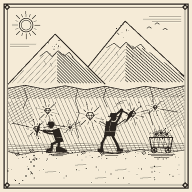{ width="96" loading="lazy" } | Diamond rush in the northern mountains! | `diamond_rush` | { .item-icon .no-zoom width="32" } `diamond` { .item-icon .no-zoom width="32" } `diamond_block` { .item-icon .no-zoom width="32" } `#c:ores` ×0.3 { .item-icon .no-zoom width="32" } `emerald` ×−0.4 | { .effect-chart .no-zoom width="64" } :material-arrow-down-bold:{ .news-down }:material-arrow-down-bold:{ .news-down } −35% trend news before the price moves |
| 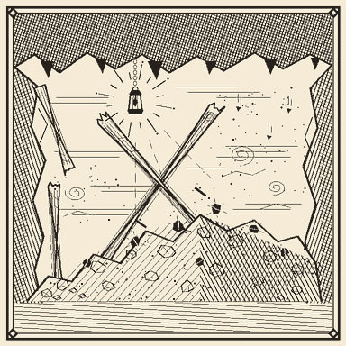{ width="96" loading="lazy" } | Mine collapse halts iron production! | `iron_supply_disruption` | { .item-icon .no-zoom width="32" } `iron_ingot` { .item-icon .no-zoom width="32" } `iron_block` 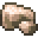{ .item-icon .no-zoom width="32" } `raw_iron` ×0.8 | { .effect-chart .no-zoom width="64" } :material-arrow-up-bold:{ .news-up }:material-arrow-up-bold:{ .news-up }:material-arrow-up-bold:{ .news-up } +45% shock |
| 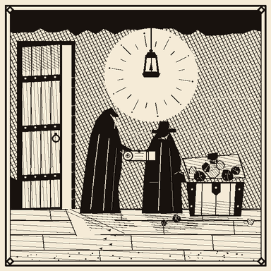{ width="96" loading="lazy" } | Leaked: expedition secures massive ancient debris hoard | `netherite_insider_leak` | 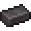{ .item-icon .no-zoom width="32" } `netherite_ingot` { .item-icon .no-zoom width="32" } `netherite_scrap` ×0.8 { .item-icon .no-zoom width="32" } `ancient_debris` ×0.8 | { .effect-chart .no-zoom width="64" } :material-arrow-down-bold:{ .news-down }:material-arrow-down-bold:{ .news-down } −30% shock news after the price moves |
| 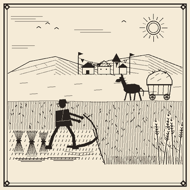{ width="96" loading="lazy" } | Harvest festival drives up grain demand! | `wheat_harvest_festival` | 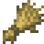{ .item-icon .no-zoom width="32" } `wheat` 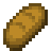{ .item-icon .no-zoom width="32" } `bread` ×0.6 | { .effect-chart .no-zoom width="64" } :material-arrow-up-bold:{ .news-up } +22% trend |
| 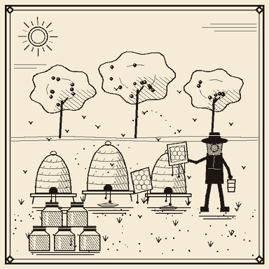{ width="96" loading="lazy" } | Bee colonies boom - honey floods the market | `honey_bumper_season` | { .item-icon .no-zoom width="32" } `honey_bottle` { .item-icon .no-zoom width="32" } `honeycomb` ×0.8 { .item-icon .no-zoom width="32" } `sweet_berries` ×0.5 | { .effect-chart .no-zoom width="64" } :material-arrow-down-bold:{ .news-down } −22% trend |
| 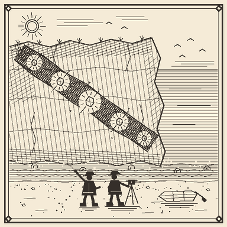{ width="96" loading="lazy" } | Massive copper seam opened in coastal cliffs! | `copper_seam_discovery` | 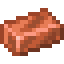{ .item-icon .no-zoom width="32" } `copper_ingot` { .item-icon .no-zoom width="32" } `copper_block` 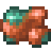{ .item-icon .no-zoom width="32" } `raw_copper` ×0.8 | { .effect-chart .no-zoom width="64" } :material-arrow-down-bold:{ .news-down }:material-arrow-down-bold:{ .news-down } −25%, permanent |
| 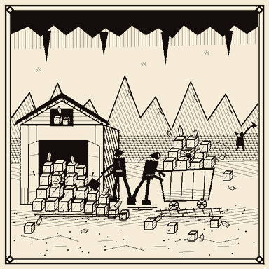{ width="96" loading="lazy" } | Nether quartz glut buries the market! | `nether_quartz_glut` | { .item-icon .no-zoom width="32" } `quartz` { .item-icon .no-zoom width="32" } `quartz_block` ×0.8 | { .effect-chart .no-zoom width="64" } :material-arrow-down-bold:{ .news-down }:material-arrow-down-bold:{ .news-down } −28% trend |
| 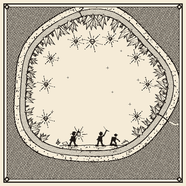{ width="96" loading="lazy" } | Colossal geode cracked open - amethyst everywhere! | `amethyst_geode_discovery` | { .item-icon .no-zoom width="32" } `amethyst_shard` | { .effect-chart .no-zoom width="64" } :material-arrow-down-bold:{ .news-down }:material-arrow-down-bold:{ .news-down } −30%, permanent |
| 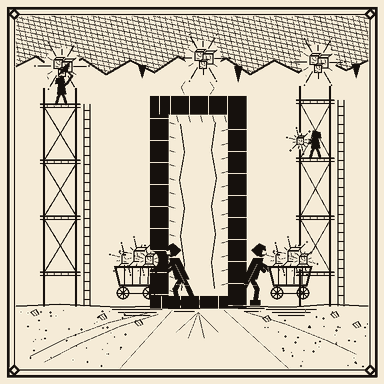{ width="96" loading="lazy" } | Glowstone farms flood the market with light! | `glowstone_farm_boom` | { .item-icon .no-zoom width="32" } `glowstone_dust` { .item-icon .no-zoom width="32" } `glowstone` ×0.8 | { .effect-chart .no-zoom width="64" } :material-arrow-down-bold:{ .news-down }:material-arrow-down-bold:{ .news-down } −25% trend |
| 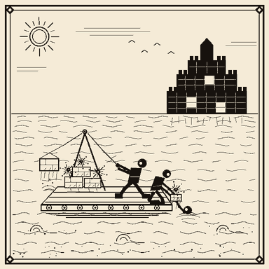{ width="96" loading="lazy" } | Ocean monument stripped bare - prismarine floods in! | `prismarine_monument_raid` | { .item-icon .no-zoom width="32" } `prismarine_shard` { .item-icon .no-zoom width="32" } `prismarine_crystals` ×0.9 { .item-icon .no-zoom width="32" } `prismarine` ×0.6 | { .effect-chart .no-zoom width="64" } :material-arrow-down-bold:{ .news-down }:material-arrow-down-bold:{ .news-down } −35% shock |
| 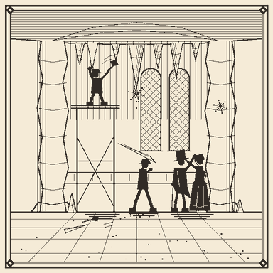{ width="96" loading="lazy" } | Dripstone the new fashion in grand halls! | `dripstone_cavern_rush` | { .item-icon .no-zoom width="32" } `dripstone_block` { .item-icon .no-zoom width="32" } `pointed_dripstone` ×0.7 | { .effect-chart .no-zoom width="64" } :material-arrow-up-bold:{ .news-up }:material-arrow-up-bold:{ .news-up } +28% trend |
| 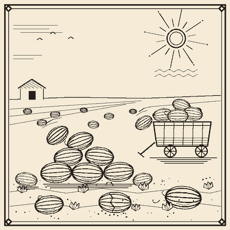{ width="96" loading="lazy" } | Bumper summer floods the market with melons | `melon_summer_glut` | { .item-icon .no-zoom width="32" } `melon_slice` { .item-icon .no-zoom width="32" } `melon` ×0.7 | { .effect-chart .no-zoom width="64" } :material-arrow-down-bold:{ .news-down } −22% trend |
| 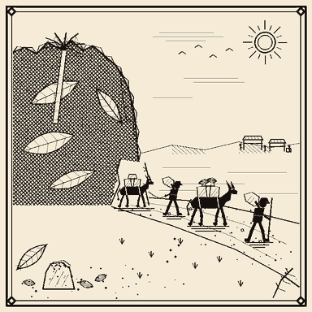{ width="96" loading="lazy" } | Southern trade route opens the cocoa floodgates | `cocoa_trade_route_opens` | { .item-icon .no-zoom width="32" } `cocoa_beans` | { .effect-chart .no-zoom width="64" } :material-arrow-down-bold:{ .news-down }:material-arrow-down-bold:{ .news-down } −28% trend |
| 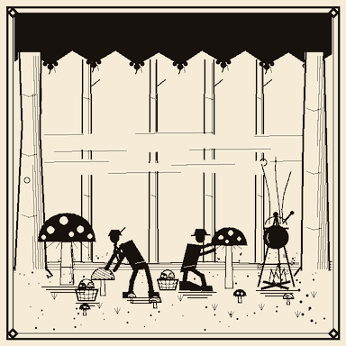{ width="96" loading="lazy" } | Foraging craze sends mushroom prices soaring | `mushroom_foraging_craze` | { .item-icon .no-zoom width="32" } `red_mushroom` { .item-icon .no-zoom width="32" } `brown_mushroom` { .item-icon .no-zoom width="32" } `mushroom_stew` ×0.6 { .item-icon .no-zoom width="32" } `bread` ×−0.2 | { .effect-chart .no-zoom width="64" } :material-arrow-up-bold:{ .news-up } +24% trend |
| 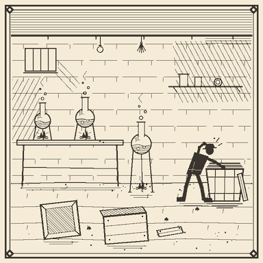{ width="96" loading="lazy" } | Brewers empty the nether wart stocks! | `netherwart_brewing_shortage` | { .item-icon .no-zoom width="32" } `nether_wart` { .item-icon .no-zoom width="32" } `sugar` ×−0.2 { .item-icon .no-zoom width="32" } `glowstone_dust` ×−0.15 | { .effect-chart .no-zoom width="64" } :material-arrow-up-bold:{ .news-up }:material-arrow-up-bold:{ .news-up }:material-arrow-up-bold:{ .news-up } +42% shock |
| 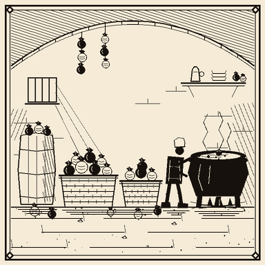{ width="96" loading="lazy" } | Record beetroot harvest weighs on prices | `beetroot_harvest_surplus` | 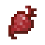{ .item-icon .no-zoom width="32" } `beetroot` { .item-icon .no-zoom width="32" } `beetroot_soup` ×0.6 | { .effect-chart .no-zoom width="64" } :material-arrow-down-bold:{ .news-down } −20% trend |
| 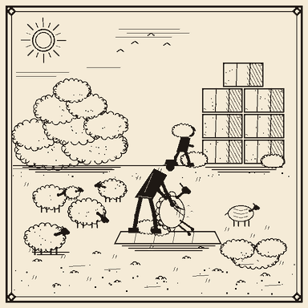{ width="96" loading="lazy" } | Spring shearing floods the wool market | `spring_shearing_glut` | { .item-icon .no-zoom width="32" } `string` ×0.5 { .item-icon .no-zoom width="32" } `#minecraft:wool` { .item-icon .no-zoom width="32" } `leather` ×−0.3 | { .effect-chart .no-zoom width="64" } :material-arrow-down-bold:{ .news-down } −24% trend |
| 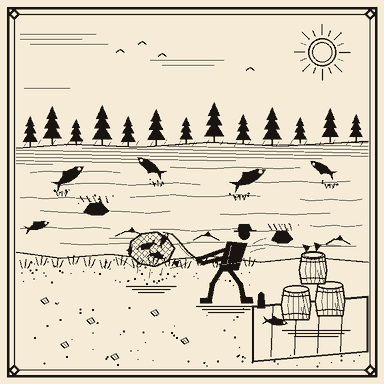{ width="96" loading="lazy" } | Great salmon run fills the nets | `salmon_spawning_run` | 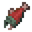{ .item-icon .no-zoom width="32" } `salmon` { .item-icon .no-zoom width="32" } `cooked_salmon` ×0.6 | { .effect-chart .no-zoom width="64" } :material-arrow-down-bold:{ .news-down }:material-arrow-down-bold:{ .news-down } −25% trend |
| 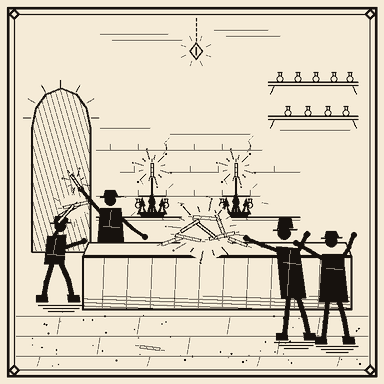{ width="96" loading="lazy" } | Alchemists' guild empties the blaze-rod stalls! | `blaze_rod_brewing_rush` | { .item-icon .no-zoom width="32" } `blaze_rod` { .item-icon .no-zoom width="32" } `blaze_powder` ×0.7 | { .effect-chart .no-zoom width="64" } :material-arrow-up-bold:{ .news-up }:material-arrow-up-bold:{ .news-up } +32% trend |
| 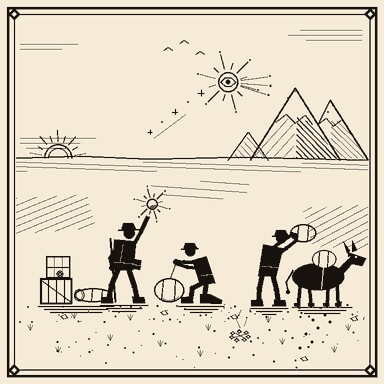{ width="96" loading="lazy" } | Expedition fever drives ender-pearl demand sky-high | `ender_pearl_expedition_boom` | { .item-icon .no-zoom width="32" } `ender_pearl` { .item-icon .no-zoom width="32" } `ender_eye` ×0.6 | { .effect-chart .no-zoom width="64" } :material-arrow-up-bold:{ .news-up }:material-arrow-up-bold:{ .news-up } +28% trend |
| 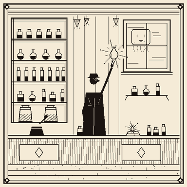{ width="96" loading="lazy" } | Apothecaries bid up ghast tears for healing tonics! | `ghast_tear_apothecary_craze` | { .item-icon .no-zoom width="32" } `ghast_tear` | { .effect-chart .no-zoom width="64" } :material-arrow-up-bold:{ .news-up }:material-arrow-up-bold:{ .news-up }:material-arrow-up-bold:{ .news-up } +40% shock |
| { width="96" loading="lazy" } | End raids stall - shulker shells scarce for good | `shulker_shell_shortage` | { .item-icon .no-zoom width="32" } `shulker_shell` | { .effect-chart .no-zoom width="64" } :material-arrow-up-bold:{ .news-up }:material-arrow-up-bold:{ .news-up } +30%, permanent |
| 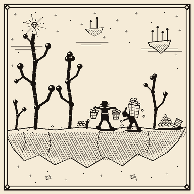{ width="96" loading="lazy" } | Outer islands yield a chorus-fruit glut | `chorus_fruit_bumper_harvest` | { .item-icon .no-zoom width="32" } `chorus_fruit` { .item-icon .no-zoom width="32" } `popped_chorus_fruit` ×0.7 | { .effect-chart .no-zoom width="64" } :material-arrow-down-bold:{ .news-down }:material-arrow-down-bold:{ .news-down } −25% trend |
| 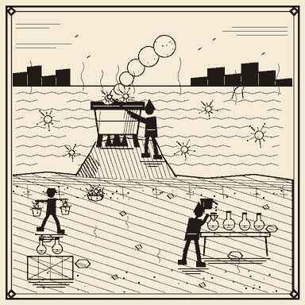{ width="96" loading="lazy" } | Fire-resistance brewing drives magma-cream demand | `magma_cream_alchemy_demand` | { .item-icon .no-zoom width="32" } `magma_cream` | { .effect-chart .no-zoom width="64" } :material-arrow-up-bold:{ .news-up }:material-arrow-up-bold:{ .news-up } +26% trend |
| 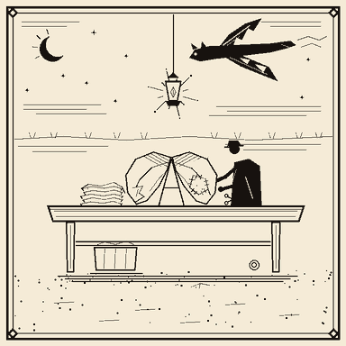{ width="96" loading="lazy" } | Rush to repair elytra empties membrane stocks | `phantom_membrane_repair_run` | { .item-icon .no-zoom width="32" } `phantom_membrane` | { .effect-chart .no-zoom width="64" } :material-arrow-up-bold:{ .news-up }:material-arrow-up-bold:{ .news-up } +30% trend |
| 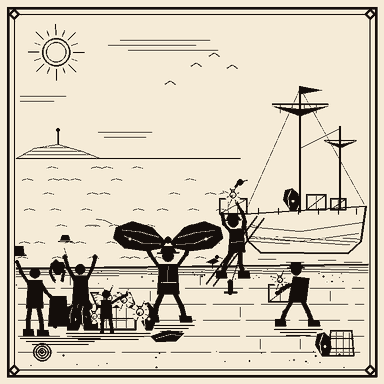{ width="96" loading="lazy" } | Triumphant End expedition floods the market with relics! | `end_expedition_returns` | { .item-icon .no-zoom width="32" } `elytra` { .item-icon .no-zoom width="32" } `dragon_breath` ×0.6 | { .effect-chart .no-zoom width="64" } :material-arrow-down-bold:{ .news-down }:material-arrow-down-bold:{ .news-down }:material-arrow-down-bold:{ .news-down } −40% crash requirements |

### Markets (3)

| Picture | Headline | ID | Markets | Effect |
|---|---|---|---|---|
| 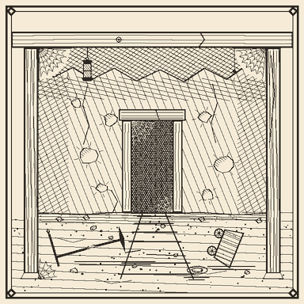{ width="96" loading="lazy" } | Ore bubble bursts - mining stocks in free fall! | `ore_market_crash` | { .item-icon .no-zoom width="32" } `*_ore` { .item-icon .no-zoom width="32" } `raw_*` ×0.7 | { .effect-chart .no-zoom width="64" } :material-arrow-down-bold:{ .news-down }:material-arrow-down-bold:{ .news-down }:material-arrow-down-bold:{ .news-down } −50% crash |
| 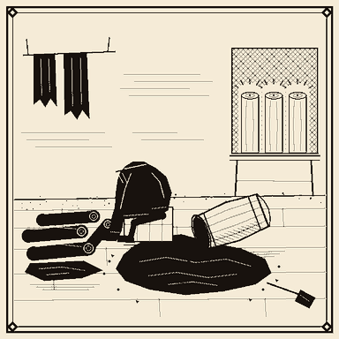{ width="96" loading="lazy" } | Black-dye trade collapses as fashion turns pale | `ink_dye_market_crash` | 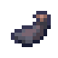{ .item-icon .no-zoom width="32" } `ink_sac` { .item-icon .no-zoom width="32" } `black_dye` ×0.8 { .item-icon .no-zoom width="32" } `white_dye` ×−0.3 | { .effect-chart .no-zoom width="64" } :material-arrow-down-bold:{ .news-down }:material-arrow-down-bold:{ .news-down }:material-arrow-down-bold:{ .news-down } −40% crash |
| 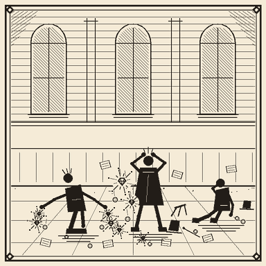{ width="96" loading="lazy" } | Margin calls wipe out overleveraged traders in a cascade! | `margin_call_crash` | { .item-icon .no-zoom width="32" } `diamond` { .item-icon .no-zoom width="32" } `emerald` ×0.8 { .item-icon .no-zoom width="32" } `gold_ingot` ×0.6 | { .effect-chart .no-zoom width="64" } :material-arrow-down-bold:{ .news-down }:material-arrow-down-bold:{ .news-down }:material-arrow-down-bold:{ .news-down } −45% crash requirements; weight 0 |

### Politics (7)

| Picture | Headline | ID | Markets | Effect |
|---|---|---|---|---|
| { width="96" loading="lazy" } | Trade council adopts the gold standard! | `gold_reserve_standard` | { .item-icon .no-zoom width="32" } `gold_ingot` | { .effect-chart .no-zoom width="64" } :material-arrow-up-bold:{ .news-up }:material-arrow-up-bold:{ .news-up } +25%, permanent requirements; chain → `gold_rush_rumor` |
| 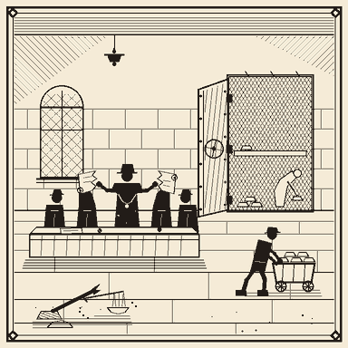{ width="96" loading="lazy" } | Trade council abandons the gold standard! | `end_of_gold_standard` | { .item-icon .no-zoom width="32" } `gold_ingot` | { .effect-chart .no-zoom width="64" } :material-arrow-down-bold:{ .news-down } −20%, permanent requirements |
| 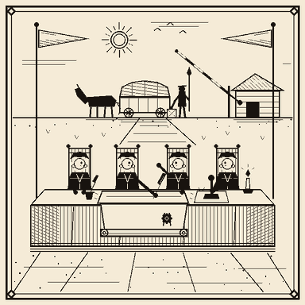{ width="96" loading="lazy" } | Trade council signs sweeping import tariff treaty | `import_tariff_treaty` | { .item-icon .no-zoom width="32" } `iron_ingot` { .item-icon .no-zoom width="32" } `gold_ingot` ×0.8 | { .effect-chart .no-zoom width="64" } :material-arrow-up-bold:{ .news-up } +18%, permanent requirements |
| 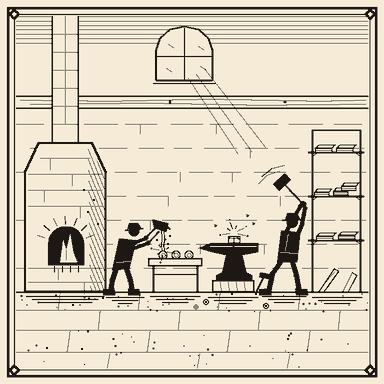{ width="96" loading="lazy" } | The mint recoins the realm's currency! | `mint_recoinage_reform` | { .item-icon .no-zoom width="32" } `gold_ingot` { .item-icon .no-zoom width="32" } `iron_ingot` ×0.6 | { .effect-chart .no-zoom width="64" } :material-arrow-up-bold:{ .news-up }:material-arrow-up-bold:{ .news-up } +28%, permanent requirements |
| 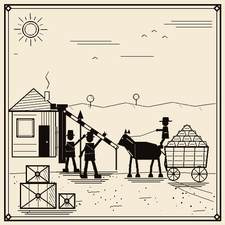{ width="96" loading="lazy" } | Trade council embargoes all foreign metals! | `metals_export_embargo` | { .item-icon .no-zoom width="32" } `iron_ingot` { .item-icon .no-zoom width="32" } `copper_ingot` ×0.8 { .item-icon .no-zoom width="32" } `gold_ingot` ×0.6 | { .effect-chart .no-zoom width="64" } :material-arrow-up-bold:{ .news-up } +24%, permanent |
| { width="96" loading="lazy" } | Council levies steep luxury tax on gems and gold | `luxury_goods_tax` | { .item-icon .no-zoom width="32" } `diamond` { .item-icon .no-zoom width="32" } `emerald` ×0.8 { .item-icon .no-zoom width="32" } `gold_ingot` ×0.6 | { .effect-chart .no-zoom width="64" } :material-arrow-down-bold:{ .news-down } −20%, permanent requirements |
| 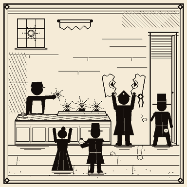{ width="96" loading="lazy" } | Council scraps the luxury tax on gems and gold | `luxury_tax_repealed` | { .item-icon .no-zoom width="32" } `diamond` { .item-icon .no-zoom width="32" } `emerald` ×0.8 { .item-icon .no-zoom width="32" } `gold_ingot` ×0.6 | { .effect-chart .no-zoom width="64" } :material-arrow-up-bold:{ .news-up } +22%, permanent requirements; undoes `luxury_goods_tax` |

### Rumors (3)

| Picture | Headline | ID | Markets | Effect |
|---|---|---|---|---|
| 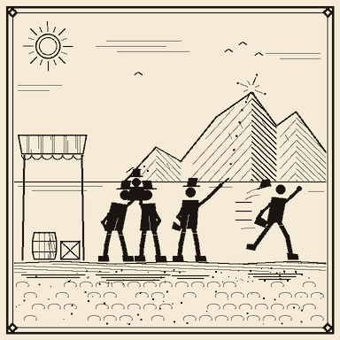{ width="96" loading="lazy" } | Rumors of a massive gold strike sweep the trading floor! | `gold_rush_rumor` | { .item-icon .no-zoom width="32" } `gold_ingot` | { .effect-chart .no-zoom width="64" } story: `pump_and_dump` or `fizzle` |
| { width="96" loading="lazy" } | Speculators pile into amethyst on wild rumors! | `amethyst_speculation` | { .item-icon .no-zoom width="32" } `amethyst_shard` | { .effect-chart .no-zoom width="64" } story: `pump_and_dump` or `fizzle` |
| { width="96" loading="lazy" } | Speculative mania grips the trading floor! | `speculation_mania` | { .item-icon .no-zoom width="32" } `diamond` { .item-icon .no-zoom width="32" } `emerald` ×0.8 { .item-icon .no-zoom width="32" } `gold_ingot` ×0.6 | { .effect-chart .no-zoom width="64" } story: `euphoria` or `cooler_heads` chain → `margin_call_crash` |

### Crime (4)

| Picture | Headline | ID | Markets | Effect |
|---|---|---|---|---|
| 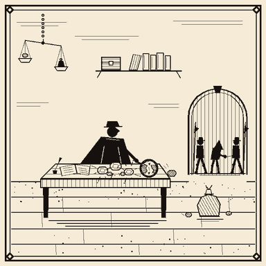{ width="96" loading="lazy" } | Counterfeit emeralds flood the market! | `emerald_counterfeit_scandal` | { .item-icon .no-zoom width="32" } `emerald` { .item-icon .no-zoom width="32" } `emerald_block` | { .effect-chart .no-zoom width="64" } :material-arrow-down-bold:{ .news-down }:material-arrow-down-bold:{ .news-down }:material-arrow-down-bold:{ .news-down } −40% crash admin only |
| { width="96" loading="lazy" } | Cartel corners quartz supply - prices squeezed! | `quartz_cartel_squeeze` | { .item-icon .no-zoom width="32" } `quartz` | { .effect-chart .no-zoom width="64" } :material-arrow-up-bold:{ .news-up }:material-arrow-up-bold:{ .news-up }:material-arrow-up-bold:{ .news-up } +45% shock admin only |
| { width="96" loading="lazy" } | Counterfeit gold coin floods the market - trust collapses! | `counterfeit_coin_scandal` | { .item-icon .no-zoom width="32" } `gold_ingot` | { .effect-chart .no-zoom width="64" } :material-arrow-down-bold:{ .news-down }:material-arrow-down-bold:{ .news-down }:material-arrow-down-bold:{ .news-down } −42% crash admin only |
| 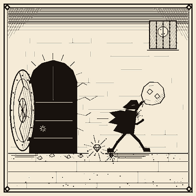{ width="96" loading="lazy" } | Daring vault heist empties the gem exchange! | `gemstone_heist` | { .item-icon .no-zoom width="32" } `diamond` { .item-icon .no-zoom width="32" } `emerald` ×0.8 | { .effect-chart .no-zoom width="64" } :material-arrow-up-bold:{ .news-up }:material-arrow-up-bold:{ .news-up }:material-arrow-up-bold:{ .news-up } +40% shock news after the price moves |

### Technology (2)

| Picture | Headline | ID | Markets | Effect |
|---|---|---|---|---|
| 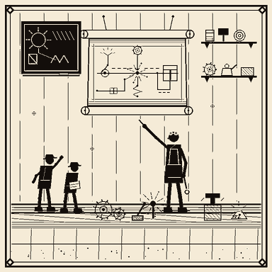{ width="96" loading="lazy" } | Engineering breakthrough doubles redstone efficiency! | `redstone_breakthrough` | { .item-icon .no-zoom width="32" } `redstone` | { .effect-chart .no-zoom width="64" } :material-arrow-up-bold:{ .news-up }:material-arrow-up-bold:{ .news-up } +30% trend news before the price moves |
| { width="96" loading="lazy" } | Enchanting craze sends lapis demand soaring! | `lapis_enchanting_craze` | { .item-icon .no-zoom width="32" } `lapis_lazuli` { .item-icon .no-zoom width="32" } `lapis_block` ×0.8 | { .effect-chart .no-zoom width="64" } :material-arrow-up-bold:{ .news-up }:material-arrow-up-bold:{ .news-up } +30% trend news before the price moves |

### Economy (5)

| Picture | Headline | ID | Markets | Effect |
|---|---|---|---|---|
| 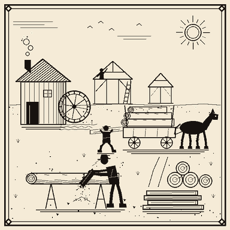{ width="96" loading="lazy" } | Construction boom drives lumber demand to record highs | `lumber_construction_boom` | { .item-icon .no-zoom width="32" } `#minecraft:logs` { .item-icon .no-zoom width="32" } `*_planks` ×0.6 { .item-icon .no-zoom width="32" } `stone` ×−0.15 | { .effect-chart .no-zoom width="64" } :material-arrow-up-bold:{ .news-up }:material-arrow-up-bold:{ .news-up } +35% trend |
| 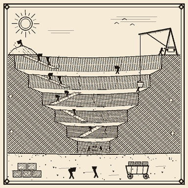{ width="96" loading="lazy" } | Deep quarry opens - deepslate cheap for good | `deepslate_quarry_expansion` | { .item-icon .no-zoom width="32" } `cobbled_deepslate` { .item-icon .no-zoom width="32" } `deepslate` ×0.8 | { .effect-chart .no-zoom width="64" } :material-arrow-down-bold:{ .news-down } −20%, permanent |
| 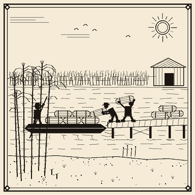{ width="96" loading="lazy" } | New river plantations turn sugar cane cheap for good | `sugarcane_plantation_boom` | { .item-icon .no-zoom width="32" } `sugar_cane` { .item-icon .no-zoom width="32" } `sugar` ×0.8 { .item-icon .no-zoom width="32" } `paper` ×0.4 | { .effect-chart .no-zoom width="64" } :material-arrow-down-bold:{ .news-down }:material-arrow-down-bold:{ .news-down } −25%, permanent |
| 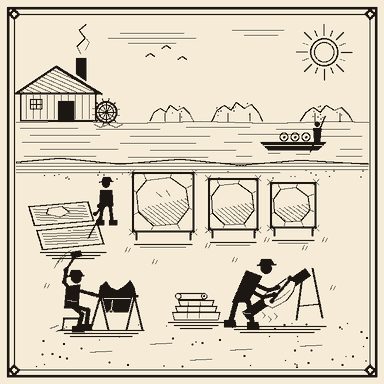{ width="96" loading="lazy" } | New tanneries drive a run on leather | `leather_tannery_boom` | { .item-icon .no-zoom width="32" } `leather` { .item-icon .no-zoom width="32" } `#minecraft:wool` ×−0.25 | { .effect-chart .no-zoom width="64" } :material-arrow-up-bold:{ .news-up }:material-arrow-up-bold:{ .news-up } +30% trend |
| { width="96" loading="lazy" } | Royal treasury floods the market with fresh coin | `treasury_stimulus_windfall` | { .item-icon .no-zoom width="32" } `diamond` { .item-icon .no-zoom width="32" } `gold_ingot` ×0.8 { .item-icon .no-zoom width="32" } `emerald` ×0.8 { .item-icon .no-zoom width="32" } `iron_ingot` ×0.6 | { .effect-chart .no-zoom width="64" } :material-arrow-up-bold:{ .news-up }:material-arrow-up-bold:{ .news-up } +30% trend news before the price moves |

### Disaster (8)

| Picture | Headline | ID | Markets | Effect |
|---|---|---|---|---|
| { width="96" loading="lazy" } | Locust swarm ravages farmland - staple crops in short supply! | `crop_pest_outbreak` | { .item-icon .no-zoom width="32" } `wheat` { .item-icon .no-zoom width="32" } `potato` ×0.9 { .item-icon .no-zoom width="32" } `carrot` ×0.9 { .item-icon .no-zoom width="32" } `bread` ×0.5 | { .effect-chart .no-zoom width="64" } :material-arrow-up-bold:{ .news-up }:material-arrow-up-bold:{ .news-up } +38% shock |
| { width="96" loading="lazy" } | Volcano erupts - villages fortify against ashfall! | `volcanic_eruption` | { .item-icon .no-zoom width="32" } `obsidian` { .item-icon .no-zoom width="32" } `basalt` ×0.8 { .item-icon .no-zoom width="32" } `blackstone` ×0.7 | { .effect-chart .no-zoom width="64" } :material-arrow-up-bold:{ .news-up }:material-arrow-up-bold:{ .news-up }:material-arrow-up-bold:{ .news-up } +48% shock admin only |
| { width="96" loading="lazy" } | Wildfires sweep the taiga - lumber prices spike! | `great_forest_fire` | { .item-icon .no-zoom width="32" } `#minecraft:logs` { .item-icon .no-zoom width="32" } `*_planks` ×0.6 | { .effect-chart .no-zoom width="64" } story: `wildfire` chain → `great_forest_fire_recovery` |
| { width="96" loading="lazy" } | Blight returns to the potato fields! | `potato_blight_return` | { .item-icon .no-zoom width="32" } `potato` { .item-icon .no-zoom width="32" } `baked_potato` ×0.6 | { .effect-chart .no-zoom width="64" } :material-arrow-up-bold:{ .news-up }:material-arrow-up-bold:{ .news-up }:material-arrow-up-bold:{ .news-up } +40% shock |
| { width="96" loading="lazy" } | Great drought scorches the croplands! | `great_drought` | { .item-icon .no-zoom width="32" } `wheat` { .item-icon .no-zoom width="32" } `potato` ×0.9 { .item-icon .no-zoom width="32" } `carrot` ×0.9 { .item-icon .no-zoom width="32" } `beetroot` ×0.8 | { .effect-chart .no-zoom width="64" } :material-arrow-up-bold:{ .news-up }:material-arrow-up-bold:{ .news-up }:material-arrow-up-bold:{ .news-up } +40% shock chain → `grain_relief_convoy` |
| { width="96" loading="lazy" } | Cattle plague fells the herds - meat and hides grow scarce! | `cattle_plague_outbreak` | { .item-icon .no-zoom width="32" } `beef` { .item-icon .no-zoom width="32" } `milk_bucket` ×0.7 { .item-icon .no-zoom width="32" } `leather` ×0.5 | { .effect-chart .no-zoom width="64" } :material-arrow-up-bold:{ .news-up }:material-arrow-up-bold:{ .news-up }:material-arrow-up-bold:{ .news-up } +42% shock admin only |
| { width="96" loading="lazy" } | Overfishing collapses the cod grounds for good | `cod_overfishing_crisis` | { .item-icon .no-zoom width="32" } `cod` { .item-icon .no-zoom width="32" } `cooked_cod` ×0.6 | { .effect-chart .no-zoom width="64" } :material-arrow-up-bold:{ .news-up }:material-arrow-up-bold:{ .news-up } +30%, permanent |
| { width="96" loading="lazy" } | Henhouse fire wipes out laying flocks - eggs vanish! | `henhouse_fire_egg_shortage` | { .item-icon .no-zoom width="32" } `egg` | { .effect-chart .no-zoom width="64" } :material-arrow-up-bold:{ .news-up }:material-arrow-up-bold:{ .news-up }:material-arrow-up-bold:{ .news-up } +40% shock news after the price moves |

### Labor (2)

| Picture | Headline | ID | Markets | Effect |
|---|---|---|---|---|
| { width="96" loading="lazy" } | Coal miners walk out - furnaces run cold! | `coal_miners_strike` | { .item-icon .no-zoom width="32" } `#minecraft:coals` | { .effect-chart .no-zoom width="64" } :material-arrow-up-bold:{ .news-up }:material-arrow-up-bold:{ .news-up } +36% shock |
| { width="96" loading="lazy" } | Dockworkers walk out - harbor cranes fall silent! | `dockworkers_strike` | { .item-icon .no-zoom width="32" } `iron_ingot` { .item-icon .no-zoom width="32" } `copper_ingot` ×0.8 { .item-icon .no-zoom width="32" } `#minecraft:planks` ×0.4 | { .effect-chart .no-zoom width="64" } :material-arrow-up-bold:{ .news-up }:material-arrow-up-bold:{ .news-up }:material-arrow-up-bold:{ .news-up } +40% shock |

### Recovery (2)

| Picture | Headline | ID | Markets | Effect |
|---|---|---|---|---|
| { width="96" loading="lazy" } | Disaster relief planks flood the lumber market | `great_forest_fire_recovery` | { .item-icon .no-zoom width="32" } `#minecraft:logs` { .item-icon .no-zoom width="32" } `*_planks` ×0.6 | { .effect-chart .no-zoom width="64" } :material-arrow-down-bold:{ .news-down } −18% trend requirements |
| { width="96" loading="lazy" } | Relief caravans pour grain into the stricken markets | `grain_relief_convoy` | { .item-icon .no-zoom width="32" } `wheat` { .item-icon .no-zoom width="32" } `potato` ×0.9 { .item-icon .no-zoom width="32" } `carrot` ×0.9 { .item-icon .no-zoom width="32" } `beetroot` ×0.8 | { .effect-chart .no-zoom width="64" } :material-arrow-down-bold:{ .news-down } −20% trend requirements; weight 0 |

### Cultural (8)

| Picture | Headline | ID | Markets | Effect |
|---|---|---|---|---|
| { width="96" loading="lazy" } | Winter solstice gifting season lifts sweets and textiles | `winter_solstice_gifting` | { .item-icon .no-zoom width="32" } `cake` { .item-icon .no-zoom width="32" } `cookie` ×0.8 { .item-icon .no-zoom width="32" } `#minecraft:wool` ×0.5 | { .effect-chart .no-zoom width="64" } :material-arrow-up-bold:{ .news-up }:material-arrow-up-bold:{ .news-up } +28% trend chain → `post_solstice_slump` |
| { width="96" loading="lazy" } | After the solstice: gift-market demand collapses | `post_solstice_slump` | { .item-icon .no-zoom width="32" } `cake` { .item-icon .no-zoom width="32" } `cookie` ×0.8 { .item-icon .no-zoom width="32" } `#minecraft:wool` ×0.5 | { .effect-chart .no-zoom width="64" } :material-arrow-down-bold:{ .news-down }:material-arrow-down-bold:{ .news-down } −28% crash |
| { width="96" loading="lazy" } | Tuff-and-calcite facades sweep the townhouses | `tuff_facade_fashion` | { .item-icon .no-zoom width="32" } `tuff` { .item-icon .no-zoom width="32" } `calcite` ×0.8 { .item-icon .no-zoom width="32" } `cobblestone` ×−0.15 | { .effect-chart .no-zoom width="64" } :material-arrow-up-bold:{ .news-up }:material-arrow-up-bold:{ .news-up } +30% trend |
| { width="96" loading="lazy" } | Autumn festival lifts the pumpkin trade! | `pumpkin_autumn_festival` | { .item-icon .no-zoom width="32" } `pumpkin` { .item-icon .no-zoom width="32" } `pumpkin_pie` ×0.7 { .item-icon .no-zoom width="32" } `carved_pumpkin` ×0.5 { .item-icon .no-zoom width="32" } `cake` ×−0.15 | { .effect-chart .no-zoom width="64" } :material-arrow-up-bold:{ .news-up }:material-arrow-up-bold:{ .news-up } +25% trend |
| { width="96" loading="lazy" } | Aquarium fad grips the wealthy | `tropical_fish_aquarium_fad` | { .item-icon .no-zoom width="32" } `tropical_fish` | { .effect-chart .no-zoom width="64" } :material-arrow-up-bold:{ .news-up }:material-arrow-up-bold:{ .news-up } +32% trend |
| { width="96" loading="lazy" } | Winter craze for rabbit stew empties the warrens | `rabbit_stew_winter_craze` | { .item-icon .no-zoom width="32" } `rabbit` { .item-icon .no-zoom width="32" } `cooked_rabbit` ×0.7 { .item-icon .no-zoom width="32" } `rabbit_hide` ×0.4 { .item-icon .no-zoom width="32" } `mutton` ×−0.25 | { .effect-chart .no-zoom width="64" } :material-arrow-up-bold:{ .news-up }:material-arrow-up-bold:{ .news-up } +30% trend |
| { width="96" loading="lazy" } | Respawn anchors become the must-have - crying obsidian soars | `crying_obsidian_anchor_fad` | { .item-icon .no-zoom width="32" } `crying_obsidian` { .item-icon .no-zoom width="32" } `*_bed` ×−0.15 | { .effect-chart .no-zoom width="64" } :material-arrow-up-bold:{ .news-up }:material-arrow-up-bold:{ .news-up } +28% trend |
| { width="96" loading="lazy" } | Court adopts royal purple - dye prices soar! | `royal_purple_fashion` | { .item-icon .no-zoom width="32" } `purple_dye` { .item-icon .no-zoom width="32" } `magenta_dye` ×0.7 { .item-icon .no-zoom width="32" } `pink_dye` ×0.5 | { .effect-chart .no-zoom width="64" } :material-arrow-up-bold:{ .news-up }:material-arrow-up-bold:{ .news-up } +30% trend |

### Conflict (3)

| Picture | Headline | ID | Markets | Effect |
|---|---|---|---|---|
| { width="96" loading="lazy" } | Kingdoms race to build redstone defenses | `redstone_arms_race` | { .item-icon .no-zoom width="32" } `redstone` { .item-icon .no-zoom width="32" } `iron_ingot` ×0.5 | { .effect-chart .no-zoom width="64" } story: `escalation` or `brief_scare` |
| { width="96" loading="lazy" } | Archery muster empties the fletchers' feather stores | `fletcher_feather_demand` | { .item-icon .no-zoom width="32" } `feather` | { .effect-chart .no-zoom width="64" } :material-arrow-up-bold:{ .news-up }:material-arrow-up-bold:{ .news-up } +28% trend |
| { width="96" loading="lazy" } | Warlord posts a bounty on wither skulls! | `wither_skull_bounty` | { .item-icon .no-zoom width="32" } `wither_skeleton_skull` { .item-icon .no-zoom width="32" } `soul_sand` ×0.4 | { .effect-chart .no-zoom width="64" } :material-arrow-up-bold:{ .news-up }:material-arrow-up-bold:{ .news-up }:material-arrow-up-bold:{ .news-up } +45% shock admin only |

## Storylines

Some events belong together:

| Story | Events |
|---|---|
| Gold standard | `gold_reserve_standard` raises gold for good and can start `gold_rush_rumor`. At least 3 hours later, `end_of_gold_standard` can lower it again. Each happens once per world. |
| Luxury tax | `luxury_goods_tax` lowers gems and gold for good. At least two days later, `luxury_tax_repealed` takes the change back exactly. Then the tax can come again. |
| Forest fire | `great_forest_fire` drives lumber up in five steps. When it ends, there is a 70% chance that `great_forest_fire_recovery` makes lumber cheap. |
| Drought | `great_drought` drives crops up. When it ends, there is a 70% chance that `grain_relief_convoy` brings prices down. |
| Winter solstice | `winter_solstice_gifting` lifts sweets and wool. When it ends, there is a 60% chance that `post_solstice_slump` drops the same markets. |
| Speculation | `speculation_mania` pumps gems and gold. When it ends, there is a 60% chance that `margin_call_crash` follows. |

The `requires` and `chains` of each event are in its file. How they work is on [Advanced events](advanced-events.md).

## Events that never fire at random

Six events are admin only: `emerald_counterfeit_scandal`, `volcanic_eruption`, `quartz_cartel_squeeze`, `cattle_plague_outbreak`, `wither_skull_bounty` and `counterfeit_coin_scandal`. They are strong events for server stories. Start them with `/stockmarket news trigger <eventId>`, or set `adminOnly` to `false` in their file to let them fire at random.

## Related pages

- [Event file reference](event-reference.md): what each field means.
- [Advanced events](advanced-events.md): sequences, requirements and chains.
- [News commands](commands.md): trigger, enable and disable events.
- [News config files](config-files.md): where the files are and how they update.
