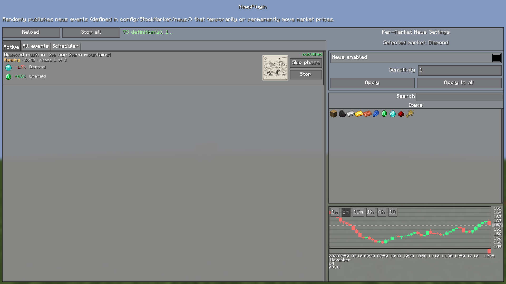
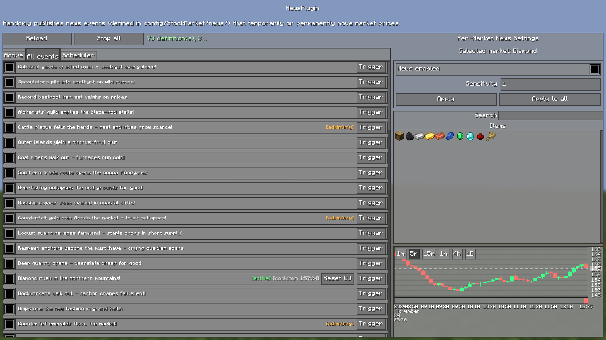
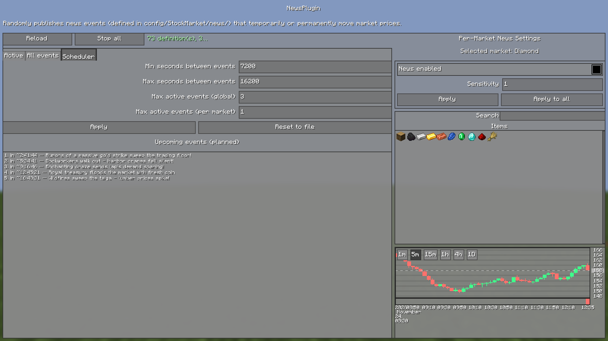
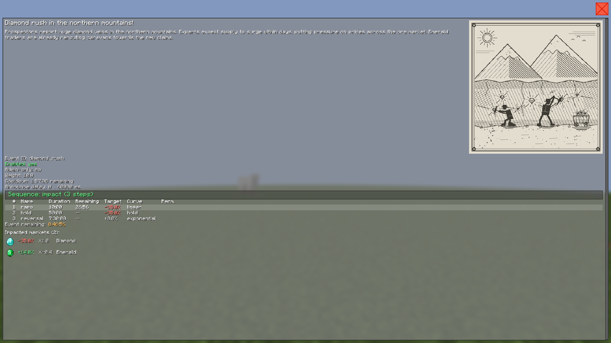

# News-System { #news-system }

News-Ereignisse sind Schlagzeilen, die Marktpreise bewegen. Von Zeit zu Zeit veröffentlicht der Server eine Meldung, zum Beispiel *Minenunglück stoppt die Eisenproduktion!*, und die Preise der betroffenen Märkte reagieren. Sie steigen oder fallen, halten sich eine Weile und kehren dann zum Normalwert zurück. Manche Meldungen ändern einen Preis dauerhaft.

Jede Meldung ist eine JSON-Datei auf dem Server. Du bestimmst also, welche Schlagzeilen es gibt, wie stark sie die Preise bewegen und welche Märkte sie treffen. StockMarket liefert 73 fertige Ereignisse mit, siehe [Mitgelieferte Ereignisse](default-events.md). Die Spieler lesen die News in der Zeitung, siehe [Markt-News](../../../stockmarket/newspaper.md).

## Wie ein News-Ereignis funktioniert { #how-a-news-event-works }

Das **NewsPlugin** steuert die News. Wie die anderen [Preis-Plugins](../plugins/index.md) arbeitet es pro Markt. Zu zufälligen Zeiten wählt es ein Ereignis aus, veröffentlicht die Schlagzeile und schiebt die Preise der betroffenen Märkte an.

Ein einfaches Ereignis läuft in drei Phasen ab:

1. **Anstieg.** Die Wirkung wächst von null bis zu ihrem Höchstwert.
2. **Haltephase.** Die Wirkung bleibt auf ihrem Höchstwert.
3. **Rückbildung.** Die Wirkung geht auf null zurück. Ein **dauerhaftes** Ereignis überspringt diese Phase: Seine Änderung wird in den Standardpreis des Markts geschrieben und bleibt, auch nach einem Neustart.

Der Höchstwert ist ein Prozentsatz: `0.5` bedeutet 50 % über dem normalen Preis, `-0.4` bedeutet 40 % darunter. Weil es ein Prozentsatz ist, wirkt dasselbe Ereignis auf einem billigen wie auf einem teuren Markt.

Fortgeschrittene Ereignisse können eine längere Geschichte in mehreren Schritten erzählen, eine von mehreren Varianten zufällig wählen, von früheren Ereignissen abhängen und Folgeereignisse starten. Siehe [Fortgeschrittene Ereignisse](advanced-events.md).

### Wie es den Preis bewegt { #how-it-moves-the-price }

News setzen Preise nicht direkt. Sie arbeiten mit den anderen Plugins zusammen:

1. Das [Nettofluss-Plugin](../plugins/net-flow.md) und das [Volatilitäts-Plugin](../plugins/volatility.md) berechnen wie gewohnt den Zielpreis des Markts.
2. Das NewsPlugin multipliziert diesen Zielpreis mit der Wirkung aller laufenden Ereignisse auf dem Markt.
3. Der [Zielpreis-Bot](../plugins/target-price-bot.md) platziert echte Orders, um den Preis zum neuen Ziel zu bewegen.

Der Preis bewegt sich also durch echten Handel, und Spieler können dagegenhalten oder mitziehen.

### Welche Märkte reagieren { #which-markets-react }

Ein Ereignis listet die Items auf, die es betrifft. Es bewegt einen Markt nur, wenn alle diese Punkte zutreffen:

- die Item-Liste des Ereignisses passt zum Markt,
- der Markt hat das NewsPlugin abonniert,
- **News aktiviert** ist für diesen Markt eingeschaltet.

**Empfindlichkeit** skaliert die Wirkung pro Markt: `0.5` halbiert jedes Ereignis, `2.0` verdoppelt es. Beide Einstellungen sind im Plugin-Fenster, siehe [News-Plugin](../plugins/news.md).

### Grenzen { #limits }

- Alle laufenden Ereignisse zusammen können einen Markt höchstens auf das 10-Fache und mindestens auf das 0.1-Fache seines normalen Zielpreises bewegen.
- Standardmäßig laufen höchstens 3 Ereignisse gleichzeitig, und höchstens 1 pro Markt. Das stellst du in [scheduler.json](config-files.md#schedulerjson) ein.
- Die Zeit eines Ereignisses läuft nur, solange der Server läuft. Ein pausierter oder gestoppter Server verbraucht kein Ereignis, keine Abklingzeit und keine Verzögerung. Wenn du das NewsPlugin ausschaltest, frieren alle laufenden Ereignisse ein.

## Das Fenster des News-Plugins { #the-news-plugin-window }

Öffne es mit `/stockmarket manage` → **Plugins verwalten** und klicke dann im Eintrag **NewsPlugin** auf **Plugin-Einstellungen öffnen**. Du brauchst das StockMarket-Admin-Flag, siehe [Admins und Berechtigungen](../../permissions.md).

Das Fenster hat drei Tabs: **Aktiv**, **Alle Ereignisse** und **Planer**. Darüber liegen zwei Knöpfe, die für alle Ereignisse gelten:

| Knopf | Was er tut |
|---|---|
| **Neu laden** | Liest alle News-Dateien neu ein und zeigt den Bericht, wie `/stockmarket news reload`. |
| **Alle stoppen** | Stoppt jedes laufende Ereignis, wie `/stockmarket news stop all`. |

Rechts liegen die **News-Einstellungen pro Markt** (**News aktiviert**, **Empfindlichkeit**), die Marktliste und ein Preischart des gewählten Markts. Das Ergebnis jedes Knopfs erscheint in einer Statuszeile oben.

### Tab „Aktiv“ { #active-tab }

<figure markdown="span">
  { width="600" }
</figure>

Eine Zeile pro laufendem Ereignis. Jede Zeile zeigt die Phase (**Ausstehend**, **Anstieg**, **Haltephase**, **Rückbildung**, **Permanent**), die restliche Zeit, ob die Schlagzeile schon veröffentlicht ist, und die aktuelle Wirkung auf jeden Markt, zum Beispiel `+25%`. Ereignisse mit mehreren Schritten zeigen den Namen des Schritts und *Phase N von M*. Klicke auf ein Markt-Icon, um diesen Markt rechts auszuwählen.

Jede Zeile hat zwei Knöpfe:

- **Nächste Phase** springt zur nächsten Phase oder zum nächsten Schritt. Überspringst du die letzte, endet das Ereignis normal.
- **Stopp** bricht das Ereignis sofort ab. Seine Wirkung wird entfernt, und seine Abklingzeit beginnt von vorn.

Klicke irgendwo sonst auf die Zeile, um die Details des Ereignisses zu öffnen.

### Tab „Alle Ereignisse“ { #all-events-tab }

<figure markdown="span">
  { width="600" }
</figure>

Eine Zeile pro geladenem Ereignis, mit seiner Schlagzeile und diesen Markierungen: **[nur Admin]**, **[aktiv]**, **[deaktiviert]** und **[Abklingzeit …]**.

- Die Checkbox links schaltet das Ereignis ein oder aus. Ein deaktiviertes Ereignis feuert nie, nicht einmal über **Auslösen**.
- **Auslösen** startet das Ereignis jetzt auf allen seinen Märkten. Läuft seine Abklingzeit noch oder sind seine Bedingungen nicht erfüllt, fragt zuerst ein Dialog nach.
- **CD-Reset** löscht die Abklingzeit. Der Knopf erscheint nur, solange die Abklingzeit läuft.

### Tab „Planer“ { #scheduler-tab }

<figure markdown="span">
  { width="600" }
</figure>

Vier Felder ändern den Planer, während der Server läuft: **Min. Sekunden zwischen Ereignissen**, **Max. Sekunden zwischen Ereignissen**, **Max. aktive Ereignisse (global)** und **Max. aktive Ereignisse (pro Markt)**. Ein Wert, der von der Datei abweicht, ist mit **(überschrieben)** markiert.

- **Übernehmen** speichert die Werte, die du geändert hast. Sie bleiben, bis du sie zurücksetzt, auch über ein Neuladen hinweg.
- **Auf Datei zurücksetzen** entfernt alle Änderungen, sodass wieder die Werte aus [scheduler.json](config-files.md#schedulerjson) gelten.

Unter den Feldern zeigt **Anstehende Ereignisse (geplant)** die nächsten geplanten Termine. Der Server prüft jeden davon erneut, wenn er fällig ist. Ein geplantes Ereignis kann also noch übersprungen oder ersetzt werden. Manche Termine zeigen *(Ereignis wird beim Auslösen gewählt)*.

### Details eines Ereignisses { #event-details }

<figure markdown="span">
  { width="600" }
</figure>

Klicke auf ein Ereignis im Tab **Aktiv** oder **Alle Ereignisse** oder auf ein geplantes Ereignis im Tab **Planer**, um alles darüber zu sehen:

- Schlagzeile, Text und Bild,
- ob es aktiviert oder nur für Admins ist, sein Gewicht, seine Abklingzeit und seine Ankündigungsverzögerung,
- seine Schritte mit Dauer, Ziel, Kurve und einer Markierung für dauerhafte Schritte,
- die Märkte, die es bewegen würde, mit ihrem Prozentsatz,
- seine Auslösebedingungen, jede als erfüllt oder nicht erfüllt markiert, und seine Folgeereignisse.

Drücke Esc, um zum Plugin-Fenster zurückzukehren.

## Master- und Slave-Server { #master-and-slave-servers }

News laufen nur auf dem Master. Der Master wählt die Ereignisse aus, bewegt die Preise und führt den Verlauf. Die Schlagzeilen erreichen die Spieler auf jedem Slave, und die Zeitung auf einem Slave liest den Verlauf des Masters. Die News-Befehle funktionieren auch auf Slaves; sie werden an den Master weitergereicht. Nur die Tab-Vervollständigung der Ereignisnamen fehlt auf Slaves. Siehe [Master- und Slave-Server](../../multi-server.md).

## Was gespeichert wird { #what-is-saved }

Alles übersteht einen Neustart:

- Laufende Ereignisse machen dort weiter, wo sie aufgehört haben, mit den Werten, mit denen sie gestartet sind, auch wenn du ihre Datei inzwischen geändert oder gelöscht hast.
- Abklingzeiten, der Timer des Planers und wartende Folgeereignisse laufen ebenfalls weiter.
- Der News-Verlauf, die veröffentlichten Bilder und das [Ereignisregister der Welt](advanced-events.md#the-world-event-registry) liegen in `<world>/data/StockMarket/News/`. Siehe [Datendateien und Backups](../../backups.md).
- Eine dauerhafte Änderung wird einmal in den Standardpreis geschrieben. Ein Neustart wendet sie nie zweimal an.

Eine neue Welt startet mit eingeschaltetem NewsPlugin, und es abonniert jeden neuen Markt von selbst (**Auto-Abo**).

## Verwandte Seiten { #related-pages }

- [News-Konfigurationsdateien](config-files.md): wo die Ereignisdateien liegen.
- [Dein erstes Ereignis schreiben](tutorial.md): Schritt für Schritt.
- [News-Befehle](commands.md): jeder `/stockmarket news`-Befehl.
- [News-Plugin](../plugins/news.md): die Einstellungen pro Markt.
