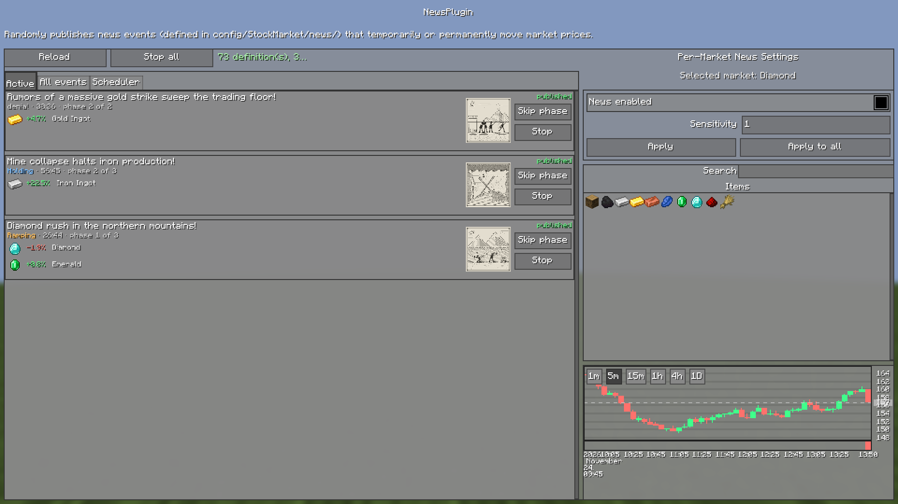
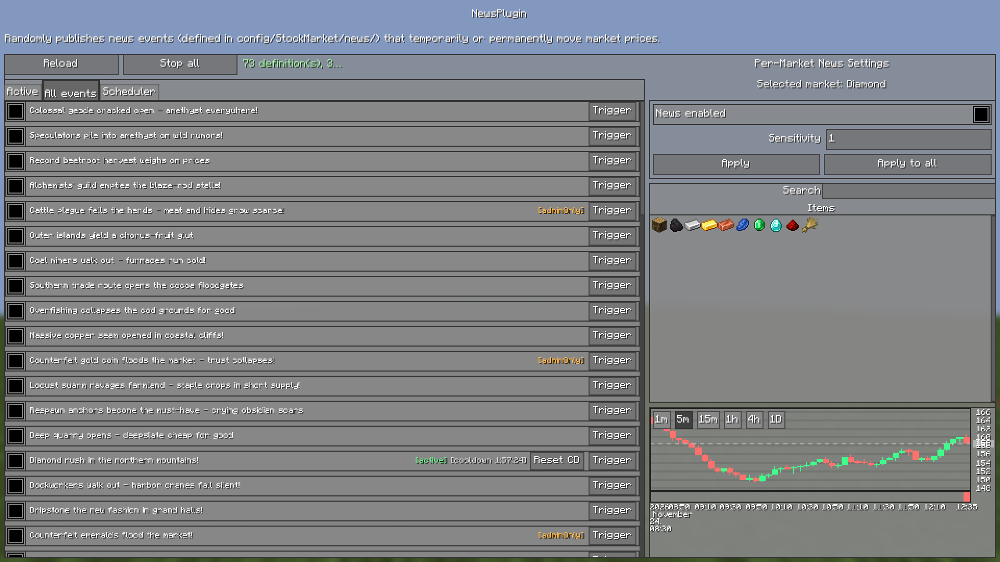
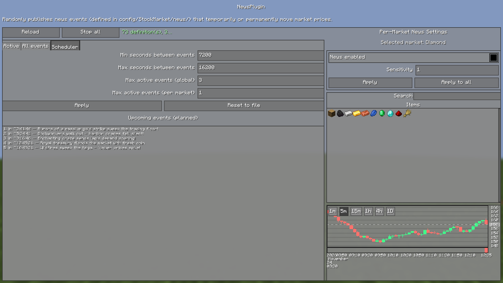
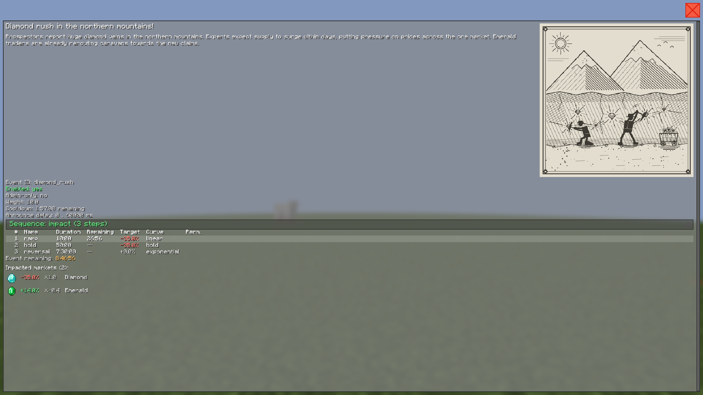

# News system

News events are headlines that move market prices. From time to time the server publishes a story, for example *Mine collapse halts iron production!*, and the prices of the affected markets react. They rise or fall, hold for a while and then return to normal. Some stories change a price for good.

Every story is a JSON file on the server, so you decide which headlines exist, how strongly they move prices and which markets they hit. StockMarket ships 73 ready-made events, see [Default events](default-events.md). Players read the news in the newspaper, see [Market news](../../../stockmarket/newspaper.md).

## How a news event works

The **NewsPlugin** runs the news. Like the other [price plugins](../plugins/index.md), it works per market. At random times it picks an event, publishes the headline and pushes the prices of the affected markets.

A simple event follows three phases:

1. **Ramp-up.** The effect grows from zero to its peak.
2. **Hold.** The effect stays at its peak.
3. **Reversal.** The effect goes back to zero. A **permanent** event skips this phase: its change is written into the market's default price and stays, also after a restart.

The peak is a percentage: `0.5` means 50% above the normal price, `-0.4` means 40% below. Because it is a percentage, the same event works on a cheap and an expensive market.

Advanced events can tell a longer story in several steps, pick one of several story variants at random, depend on earlier events and start follow-up events. See [Advanced events](advanced-events.md).

### How it moves the price

News doesn't set prices directly. It works together with the other plugins:

1. The [Net Flow plugin](../plugins/net-flow.md) and the [Volatility plugin](../plugins/volatility.md) work out the market's target price as usual.
2. The NewsPlugin multiplies that target price by the effect of all running events on the market.
3. The [Target Price Bot](../plugins/target-price-bot.md) places real orders to move the price toward the new target.

So the price moves through real trades, and players can push against it or follow it.

### Which markets react

An event lists the items it affects. It only moves a market if all of these are true:

- the event's item list matches the market,
- the market is subscribed to the NewsPlugin,
- **News enabled** is on for that market.

**Sensitivity** scales the effect per market: `0.5` halves every event, `2.0` doubles it. Both settings are in the plugin window, see [News plugin](../plugins/news.md).

### Limits

- All running events together can move a market to at most 10 times and at least 0.1 times its normal target price.
- By default at most 3 events run at once, and at most 1 per market. You set this in [scheduler.json](config-files.md#schedulerjson).
- Event time only runs while the server runs. A paused or stopped server doesn't use up an event, a cooldown or a delay. Turning the NewsPlugin off freezes all running events.

## The News plugin window

Open it with `/stockmarket manage` → **Manage Plugins**, then click **Open Plugin Settings** in the **NewsPlugin** entry. You need the StockMarket admin flag, see [Admins and permissions](../../permissions.md).

The window has three tabs: **Active**, **All events** and **Scheduler**. Above them are two buttons for all events:

| Button | What it does |
|---|---|
| **Reload** | Reads all news files again and shows the report, like `/stockmarket news reload`. |
| **Stop all** | Stops every running event, like `/stockmarket news stop all`. |

On the right are the **Per-Market News Settings** (**News enabled**, **Sensitivity**), the market list and a price chart of the selected market. The result of every button shows in a status line at the top.

### Active tab

<figure markdown="span">
  { width="600" }
</figure>

One row per running event. Each row shows the phase (**Pending**, **Ramping**, **Holding**, **Reverting**, **Permanent**), the time left, whether the headline is out yet and the current effect on each market, for example `+25%`. Events with several steps show the step name and *phase N of M*. Click a market icon to select that market on the right.

Each row has two buttons:

- **Skip phase** jumps to the next phase or step. Skipping the last one ends the event normally.
- **Stop** cancels the event at once. Its effect is removed and its cooldown starts again.

Click anywhere else on the row to open the event details.

### All events tab

<figure markdown="span">
  { width="600" }
</figure>

One row per loaded event, with its headline and these markers: **[adminOnly]**, **[active]**, **[disabled]** and **[cooldown …]**.

- The checkbox on the left turns the event on or off. A disabled event never fires, not even by **Trigger**.
- **Trigger** starts the event now on all its markets. If its cooldown is still running or its requirements aren't met, a dialog asks first.
- **Reset CD** clears the cooldown. It only shows while the event is cooling down.

### Scheduler tab

<figure markdown="span">
  { width="600" }
</figure>

Four fields change the scheduler while the server runs: **Min seconds between events**, **Max seconds between events**, **Max active events (global)** and **Max active events (per market)**. A value that differs from the file is marked **(overridden)**.

- **Apply** saves the values you changed. They stay until you reset them, also through a reload.
- **Reset to file** removes all changes, so the values from [scheduler.json](config-files.md#schedulerjson) apply again.

Below the fields, **Upcoming events (planned)** shows the next planned slots. The server checks each one again when it is due, so a planned event can still be skipped or replaced. Some slots show *(event picked at trigger time)*.

### Event details

<figure markdown="span">
  { width="600" }
</figure>

Click an event in the **Active** or **All events** tab, or a planned event in the **Scheduler** tab, to see everything about it:

- headline, text and picture,
- whether it is enabled or admin-only, its weight, its cooldown and its announce delay,
- its steps with duration, target, curve and a mark for permanent steps,
- the markets it would move, with their percentage,
- its trigger requirements, each marked as met or not, and its follow-up events.

Press Esc to go back to the plugin window.

## Master and slave servers

News runs only on the master. The master picks the events, moves the prices and keeps the history. Headlines reach the players on every slave, and the newspaper on a slave reads the master's history. The news commands work on slaves too; they are passed to the master. Only the tab completion of event names is missing on slaves. See [Master and slave servers](../../multi-server.md).

## What is saved

Everything survives a restart:

- Running events continue where they stopped, with the values they started with, even if you changed or deleted their file in between.
- Cooldowns, the scheduler timer and waiting follow-up events continue too.
- The news history, the published pictures and the [event registry](advanced-events.md#the-world-event-registry) are in `<world>/data/StockMarket/News/`. See [Data files and backups](../../backups.md).
- A permanent change is written into the default price once. A restart never applies it twice.

A new world starts with the NewsPlugin switched on, and it subscribes every new market by itself (**Auto-subscribe**).

## Related pages

- [News config files](config-files.md): where the event files live.
- [Writing your first event](tutorial.md): step by step.
- [News commands](commands.md): every `/stockmarket news` command.
- [News plugin](../plugins/news.md): the per-market settings.
