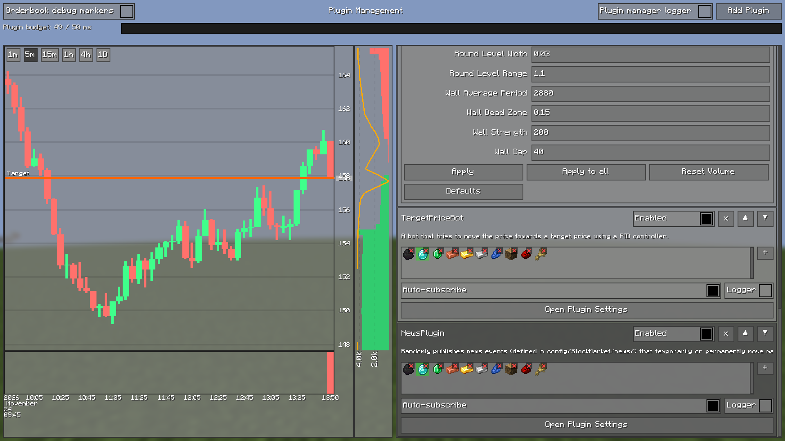

# Plugins { #plugins }

Plugins sind die Bots der Börse. Sie bewegen Preise, füllen das Orderbuch und veröffentlichen News. Ohne sie ändert sich ein Markt nur, wenn Spieler miteinander handeln. Spieler sehen die Plugins nie, nur ihre Wirkung auf Preise und Orders.

## Die fünf Standard-Plugins { #the-five-default-plugins }

Eine neue Welt startet mit fünf Plugins, alle eingeschaltet. Jeder neue Markt wird ihnen automatisch hinzugefügt.

| Plugin | Was es tut |
|---|---|
| [Nettofluss-Plugin](net-flow.md) (**NetFlowPlugin**) | Berechnet den fairen Preis jedes Markts aus dem, was Spieler verkaufen und kaufen: Verkaufen senkt ihn, Kaufen hebt ihn. |
| [Volatilitäts-Plugin](volatility.md) (**VolatilityPlugin**) | Lässt den Preis zufällig um diesen fairen Preis schwanken. Das Ergebnis ist der Zielpreis. |
| [Orderbuch-Volumen-Plugin](order-book-volume.md) (**DefaultOrderbookVolumeDistributionPlugin**) | Füllt das Orderbuch mit Bot-Orders rund um den Preis, damit Spieler immer handeln können. |
| [Zielpreis-Bot](target-price-bot.md) (**TargetPriceBot**) | Platziert Orders, die den echten Preis zum Zielpreis schieben. |
| [News-Plugin](news.md) (**NewsPlugin**) | Veröffentlicht News-Ereignisse, die Preise eine Zeit lang bewegen. |

Die fett gedruckten Namen sind die Namen in der Liste.

## Die Reihenfolge zählt { #the-order-matters }

Plugins laufen von oben nach unten durch die Liste, viele Male pro Sekunde. Jedes kann nutzen, was die Plugins darüber gerade berechnet haben:

1. **NetFlowPlugin** berechnet den fairen Preis.
2. **VolatilityPlugin** liest ihn und setzt den Zielpreis.
3. **DefaultOrderbookVolumeDistributionPlugin** formt das Orderbuch.
4. **TargetPriceBot** liest den Zielpreis und handelt in seine Richtung.

Die Regel: Plugins, die einen Preis setzen, laufen vor den Plugins, die ihn lesen. Das **NewsPlugin** läuft in einem eigenen letzten Schritt, seine Position in der Liste spielt also keine Rolle. Behalte die Standardreihenfolge, außer du weißt, warum du sie änderst.

## Die Plugin-Verwaltung { #the-plugin-management-screen }

Gib `/stockmarket manage` ein und klicke auf **Plugins verwalten**. Das Feld **Plugins** über dem Button zeigt, wie viele Plugins eingeschaltet sind.

<figure markdown="span">
  { width="600" }
</figure>

Links siehst du Chart und Orderbuch des gewählten Markts, mit den Linien der Plugins darauf, zum Beispiel dem Zielpreis. Rechts stehen die Plugins. Jeder Eintrag hat:

| Element | Was es tut |
|---|---|
| Name | Fahre mit der Maus darüber, um die ID des Plugins zu sehen. |
| **Aktiviert** | Schaltet das Plugin sofort ein oder aus. Einstellungen und Märkte bleiben erhalten. |
| **Auto-Abo** | Neue Märkte werden diesem Plugin automatisch hinzugefügt. Märkte, die mit **Plugin-Autosubscribe ignorieren** erstellt wurden, werden übersprungen. |
| **Logger** | Schreibt die Meldungen des Plugins ins Server-Log. |
| Pfeile nach oben und unten | Verschieben das Plugin in der Reihenfolge. |
| Markt-Icons | Die Märkte, auf denen dieses Plugin arbeitet. Klicke auf ein Icon, um den Chart dieses Markts zu zeigen. |
| **+** | Fügt dem Plugin einen Markt hinzu. |
| Kleines **x** auf einem Icon | Entfernt den Markt aus dem Plugin. Drücke und lass auf dem **x** los, um zu bestätigen; zieh die Maus vor dem Loslassen weg, um abzubrechen. |
| Einstellungen | Felder im Eintrag, oder **Plugin-Einstellungen öffnen** beim Zielpreis-Bot und beim News-Plugin. |

Klicke auf einen Eintrag, um ihn auszuwählen. Mit den Pfeiltasten **Links** und **Rechts** gehst du dann durch seine Märkte.

### Einstellungen ändern { #changing-settings }

Die meisten Einstellungen gelten pro Markt. Wähle ein Markt-Icon, ändere die Felder und klicke auf:

- **Anwenden**, um sie für den gewählten Markt zu speichern;
- **Auf alle anwenden**, um sie nach einer Rückfrage für jeden Markt dieses Plugins zu speichern.

Die Seite jedes Plugins listet seine Einstellungen auf. Alle Plugin-Daten werden mit der Welt gespeichert.

!!! tip "Nutze beim Einstellen den Wartungsmodus"
    Eine geänderte Einstellung kann den Preis springen lassen, und schnelle Spieler können davon profitieren. Versetze den Markt vorher in den [Wartungsmodus](../markets.md#maintenance-mode) und beende ihn, wenn du mit dem Ergebnis zufrieden bist.

### Plugins hinzufügen und entfernen { #adding-and-removing-plugins }

**Plugin hinzufügen** fügt ein weiteres Plugin eines Typs hinzu, zum Beispiel einen zweiten Zielpreis-Bot mit anderen Einstellungen für einige Märkte. Das **x** neben dem Namen eines Plugins löscht es.

### Die Leistungsanzeige { #the-performance-bar }

Der Balken oben zeigt, wie viel der Serverzeit pro Tick die Plugins brauchen, aufgeteilt nach Plugin. *Plugin-Budget: 42 / 50 ms* heißt, dass für die Plugins 42 ms übrig sind, nach allem anderen, was der Server in einem Tick tut. Brauchen die Plugins mehr, wird der Balken rot und zeigt *Plugins überschreiten das 50-ms-Tick-Budget — Serverlast zu hoch*. Fahre mit der Maus über einen Teil des Balkens, um die Zeiten des Plugins und seine Anzahl Märkte zu sehen. Ein ausgeschaltetes Plugin zählt nicht zur Summe.

## Verwandte Seiten { #related-pages }

- [Den passenden Markt-Aufbau wählen](../setup-use-cases.md): Märkte mit und ohne Bots.
- [Märkte erstellen und verwalten](../markets.md): **Virtuelles Orderbuch aktiv** pro Markt.
- [Orderbuch-Volumen-Plugin](order-book-volume.md): eine Plugin-Seite mit jeder Einstellung.
