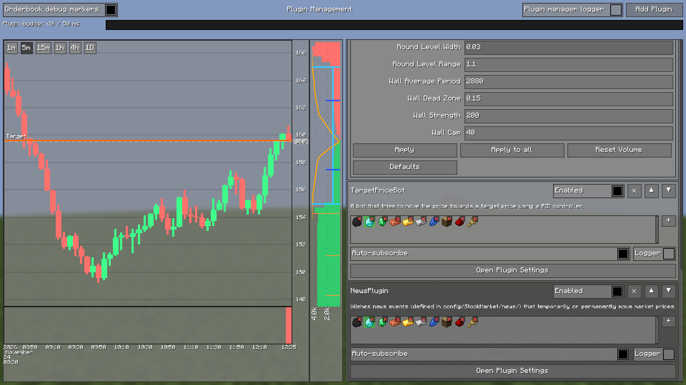

# Plugins

Plugins are the bots of the stock market. They move prices, fill the order book and publish news. Without them a market only changes when players trade with each other. Players never see the plugins, only their effect on prices and orders.

## The five default plugins

A new world starts with five plugins, all switched on. Each new market is added to them automatically.

| Plugin | What it does |
|---|---|
| [Net Flow plugin](net-flow.md) (**NetFlowPlugin**) | Works out each market's fair price from what players sell and buy: selling lowers it, buying raises it. |
| [Volatility plugin](volatility.md) (**VolatilityPlugin**) | Lets the price wander randomly around that fair price. The result is the target price. |
| [Order book volume plugin](order-book-volume.md) (**DefaultOrderbookVolumeDistributionPlugin**) | Fills the order book with bot orders around the price, so players can always trade. |
| [Target Price Bot](target-price-bot.md) (**TargetPriceBot**) | Places orders that push the real price towards the target price. |
| [News plugin](news.md) (**NewsPlugin**) | Publishes news events that move prices for a while. |

The names in bold are how the plugins appear in the list.

## The order matters

Plugins run from the top of the list to the bottom, many times per second. Each one can use what the plugins above it just worked out:

1. **NetFlowPlugin** works out the fair price.
2. **VolatilityPlugin** reads it and sets the target price.
3. **DefaultOrderbookVolumeDistributionPlugin** shapes the order book.
4. **TargetPriceBot** reads the target price and trades towards it.

The rule: plugins that set a price run before the plugins that read it. The **NewsPlugin** runs in a separate last step, so its place in the list doesn't matter. Keep the default order unless you know why you change it.

## The Plugin Management screen

Run `/stockmarket manage` and click **Manage Plugins**. The **Plugins** box above the button shows how many plugins are switched on.

<figure markdown="span">
  { width="600" }
</figure>

The left side shows the chart and order book of the selected market, with the plugins' lines drawn on it, such as the target price. The right side lists the plugins. Each entry has:

| Control | What it does |
|---|---|
| Name | Hover it to see the plugin's id. |
| **Enabled** | Switches the plugin on or off at once. Settings and markets are kept. |
| **Auto-subscribe** | New markets are added to this plugin automatically. Markets created with **Ignore Plugin Autosubscribe** are skipped. |
| **Logger** | Writes the plugin's messages to the server log. |
| Up and down arrows | Move the plugin in the run order. |
| Market icons | The markets this plugin works on. Click an icon to show that market's chart. |
| **+** | Adds a market to the plugin. |
| Small **x** on an icon | Removes the market from the plugin. Press and release on the **x** to confirm; move away before releasing to cancel. |
| Settings | Fields in the entry, or **Open Plugin Settings** for the Target Price Bot and News plugin. |

Click an entry to select it. The **Left** and **Right** arrow keys then step through its markets.

### Changing settings

Most settings are per market. Select a market icon, change the fields and click:

- **Apply** to save them for the selected market;
- **Apply to all** to save them for every market of this plugin, after a confirmation.

Each plugin's page lists its settings. All plugin data is saved with the world.

!!! tip "Use maintenance mode while you tune"
    A changed setting can make a price jump, and fast players can profit from it. Put the market into [maintenance mode](../markets.md#maintenance-mode) first, and end it when you're happy with the result.

### Adding and removing plugins

**Add Plugin** adds another plugin of a type, for example a second Target Price Bot with other settings for some markets. The **x** next to a plugin's name deletes it.

### The performance bar

The bar at the top shows how much of the server's time per tick the plugins use, split by plugin. *Plugin budget: 42 / 50 ms* means 42 ms are left for plugins after everything else the server does in a tick. If the plugins need more than that, the bar turns red and says *Plugins exceed the 50 ms tick budget — server load too high*. Hover a part of the bar to see the plugin's times and its number of markets. Switching a plugin off removes it from the sum.

## Related pages

- [Choosing a market setup](../setup-use-cases.md): markets with and without bots.
- [Creating and managing markets](../markets.md): **Enable Virtual Orderbook** per market.
- [Order book volume plugin](order-book-volume.md): a plugin page with every setting.
