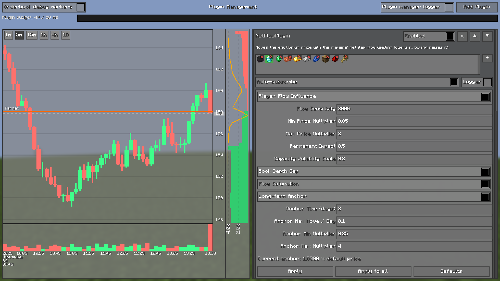

# Nettofluss-Plugin { #net-flow-plugin }

*In der Plugin-Liste: **NetFlowPlugin***

Dieses Plugin entscheidet, **wo sich ein Preis einpendelt**, wenn Spieler ein Item immer wieder verkaufen oder kaufen. Items, die Spieler farmen und viel verkaufen, werden billiger; Items, die sie ständig kaufen, werden teurer. So gleicht sich die Wirtschaft des Servers selbst aus.

Für jeden Markt berechnet es den **fairen Preis** (Gleichgewichtspreis) aus dem **Nettofluss**: den Items, die Spieler an den Markt verkauft haben, minus den Items, die sie gekauft haben. Es handelt nicht selbst.

```text
fair price = anchor × e^(−net flow / capacity)    (kept between the price limits)
anchor     = default price, moved slowly by lasting trends
```

**Setze es auf** jedem Markt ein, dessen Preis Angebot und Nachfrage der Spieler folgen soll. Ohne das Plugin schwankt der Preis um den festen Standardpreis. Es funktioniert nur auf Märkten, bei denen **Virtuelles Orderbuch aktiv** eingeschaltet ist.

## Zusammenspiel mit den anderen Plugins { #how-it-works-with-the-other-plugins }

- **Volatilitäts-Plugin.** Läuft als Nächstes und legt seine zufällige Schwankung auf den fairen Preis. Siehe [Volatilitäts-Plugin](volatility.md).
- **Zielpreis-Bot.** Handelt den echten Preis zum Ziel. Füge ihn denselben Märkten hinzu. Er nutzt den fairen Preis auch für sein Band, siehe [Zielpreis-Bot](target-price-bot.md#after-a-player-trade).
- **Orderbuch-Volumen-Plugin.** Richtet die Bot-Orders am fairen Preis aus, damit ein durch Massenverkäufe gedrückter Preis das Orderbuch nicht mitzieht. Im Gegenzug begrenzt seine Tiefe, wie weit ein großer Handel den fairen Preis bewegen kann, siehe [Dauerhafte Preiswirkung](#permanent-impact-and-book-depth-cap).
- **News-Plugin.** Ändert das Ziel während News-Ereignissen. Ein dauerhaftes News-Ereignis ändert den Standardpreis des Markts, und der faire Preis bewegt sich mit.

## Die Einstellungen ändern { #changing-the-settings }

Alle Einstellungen gelten **pro Markt**. Öffne die Plugin-Verwaltung (`/stockmarket manage` → **Plugins verwalten**), wähle ein Markt-Icon im Eintrag dieses Plugins, ändere die Felder und klicke auf **Anwenden** für diesen Markt oder auf **Auf alle anwenden** für jeden Markt des Plugins. Fahre mit der Maus über ein Feld, um seinen Tooltip zu sehen.

<figure markdown="span">
  { width="600" }
</figure>

Unter den Feldern zeigt *Aktueller Anker: … x Standardpreis* den Anker des gewählten Markts. Ungültige Werte werden durch den Standardwert ersetzt.

## Einstellungen { #settings }

| Einstellung | Standard | Bereich | Was sie tut |
|---|---|---|---|
| **Spieler-Handelsfluss Einfluss** | an | | Ob der Handel der Spieler den fairen Preis überhaupt bewegt. |
| **Fluss-Empfindlichkeit** | `2000` | `0` oder weniger = aus | Wie viele Items nötig sind, um den fairen Preis zu bewegen. |
| **Min. Preismultiplikator** | `0.05` | über 0, unter 1 | Niedrigster fairer Preis, als Anteil des Ankers. |
| **Max. Preismultiplikator** | `3` | über 1 | Höchster fairer Preis, als Vielfaches des Ankers. |
| **Dauerhafte Preiswirkung** | `0.5` | über 0, höchstens 1 | Größte bleibende Bewegung durch einen großen Handel, verglichen mit seiner Bewegung durch das Orderbuch. |
| **Kapazitäts-Volatilitätsskala** | `0.3` | 0 oder mehr | Höhere Werte lassen den Markt etwas schneller reagieren. |
| **Orderbuchtiefe-Begrenzung** | an | | Ob die Tiefe des Orderbuchs die Bewegung begrenzt. |
| **Fluss-Sättigung** | an | | Ob Fluss jenseits der Preisgrenzen ignoriert wird. |
| **Langzeit-Anker** | an | | Ob anhaltende Trends den Anker bewegen. |
| **Ankerzeit (Tage)** | `2` | über 0 | Wie langsam der Anker dem Fluss folgt. |
| **Max. Ankerbewegung / Tag** | `0.1` | 0 oder mehr | Größte Bewegung des Ankers pro Tag. |
| **Min. Anker-Multiplikator** | `0.25` | über 0, unter 1 | Niedrigster Anker, als Anteil des Standardpreises. |
| **Max. Anker-Multiplikator** | `4` | über 1 | Höchster Anker, als Vielfaches des Standardpreises. |

## So wird der faire Preis berechnet { #how-the-fair-price-is-worked-out }

Jeder Markt zählt seinen Nettofluss. Nur Handel von Spielern zählt, keine Bot-Orders. Die Zählung verblasst mit der Zeit, mit der **Halbwertszeit Nettofluss (min)** aus den [Mod-Einstellungen](../mod-settings.md) (standardmäßig 6 Stunden), sodass alter Handel langsam seine Wirkung verliert. Beide Zahlen siehst du in den [Markt-Einstellungen](../markets.md#market-settings) des Markts, mit einem Button **Zurücksetzen**.

```text
capacity = Flow Sensitivity × Abundance / (1 + Capacity Volatility Scale)
           (at least the order book depth / Permanent Impact)
```

Die **Kapazität** ist die Zahl der Items, die Spieler netto verkaufen müssen, um den fairen Preis auf etwa 37 % zu senken. Wer dieselbe Menge kauft, hebt ihn auf das 2.7-Fache. Kleine Flüsse wirken proportional: Wer 10 % der Kapazität verkauft, senkt den Preis um etwa 10 %.

**Beispiel:** Diamanten mit Standardpreis 160 und Häufigkeit 50 haben eine Kapazität von 2000 × 50 / 1.3 = 76'923 Items. Verkaufen Spieler 7'700 Diamanten mehr, als sie kaufen, sinkt der faire Preis auf etwa 145.

### Spieler-Handelsfluss Einfluss { #player-flow-influence }

Wenn aus, ist der faire Preis immer der Anker. Handel von Spielern bewegt den Preis dann nur für eine Weile, und der Zielpreis-Bot zieht ihn zurück. Nutze das für Märkte, die immer zu einem festen Preis zurückkehren sollen.

### Fluss-Empfindlichkeit { #flow-sensitivity }

Wie schwerfällig der Markt ist. Der doppelte Wert braucht doppelt so viele Items für dieselbe Bewegung. Ein Rückgang um 10 % braucht etwa 0.1 × die Kapazität, ein Rückgang um 50 % etwa 0.7 × die Kapazität. Kleine Server wollen meist einen niedrigeren Wert, große Server einen höheren.

### Min. und Max. Preismultiplikator { #min-and-max-price-multiplier }

Untergrenze und Obergrenze des fairen Preises. Mit den Standardwerten bleiben Diamanten zwischen 8 und 480. Sie begrenzen den fairen Preis, nicht den endgültigen Preis: Die zufällige Schwankung und News wirken zusätzlich.

### Dauerhafte Preiswirkung und Orderbuchtiefe-Begrenzung { #permanent-impact-and-book-depth-cap }

Ein Spieler, der einen großen Stapel auf einmal verkauft, drückt den Preis Stufe für Stufe durch das Orderbuch nach unten. **Dauerhafte Preiswirkung** sorgt dafür, dass sich der faire Preis nie um mehr als diesen Anteil dieser Bewegung verschiebt. Verkaufen und Zurückkaufen kann den Preis also nicht weiter bewegen als der Handel selbst. Mit niedrigeren Werten bewegen große Käufe und Verkäufe den Markt weniger.

Ist **Orderbuchtiefe-Begrenzung** aus, zählt nur die Empfindlichkeit. Märkte ohne das [Orderbuch-Volumen-Plugin](order-book-volume.md) haben kein Orderbuch, das sich messen lässt; die Begrenzung ist dann aus, mit einer Warnung im Log.

### Kapazitäts-Volatilitätsskala { #capacity-volatility-scale }

Die Kapazität wird durch 1 plus diesen Wert geteilt. Sie ist unabhängig von der **Volatilitätsskala** des Volatilitäts-Plugins.

### Fluss-Sättigung { #flow-saturation }

Steht der faire Preis an seiner Unter- oder Obergrenze, wird zusätzlicher Fluss nicht gezählt. Spieler, die weit unter die Untergrenze verkauft haben, sehen den Preis steigen, sobald sie zurückkaufen. Ist sie aus, zählt aller Fluss, aber Unter- und Obergrenze gelten weiter.

## Langzeit-Anker { #long-term-anchor }

Ohne den Anker verblasst der Nettofluss, und der Preis kehrt immer zum Standardpreis zurück, sogar nach Wochen einseitigen Handels. Der Anker behält einen kleinen Teil eines **anhaltenden** Trends: Solange Spieler verkaufen, sinkt er langsam; solange sie kaufen, steigt er.

- Ohne Handel bleibt der Anker, wo er ist. Ein ruhender Markt behält seinen Preis.
- Mit den standardmäßigen 2 Tagen bleiben von einem kurzen Handel nur etwa 18 % seiner Wirkung im Anker. Schnelle Tricks mit Verkaufen und Zurückkaufen lohnen sich nicht.
- **Zurücksetzen** neben **Nettofluss** in den Einstellungen des Markts setzt Fluss und Anker auf den Standardpreis zurück.

**Tipps zum Einstellen:**

- Eine höhere **Ankerzeit (Tage)** ergibt einen langsameren, kleineren bleibenden Teil. Bleib bei 1 Tag oder mehr: Kürzere Zeiten lassen schnelles Verkaufen und Zurückkaufen Gewinn bringen.
- **Max. Ankerbewegung / Tag** begrenzt sehr große Flüsse: Mit `0.1` bewegt sich der Anker höchstens um etwa 10 % pro Tag.
- **Min. Anker-Multiplikator** und **Max. Anker-Multiplikator** begrenzen, wie weit ein langer Trend den Preis tragen kann. Zusammen mit den Preisgrenzen können Diamanten von 160 × 0.25 × 0.05 = 2 bis 160 × 4 × 3 = 1'920 reichen.
- Ist **Langzeit-Anker** aus, kehrt jeder Markt immer zu seinem Standardpreis zurück.

## Allgemeine Einstellungen { #generic-settings }

| Einstellung | Wirkung bei diesem Plugin |
|---|---|
| **Aktiviert** | Wenn aus, gibt es keinen fairen Preis; das Volatilitäts-Plugin schwankt dann um den Standardpreis. Einstellungen und Märkte bleiben erhalten. |
| **Auto-Abo** | Neue Märkte werden automatisch hinzugefügt. Märkte, die mit **Plugin-Autosubscribe ignorieren** erstellt wurden, werden übersprungen. |
| **Logger** | Schreibt die Meldungen des Plugins ins Server-Log. |
| **Markt-Abonnements** | Nur diese Märkte bekommen einen fairen Preis aus dem Spielerfluss. |
| **Position in der Liste** | Ganz oben, vor dem Volatilitäts-Plugin und dem Zielpreis-Bot (Standard). Siehe [Plugins](index.md#the-order-matters). |

## Verwandte Seiten { #related-pages }

- [Volatilitäts-Plugin](volatility.md): die zufällige Schwankung auf dem fairen Preis.
- [Märkte erstellen und verwalten](../markets.md#market-settings): der Nettofluss eines Markts und sein **Zurücksetzen**.
- [Mod-Einstellungen](../mod-settings.md): die Halbwertszeit des Nettoflusses.
