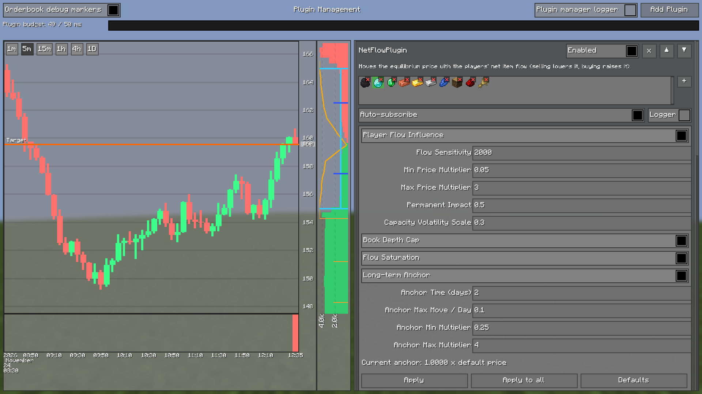

# Net Flow plugin

*In the plugin list: **NetFlowPlugin***

This plugin decides **where a price settles** when players keep selling or buying an item. Items that players farm and sell a lot get cheaper; items they keep buying get more expensive. So the server's economy balances itself.

For each market it works out the **fair price** (equilibrium price) from the **net flow**: the items players sold into the market minus the items they bought. It doesn't trade itself.

```text
fair price = anchor × e^(−net flow / capacity)    (kept between the price limits)
anchor     = default price, moved slowly by lasting trends
```

**Use it on** every market whose price should follow player supply and demand. Without it, the price wanders around the fixed default price. It only works on markets with **Enable Virtual Orderbook** switched on.

## How it works with the other plugins

- **Volatility plugin.** Runs next and adds its random swing on top of the fair price. See [Volatility plugin](volatility.md).
- **Target Price Bot.** Trades the real price towards the target. Add it to the same markets. It also uses the fair price for its band, see [Target Price Bot](target-price-bot.md#after-a-player-trade).
- **Order book volume plugin.** Centres the bot orders on the fair price, so a dumped price doesn't drag the order book along. In return, its depth sets a limit on how far one big trade can move the fair price, see [Permanent Impact](#permanent-impact-and-book-depth-cap).
- **News plugin.** Changes the target during news events. A permanent news event changes the market's default price, and the fair price moves with it.

## Changing the settings

All settings are **per market**. Open the Plugin Management screen (`/stockmarket manage` → **Manage Plugins**), select a market icon in this plugin's entry, change the fields and click **Apply** for this market or **Apply to all** for every market of the plugin. Hover a field for its tooltip.

<figure markdown="span">
  { width="600" }
</figure>

Below the fields, *Current anchor: … x default price* shows the selected market's anchor. Invalid values are replaced by the default.

## Settings

| Setting | Default | Range | What it does |
|---|---|---|---|
| **Player Flow Influence** | on | | Whether player trading moves the fair price at all. |
| **Flow Sensitivity** | `2000` | `0` or less = off | How many items it takes to move the fair price. |
| **Min Price Multiplier** | `0.05` | above 0, below 1 | Lowest fair price, as a share of the anchor. |
| **Max Price Multiplier** | `3` | above 1 | Highest fair price, as a multiple of the anchor. |
| **Permanent Impact** | `0.5` | above 0, at most 1 | Largest lasting move from one big trade, compared to its move through the order book. |
| **Capacity Volatility Scale** | `0.3` | 0 or more | Higher values let the market react a little faster. |
| **Book Depth Cap** | on | | Whether the order book depth limits the move. |
| **Flow Saturation** | on | | Whether flow beyond the price limits is ignored. |
| **Long-term Anchor** | on | | Whether lasting trends move the anchor. |
| **Anchor Time (days)** | `2` | above 0 | How slowly the anchor follows the flow. |
| **Anchor Max Move / Day** | `0.1` | 0 or more | Largest anchor move per day. |
| **Anchor Min Multiplier** | `0.25` | above 0, below 1 | Lowest anchor, as a share of the default price. |
| **Anchor Max Multiplier** | `4` | above 1 | Highest anchor, as a multiple of the default price. |

## How the fair price is worked out

Every market counts its net flow. Only player trades count, not bot orders. The count fades over time, with the **Net flow half-life (min)** from the [Mod Settings](../mod-settings.md) (6 hours by default), so old trades slowly lose their effect. You see both numbers in the market's [Market Settings](../markets.md#market-settings), with a **Reset** button.

```text
capacity = Flow Sensitivity × Abundance / (1 + Capacity Volatility Scale)
           (at least the order book depth / Permanent Impact)
```

The **capacity** is how many items players must sell, net, to drop the fair price to about 37 %. Buying the same amount raises it 2.7 times. Small flows have a proportional effect: selling 10 % of the capacity lowers the price by about 10 %.

**Example:** diamonds with default price 160 and abundance 50 have a capacity of 2000 × 50 / 1.3 = 76,923 items. Players selling 7,700 diamonds more than they buy lower the fair price to about 145.

### Player Flow Influence

When off, the fair price is always the anchor. Player trades then move the price only for a while, and the Target Price Bot pulls it back. Use it for markets that should always return to a fixed price.

### Flow Sensitivity

How heavy the market is. Twice the value needs twice the items for the same move. A drop of 10 % needs about 0.1 × the capacity, a drop of 50 % about 0.7 × the capacity. Small servers usually want a lower value, large servers a higher one.

### Min and Max Price Multiplier

The floor and ceiling of the fair price. With the defaults, diamonds stay between 8 and 480. They limit the fair price, not the final price: the random swing and news act on top.

### Permanent Impact and Book Depth Cap

A player who sells a large stack at once walks the price down through the order book. **Permanent Impact** makes sure the fair price never moves more than this share of that move. So selling and buying back can't move the price further than the trade itself did. Lower values make the market harder to move with big trades.

With **Book Depth Cap** off, only the sensitivity counts. Markets without the [Order book volume plugin](order-book-volume.md) have no order book to measure; the limit is then off, with a warning in the log.

### Capacity Volatility Scale

The capacity is divided by 1 plus this value. It is separate from the **Volatility Scale** of the Volatility plugin.

### Flow Saturation

When the fair price is at its floor or ceiling, extra flow is not counted. Players who sold far below the floor see the price rise as soon as they buy back. With it off, all flow is counted, but the floor and ceiling still apply.

## Long-term Anchor

Without the anchor, the net flow fades away and the price always returns to the default price, even after weeks of one-sided trading. The anchor keeps a small part of a **lasting** trend: while players sell, it sinks slowly; while they buy, it rises.

- Without trading the anchor stays where it is. An idle market keeps its price.
- With the default 2 days, a short trade leaves only about 18 % of its effect in the anchor. Fast sell-and-buy-back tricks don't pay off.
- **Reset** next to **Net Flow** in the market's settings sets the flow and the anchor back to the default price.

**Tuning tips:**

- A higher **Anchor Time (days)** gives a slower, smaller lasting part. Keep it at 1 day or more: shorter times let fast sell-and-buy-back trades profit.
- **Anchor Max Move / Day** caps very large flows: with `0.1` the anchor moves at most about 10 % per day.
- **Anchor Min Multiplier** and **Anchor Max Multiplier** limit how far a long trend can carry the price. Together with the price limits, diamonds can range from 160 × 0.25 × 0.05 = 2 to 160 × 4 × 3 = 1,920.
- With **Long-term Anchor** off, every market always returns to its default price.

## Generic settings

| Setting | Effect for this plugin |
|---|---|
| **Enabled** | When off, there is no fair price; the Volatility plugin then wanders around the default price. Settings and markets are kept. |
| **Auto-subscribe** | New markets are added automatically. Markets created with **Ignore Plugin Autosubscribe** are skipped. |
| **Logger** | Writes the plugin's messages to the server log. |
| **Market subscriptions** | Only these markets get a fair price from player flow. |
| **Position in the list** | First, before the Volatility plugin and the Target Price Bot (the default). See [Plugins](index.md#the-order-matters). |

## Related pages

- [Volatility plugin](volatility.md): the random swing on top of the fair price.
- [Creating and managing markets](../markets.md#market-settings): the net flow of a market and its **Reset**.
- [Mod Settings](../mod-settings.md): the net flow half-life.
