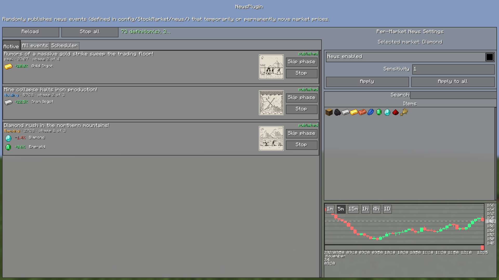
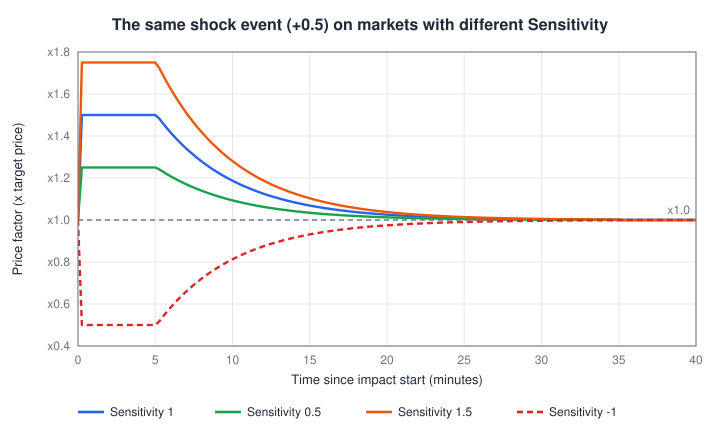

# News-Plugin { #news-plugin }

*In der Plugin-Liste: **NewsPlugin***

Dieses Plugin veröffentlicht **News-Ereignisse** und bewegt die Preise der betroffenen Märkte, solange ein Ereignis läuft: ein plötzlicher Schock, ein langsamer Trend, ein Crash oder eine dauerhafte Änderung. Spieler lesen die Schlagzeilen in der Zeitung.

Diese Seite behandelt die Einstellungen des Plugins. Wie man Ereignisse schreibt, das Plugin-Fenster und die Befehle stehen im Abschnitt [News-System](../news/index.md).

**Nutze es**, wenn du zusätzlich zur normalen zufälligen Schwankung Preisbewegungen mit einer Geschichte willst. Es ist optional: Märkte funktionieren auch ohne.

## Wie es Preise bewegt { #how-it-moves-prices }

Das Plugin handelt nicht. Nachdem alle anderen Plugins gelaufen sind, **multipliziert es den Zielpreis** jedes betroffenen Markts:

```text
factor of one event = 1 + effect now × item weight × Sensitivity
all events together = the factors multiplied, kept between 0.1 and 10
new target price    = target price × all events together
```

- **Aktuelle Wirkung** ist, wie stark das Ereignis in diesem Moment ist, zum Beispiel `0.5` für +50 % auf dem Höhepunkt.
- **Item-Gewicht** kommt aus dem Ereignis: wie stark dieses Item betroffen ist.
- **Empfindlichkeit** ist die Einstellung pro Markt weiter unten.

### Zusammenspiel mit den anderen Plugins { #how-it-works-with-the-other-plugins }

- **Zielpreis-Bot.** Der Bot handelt den echten Preis zum geänderten Ziel. Wie schnell News im Chart sichtbar werden, hängt also vom Bot ab. Siehe [Zielpreis-Bot](target-price-bot.md).
- **Position in der Liste.** News werden in einem eigenen letzten Schritt angewendet, die Position in der Liste spielt also keine Rolle.
- **Dauerhafte Ereignisse** ändern den Standardpreis des Markts, wenn sie enden. Der faire Preis des [Nettofluss-Plugins](net-flow.md) und seine Grenzen bewegen sich mit.

## Die Wirkung im Zeitverlauf { #the-effect-over-time }

Die meisten Ereignisse nutzen eine von drei Formen. Ein Ereignis kann die Zeiten ändern.

| Form | Anstieg | Haltedauer | Abklingen |
|---|---|---|---|
| Schock | 5 s | 5 min | erst schnell, nach etwa 30 min verschwunden |
| Trend | 2 min | 10 min | gleichmäßig über 10 min |
| Crash | 10 s | 2 min | erst schnell, nach etwa 90 min verschwunden |

<figure markdown="span">
  { width="600" }
</figure>

Die mitgelieferte `scheduler.json` lässt jedes Ereignis **dreimal** so lange dauern und **halb** so stark wirken, wie das Ereignis selbst angibt. Der Schock oben bewegt das Ziel also auf ×1.25 und hält es 15 Minuten. Siehe [scheduler.json](../news/config-files.md#schedulerjson).

**Beispiel:** ein Diamant-Markt mit Zielpreis 160 und ein Schock von +50 % auf dem Höhepunkt. Auf dem Höhepunkt ist das Ziel 160 × 1.5 = 240. Läuft auf demselben Markt ein Crash von −40 %, werden die Faktoren multipliziert: 1.5 × 0.6 = 0.9.

Ein dauerhaftes Ereignis von +20 % ändert den Standardpreis von 160 auf 192, wenn es endet.

## Die Einstellungen ändern { #changing-the-settings }

Klicke in der Plugin-Verwaltung (`/stockmarket manage` → **Plugins verwalten**) im Eintrag des Plugins auf **Plugin-Einstellungen öffnen**. Die **News-Einstellungen pro Markt** stehen auf der rechten Seite des Fensters.

<figure markdown="span">
  { width="600" }
</figure>

Wähle einen Markt, ändere die Werte und klicke auf **Übernehmen** für diesen Markt oder auf **Auf alle anwenden** für jeden Markt des Plugins.

| Einstellung | Standard | Bereich | Was sie tut |
|---|---|---|---|
| **News aktiviert** | an | | Ob dieser Markt überhaupt an News teilnimmt. |
| **Empfindlichkeit** | `1.0` | jede Zahl; negativ kehrt die Wirkung um | Wie stark News diesen Markt bewegen. |

Den zeitlichen Ablauf und die Zahl gleichzeitiger Ereignisse stellst du für den ganzen Server auf dem Tab **Planer** im selben Fenster ein, siehe [Tab „Planer“](../news/index.md#scheduler-tab).

### News aktiviert { #news-enabled }

Wenn aus, ist der Markt komplett von News ausgeschlossen. Kein Ereignis löst wegen ihm aus, und laufende Ereignisse bewegen seinen Preis sofort nicht mehr. Ein Ereignis, bei dem alle Märkte News aus haben, löst nie aus.

Nutze das für Märkte, deren Preis vorhersehbar bleiben muss, etwa ein Währungs-Item, ohne den Markt aus dem Plugin zu entfernen.

### Empfindlichkeit { #sensitivity }

Skaliert jede News-Wirkung auf diesem Markt, auch die dauerhafte Änderung durch dauerhafte Ereignisse.

<figure markdown="span">
  { width="600" }
</figure>

| Empfindlichkeit | Ereignis von +50 % auf dem Höhepunkt | Ereignis von −40 % auf dem Höhepunkt |
|---|---|---|
| `0` | ×1.0 (keine Wirkung, aber der Markt kann trotzdem gewählt werden) | ×1.0 |
| `0.5` | ×1.25 | ×0.8 |
| `1` (Standard) | ×1.5 | ×0.6 |
| `2` | ×2.0 | ×0.2 |
| `3` | ×2.5 | ×0.1 (die untere Grenze) |
| `-1` | ×0.5 (umgekehrt) | ×1.4 (umgekehrt) |

**Tipps zum Einstellen:**

- `0.3` bis `0.7` für Alltags-Items, die nur wenig auf News reagieren sollen.
- `1.5` bis `2` für Items, auf die Spieler spekulieren sollen. Crashs werden viel tiefer: Ab `2.25` erreicht ein Crash von −40 % die untere Grenze.
- `0`, statt **News aktiviert** auszuschalten, wenn Ereignisse für diesen Markt weiter auslösen und Schlagzeilen zeigen sollen, sein Preis sich aber nicht bewegen darf.
- Negative Werte machen für diesen Markt aus guten News schlechte. Soll nur ein Ereignis umgekehrt wirken, gib dem Item stattdessen in diesem Ereignis ein negatives Gewicht.

## Allgemeine Einstellungen { #generic-settings }

| Einstellung | Wirkung bei diesem Plugin |
|---|---|
| **Aktiviert** | Wenn aus, bewegen News keine Preise mehr, und alle Timer pausieren: laufende Ereignisse, Abklingzeiten und der Planer. Wieder eingeschaltet, laufen sie dort weiter, wo sie stehen geblieben sind. |
| **Auto-Abo** | Neue Märkte werden automatisch hinzugefügt. Märkte, die mit **Plugin-Autosubscribe ignorieren** erstellt wurden, werden übersprungen. |
| **Logger** | Schreibt die Meldungen des Plugins (Laden, Planen, Veröffentlichen) ins Server-Log. |
| **Markt-Abonnements** | Nur diese Märkte können von News bewegt werden. |
| **Position in der Liste** | Keine Wirkung: News werden nach allen anderen Plugins angewendet. |

## Verwandte Seiten { #related-pages }

- [News-System](../news/index.md): wie News funktionieren und das Plugin-Fenster.
- [News-Konfigurationsdateien](../news/config-files.md): die Ereignisdateien und `scheduler.json`.
- [Zielpreis-Bot](target-price-bot.md): wie schnell der Preis den News folgt.
