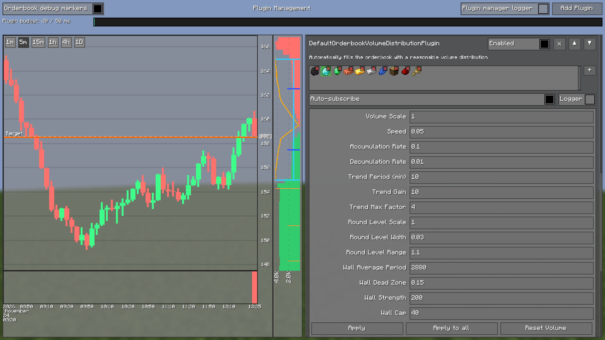
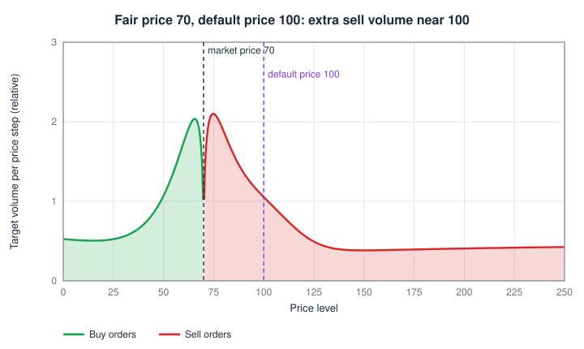

# Orderbuch-Volumen-Plugin { #order-book-volume-plugin }

*In der Plugin-Liste: **DefaultOrderbookVolumeDistributionPlugin***

Dieses Plugin füllt das Orderbuch mit **virtuellen Orders**: Kauforders unter dem Preis und Verkaufsorders darüber. Spieler und der [Zielpreis-Bot](target-price-bot.md) handeln gegen dieses Volumen. Wie tief das Orderbuch ist, entscheidet, wie weit sich der Preis bewegt, wenn jemand kauft oder verkauft.

Für jede Preisstufe berechnet das Plugin ein **Zielvolumen**. Das echte Volumen nähert sich diesem Ziel mit der Zeit an. Kaufen oder verkaufen Spieler Volumen weg, wächst es langsam nach. Bewegt sich der faire Preis, formt sich das Orderbuch um ihn herum neu.

**Setze es auf** jedem Markt ein, auf dem Spieler handeln können sollen, ohne dass ein anderer Spieler auf der Gegenseite steht. Ohne das Plugin wird eine Market-Order nur gegen Limit-Orders von Spielern ausgeführt, und das Orderbuch sieht leer aus. Es funktioniert nur auf Märkten, bei denen **Virtuelles Orderbuch aktiv** eingeschaltet ist.

## Zusammenspiel mit den anderen Plugins { #how-it-works-with-the-other-plugins }

- **Fairer Preis.** Das Orderbuch ist am fairen Preis ausgerichtet, nicht am zuletzt gehandelten Preis. Der faire Preis ist der Gleichgewichtspreis des [Nettofluss-Plugins](net-flow.md), der dem Netto-Kaufen und -Verkaufen der Spieler folgt. Ohne dieses Plugin ist es der Standardpreis des Markts. Ein schneller Massenverkauf zieht das Orderbuch also nicht mit nach unten: Wer danach zurückkauft, trifft auf dieselbe Tiefe, in die der Massenverkauf verkauft hat.
- **Zielpreis-Bot.** Der Bot bemisst seine Orders an der Tiefe, ein tieferes Orderbuch bremst den Bot also nicht. Spieler bremst es dagegen: Sie brauchen mehr Items, um den Preis zu bewegen.
- **Häufigkeit.** Die **Häufigkeit** des Items bestimmt die Tiefe. Das Orderbuch ist so bemessen, dass eine Referenzorder von `max(64, 64 × Abundance)` Items den Preis auf jedem Markt um etwa denselben Prozentsatz bewegt. Die **Max. Ordergröße** des Markts ändert die Tiefe nicht.
- **Reihenfolge.** Lass dieses Plugin nach dem Nettofluss-Plugin laufen, dessen fairen Preis es nutzt, und vor dem Zielpreis-Bot, der seine Orders nach der Tiefe bemisst. Das ist die Standardreihenfolge. Siehe [Plugins](index.md).

## Die Einstellungen ändern { #changing-the-settings }

Alle Einstellungen gelten **pro Markt**. Öffne die Plugin-Verwaltung (`/stockmarket manage` → **Plugins verwalten**), wähle ein Markt-Icon im Eintrag dieses Plugins, bearbeite die Felder und klicke auf einen der Buttons:

<figure markdown="span">
  { width="600" }
</figure>

| Button | Was er tut |
|---|---|
| **Anwenden** | Speichert die Werte für den gewählten Markt. Das Volumen nähert sich dann mit der Zeit dem neuen Ziel an. |
| **Auf alle anwenden** | Speichert die Werte nach einer Rückfrage für jeden Markt, der dieses Plugin abonniert hat. Das Volumen wird nicht zurückgesetzt. |
| **Volumen zurücksetzen** | Speichert die Werte für den gewählten Markt **und** ersetzt sein Volumen sofort durch das Ziel, ohne die langsame Annäherung. |

## Einstellungen { #settings }

Die Felder nehmen nur Zahlen von 0 oder mehr an.

| Einstellung | Standard | Bereich | Was sie tut |
|---|---|---|---|
| **Volumenskalierung** | `1` | 0 oder mehr | Tiefe des ganzen Orderbuchs. Bei `1` bewegt eine Referenzorder von `max(64, 64 × Abundance)` Items den Preis um etwa 0.36 %. |
| **Geschwindigkeit** | `0.05` | 0 oder mehr | Gesamttempo der Annäherung an das Ziel. Wird mit beiden Raten unten multipliziert. |
| **Akkumulationsrate** | `0.1` | 0 oder mehr | Wie schnell fehlendes Volumen aufgefüllt wird. |
| **Dekumulationsrate** | `0.01` | 0 oder mehr | Wie schnell überschüssiges Volumen abgebaut wird. |
| **Runde-Preise-Skala** | `1` | 0 oder mehr | Zusätzliches Volumen an runden Preisen (100, 200, 250, 500, 1000 …), als Vielfaches der Tiefe nahe am Preis. `0` = aus. |
| **Runde-Preise-Breite** | `0.03` | 0.005 bis 0.5 | Breite eines Clusters an einem runden Preis, im logarithmischen Preis. `0.03` sind etwa ±3 % um die Stufe. |
| **Runde-Preise-Reichweite** | `1.1` | 0.05 bis 5 | Wie weit vom Preis entfernt Cluster an runden Preisen sichtbar bleiben. Größer = Cluster weit vom Preis bleiben größer. |
| **Trend-Periode (min)** | `10` | mehr als 0 | Zeitraum des kurzen gleitenden Durchschnitts des Preises, in Minuten. |
| **Trend-Verstärkung** | `10` | 0 oder mehr | Wie stark eine Bewegung weg vom kurzen Durchschnitt das Auffüllen auf der Seite beschleunigt, auf die sich der Preis zubewegt. `0` = aus. |
| **Trend-Maximalfaktor** | `4` | 1 oder mehr | Größte Beschleunigung oder Bremsung des Auffüllens einer Seite. `1` = aus. |
| **Wand-Durchschnittsdauer** | `2880` | 0 oder mehr | Zeitraum des langsamen gleitenden Durchschnitts des Preises, in Minuten. `2880` sind 2 Tage. `0` = Wand aus. |
| **Wand-Totzone** | `0.15` | 0 oder mehr | Abstand vom langsamen Durchschnitt ohne jede Wand, im logarithmischen Preis. `0.15` sind etwa ±15 %. |
| **Wand-Stärke** | `200` | 0 oder mehr | Wie schnell die Wand jenseits der Totzone wächst. Bei `200` bekommt eine Stufe 10 % jenseits der Totzone das 20-Fache der normalen Tiefe. `0` = aus. |
| **Wand-Obergrenze** | `40` | 0 oder mehr | Größte zusätzliche Tiefe der Wand, als Vielfaches der normalen Tiefe nahe am Preis. `0` = aus. |

Die Abschnitte unten erklären jede Gruppe.

## Volumenskalierung: wie tief das Orderbuch ist { #volume-scale-how-deep-the-book-is }

Die Volumenskalierung macht das ganze Orderbuch tiefer oder dünner, ohne seine Form zu ändern.

Bei `1` bewegt eine Referenzorder von `max(64, 64 × Abundance)` Items den Preis um etwa 0.36 %. Bei Häufigkeit 50 zum Beispiel ist die Referenzorder 3'200 Items groß. Eine höhere Häufigkeit ergibt ein tieferes Orderbuch.

**Was Spieler merken:** Der Preis bewegt sich ungefähr umgekehrt proportional zur Tiefe. Bei `2` braucht ein Spieler etwa doppelt so viele Items, um den Preis um denselben Prozentsatz zu bewegen. Bei `0.5` halb so viele.

Einige Details:

- **Teure Items** bekommen immer mindestens 0.1 Items pro Preisschritt (mal Volumenskalierung). Selbst ein sehr teurer Markt hat also nie ein so dünnes Orderbuch, dass einzelne Items den Preis springen lassen.
- **Billige Items** (Preis unter etwa 1) bewegen sich in großen Schritten. Erde zu 0.1 bewegt sich in Schritten von 10 %. Ihr Orderbuch ist pro Schritt tief.
- Ändert sich der **Standardpreis** eines Markts, wird sein Orderbuch sofort neu aufgebaut, wie bei **Volumen zurücksetzen**. Eine geänderte **Häufigkeit** ändert die Tiefe auch, aber das Orderbuch nähert sich ihr im normalen Tempo an.

**Tipps zum Einstellen:**

- Wenn ein Spieler einen Markt mit wenigen Orders in maximaler Größe abstürzen lassen oder hochtreiben kann, erhöhe die Volumenskalierung für diesen Markt oder senke seine maximale Ordergröße.
- Wenn Handel keine Wirkung auf den Preis zu haben scheint, senke sie.
- Nutze **Volumen zurücksetzen**, um die neue Tiefe sofort zu sehen. Sonst füllt sie sich über einige Minuten auf.

## Die Form des Orderbuchs { #the-shape-of-the-book }

<figure markdown="span">
  { width="600" }
</figure>

Direkt am fairen Preis hat das Orderbuch fast kein Volumen (ein Spread von mindestens 0.5 %). Das Volumen steigt schnell zu einem Höhepunkt etwa 5 bis 10 % entfernt und flacht dann ab. Keine Seite läuft leer: Weit vom Preis gibt es darunter immer etwas Kaufinteresse und darüber immer etwas Verkaufsinteresse, ein Massenverkauf trifft also immer auf Käufer und ein Hochtreiben immer auf Verkäufer.

Das Orderbuch legt außerdem zusätzliches Volumen um den **Standardpreis** des Markts. Haben Nettoverkäufe den fairen Preis nach unten gedrückt, müssen Käufer, die ihn wieder hochtreiben wollen, erst durch dieses zusätzliche Verkaufsvolumen:

<figure markdown="span">
  { width="600" }
</figure>

Bewegt sich der Preis, werden Preisstufen, die die Seite wechseln (zum Beispiel von Kauf zu Verkauf), sofort geleert und füllen sich mit der anderen Orderart neu. Nach einer schnellen Bewegung sind die überfahrenen Stufen also eine Weile leer, und der nächste Handel in die Gegenrichtung kann den Preis kurz ausschlagen lassen.

### Cluster an runden Preisen { #round-price-clusters }

Echte Händler mögen runde Zahlen. Das Orderbuch legt zusätzliches Volumen um Preise wie das 1-, 2-, 2.5-, 3- und 5-Fache einer Zehnerpotenz (… 10, 20, 25, 30, 50, 100, 200 …). Preise der Form 1 × 10ⁿ bekommen am meisten, dann 5, dann 2, dann 2.5 und 3.

- **Runde-Preise-Skala** legt fest, wie viel zusätzliches Volumen ein Cluster bekommt.
- **Runde-Preise-Breite** legt fest, wie breit jeder Cluster ist.
- **Runde-Preise-Reichweite** legt fest, wie schnell Cluster mit dem Abstand zum Preis schrumpfen. Mit dem Standardwert hält auf einem Markt bei 160 der Verkaufs-Cluster bei 1'000 etwa 19 % der Tiefe nahe am Preis.

Ein Markt, dessen Preis genau auf einer runden Stufe liegt, hat dort etwa die doppelte Tiefe, Spielerfluss bewegt seinen Preis also etwas weniger.

## Geschwindigkeit und die zwei Raten: wie schnell Volumen zurückkommt { #speed-and-the-two-rates-how-fast-volume-comes-back }

Jede Sekunde legt jede Preisstufe einen Teil des Wegs zu ihrem Ziel zurück:

```text
change per second = (target − current volume) × rate × Speed

rate = Accumulation Rate   if the level holds less than its target
       Decumulation Rate   if the level holds more than its target
```

Die **Zeitkonstante** `1 / (rate × Speed)` ist die Zeit für 63 % des Wegs. Nach drei Zeitkonstanten sind 95 % geschafft.

| Fall | Standardwerte | Zeitkonstante | 95 % geschafft nach |
|---|---|---|---|
| Auffüllen | 0.1 × 0.05 = 0.005 pro Sekunde | 200 s (etwa 3 min) | etwa 10 min |
| Abbauen | 0.01 × 0.05 = 0.0005 pro Sekunde | 2'000 s (etwa 33 min) | etwa 1.7 h |

<figure markdown="span">
  { width="600" }
</figure>

- **Geschwindigkeit** ändert beide Richtungen auf einmal. Wer sie verdoppelt, halbiert beide Zeiten.
- **Akkumulationsrate** legt fest, wie schnell Volumen zurückkommt, nachdem Spieler oder der Bot es verbraucht haben. Schnelles Auffüllen ergibt einen nachsichtigen Markt, der große Käufe und Verkäufe aufnimmt. Langsames Auffüllen hält das Orderbuch nach einem großen Handel dünn, sodass die nächsten Käufe und Verkäufe den Preis stärker bewegen.
- **Dekumulationsrate** legt fest, wie schnell zusätzliches Volumen verschwindet, zum Beispiel nachdem du die Volumenskalierung gesenkt hast. Sie ist absichtlich langsamer, damit das Orderbuch nicht plötzlich verschwindet.

**Tipps zum Einstellen:**

- Halte `rate × Speed` deutlich unter 1. Über 1 pro Sekunde kann das Volumen nach Serverlag übers Ziel hinausschießen.
- Geschwindigkeit `0` friert das Orderbuch ein: Verbrauchtes Volumen kommt nie zurück, außer über **Volumen zurücksetzen**.
- Für einen Markt, auf dem Spieler merken sollen, wie das Volumen ausgeht, senke die Akkumulationsrate. Bei `0.02` liegt die Zeitkonstante des Auffüllens bei etwa 17 Minuten.

## Trend-Einstellungen: sich gegen eine Bewegung stemmen { #trend-settings-leaning-against-a-move }

Das Plugin verfolgt einen kurzen gleitenden Durchschnitt des Preises über **Trend-Periode (min)**. Solange der Preis über diesem Durchschnitt liegt, füllt sich die Verkaufsseite schneller und die Kaufseite langsamer auf. Unter dem Durchschnitt ist es umgekehrt. So stemmt sich das Orderbuch gegen eine Bewegung, die weiterläuft.

- **Trend-Verstärkung** legt fest, wie stark der Abstand zum Durchschnitt das Tempo des Auffüllens ändert.
- **Trend-Maximalfaktor** begrenzt die Änderung. Bei `4` füllt sich eine Seite höchstens 4-mal schneller oder langsamer auf als normal.

Setze Trend-Verstärkung auf `0` oder Trend-Maximalfaktor auf `1`, um das auszuschalten.

## Wand-Einstellungen: Schutz gegen Dauerhandel { #wall-settings-protection-against-flood-trading }

Die Wand schützt einen Markt gegen einen Spieler, der dasselbe Item ohne Pause kauft oder verkauft, über Stunden oder Tage.

Das Plugin führt einen zweiten, **langsamen** gleitenden Durchschnitt des Preises über die **Wand-Durchschnittsdauer** (standardmäßig 2 Tage). Jede Preisstufe, die weiter als die **Wand-Totzone** von diesem Durchschnitt entfernt ist, bekommt zusätzliches Volumen, aber nur auf der Seite, die vom Durchschnitt weg zeigt:

- **Über dem Durchschnitt** bekommen nur Verkaufsorders das zusätzliche Volumen: Händler nehmen ihre Gewinne mit.
- **Unter dem Durchschnitt** bekommen es nur Kauforders: Schnäppchenjäger steigen ein.

Das zusätzliche Volumen wächst mit dem Abstand jenseits der Totzone. **Wand-Stärke** legt fest, wie schnell es wächst, **Wand-Obergrenze**, wie groß es werden kann. Mit den Standardwerten hält eine Stufe 10 % jenseits der Totzone das 20-Fache der normalen Tiefe, und ab 20 % jenseits das volle 40-Fache.

Was das im Spiel bedeutet:

- **Normaler Handel ist nicht betroffen.** Natürliche Preisschwankungen, sogar Trends über mehrere Tage, bleiben meist innerhalb der Totzone von ±15 %.
- **Weiterschieben wird teuer.** Ein Spieler, der den Preis immer weiter in eine Richtung schiebt, muss für jedes weitere Prozent mehr und mehr Items kaufen oder verkaufen.
- **Zurückbewegen ist nicht betroffen.** Die Seite zum Durchschnitt hin bekommt kein zusätzliches Volumen, den Preis zurückzuhandeln kostet also so viel wie vorher.
- **Ein anhaltender neuer Preis wird normal.** Der langsame Durchschnitt folgt dem Preis. Bleibt der Preis tagelang auf einem neuen Niveau, holt der Durchschnitt auf, und die Wand verschwindet.
- **Die Wand baut sich auf wie jedes andere Volumen.** Sie wächst und schrumpft im Auffülltempo, das Geschwindigkeit und die zwei Raten festlegen.

In einem 10-tägigen Test eines Diamant-Markts, auf dem ein Spieler jede Minute 3'200 Diamanten per Market-Order kauft, endete der Preis mit der Wand bei etwa 650 und ohne sie bei etwa 30'000.

Setze **Wand-Stärke**, **Wand-Obergrenze** oder **Wand-Durchschnittsdauer** auf `0`, um die Wand auszuschalten.

!!! note "Ältere Welten"
    Märkte, die gespeichert wurden, bevor es die Wand gab, laden mit den Standardwerten der Wand. Nach dem Update ist die Wand also an.

## Allgemeine Einstellungen { #generic-settings }

Jedes Plugin hat diese Elemente in seinem Eintrag in der Plugin-Verwaltung:

| Einstellung | Wirkung bei diesem Plugin |
|---|---|
| **Aktiviert** | Wenn aus, wird das Orderbuch nicht mehr umgeformt oder aufgefüllt. Das vorhandene virtuelle Volumen bleibt, wie es ist. Einstellungen und Abonnements bleiben erhalten. |
| **Auto-Abo** | Neue Märkte werden automatisch abonniert. Märkte, die mit **Plugin-Autosubscribe ignorieren** erstellt wurden, werden übersprungen. |
| **Logger** | Schreibt die Meldungen des Plugins ins Server-Log. |
| **Markt-Abonnements** | Nur abonnierte Märkte bekommen virtuelles Volumen. Abonniert ein Markt das Plugin, wird sein Volumen auf das Ziel zurückgesetzt. |
| **Position in der Liste** | Nach dem Nettofluss-Plugin und vor dem Zielpreis-Bot (Standard). |

## Verwandte Seiten { #related-pages }

- [Nettofluss-Plugin](net-flow.md): woher der faire Preis kommt.
- [Zielpreis-Bot](target-price-bot.md): der Bot, der gegen dieses Volumen handelt.
- [Den passenden Markt-Aufbau wählen](../setup-use-cases.md): Märkte mit und ohne virtuelles Orderbuch.
