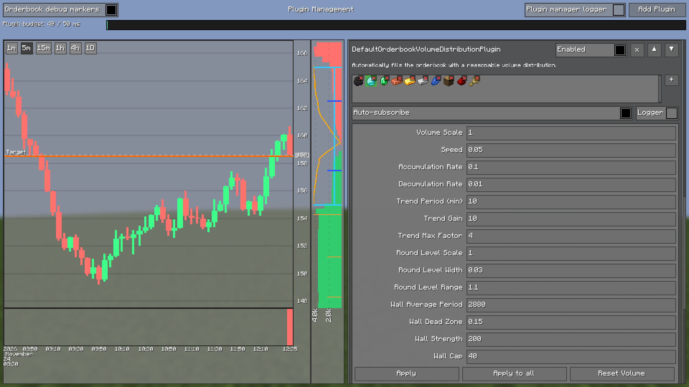
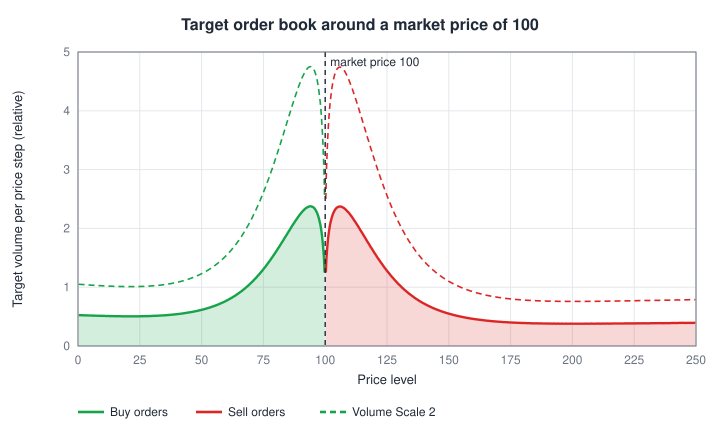
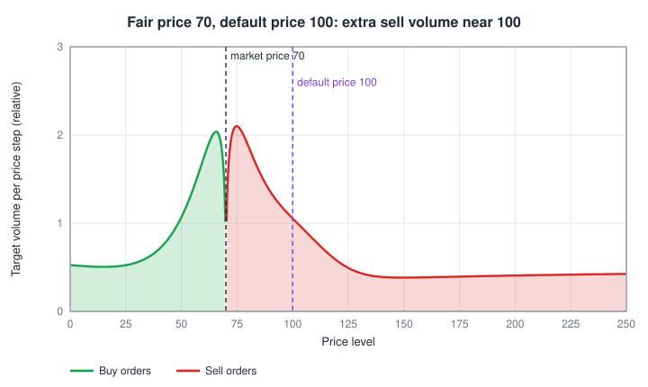
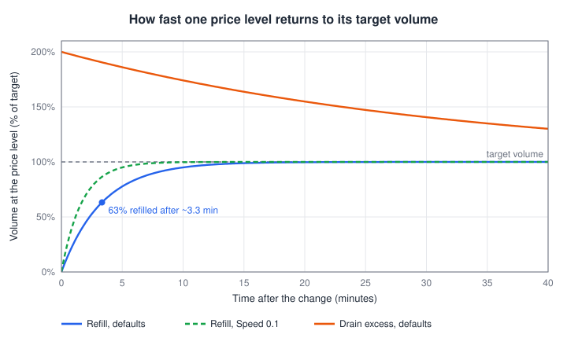

# Order book volume plugin

*In the plugin list: **DefaultOrderbookVolumeDistributionPlugin***

This plugin fills the order book with **virtual orders**: buy orders below the price and sell orders above it. Players and the [Target Price Bot](target-price-bot.md) trade against this volume. How deep the book is decides how far the price moves when someone buys or sells.

For every price level the plugin works out a **target volume**. The real volume drifts toward that target over time. When players buy or sell volume away, it grows back slowly. When the fair price moves, the book reshapes around it.

**Use it on** every market that players should be able to trade without another player on the other side. Without it, a market order only fills against player limit orders, and the order book looks empty. It only works on markets with **Enable Virtual Orderbook** switched on.

## How it works with the other plugins

- **Fair price.** The book is centred on the fair price, not on the last traded price. The fair price is the equilibrium price of the [Net Flow plugin](net-flow.md), which follows net player buying and selling. Without that plugin it is the market's default price. So a fast dump does not drag the book down with it: buying back after the dump meets the same depth the dump sold into.
- **Target Price Bot.** The bot sizes its orders from the depth, so a deeper book doesn't slow the bot down. It does slow down players: they need more items to move the price.
- **Abundance.** The item's **Abundance** sets the depth. The book is sized so that a reference order of `max(64, 64 × Abundance)` items moves the price by about the same percentage on every market. The market's **Max order size** does not change the depth.
- **Run order.** Keep this plugin after the plugins that move the price (by default it runs last). See [Plugins](index.md).

## Changing the settings

All settings are **per market**. Open the Plugin Management screen (`/stockmarket manage` → **Manage Plugins**), select a market icon in this plugin's entry, edit the fields and click one of the buttons:

<figure markdown="span">
  { width="600" }
</figure>

| Button | What it does |
|---|---|
| **Apply** | Saves the values for the selected market. The volume then drifts to the new target over time. |
| **Apply to all** | Saves the values for every market subscribed to this plugin, after a confirmation. The volume is not reset. |
| **Reset Volume** | Saves the values for the selected market **and** replaces its volume with the target at once, without the slow drift. |

## Settings

The fields accept only numbers of 0 or more.

| Setting | Default | Range | What it does |
|---|---|---|---|
| **Volume Scale** | `1` | 0 or more | Depth of the whole book. At `1`, a reference order of `max(64, 64 × Abundance)` items moves the price about 0.36 %. |
| **Speed** | `0.05` | 0 or more | Overall speed of the drift toward the target. Multiplies both rates below. |
| **Accumulation Rate** | `0.1` | 0 or more | How fast missing volume is refilled. |
| **Decumulation Rate** | `0.01` | 0 or more | How fast extra volume is removed. |
| **Round Level Scale** | `1` | 0 or more | Extra volume at round prices (100, 200, 250, 500, 1000 …), as a multiple of the depth near the price. `0` = off. |
| **Round Level Width** | `0.03` | 0.005 to 0.5 | Width of a round-price cluster in log price. `0.03` is about ±3 % around the level. |
| **Round Level Range** | `1.1` | 0.05 to 5 | How far from the price round-price clusters stay visible. Larger = clusters far from the price stay bigger. |
| **Trend Period (min)** | `10` | more than 0 | Time of the price's short moving average, in minutes. |
| **Trend Gain** | `10` | 0 or more | How strongly a move away from the short average speeds up the refill on the side facing the move. `0` = off. |
| **Trend Max Factor** | `4` | 1 or more | Largest speed-up or slow-down of a side's refill. `1` = off. |
| **Wall Average Period** | `2880` | 0 or more | Time of the price's slow moving average, in minutes. `2880` is 2 days. `0` = wall off. |
| **Wall Dead Zone** | `0.15` | 0 or more | Distance from the slow average without any wall, in log price. `0.15` is about ±15 %. |
| **Wall Strength** | `200` | 0 or more | How fast the wall grows beyond the dead zone. At `200`, a level 10 % beyond the dead zone gets 20 times the normal depth. `0` = off. |
| **Wall Cap** | `40` | 0 or more | Largest extra depth of the wall, as a multiple of the normal depth near the price. `0` = off. |

The sections below explain each group.

## Volume Scale: how deep the book is

Volume Scale makes the whole book deeper or thinner without changing its shape.

At `1`, a reference order of `max(64, 64 × Abundance)` items moves the price by about 0.36 %. For example, with Abundance 50 the reference order is 3,200 items. A higher Abundance gives a deeper book.

**What players notice:** the price moves about inversely to the depth. At `2`, a player needs about twice as many items to move the price by the same percentage. At `0.5`, half as many.

Some details:

- **Expensive items** always get at least 0.1 items per price step (times Volume Scale). So even a very expensive market never has a book so thin that single items make the price jump.
- **Cheap items** (price below about 1) move in big steps. Dirt at 0.1 moves in 10 % steps. Their book is deep per step.
- Changing a market's **default price** rebuilds its book at once, like **Reset Volume**. A changed **Abundance** changes the depth too, but the book drifts to it at the normal speed.

**Tuning tips:**

- If one player can crash or pump a market with a few max-size orders, raise Volume Scale for that market or lower its max order size.
- If trades seem to have no effect on the price, lower it.
- Use **Reset Volume** to see the new depth right away. Otherwise it fills in over a few minutes.

## The shape of the book

<figure markdown="span">
  { width="600" }
</figure>

The book has almost no volume right at the fair price (a spread of at least 0.5 %). Volume rises quickly to a peak about 5 to 10 % away and then levels off. Neither side runs dry: far from the price, there is always some buy interest below and some sell interest above, so a dump always meets buyers and a pump always meets sellers.

The book also adds extra volume around the market's **default price**. If net selling has pushed the fair price down, buyers who want to push it back up first have to get through this extra sell volume:

<figure markdown="span">
  { width="600" }
</figure>

When the price moves, price levels that change side (for example from buy to sell) are emptied at once and refill with the other order type. So after a fast move the swept levels are empty for a while, and the next trade in the opposite direction can briefly spike the price.

### Round-price clusters

Real traders like round numbers. The book adds extra volume around prices like 1, 2, 2.5, 3 and 5 times a power of ten (… 10, 20, 25, 30, 50, 100, 200 …). Prices of the form 1 × 10ⁿ get the most, then 5, then 2, then 2.5 and 3.

- **Round Level Scale** sets how much extra volume a cluster gets.
- **Round Level Width** sets how wide each cluster is.
- **Round Level Range** sets how fast clusters shrink with distance from the price. At the default, on a market at 160, the sell cluster at 1,000 holds about 19 % of the depth near the price.

A market whose price sits right on a round level gets about twice the depth there, so player flow moves its price a bit less.

## Speed and the two rates: how fast volume comes back

Every second, each price level moves part of the way toward its target:

```text
change per second = (target − current volume) × rate × Speed

rate = Accumulation Rate   if the level holds less than its target
       Decumulation Rate   if the level holds more than its target
```

The **time constant** `1 / (rate × Speed)` is the time to cover 63 % of the way. After three time constants, 95 % is done.

| Case | Defaults | Time constant | 95 % done after |
|---|---|---|---|
| Refill | 0.1 × 0.05 = 0.005 per second | 200 s (about 3 min) | about 10 min |
| Drain | 0.01 × 0.05 = 0.0005 per second | 2,000 s (about 33 min) | about 1.7 h |

<figure markdown="span">
  { width="600" }
</figure>

- **Speed** changes both directions at once. Doubling it halves both times.
- **Accumulation Rate** sets how fast volume comes back after players or the bot used it up. A fast refill makes a forgiving market that absorbs big trades. A slow refill keeps the book thin after a big trade, so the next trades move the price more.
- **Decumulation Rate** sets how fast extra volume disappears, for example after you lowered Volume Scale. It is slower on purpose, so the book doesn't suddenly vanish.

**Tuning tips:**

- Keep `rate × Speed` well below 1. Above 1 per second, the volume can overshoot after server lag.
- Speed `0` freezes the book: used-up volume never comes back, except through **Reset Volume**.
- For a market where players should feel the volume running out, lower Accumulation Rate. At `0.02`, the refill time constant is about 17 minutes.

## Trend settings: leaning against a move

The plugin tracks a short moving average of the price over **Trend Period (min)**. While the price is above that average, the sell side refills faster and the buy side slower. Below the average it is the other way round. So the book leans against a move that keeps going.

- **Trend Gain** sets how strongly the distance to the average changes the refill speed.
- **Trend Max Factor** caps the change. At `4`, a side refills at most 4 times faster or slower than normal.

Set Trend Gain to `0` or Trend Max Factor to `1` to switch it off.

## Wall settings: protection against flood trading

The wall protects a market against a player who buys or sells the same item non-stop, for hours or days.

The plugin keeps a second, **slow** moving average of the price over **Wall Average Period** (2 days by default). Every price level that is further than the **Wall Dead Zone** from this average gets extra volume, but only on the side that points away from the average:

- **Above the average**, only sell orders get the extra volume: traders take their profits.
- **Below the average**, only buy orders get it: bargain hunters step in.

The extra volume grows with the distance beyond the dead zone. **Wall Strength** sets how fast it grows, **Wall Cap** how big it can get. With the defaults, a level 10 % beyond the dead zone holds 20 times the normal depth, and from 20 % beyond it holds the full 40 times.

What this means in play:

- **Normal trading isn't affected.** Natural price swings, even trends over several days, mostly stay inside the ±15 % dead zone.
- **Pushing further gets expensive.** A player who keeps pushing the price in one direction has to buy or sell more and more items for each further percent.
- **Moving back is not affected.** The side facing the average gets no extra volume, so trading the price back costs the same as before.
- **A lasting new price becomes normal.** The slow average follows the price. If the price stays at a new level for days, the average catches up and the wall fades.
- **The wall builds up like any other volume.** It grows and shrinks at the refill speed set by Speed and the two rates.

In a 10-day test of a diamond market where one player market-buys 3,200 diamonds every minute, the price ended near 650 with the wall, and near 30,000 without it.

Set **Wall Strength**, **Wall Cap** or **Wall Average Period** to `0` to switch the wall off.

!!! note "Older worlds"
    Markets saved before the wall existed load with the default wall settings, so the wall is on after the update.

## Generic settings

Every plugin has these controls in its entry of the Plugin Management screen:

| Setting | Effect for this plugin |
|---|---|
| **Enabled** | When off, the book is no longer reshaped or refilled. The existing virtual volume stays as it is. Settings and subscriptions are kept. |
| **Auto-subscribe** | New markets are subscribed automatically. Markets created with **Ignore Plugin Autosubscribe** are skipped. |
| **Logger** | Writes the plugin's messages to the server log. |
| **Market subscriptions** | Only subscribed markets get virtual volume. Subscribing a market resets its volume to the target. |
| **Position in the list** | Run it after the plugins that move the price (default: last). |

## Related pages

- [Net Flow plugin](net-flow.md): where the fair price comes from.
- [Target Price Bot](target-price-bot.md): the bot that trades against this volume.
- [Choosing a market setup](../setup-use-cases.md): markets with and without the virtual order book.
