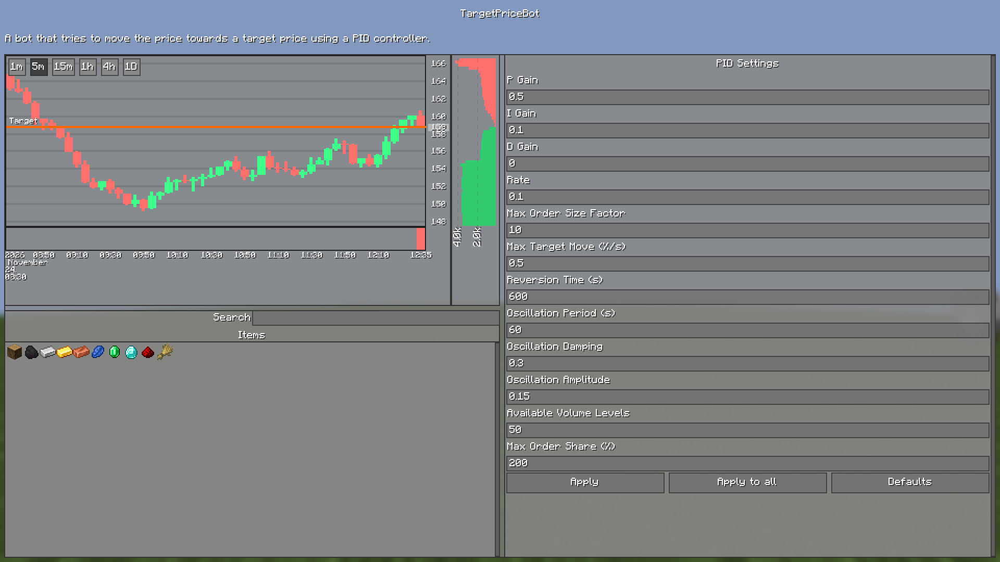

# Zielpreis-Bot { #target-price-bot }

*In der Plugin-Liste: **TargetPriceBot***

Dieser Bot bewegt den echten Preis zum **Zielpreis**. Das [Volatilitäts-Plugin](volatility.md) setzt das Ziel, und das [News-Plugin](news.md) ändert es während News-Ereignissen. Der Bot platziert Market-Orders gegen die Bot-Orders im Orderbuch, bis der Preis dort ankommt.

**Setze ihn auf** jedem Markt mit einem Volatilitäts-Plugin ein. Ohne den Bot wird das Ziel zwar berechnet, aber nichts bewegt den Preis dorthin. Er funktioniert nur auf Märkten, bei denen **Virtuelles Orderbuch aktiv** eingeschaltet ist.

## Was der Bot tut { #what-the-bot-does }

Etwa viermal pro Sekunde, für jeden Markt:

1. Er misst den **Abstand**: wie weit das Ziel vom aktuellen Preis entfernt ist, in Prozent.
2. Ein Regler macht aus dem Abstand eine **Dringlichkeit** zwischen 0 und 1. Ein großer Abstand bedeutet hohe Dringlichkeit.
3. Er kauft (Ziel darüber) oder verkauft (Ziel darunter) diesen Anteil der Bot-Orders zwischen Preis und Ziel.

Seine Orders gehen nie über das Ziel hinaus. Spieler-Orders, die im Weg liegen, werden dabei ausgeführt.

### Nach einem Handel eines Spielers { #after-a-player-trade }

Kauft oder verkauft ein Spieler viel, lässt der Bot den Preis nicht sofort zurückschnellen. Spieler sollen die Wirkung ihres Handels sehen:

- **Halten und zurückkehren.** Der Bot hält den Preis in der Nähe der Stelle, an die der Spieler ihn geschoben hat, und lässt ihn über etwa die **Rückkehrzeit** (standardmäßig 10 Minuten) zum Ziel zurückkehren. Auf dem Rückweg schwankt der Preis ein wenig um seinen Pfad, wie ein echter Preis. Weitere Käufe oder Verkäufe in dieselbe Richtung starten die Rückkehr nicht neu.
- **Pause bei leeren Bereichen.** Eine große Order kann alle Bot-Orders nahe am Preis wegräumen. Etwa eine Minute lang handelt der Bot danach nicht in einen solchen leeren Bereich. Die genaue Pause ist zufällig, damit Spieler sie nicht abpassen können.
- **Langsamer Start.** Nach einem Handel eines Spielers starten die Orders des Bots klein und wachsen über drei Minuten. Der Preis beginnt langsam zu gleiten und dann schneller.
- **Band.** Der Bot hält den Preis höchstens zwischen 25 % und dem 3-Fachen des fairen Preises des [Nettofluss-Plugins](net-flow.md). Ein Spieler, der den Preis über dieses Band hinaus schiebt, sieht ihn zuerst zum Rand des Bands zurückkommen.

### Zusammenspiel mit den anderen Plugins { #how-it-works-with-the-other-plugins }

- **Volatilitäts-Plugin.** Der Bot braucht dessen Ziel auf demselben Markt.
- **Orderbuch-Volumen-Plugin.** Der Bot handelt gegen die Bot-Orders des [Orderbuch-Volumen-Plugins](order-book-volume.md). Ein tieferes Orderbuch bedeutet größere Bot-Orders, die **Volumenskalierung** ändert also nicht, wie schnell der Bot das Ziel erreicht.

## Die Einstellungen ändern { #changing-the-settings }

Der Bot hat ein eigenes Fenster. Klicke in der Plugin-Verwaltung (`/stockmarket manage` → **Plugins verwalten**) im Eintrag des Bots auf **Plugin-Einstellungen öffnen**.

<figure markdown="span">
  { width="600" }
</figure>

Das Fenster zeigt oben links Chart und Orderbuch des gewählten Markts, darunter die Marktliste und rechts die **PID-Einstellungen**. Wähle einen Markt, ändere die Werte und klicke auf **Anwenden** für diesen Markt oder auf **Auf alle anwenden** für jeden Markt des Bots. **Standard** füllt die Standardwerte ein; geändert wird erst, wenn du sie anwendest.

## Einstellungen { #settings }

Alle Einstellungen gelten **pro Markt**. Nutze nur Werte von 0 oder mehr: Negative Verstärkungen lassen den Bot vom Ziel weg handeln.

| Einstellung | Standard | Was sie tut |
|---|---|---|
| **P Verstärkung** | `0.5` | Wie stark der Bot auf den Abstand im Moment reagiert. |
| **I Verstärkung** | `0.1` | Baut sich auf, solange ein Abstand bleibt, und schließt kleine verbleibende Abstände. |
| **D Verstärkung** | `0` | Reagiert darauf, wie schnell sich der Abstand ändert. |
| **Änderungsrate** | `0.1` | Das Höchste, was der Anteil der **I Verstärkung** beitragen kann. Keine Geschwindigkeit. |
| **Faktor max. Ordergröße** | `10` | Größte Bot-Order pro Schritt, als Vielfaches der **Max. Ordergröße** des Markts. `0` = keine Grenze, auch wenn der Markt keine Grenze hat. |
| **Max. Zielbewegung (%/s)** | `0.5` | Wie schnell das Ziel des Bots einem Sprung des Zielpreises folgen darf, in Prozent pro Sekunde. `0` = keine Grenze. |
| **Rückkehrzeit (s)** | `600` | Wie lange der Preis braucht, um nach einem Schub eines Spielers zurückzukehren. `0` = aus: Der Bot folgt dem Ziel sofort. |
| **Schwingungsdauer (s)** | `60` | Länge einer Schwingung auf dem Rückweg. |
| **Schwingungsdämpfung** | `0.3` | Wie schnell die Schwingungen abklingen, 0 bis 1. `0` = sie laufen weiter, `1` = kein Überschwingen. |
| **Schwingungsamplitude** | `0.15` | Größe der ersten Schwingung, als Anteil des Schubs des Spielers. Der Preis geht nie über das Ziel oder über den Preis des Spielers hinaus. |
| **Verfügbare Volumen-Stufen** | `50` | Wie viele Preisstufen mit Bot-Orders der Bot zählt, wenn er eine Order bemisst. Mehr Stufen lassen ihn den Preis schneller zurückbringen. |
| **Max. Orderanteil (%)** | `200` | Die größte Order nach dem langsamen Start, in Prozent des gezählten Volumens. Über 100 % ordert der Bot über die gezählten Stufen hinaus, aber nie über sein Ziel oder seine Ordergrenze hinaus. |

## Der Regler { #the-controller }

Der Abstand wird in Prozent des Preises gemessen, dieselben Werte funktionieren also bei billigen und teuren Items:

```text
I part   = I part + gap × seconds × I Gain, kept between −Rate and +Rate
output   = P Gain × gap + I part + D Gain × (change of the gap per second)
urgency  = output, smoothed and kept between 0 and 1
```

Mit den Standardwerten wird ein Abstand von 4 % oder mehr in einem Zug geschlossen. Ein Abstand von 1 % ist nach dem ersten Schritt zu etwa einem Viertel geschlossen und nach einer Sekunde zu drei Vierteln. Ist das Ziel weniger als einen Cent entfernt, wartet der Bot.

### P Verstärkung { #p-gain }

Wie eng der Preis am Ziel klebt:

- **Hoch:** Ein Spieler verkauft einen großen Stapel, und innerhalb einer Sekunde kauft der Bot den Preis wieder hoch. Handel von Spielern hinterlässt im Chart fast keine Spur.
- **Niedrig:** Handel von Spielern schiebt den Preis weg, und er driftet über Sekunden bis Minuten zurück. Der Markt fühlt sich stärker von Spielern getrieben an.

### I Verstärkung und Änderungsrate { #i-gain-and-rate }

**I Verstärkung** schließt kleine Abstände, die bleiben und für die **P Verstärkung** allein zu schwach ist. Zu hoch lässt sie den Preis übers Ziel hinausschießen und um das Ziel schwingen. **Änderungsrate** begrenzt sie: Mit `0.1` schließt dieser Anteil allein höchstens etwa ein Zehntel des Abstands pro Schritt. Erhöhe beide, wenn ein Markt lange hinter seinem Ziel herläuft; senke sie, wenn der Preis nach langen einseitigen Bewegungen übers Ziel hinausschießt.

### D Verstärkung { #d-gain }

Dämpft das Überschwingen. Die Ausgabe ist schon geglättet, daher funktioniert `0` für fast jeden Markt. Vermeide große Werte: Wenn ein News-Ereignis das Ziel plötzlich bewegt, verursachen sie einen kurzen Schub sehr harten Handels.

### Checkliste zum Einstellen { #tuning-checklist }

1. Starte mit den Standardwerten und beobachte im Chart, wie der Preis der Ziellinie folgt.
2. Der Preis hängt weit hinter dem Ziel zurück: Erhöhe **P Verstärkung**. Folgt das Ziel des Bots einem News-Sprung zu langsam, erhöhe **Max. Zielbewegung (%/s)**.
3. Der Preis schießt übers Ziel hinaus und schwingt darum: Senke **I Verstärkung** oder **Änderungsrate**, dann **P Verstärkung**.
4. Spieler sagen, ihr Handel hat keine Wirkung: Erhöhe **Rückkehrzeit (s)** oder senke **P Verstärkung**.

## Allgemeine Einstellungen { #generic-settings }

| Einstellung | Wirkung bei diesem Plugin |
|---|---|
| **Aktiviert** | Wenn aus, hört der Bot auf zu handeln, und der Preis bewegt sich nur noch durch Spieler. Einstellungen und Märkte bleiben erhalten. |
| **Auto-Abo** | Neue Märkte werden automatisch hinzugefügt. Märkte, die mit **Plugin-Autosubscribe ignorieren** erstellt wurden, werden übersprungen. |
| **Logger** | Schreibt für jede Bot-Order eine Zeile ins Server-Log. Sehr gesprächig: nur zur Fehlersuche. |
| **Markt-Abonnements** | Der Bot handelt nur auf diesen Märkten. |
| **Position in der Liste** | Nach dem Volatilitäts-Plugin (Standard). Siehe [Plugins](index.md#the-order-matters). |

## Verwandte Seiten { #related-pages }

- [Volatilitäts-Plugin](volatility.md): woher das Ziel kommt.
- [Orderbuch-Volumen-Plugin](order-book-volume.md): die Bot-Orders, gegen die er handelt.
- [Nettofluss-Plugin](net-flow.md): der faire Preis und das Band.
