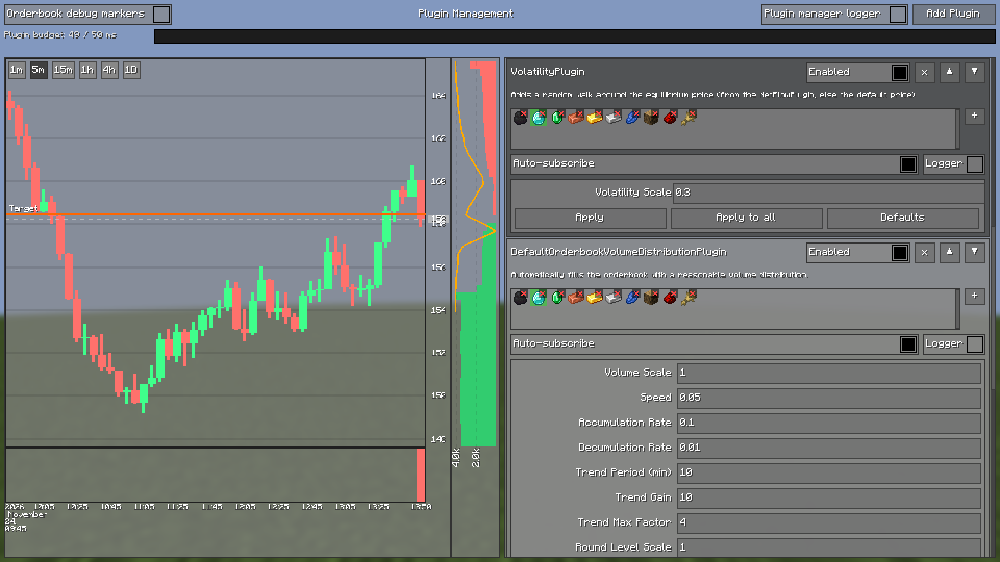
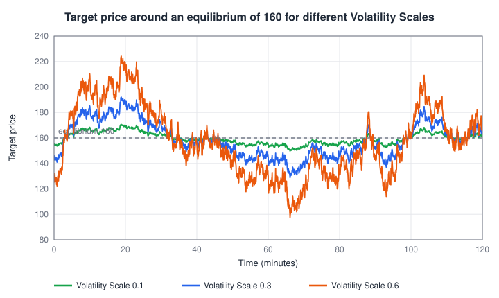

# Volatilitäts-Plugin { #volatility-plugin }

*In der Plugin-Liste: **VolatilityPlugin***

Dieses Plugin lässt den Preis langsam und zufällig schwanken, damit ein Chart nie flach aussieht. Es setzt für jeden Markt einen **Zielpreis**: den fairen Preis plus eine zufällige Schwankung. Es handelt nicht selbst. Der [Zielpreis-Bot](target-price-bot.md) platziert die Orders, die den echten Preis zum Ziel bewegen.

```text
target price = fair price × (1 + random value × Volatility Scale)
```

**Setze es auf** jedem Markt ein, der sich von selbst bewegen soll. Ohne das Plugin, oder ohne einen Zielpreis-Bot auf demselben Markt, bewegt sich ein Preis nur, wenn Spieler handeln. Es funktioniert nur auf Märkten, bei denen **Virtuelles Orderbuch aktiv** eingeschaltet ist.

## Zusammenspiel mit den anderen Plugins { #how-it-works-with-the-other-plugins }

- **Fairer Preis.** Die Schwankung ist am Gleichgewichtspreis des [Nettofluss-Plugins](net-flow.md) ausgerichtet, das davor läuft. Ohne dieses Plugin ist es der Standardpreis des Markts.
- **Zielpreis-Bot.** Der Bot handelt den Preis zum Ziel. Füge beide Plugins denselben Märkten hinzu.
- **News.** Das [News-Plugin](news.md) multipliziert das Ziel, solange ein News-Ereignis läuft.

## Die Einstellung ändern { #changing-the-setting }

Die Einstellung gilt **pro Markt**. Öffne die Plugin-Verwaltung (`/stockmarket manage` → **Plugins verwalten**), wähle ein Markt-Icon im Eintrag dieses Plugins, ändere das Feld und klicke auf **Anwenden** für diesen Markt oder auf **Auf alle anwenden** für jeden Markt des Plugins.

<figure markdown="span">
  { width="600" }
</figure>

| Einstellung | Standard | Bereich | Was sie tut |
|---|---|---|---|
| **Volatilitätsskala** | `0.3` | 0 oder mehr | Wie weit der Preis um den fairen Preis schwankt. `0` = keine Schwankung: Das Ziel ist der faire Preis. |

## Volatilitätsskala: wie weit der Preis schwankt { #volatility-scale-how-far-the-price-swings }

Der Zufallswert ist eine Mischung aus langsamen und schnellen Schwankungen: Manche ändern sich innerhalb von Minuten, manche über eine Stunde, manche über 8 Stunden und manche über zwei bis drei Tage. Der größte Teil der Bewegung steckt im langsamen Teil. So driftet der Preis in Auf- und Abwärtstrends, die Tage dauern können, während er sich innerhalb einer Stunde nur wenig ändert. Die Schwankung folgt der Echtzeit.

Die Schwankung ist ein Prozentsatz des fairen Preises, derselbe Wert wirkt also bei billigen und teuren Items gleich:

| Volatilitätsskala | Übliche Schwankung | 90 % der Zeit innerhalb | Praktisch nie über | Übliche Änderung in einer Stunde |
|---|---|---|---|---|
| `0.1` | ±3 % | ±8 % | ±14 % | ±1 % |
| `0.3` (Standard) | ±10 % | ±23 % | ±42 % | ±2 % |
| `0.6` | ±19 % | ±46 % | ±85 % | ±5 % |

<figure markdown="span">
  { width="600" }
</figure>

**Tipps zum Einstellen:**

- `0.1` bis `0.2` für Alltags-Items, die sich stabil anfühlen sollen, etwa Nahrung und Baublöcke.
- `0.3` für einen lebhaften Markt.
- `0.4` bis `0.5` für Items, auf die Spieler spekulieren sollen.
- Bleib unter etwa `0.6`. Das Ziel kann nicht unter null fallen, deshalb kann bei größeren Werten eine tiefe Schwankung den Preis auf null drücken.

## Allgemeine Einstellungen { #generic-settings }

| Einstellung | Wirkung bei diesem Plugin |
|---|---|
| **Aktiviert** | Wenn aus, stoppt die Schwankung, und das Ziel ist der faire Preis des Nettofluss-Plugins. Einstellungen und Märkte bleiben erhalten. |
| **Auto-Abo** | Neue Märkte werden automatisch hinzugefügt. Märkte, die mit **Plugin-Autosubscribe ignorieren** erstellt wurden, werden übersprungen. |
| **Logger** | Schreibt die Meldungen des Plugins ins Server-Log. |
| **Markt-Abonnements** | Nur diese Märkte bekommen von diesem Plugin einen Zielpreis. |
| **Position in der Liste** | Nach dem Nettofluss-Plugin und vor dem Zielpreis-Bot (Standard). Siehe [Plugins](index.md#the-order-matters). |

## Verwandte Seiten { #related-pages }

- [Nettofluss-Plugin](net-flow.md): woher der faire Preis kommt.
- [Zielpreis-Bot](target-price-bot.md): der Bot, der dem Ziel folgt.
- [Plugins](index.md): alle Plugins und die Plugin-Verwaltung.
