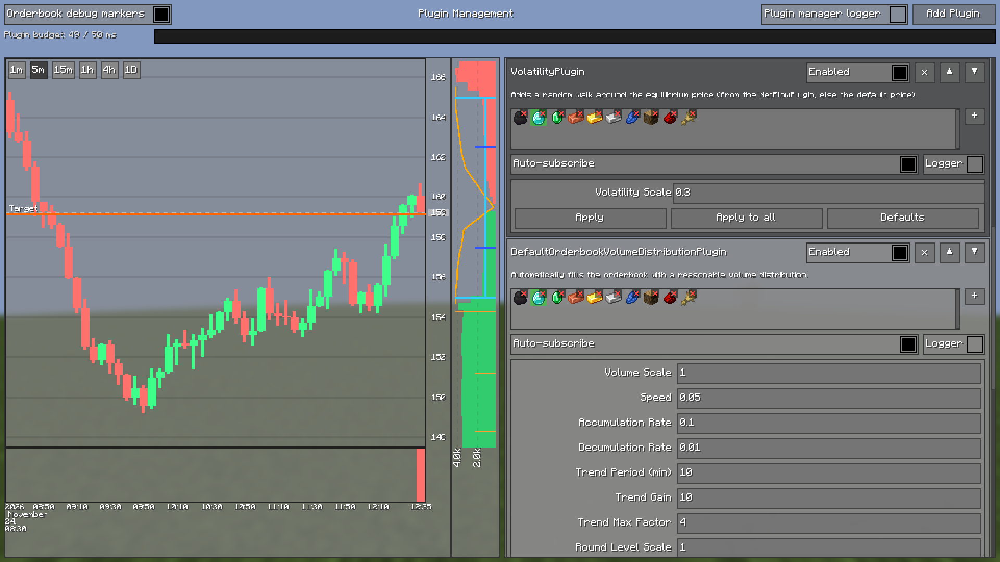
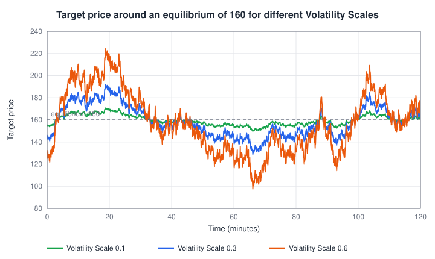

# Volatility plugin

*In the plugin list: **VolatilityPlugin***

This plugin lets the price wander slowly and randomly, so a chart never looks flat. It sets a **target price** for each market: the fair price plus a random swing. It doesn't trade itself. The [Target Price Bot](target-price-bot.md) places the orders that move the real price towards the target.

```text
target price = fair price × (1 + random value × Volatility Scale)
```

**Use it on** every market that should move by itself. Without it, or without a Target Price Bot on the same market, a price only moves when players trade. It only works on markets with **Enable Virtual Orderbook** switched on.

## How it works with the other plugins

- **Fair price.** The swing is centred on the equilibrium price of the [Net Flow plugin](net-flow.md), which runs before it. Without that plugin it is the market's default price.
- **Target Price Bot.** The bot trades the price towards the target. Add both plugins to the same markets.
- **News.** The [News plugin](news.md) multiplies the target while a news event runs.

## Changing the setting

The setting is **per market**. Open the Plugin Management screen (`/stockmarket manage` → **Manage Plugins**), select a market icon in this plugin's entry, change the field and click **Apply** for this market or **Apply to all** for every market of the plugin.

<figure markdown="span">
  { width="600" }
</figure>

| Setting | Default | Range | What it does |
|---|---|---|---|
| **Volatility Scale** | `0.3` | 0 or more | How far the price swings around the fair price. `0` = no swing: the target is the fair price. |

## Volatility Scale: how far the price swings

The random value is a mix of slow and fast swings: some change within minutes, some over an hour, some over 8 hours and some over two to three days. Most of the movement is in the slow part. So the price drifts in up and down trends that can last days, while it changes only a little within one hour. The swing follows real time.

The swing is a percentage of the fair price, so the same value works the same on cheap and expensive items:

| Volatility Scale | Usual swing | 90 % of the time within | Practically never beyond | Usual change in one hour |
|---|---|---|---|---|
| `0.1` | ±3 % | ±8 % | ±14 % | ±1 % |
| `0.3` (default) | ±10 % | ±23 % | ±42 % | ±2 % |
| `0.6` | ±19 % | ±46 % | ±85 % | ±5 % |

<figure markdown="span">
  { width="600" }
</figure>

**Tuning tips:**

- `0.1` to `0.2` for everyday items that should feel stable, such as food and building blocks.
- `0.3` for a lively market.
- `0.4` to `0.5` for items players should speculate on.
- Stay below about `0.6`. The target can't go below zero, so with larger values a deep swing can push the price to zero.

## Generic settings

| Setting | Effect for this plugin |
|---|---|
| **Enabled** | When off, the swing stops and the target is the fair price of the Net Flow plugin. Settings and markets are kept. |
| **Auto-subscribe** | New markets are added automatically. Markets created with **Ignore Plugin Autosubscribe** are skipped. |
| **Logger** | Writes the plugin's messages to the server log. |
| **Market subscriptions** | Only these markets get a target price from this plugin. |
| **Position in the list** | After the Net Flow plugin and before the Target Price Bot (the default). See [Plugins](index.md#the-order-matters). |

## Related pages

- [Net Flow plugin](net-flow.md): where the fair price comes from.
- [Target Price Bot](target-price-bot.md): the bot that follows the target.
- [Plugins](index.md): all plugins and the Plugin Management screen.
