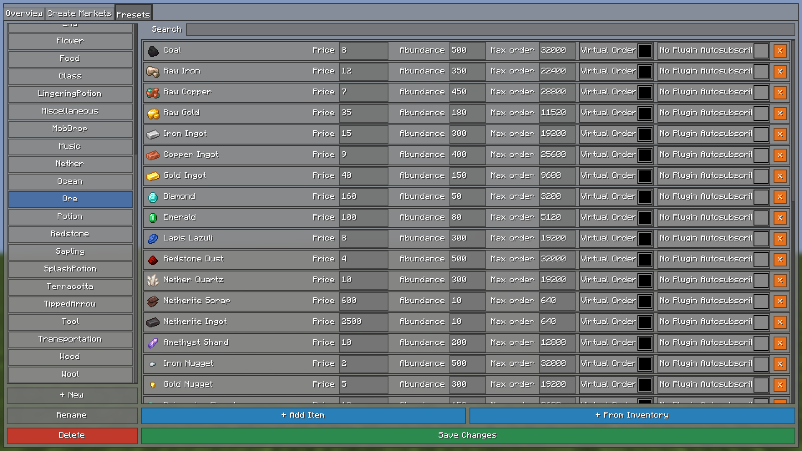

# Markt-Voreinstellungen { #market-presets }

Eine Voreinstellung enthält die Startwerte für den Markt eines Items: seinen Preis, seine Häufigkeit und sein Orderlimit. Wenn du auf dem Tab **Märkte erstellen** einen Markt erstellst, trägt die Voreinstellung diese Werte ein. Voreinstellungen sind in Kategorien gruppiert, etwa Ore, Food oder Redstone.

StockMarket liefert Voreinstellungen für die meisten Vanilla-Items mit, auch für verzauberte Bücher und Tränke. Diese Seite brauchst du nur, um Preise zu ändern oder Items aus anderen Mods hinzuzufügen.

## Der Tab „Voreinstellungen“ { #the-presets-tab }

Führe `/stockmarket manage` aus und öffne den Tab **Voreinstellungen**. Du brauchst das StockMarket-Admin-Flag.

<figure markdown="span">
  { width="600" }
</figure>

Wähle links eine Kategorie. **+ Neu** fügt eine Kategorie hinzu; **Umbenennen** und **Löschen** ändern die ausgewählte. Jedes Item in der Kategorie hat diese Felder:

| Feld | Was es bedeutet |
|---|---|
| **Preis** | Der Start- und Standardpreis des Markts. |
| **Häufigkeit** | Wie häufig das Item ist. Höher heißt häufiger: Erde hat 200, Diamanten 5. Die Häufigkeit skaliert die Bot-Orders und die Preisstabilität. Muss über 0 liegen; die meisten Items liegen zwischen 0.5 und 200. |
| **Max. Order** | Die größte Zahl an Items, die eine einzelne Spieler-Order kaufen oder verkaufen darf. `0` = kein Limit. Neue Voreinstellungen bekommen den **Faktor max. Ordergröße** mal die Häufigkeit, aber mindestens den Faktor. |
| **Virtuelles Orderbuch** | Märkte aus dieser Voreinstellung starten mit Bot-Orders. |
| **Kein Plugin-Autosubscribe** | Plugins, die sich selbst zu neuen Märkten hinzufügen, lassen Märkte aus dieser Voreinstellung aus. Du kannst sie trotzdem von Hand hinzufügen. |

Klicke auf **Änderungen speichern**, wenn du fertig bist. Änderungen wirken nur auf Märkte, die du später erstellst. Um einen bestehenden Markt zu ändern, nutze seine [Markt-Einstellungen](markets.md#market-settings).

## Items hinzufügen { #adding-items }

| Knopf | Fügt hinzu |
|---|---|
| **+ Item hinzufügen** | Ein Item aus der Liste aller Items. |
| **+ Aus Inventar** | Ein Item aus deinem Inventar, mit seinen Daten. Nutze das für umbenannte Items oder für Items aus Mods, die Daten am Item speichern. |

Das geht auch mit einem Befehl. Halte das Item in deiner Haupthand und führe aus:

```text
/stockmarket preset add "<category>" ["<name>"]
```

Der optionale Name wird zum Anzeigenamen der Voreinstellung. Eine Kategorie, die es noch nicht gibt, wird angelegt.

## Die Voreinstellungsdateien { #the-preset-files }

Voreinstellungen liegen in `config/StockMarket/market_presets/`, eine JSON-Datei pro Kategorie. Sie gehören zum Server, nicht zu einer Welt, daher nutzt jede Welt auf dem Server dieselben Voreinstellungen.

Voreinstellungen lassen sich nur auf dem Master-Server eines [Netzwerks](../multi-server.md) ändern. Ist der Ordner beim Serverstart leer, werden die Standard-Voreinstellungen neu geschrieben. Um zu den Standardwerten zurückzukehren, stoppe den Server und lösche die Dateien im Ordner.

## Verwandte Seiten { #related-pages }

- [Märkte erstellen und verwalten](markets.md): Märkte aus den Voreinstellungen erstellen.
- [Mod-Einstellungen von StockMarket](mod-settings.md): der **Faktor max. Ordergröße**.
- [Preis-Plugins](plugins/index.md): wie die Häufigkeit die Bots beeinflusst.
