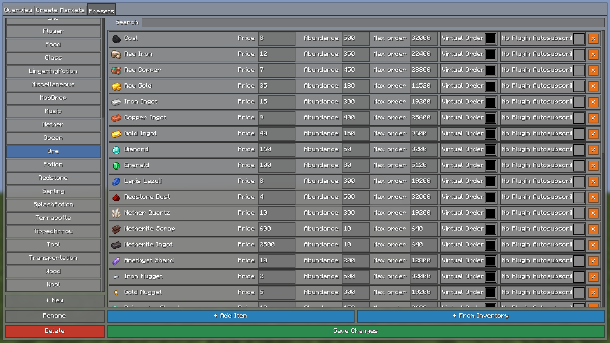

# Market presets

A preset holds the starting values for one item's market: its price, abundance and order limit. When you create a market on the **Create Markets** tab, the preset fills in these values. Presets are grouped into categories such as Ore, Food or Redstone.

StockMarket ships presets for most vanilla items, including enchanted books and potions. You only need this page to change prices, or to add items from other mods.

## The Presets tab

Run `/stockmarket manage` and open the **Presets** tab. You need the StockMarket admin flag.

<figure markdown="span">
  { width="600" }
</figure>

Choose a category on the left. **+ New** adds a category; **Rename** and **Delete** change the selected one. Each item in the category has these fields:

| Field | What it means |
|---|---|
| **Price** | The starting and default price of the market. |
| **Abundance** | How common the item is. Higher means more common: dirt has 200, diamonds 5. Abundance scales the bot orders and the price stability. Must be above 0; most items are between 0.5 and 200. |
| **Max order** | The most items one player order may buy or sell. `0` = no limit. New presets get the **Max order size factor** times the abundance, but at least the factor. |
| **Virtual Orderbook** | Markets created from this preset start with bot orders. |
| **No Plugin Autosubscribe** | Plugins that add themselves to new markets skip markets from this preset. You can still add them by hand. |

Click **Save Changes** when you are done. Changes only affect markets you create later. To change an existing market, use its [Market Settings](markets.md#market-settings).

## Adding items

| Button | Adds |
|---|---|
| **+ Add Item** | An item from the list of all items. |
| **+ From Inventory** | An item from your inventory, with its data. Use this for renamed items or items from mods that store data on the item. |

The same works with a command. Hold the item in your main hand and run:

```text
/stockmarket preset add "<category>" ["<name>"]
```

The optional name becomes the preset's display name. A category that doesn't exist yet is created.

## The preset files

Presets are stored in `config/StockMarket/market_presets/`, one JSON file per category. They belong to the server, not to a world, so every world on the server uses the same presets.

Presets can only be changed on the master server of a [network](../multi-server.md). If the folder is empty when the server starts, the default presets are written again. To go back to the defaults, stop the server and delete the folder's files.

## Related pages

- [Creating and managing markets](markets.md): create markets from the presets.
- [StockMarket Mod Settings](mod-settings.md): the **Max order size factor**.
- [Price plugins](plugins/index.md): how abundance affects the bots.
