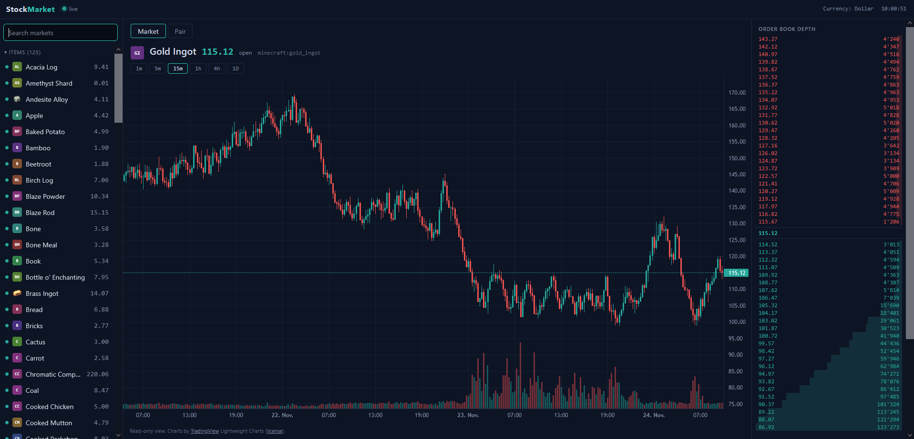

# Web-Oberfläche { #web-interface }

StockMarket kann seine Märkte auf einer Webseite zeigen. Spieler öffnen sie in einem Browser und verfolgen die Preise, ohne dem Spiel beizutreten. Die Seite zeigt nur an; niemand kann über sie handeln oder etwas ändern.

<figure markdown="span">
  { width="600" }
</figure>

## Einschalten { #turning-it-on }

1. Öffne die Mod-Einstellungen von StockMarket: `/stockmarket manage` → **Mod-Einstellungen**.
2. Schalte unter **Integrationen** die Option **Web-Oberfläche (nur lesen)** ein.
3. Lege den **Port** fest, Standard `8090`.
4. Klicke auf **Anwenden**. Die Seite startet sofort, ohne Neustart.

Die Seite ist dann unter `http://<server address>:<port>/` erreichbar, zum Beispiel `http://play.example.com:8090/`. Das Server-Log zeigt `[StockMarket Web] serving on …`, wenn sie läuft.

Der Port muss zwischen 1024 und 65535 liegen. Er darf nicht der Spielport, der Port des [Netzwerks](multi-server.md) oder ein Port sein, den ein anderes Programm verwendet. Die Mod-Einstellungen lehnen einen solchen Port vor dem Speichern ab.

!!! warning "Jeder, der den Port erreicht, kann die Seite sehen"
    Die Seite hat keine Anmeldung. Öffne den Port in deiner Firewall nur, wenn jeder deine Märkte sehen darf. Die Seite zeigt nie Spielernamen, UUIDs, Kontonummern oder Order-IDs.

## Was die Seite zeigt { #what-the-page-shows }

- **Die Marktliste** links, mit einem Suchfeld. Klicke auf einen Markt, um ihn zu öffnen.
- **Das Preischart**, als **Candles** oder als **Line**, mit Zeiträumen von 1 Minute bis 1 Tag. Mit **Kerzen: Spielzeit verwenden** sind die Zeiträume stattdessen Stunden, Tage und Wochen im Spiel.
- **Pair**: der Preis eines Items in einem anderen, wie beim Handel [Item gegen Item](../stockmarket/pair-trading.md). Wähle **I have** und **I want**.
- **Order book depth**: wie viele Items rund um den aktuellen Preis angeboten werden.
- **Open player orders**: Orders von Spielern, nach Preis gruppiert, ohne Namen.
- **Recent trades (24 h)**: Zeit, Kauf oder Verkauf, Menge und Durchschnittspreis.

Preise und Orderbuch werden alle 2 Sekunden aktualisiert, die Trades alle 5 Sekunden.

## Wo sie läuft { #where-it-runs }

| Server | Web-Oberfläche |
|---|---|
| Ein einzelner Server | Auf allen Netzwerkadressen, damit andere Computer sie erreichen. |
| Master eines Netzwerks | Ebenso. Sie zeigt alle Märkte des Netzwerks. |
| Slave | Nie. Spieler verwenden die Seite des Masters. |
| Einzelspieler | Nur auf deinem eigenen Computer, unter `http://127.0.0.1:<port>/`. |

## Wenn die Seite nicht öffnet { #if-the-page-doesnt-open }

| Problem | Lösung |
|---|---|
| Das Log sagt *could not bind port* | Ein anderes Programm verwendet den Port. Wähle einen anderen. |
| Es funktioniert auf dem Server-Rechner, aber nicht von außen | Öffne den Port in der Firewall oder leite ihn in deinem Router weiter. Manche Hoster erlauben nur Ports, die sie dir zuweisen. |
| Nichts im Log | Die Einstellung ist aus, oder dieser Server ist ein Slave. |

## Verwandte Seiten { #related-pages }

- [Funktionen ein- und ausschalten](features.md): jeder Schalter beider Mods.
- [Platzhalter](placeholders.md): Live-Preise im Spiel.
- [Master- und Slave-Server](multi-server.md): welcher Server was macht.
