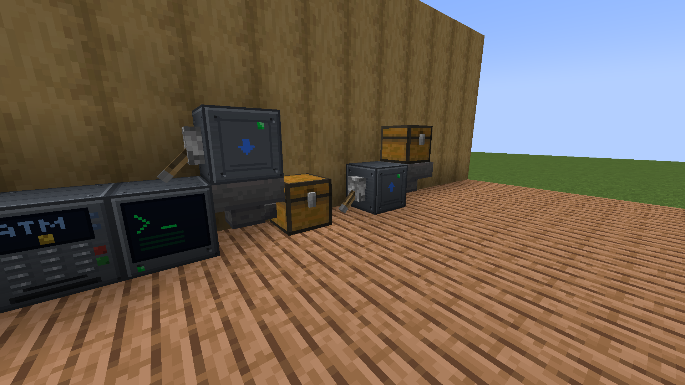
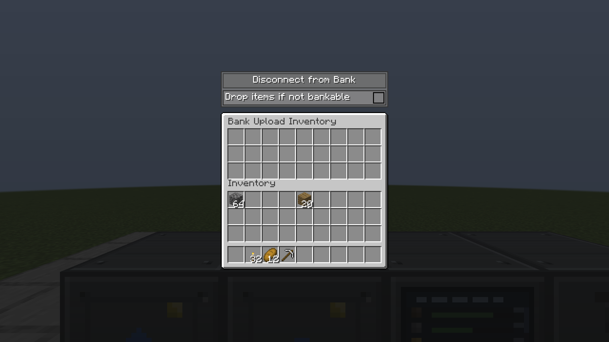
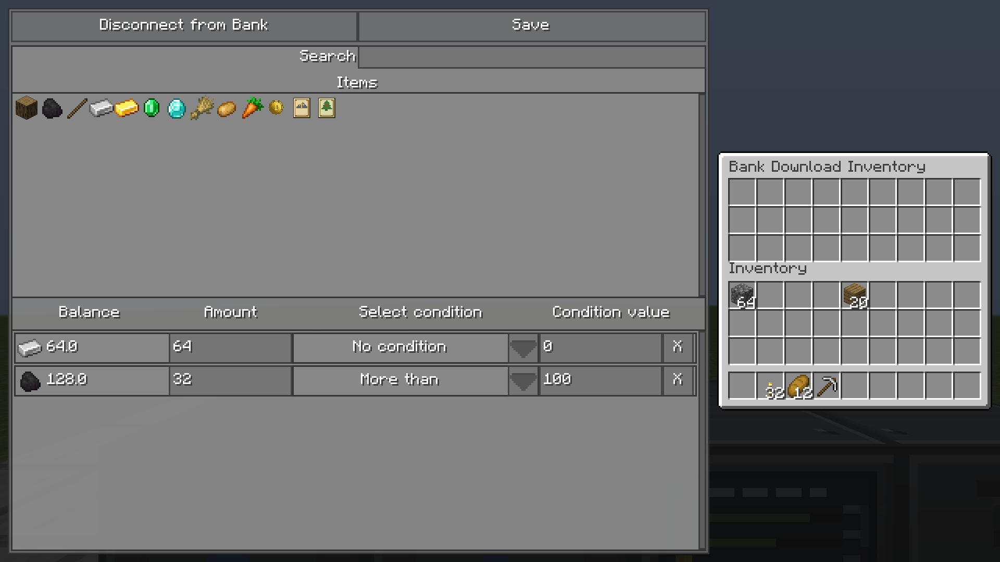

# Automatisierung { #automation }

Zwei Blöcke verbinden dein Bankkonto mit Trichtern, Rohren und Redstone:

- Der **Bank Upload Block** sendet Items auf dein Bankkonto, zum Beispiel die Ausbeute einer Farm.
- Der **Bank Download Block** holt Items von deinem Bankkonto und hält einen Vorrat bereit, zum Beispiel Brennstoff für deine Öfen.

Beide Blöcke arbeiten nur, solange sie ein Redstone-Signal bekommen. Die Rezepte findest du unter [Blöcke und Rezepte](blocks-and-recipes.md).

<figure markdown="span">
  { width="600" }
</figure>

## Bank Upload Block { #bank-upload-block }

1. Stelle den Block auf und mache einen Rechtsklick darauf.
2. Klicke auf **Mit Bank verbinden** und wähle das Konto.
3. Entscheide, was mit Items passiert, die die Bank nicht einlagern kann. Ist **Erlaube Items zu droppen** angehakt, wirft der Block sie auf den Boden. Sonst bleiben sie im Block.
4. Füttere den Block über einen Trichter oder ein Rohr mit Items oder lege sie von Hand hinein.
5. Versorge den Block mit Redstone. Solange er Strom hat, sendet er seine Items an die Bank.

Der Block zahlt im Namen des Spielers ein, der ihn verbunden hat. Dieser Spieler braucht **Erlaubt einzuzahlen** auf dem Konto. Verliert er das Recht, hält der Block an. Nur dieser Spieler kann den Block öffnen: Bei allen anderen bewirkt ein Rechtsklick nichts.

Der Block überspringt beschädigte und verzauberte Items. Sie bleiben im Block oder fallen auf den Boden, wenn **Erlaube Items zu droppen** angehakt ist.

<figure markdown="span">
  { width="600" }
</figure>

## Bank Download Block { #bank-download-block }

Der Download Block hält eine feste Menge Items in seinem eigenen Inventar. Nimmt ein Trichter oder ein Spieler Items heraus, füllt er aus der Bank nach.

1. Stelle den Block auf und mache einen Rechtsklick darauf.
2. Klicke auf **Mit Bank verbinden** und wähle das Konto.
3. Wähle ein Item aus der Liste. Damit legst du einen Abhebeauftrag dafür an. Du kannst Aufträge für mehrere Items anlegen.
4. Stelle jeden Auftrag ein:
    - **Ziel Menge**: wie viele dieses Items der Block in seinem Inventar hält. 0 schaltet den Auftrag aus.
    - **Bedingung**: wann nachgefüllt wird. **Keine** füllt immer nach. **Mehr als** füllt nur nach, solange deine Bank mehr als den **Bedingungs Wert** enthält. **Weniger als** füllt nur nach, solange sie weniger enthält.
5. Klicke auf **Speichern**. Der Knopf wird bernsteinfarben, solange du ungespeicherte Änderungen hast.
6. Versorge den Block mit Redstone. Solange er Strom hat, füllt er nach.

Neben jedem Auftrag zeigt **Bank Kontostand**, wie viele dieses Items in der Bank liegen. Das **X** entfernt den Auftrag beim Speichern.

<figure markdown="span">
  { width="600" }
</figure>

!!! tip "Halte eine Reserve"
    Nutze **Mehr als**, um anzuhalten, bevor die Bank leer ist. Der Block prüft die Bedingung vor dem Nachfüllen, und das Nachfüllen selbst kann unter den Wert gehen. Ein Auftrag über 64 Kohle mit **Mehr als** 64 nimmt zum Beispiel trotzdem 64 Kohle, wenn die Bank 70 enthält, und lässt 6 übrig. Um immer 64 in der Bank zu behalten, setze den **Bedingungs Wert** auf 128.

### Wer ihn ändern darf { #who-can-change-it }

Nur Spieler mit **Erlaubt abzuheben** auf dem verbundenen Konto können den Block öffnen, seine Einstellungen ändern oder ihn trennen. Der Block hebt im Namen des Spielers ab, der ihn zuletzt gespeichert hat. Verliert dieser Spieler **Erlaubt abzuheben**, hält der Block an, bis ihn jemand mit dem Recht erneut speichert.

Ein Block, der vor Version 2.2.0 aufgestellt wurde, weiß nicht, wer ihn eingerichtet hat, und bleibt nach dem Update untätig. Öffne ihn einmal und klicke auf **Speichern**, um ihn wieder zu starten.

## Wenn etwas schiefgeht { #if-something-goes-wrong }

| Was du siehst | Warum | Was du tun kannst |
|---|---|---|
| Nichts passiert | Der Block hat kein Redstone-Signal. | Füge einen Hebel, eine Redstone-Fackel oder einen Taktgeber hinzu. |
| Der Knopf **Mit Bank verbinden** des Download Blocks ist orange | Der Block ist noch mit keinem Konto verbunden. Der Knopf blinkt, wenn du etwas versuchst, das ein Konto braucht. | Klicke darauf und wähle ein Konto. |
| Im Upload Block stauen sich Items | Die Bank erlaubt diese Items nicht, oder der Spieler, der den Block verbunden hat, hat **Erlaubt einzuzahlen** verloren. | Hake **Erlaube Items zu droppen** an, filtere die Items vor dem Block heraus oder prüfe die Kontorechte. |
| Der Download Block füllt nicht mehr nach | Die Bedingung ist nicht erfüllt, die Bank ist leer, oder der Spieler, der ihn gespeichert hat, hat **Erlaubt abzuheben** verloren. | Prüfe **Bank Kontostand** und die Bedingung und klicke dann erneut auf **Speichern**. |
| Die Blöcke halten an, und nichts erklärt warum | Vielleicht hat ein Admin das Konto eingefroren. Der Upload Block behält die Items dann in seinen Slots, und der Download Block füllt nicht nach. Keiner der beiden Blöcke sendet eine Chatnachricht. | Such im [Verwaltungsfenster](bank-accounts.md#frozen-accounts) des Kontos nach der grauen Markierung **Eingefroren** und frag einen Admin. |

## Verwandte Seiten { #related-pages }

- [Bank Terminal](bank-terminal.md): Items von Hand bewegen.
- [Bankkonten](bank-accounts.md): Kontorechte.
- [Bank Anzeige](displays.md): einen Kontostand an einer Wand zeigen.
