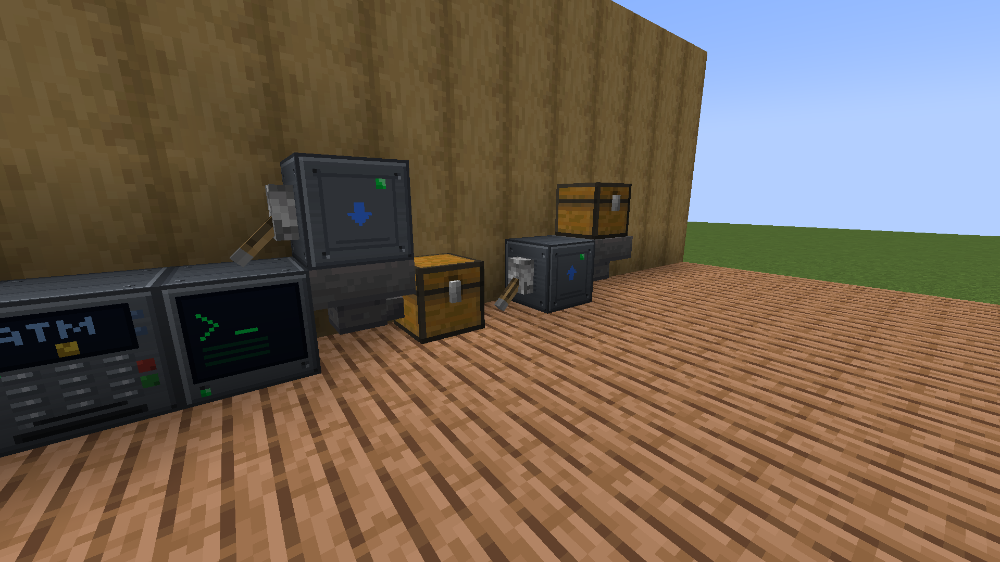
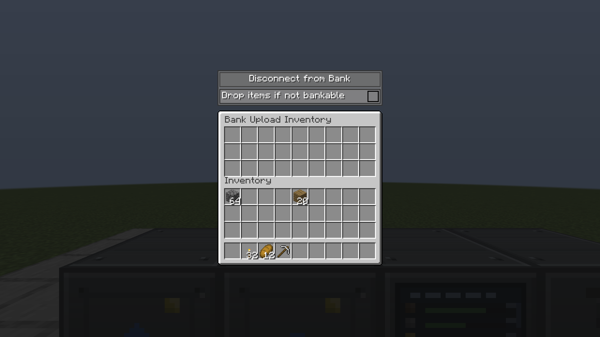
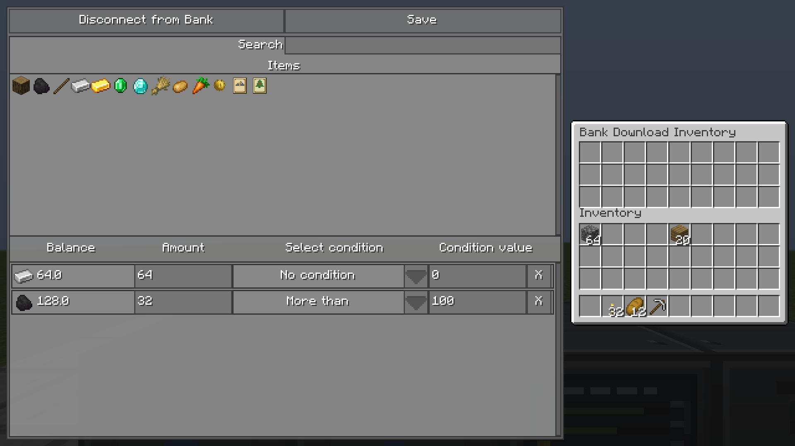

# Automation

Two blocks connect your bank account to hoppers, pipes and redstone:

- The **Bank Upload Block** sends items into your bank account, for example the output of a farm.
- The **Bank Download Block** takes items out of your bank account and keeps a stock ready, for example fuel for your furnaces.

Both blocks only work while they get a redstone signal. For the recipes, see [Blocks and recipes](blocks-and-recipes.md).

<figure markdown="span">
  { width="600" }
</figure>

## Bank Upload Block

1. Place the block and right-click it.
2. Click **Connect to Bank** and pick the account.
3. Decide what happens to items the bank can't store. With **Drop items if not bankable** ticked, the block drops them on the ground. Without it, they stay in the block.
4. Feed items in with a hopper or a pipe, or put them in by hand.
5. Power the block with redstone. While it is powered, it sends its items to the bank.

The block deposits in the name of the player who connected it. That player needs **Allowed to deposit** on the account. If they lose the right, the block stops. Only this player can open the block: for anyone else, right-clicking it does nothing.

The block skips damaged and enchanted items. They stay in the block, or drop on the ground with **Drop items if not bankable** ticked.

<figure markdown="span">
  { width="600" }
</figure>

## Bank Download Block

The Download Block keeps a set amount of items in its own inventory. When a hopper or a player takes items out, it refills from the bank.

1. Place the block and right-click it.
2. Click **Connect to Bank** and pick the account.
3. Pick an item from the list. This adds a withdraw order for it. You can add orders for several items.
4. Set each order:
    - **Amount**: how many of the item the block keeps in its inventory. 0 turns the order off.
    - **Select condition**: when to refill. **No condition** always refills. **More than** only refills while your bank holds more than the **Condition value**. **Less than** only refills while it holds less.
5. Click **Save**. The button turns amber while you have unsaved changes.
6. Power the block with redstone. While it is powered, it refills.

Next to each order, **Balance** shows how many of the item are in the bank. The **X** removes the order when you save.

<figure markdown="span">
  { width="600" }
</figure>

!!! tip "Keep a reserve"
    Use **More than** to stop before the bank runs dry. The block checks the condition before it refills, and the refill itself can go below the value. For example, an order for 64 coal with **More than** 64 still takes 64 coal when the bank holds 70, and leaves 6. To always keep 64 in the bank, set the **Condition value** to 128.

### Who can change it

Only players with **Allowed to withdraw** on the connected account can open the block, change its settings or disconnect it. The block withdraws in the name of the player who last saved it. If that player loses **Allowed to withdraw**, the block stops until someone with the right saves it again.

A block placed before version 2.2.0 doesn't know who set it up, so it stays idle after the update. Open it once and click **Save** to start it again.

## If something goes wrong

| What you see | Why | What to do |
|---|---|---|
| Nothing happens | The block has no redstone signal. | Add a lever, a redstone torch or a clock. |
| The **Connect to Bank** button of the Download Block is orange | The block isn't connected to an account yet. The button flashes when you try something that needs an account. | Click it and pick an account. |
| Items pile up in the Upload Block | The bank doesn't allow those items, or the player who connected the block lost **Allowed to deposit**. | Tick **Drop items if not bankable**, filter the items out before the block, or check the account rights. |
| The Download Block stopped refilling | The condition isn't met, the bank ran out, or the player who saved it lost **Allowed to withdraw**. | Check **Balance** and the condition, then click **Save** again. |
| The blocks stop and nothing explains why | An admin may have frozen the account. The Upload Block then keeps the items in its slots, and the Download Block doesn't refill. Neither block sends a chat message. | Look for the grey **Frozen** marker in the account's [management screen](bank-accounts.md#frozen-accounts) and ask an admin. |

## Related pages

- [Bank Terminal](bank-terminal.md): moving items by hand.
- [Bank accounts](bank-accounts.md): account rights.
- [Bank Display](displays.md): show a balance on a wall.
