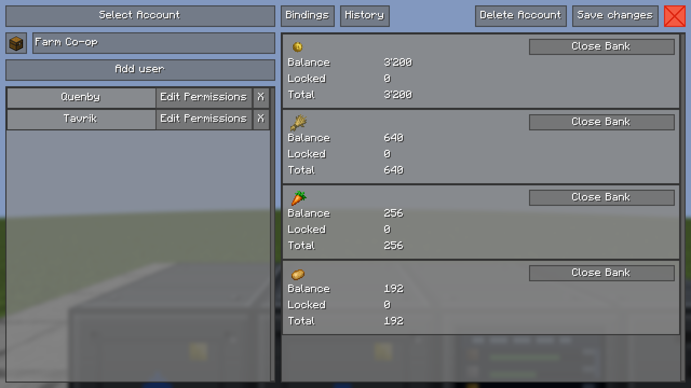
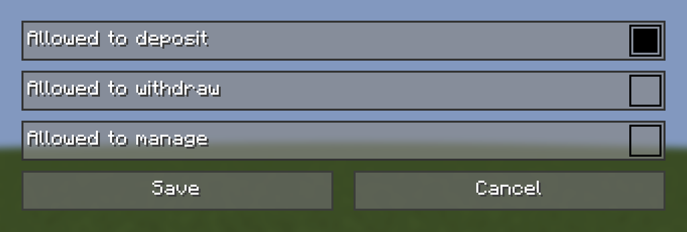

# Bankkonten { #bank-accounts }

Ein Bankkonto enthält dein Geld und deine Items. Ein persönliches Konto bekommst du automatisch, und du kannst weitere Konten eröffnen und mit Freunden teilen. Diese Seite zeigt, wie das geht.

## Dein persönliches Konto { #your-personal-account }

Die Mod eröffnet dein persönliches Konto, wenn du den Server zum ersten Mal betrittst. Es ist immer da, und niemand kann es löschen.

Um zu sehen, was auf deinem Konto ist, tippe einen dieser Befehle in den Chat:

| Befehl | Zeigt |
|---|---|
| `/bank` | Die Kontostände deines Kontos. |
| `/money` | Nur dein Geld. |

## Ein weiteres Konto eröffnen { #creating-another-account }

Du kannst weitere Konten eröffnen, zum Beispiel eines für einen Laden, den du mit Freunden führst:

```text
/bank create <name>
```

Das Verwaltungsfenster des neuen Kontos öffnet sich sofort.

Jeder Spieler kann standardmäßig **3** Konten eröffnen. Dein Admin kann mehr oder weniger erlauben. Dein persönliches Konto und Konten, zu denen dich andere Spieler hinzugefügt haben, zählen nicht. [Ein Unternehmen gründen](companies.md) zählt dagegen, denn das Unternehmen bekommt ein eigenes Konto.

## Das Verwaltungsfenster { #the-management-screen }

Das Verwaltungsfenster deines persönlichen Kontos öffnest du mit `/bank manage`. Für ein anderes Konto hängst du seinen Namen an:

```text
/bank manage <name>
```

Mit dem Konto-Knopf oben im Fenster wechselst du zu jedem anderen Konto, auf das du Zugriff hast. Fahre mit der Maus über ein Konto in der Liste, um seine Nummer zu sehen und wer es nutzen darf.

<figure markdown="span">
  { width="600" }
</figure>

## Ein Konto teilen { #sharing-an-account }

1. Öffne das Verwaltungsfenster des Kontos.
2. Klicke auf **Benutzer hinzufügen** und wähle den Spieler.
3. Klicke neben dem Spieler auf **Berechtigung bearbeiten** und hake die Rechte an, die er haben soll. Klicke auf **Speichern**.
4. Klicke auf **Änderungen speichern**.

Nichts wird gespeichert, bevor du auf **Änderungen speichern** klickst. Verlässt du das Fenster mit ungespeicherten Änderungen, fragt ein Popup, ob du sie **Speichern** oder **Verwerfen** willst.

<figure markdown="span">
  { width="600" }
</figure>

### Die drei Rechte { #the-three-rights }

| Recht | Der Spieler kann |
|---|---|
| **Erlaubt einzuzahlen** | Items und Geld auf das Konto einzahlen. |
| **Erlaubt abzuheben** | Items und Geld abheben und sie am [Bank Terminal](bank-terminal.md) zum Herstellen nutzen. |
| **Erlaubt zu verwalten** | Benutzer hinzufügen und entfernen, ihre Rechte ändern, das Konto umbenennen und löschen. |

Um mit einem Konto am Aktienmarkt zu handeln, brauchst du sowohl **Erlaubt einzuzahlen** als auch **Erlaubt abzuheben**. Siehe [So arbeiten die beiden Mods zusammen](../together.md#your-bank-account-is-your-trading-wallet).

Um einen Spieler zu entfernen, klicke neben ihm auf das **X** und speichere. Den letzten Benutzer eines Kontos kannst du nicht entfernen. Hat nach deiner Änderung niemand mehr **Erlaubt zu verwalten**, gibt die Mod dieses Recht dem verbleibenden Benutzer mit den meisten Rechten.

## Weitere Knöpfe { #more-buttons }

- **Verknüpfungen**: bindet das Konto an eine Währung aus einer anderen Mod. Siehe [Währungsbindungen](currency-bindings.md).
- **Verlauf**: das Diagramm mit dem Kontoverlauf. Siehe [Bank Terminal](bank-terminal.md).
- **Auszahlungen**: nur für Unternehmenskonten. Siehe [Auszahlungen und Dividenden](payouts.md).

## Ein Konto löschen { #deleting-an-account }

Benutzer mit **Erlaubt zu verwalten** können auf **Konto löschen** klicken.

!!! danger "Alles darin geht verloren"
    Wenn du ein Konto löschst, werden alles Geld und alle Items darin vernichtet. Nimm vorher alles heraus.

Dein persönliches Konto lässt sich nicht löschen. Das Konto eines Unternehmens auch nicht: Solange ein Unternehmen es nutzt, ist **Konto löschen** ausgegraut.

## Eingefrorene Konten { #frozen-accounts }

Ein Admin kann ein Konto einfrieren. Das Verwaltungsfenster zeigt dann eine graue Markierung **Eingefroren**. Solange ein Konto eingefroren ist, geht nichts hinein oder hinaus: keine Einzahlungen, Abhebungen, Überweisungen, Auszahlungen oder Handel. Deine offenen Orders am Aktienmarkt werden storniert, und was sie reserviert hatten, geht zurück auf das Konto. Du behältst, was darauf ist, und kannst es dir weiterhin ansehen. Bitte einen Admin, es wieder freizugeben.

## Wenn etwas schiefgeht { #if-something-goes-wrong }

| Meldung | Was sie bedeutet | Was du tun kannst |
|---|---|---|
| *Du hast dein Limit von N Bankkonto/-konten erreicht. Du kannst kein weiteres erstellen.* | Du hast schon so viele Konten, wie der Server erlaubt. | Lösche ein Konto, das du nicht brauchst, oder frag deinen Admin. |
| *Ein Konto muss immer mindestens einen Benutzer mit Verwalten-Berechtigung behalten — die Änderung wurde nicht übernommen.* | Deine Änderung würde den letzten Benutzer des Kontos entfernen. | Lass mindestens einen Benutzer auf dem Konto. |
| *Du hast keine Berechtigung um Items von dem Konto "N" abzuheben.* | Dir fehlt ein Recht auf diesem Konto (dasselbe gibt es für Einzahlen und Verwalten). | Bitte einen Verwalter des Kontos, dir das Recht zu geben. |
| *Dieser Server wird vom Master-Server nicht als vertrauenswürdig eingestuft. Änderungen sind deaktiviert…* | In einem Netzwerk aus mehreren Servern ist dieser Server noch nicht fertig eingerichtet. Du kannst dir alles ansehen, aber nichts ändern. | Sag deinem Admin Bescheid. |

## Verwandte Seiten { #related-pages }

- [Bank Terminal](bank-terminal.md): Items auf ein Konto bringen und wieder herausholen.
- [Geld und Geldautomat](money.md): Geld an andere Spieler senden.
- [Ein Unternehmen gründen und führen](companies.md): Unternehmen haben ein eigenes Konto.
