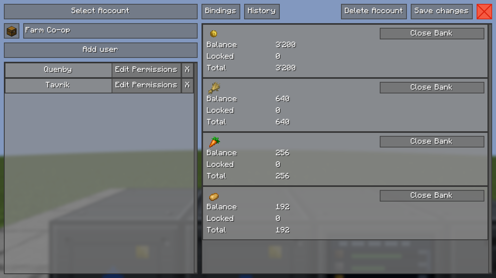
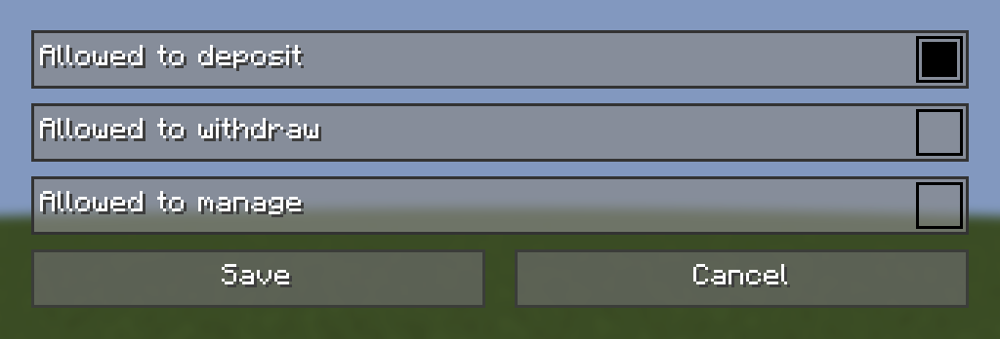

# Bank accounts

A bank account holds your money and your items. You get a personal account automatically, and you can open more accounts and share them with friends. This page shows how.

## Your personal account

The mod opens a personal account for you the first time you join the server. It is always there, and nobody can delete it.

To see what is in your account, type one of these in chat:

| Command | Shows |
|---|---|
| `/bank` | The balances of your account. |
| `/money` | Only your money. |

## Creating another account

You can open more accounts, for example one for a shop you run with friends:

```text
/bank create <name>
```

The management screen of the new account opens right away.

Each player can create **3** accounts by default. Your admin may allow more or fewer. Your personal account and accounts other players added you to don't count. [Founding a company](companies.md) does count, because the company gets its own account.

## The management screen

Open the management screen of your personal account with `/bank manage`. For another account, add its name:

```text
/bank manage <name>
```

The account button at the top of the screen switches to any other account you have access to. Hover over an account in the list to see its number and who can use it.

<figure markdown="span">
  { width="600" }
</figure>

## Sharing an account

1. Open the management screen of the account.
2. Click **Add user** and pick the player.
3. Click **Edit Permissions** next to the player and tick the rights they should have. Click **Save**.
4. Click **Save changes**.

Nothing is stored until you click **Save changes**. If you leave the screen with unsaved changes, a popup asks whether to **Save** or **Discard** them.

<figure markdown="span">
  { width="600" }
</figure>

### The three rights

| Right | The player can |
|---|---|
| **Allowed to deposit** | Put items and money into the account. |
| **Allowed to withdraw** | Take items and money out, and use them for crafting at the [Bank Terminal](bank-terminal.md). |
| **Allowed to manage** | Add and remove users, change their rights, rename the account and delete it. |

To trade on the stock market with an account, you need both **Allowed to deposit** and **Allowed to withdraw**. See [How the two mods work together](../together.md#your-bank-account-is-your-trading-wallet).

To remove a player, click the **X** next to them and save. You can't remove the last user of an account. If your change leaves nobody with **Allowed to manage**, the mod gives that right to the remaining user with the most rights.

## More buttons

- **Bindings**: link the account to a currency from another mod. See [Currency bindings](currency-bindings.md).
- **History**: the balance history chart of the account. See [Bank Terminal](bank-terminal.md).
- **Payouts**: only for company accounts. See [Payouts and dividends](payouts.md).

## Deleting an account

Users with **Allowed to manage** can click **Delete Account**.

!!! danger "Everything in it is lost"
    Deleting an account destroys all money and items in it. Take everything out first.

Your personal account can't be deleted. Neither can a company's account: while a company uses it, **Delete Account** is greyed out.

## Frozen accounts

An admin can freeze an account. The management screen then shows a grey **Frozen** marker. While an account is frozen, nothing moves in or out: no deposits, withdrawals, transfers, payouts or trades. Your open orders on the stock market are cancelled, and what they had reserved goes back into the account. You keep what is in it, and you can still look at it. Ask an admin to unfreeze it.

## If something goes wrong

| Message | What it means | What to do |
|---|---|---|
| *You have reached your limit of N bank account(s). You cannot create another one.* | You already have as many accounts as the server allows. | Delete an account you don't need, or ask your admin. |
| *An account must always keep at least one user with Manage permission — the change was not applied.* | Your change would remove the last user of the account. | Keep at least one user on the account. |
| *You don't have the permission to withdraw from the account "N"* | You lack a right on this account (the same exists for deposit and manage). | Ask a manager of the account to give you the right. |
| *This server is not trusted by the master server. Changes are disabled…* | On a network of several servers, this one isn't set up fully yet. You can look, but not change anything. | Tell your admin. |

## Related pages

- [Bank Terminal](bank-terminal.md): moving items in and out of an account.
- [Money and the ATM](money.md): sending money to other players.
- [Founding and running a company](companies.md): companies have their own account.
