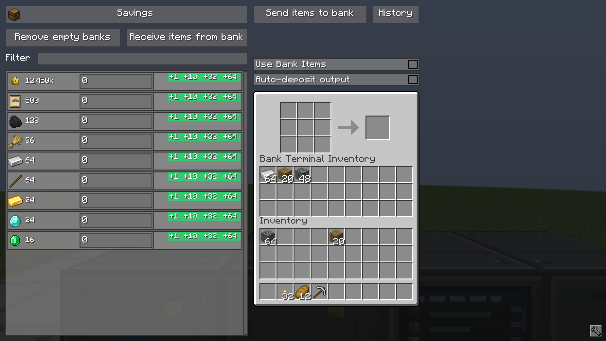
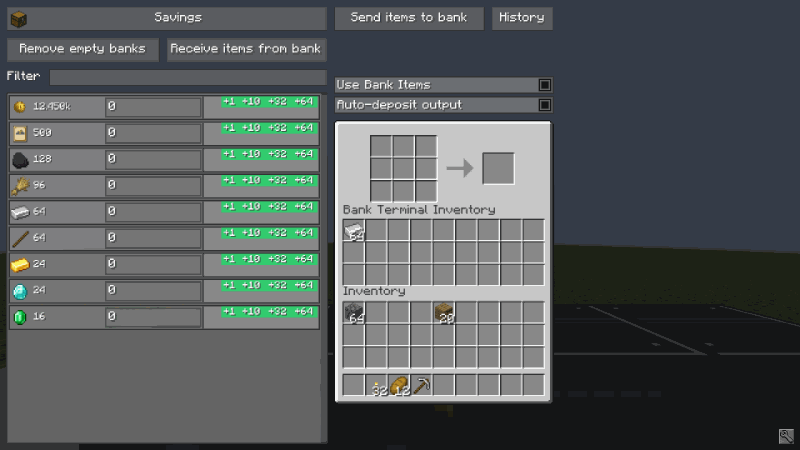
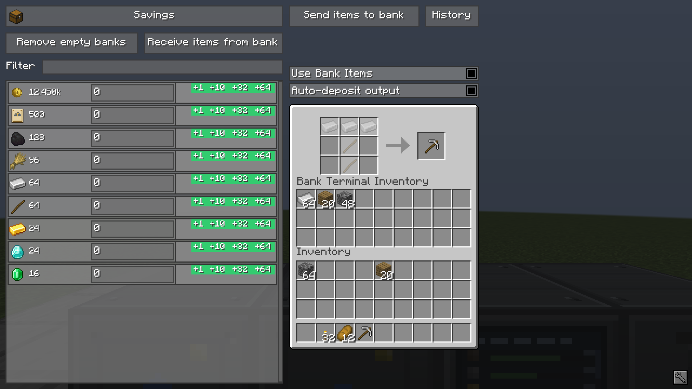
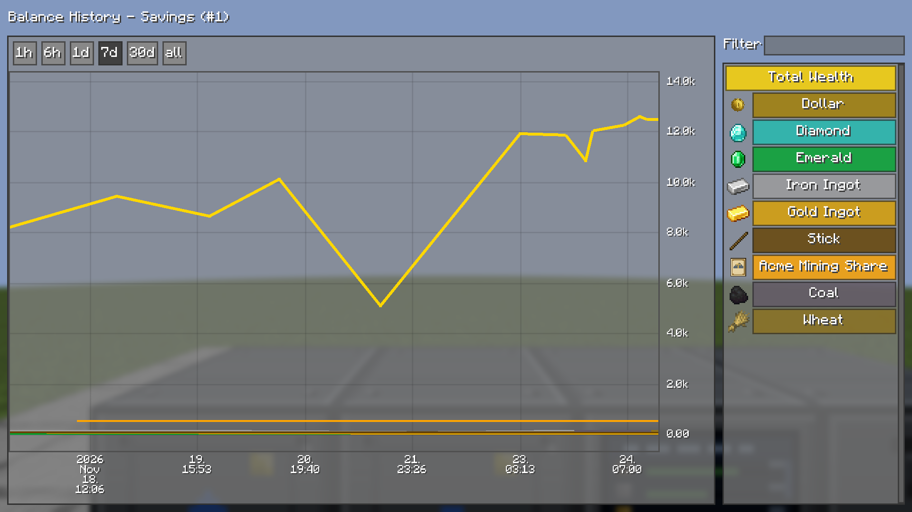

# Bank Terminal { #bank-terminal }

Am **Bank Terminal Block** wandern Items auf dein Bankkonto und wieder heraus. Du kannst auch mit den Items in deiner Bank herstellen, ohne sie vorher abzuheben, und dir ansehen, wie sich deine Kontostände mit der Zeit verändert haben.

Für ein Bank Terminal machst du mit **Banking Software** einen Rechtsklick auf einen **Terminal Block**. Siehe [Blöcke und Rezepte](blocks-and-recipes.md).

<figure markdown="span">
  { width="600" }
</figure>

## Das Fenster { #the-screen }

Mache einen Rechtsklick auf den Bank Terminal Block. Das Fenster hat zwei Hälften:

- **Links** stehen die Items auf deinem Bankkonto, eine Zeile pro Item mit seinem Kontostand. Tippe in das Feld **Filter**, um ein Item über seinen Namen zu finden. Mit dem Konto-Knopf oben wechselst du zu einem anderen Konto, auf das du Zugriff hast.
- **Rechts** liegen das **Bank Terminal Inventar** (27 Slots), ein Handwerksfeld und dein eigenes Inventar.

Das Bank Terminal Inventar gehört nur dir. Andere Spieler, die denselben Block nutzen, sehen ihre eigenen Slots, wie bei einer Endertruhe.

## Items in die Bank einzahlen { #putting-items-into-the-bank }

1. Lege die Items aus deinem Inventar in die Slots des Bank Terminal Inventars.
2. Klicke auf **Sende Items zur Bank**.

Alles in den Slots geht auf das gewählte Konto. Items, die nicht eingelagert werden können, bleiben in den Slots:

- Items, die der Server in der Bank nicht erlaubt. Frag deinen Admin, welche Items erlaubt sind.
- Beschädigte oder verzauberte Items. Die Bank lagert Items nur in ihrem einfachen Zustand.

## Items abheben { #taking-items-out }

1. Such das Item in der Liste links.
2. Stelle die Menge mit den Knöpfen **+1**, **+10**, **+32** und **+64** ein oder tippe sie ein. Die Menge kann nicht über deinem Kontostand liegen.
3. Stelle bei Bedarf Mengen für weitere Items ein. Ein Klick hebt sie alle ab.
4. Klicke auf **Empfange Items von der Bank**.

Die Items erscheinen in den Slots des Bank Terminal Inventars. Leg sie in dein Inventar.

<figure markdown="span">
  { width="600" }
</figure>

!!! warning "Lass keine Items in den Slots"
    Wird der Bank Terminal Block abgebaut oder mit einer anderen Software umprogrammiert, fällt alles, was noch in seinen Slots liegt, auf den Boden. Das gilt für die Slots aller Spieler. Items auf dem Bankkonto sind sicher.

**Leere Banken entfernen** entfernt die Zeilen der Items mit einem Kontostand von null aus der Liste.

## Mit Bank-Items herstellen { #crafting-with-bank-items }

Das 3×3-Handwerksfeld funktioniert wie eine Werkbank, mit allen normalen Rezepten. Zwei Kästchen verbinden es mit deiner Bank:

- **Use Bank Items**: Fehlende Zutaten kommen vom Bankkonto. Lege mindestens ein echtes Item ins Feld, um das Rezept zu starten. Blasse Symbole zeigen dann, welche Items die Bank beisteuert. Geld wird nie als Zutat verwendet. Du brauchst **Erlaubt abzuheben** auf dem Konto.
- **Auto-deposit output**: Was du herstellst, geht direkt auf das Bankkonto statt in dein Inventar. Du brauchst **Erlaubt einzuzahlen**. Kann die Bank das Item nicht einlagern, kommt es in dein Inventar, und eine Meldung sagt dir, warum.

Das Terminal merkt sich beide Kästchen für dich. Items, die im Handwerksfeld übrig bleiben, gehen beim Schließen des Fensters zurück in dein Inventar.

Um ein Item herzustellen, ohne sein Rezept zu kennen, klicke auf sein Symbol in der Bankliste. Lässt sich genau eines seiner Rezepte bezahlen (aus der Bank, wenn **Use Bank Items** an ist, sonst aus deinem Inventar), legt das Terminal es im Handwerksfeld an. Sonst listet das Fenster **Recipe selection** die Rezepte zur Auswahl auf.

<figure markdown="span">
  { width="600" }
</figure>

### Mit JEI { #with-jei }

Ist die Mod JEI installiert, füllt der Knopf **+** in einem JEI-Rezept das Handwerksfeld. Ist **Use Bank Items** an, legt er nur das Muster des Rezepts an, und die Bank liefert die Zutaten beim Herstellen.

## Kontoverlauf { #balance-history }

Der Knopf **Verlauf** oben rechts öffnet ein Diagramm der Kontostände deines Kontos über die Zeit, eine farbige Linie pro Item. Ist StockMarket installiert, zeigt eine goldene Linie **Total Wealth** den Wert des ganzen Kontos zu Marktpreisen.

- Die Knöpfe **1h**, **6h**, **1d**, **7d**, **30d** und **all** legen den Zeitraum fest.
- Ziehe, um das Diagramm zu verschieben, und scrolle zum Zoomen. ++space++ passt die Ansicht an die Daten an, ++ctrl+space++ springt zurück zur Gegenwart.
- Tippe in das Feld **Filter**, um die Itemliste einzugrenzen. Klicke auf ein Item, um seine Linie ein- oder auszuschalten. Das Diagramm merkt sich deine Auswahl.

<figure markdown="span">
  { width="600" }
</figure>

## Wenn etwas schiefgeht { #if-something-goes-wrong }

| Meldung | Was sie bedeutet | Was du tun kannst |
|---|---|---|
| *… ist nicht für das Lagern in der Bank zugelassen* | Der Server erlaubt dieses Item nicht in der Bank. | Behalte es oder frag deinen Admin. |
| *Der Zustand von … verhindert das Einlagern in der Bank* | Das Item ist in einem Zustand, den die Bank nicht einlagern kann, zum Beispiel verdorbenes Essen aus einer anderen Mod. | Behalte es in deinem Inventar. |
| *Crafted … could not be deposited into the bank and was moved to your inventory* | **Auto-deposit output** war an, aber die Bank kann dieses Item nicht einlagern. | Nichts: Das Item ist in deinem Inventar. |
| Das Kästchen **Use Bank Items** ist ausgegraut | Du hast auf diesem Konto kein **Erlaubt abzuheben**. | Wähle ein anderes Konto oder bitte einen Verwalter um das Recht. |
| Eine Chatnachricht sagt, dass das Konto eingefroren ist | Ein Admin hat das Konto eingefroren. Nichts kann hinein oder hinaus. | Frag einen Admin. Deine Items bleiben, wo sie sind. |

## Verwandte Seiten { #related-pages }

- [Bankkonten](bank-accounts.md): ein Konto teilen und seine Rechte.
- [Automatisierung](automation.md): Items mit Redstone in die Bank bringen und wieder herausholen.
- [So arbeiten die beiden Mods zusammen](../together.md): was Total Wealth bedeutet.
