# Blöcke und Rezepte { #blocks-and-recipes }

Die Maschinen von BankSystem bestehen aus wenigen Teilen: einer **Print Platine**, einem **Bildschirm** und einem **Metall Gehäuse Block**. Daraus stellst du den **Terminal Block** her, der zu einem Bank Terminal oder einem Geldautomaten wird, wenn du ihn mit Software programmierst.

## Blöcke { #blocks }

| Block | Was er tut | Mehr dazu |
|---|---|---|
| **Terminal Block** | Ein leeres Terminal. Programmiere es mit Software. | [unten](#programming-a-terminal-block) |
| **Bank Terminal Block** | Items in die Bank einzahlen und abheben. | [Bank Terminal](bank-terminal.md) |
| **Geldautomat** | Bargeld abheben und Scheine wechseln. | [Geld und Geldautomat](money.md) |
| **Bank Upload Block** | Sendet Items aus Trichtern in die Bank. | [Automatisierung](automation.md) |
| **Bank Download Block** | Füllt sich selbst aus der Bank auf. | [Automatisierung](automation.md) |
| **Bank Anzeige** | Zeigt ein Konto an einer Wand. | [Bank Anzeige](displays.md) |
| **Aktien-Prägestation** | Stellt Unternehmensaktien her. | [Aktien und Aktien-Prägestation](shares.md) |
| **Metall Gehäuse Block** | Ein Bauteil für die anderen Blöcke. | |
| **Geldhaufen Block** | Ein Haufen Bargeld. Du stellst ihn nicht her: Mache mit Geld einen Rechtsklick auf einen Block. | [Geld und Geldautomat](money.md#the-money-stockpile) |

## Items { #items }

| Item | Wofür es ist |
|---|---|
| **Print Platine**, **Bildschirm** | Bauteile für Blöcke und Module. |
| **Leere Software** | Die Grundlage für jede Software. |
| **Banking Software**, **Bankomat Software** | Programmieren einen Terminal Block. |
| **Bank Sender Modul**, **Bank Empfänger Modul** | Bauteile für den Upload Block und den Download Block. |
| **Leere Aktie**, **Unternehmensaktie** | Eine Aktie vor und nach der Aktien-Prägestation. |
| Geld | Münzen und Banknoten, siehe [Geld und Geldautomat](money.md). |

## Einen Terminal Block programmieren { #programming-a-terminal-block }

1. Stelle einen **Terminal Block** auf.
2. Halte eine Software in der Hand und mache einen Rechtsklick auf den Terminal Block.

| Software | Aus dem Terminal Block wird |
|---|---|
| **Banking Software** | **Bank Terminal Block** |
| **Bankomat Software** | **Geldautomat** |
| **Handels Software** (StockMarket) | **Aktienmarkt-Block**, siehe [StockMarket-Rezepte](../stockmarket/blocks-and-recipes.md) |
| **Leere Software** | Wieder ein einfacher **Terminal Block** |

Die Software wird nicht verbraucht. Ein programmierter Block droppt beim Abbauen als er selbst, du kannst ihn also umsetzen.

!!! warning "Leere zuerst das Bank Terminal"
    Programmierst du einen Bank Terminal Block um oder baust ihn ab, fallen Items, die noch in seinen Slots liegen, auf den Boden, und zwar für jeden Spieler.

## Rezepte { #recipes }

### Bauteile { #parts }

<figure markdown="span">
  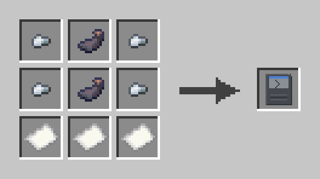{ width="350" }
  <figcaption>Leere Software (ergibt 5)</figcaption>
</figure>

<figure markdown="span">
  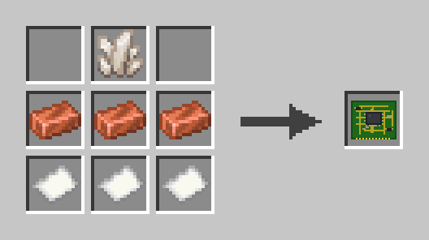{ width="350" }
  <figcaption>Print Platine</figcaption>
</figure>

<figure markdown="span">
  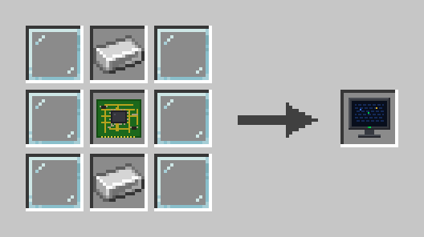{ width="350" }
  <figcaption>Bildschirm</figcaption>
</figure>

<figure markdown="span">
  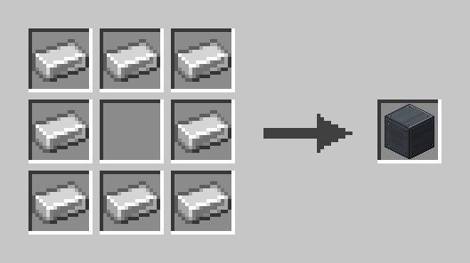{ width="350" }
  <figcaption>Metall Gehäuse Block</figcaption>
</figure>

### Software { #software }

<figure markdown="span">
  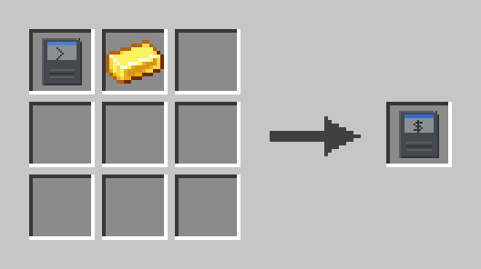{ width="350" }
  <figcaption>Banking Software</figcaption>
</figure>

<figure markdown="span">
  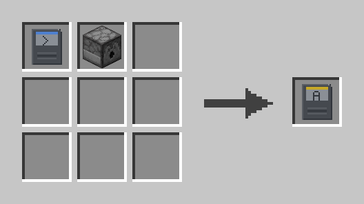{ width="350" }
  <figcaption>Bankomat Software</figcaption>
</figure>

### Module { #modules }

<figure markdown="span">
  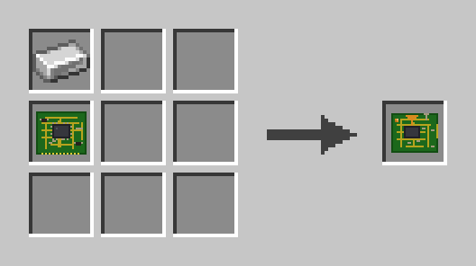{ width="350" }
  <figcaption>Bank Sender Modul</figcaption>
</figure>

<figure markdown="span">
  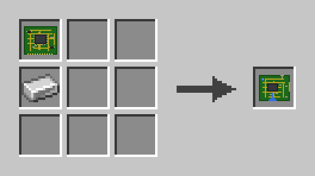{ width="350" }
  <figcaption>Bank Empfänger Modul</figcaption>
</figure>

### Blöcke { #blocks_1 }

<figure markdown="span">
  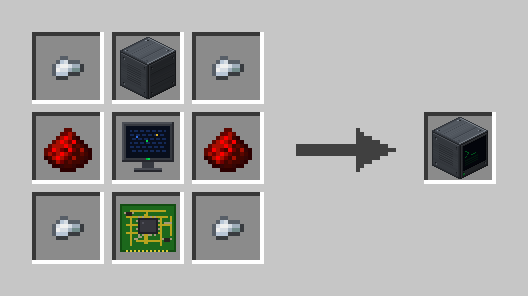{ width="350" }
  <figcaption>Terminal Block</figcaption>
</figure>

<figure markdown="span">
  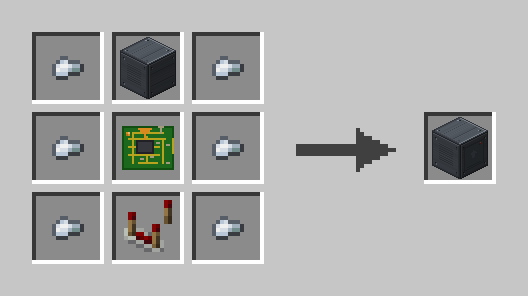{ width="350" }
  <figcaption>Bank Upload Block</figcaption>
</figure>

<figure markdown="span">
  { width="350" }
  <figcaption>Bank Download Block</figcaption>
</figure>

<figure markdown="span">
  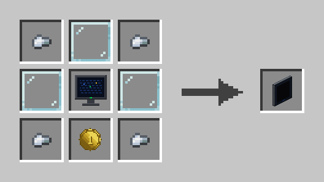{ width="350" }
  <figcaption>Bank Anzeige</figcaption>
</figure>

### Unternehmen { #company }

<figure markdown="span">
  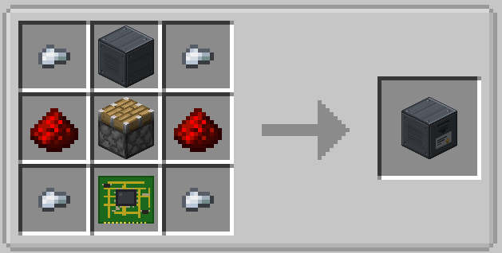{ width="350" }
  <figcaption>Aktien-Prägestation</figcaption>
</figure>

<figure markdown="span">
  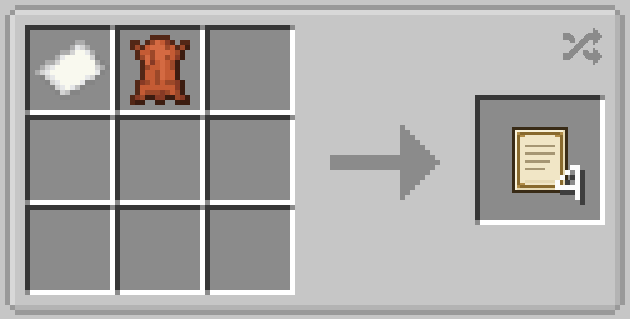{ width="350" }
  <figcaption>Leere Aktie (ergibt 4)</figcaption>
</figure>

### Geld wechseln { #changing-money }

Du kannst Münzen und Banknoten zu größeren und kleineren verarbeiten, von 1 Cent bis 1'000'000 Euro. Zwei Beispiele:

<figure markdown="span">
  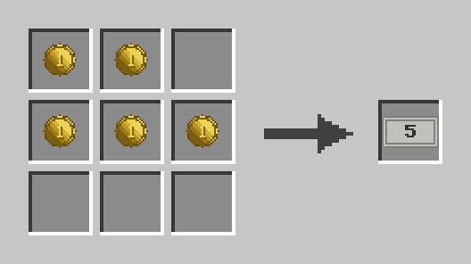{ width="350" }
  <figcaption>5 × Euro → 5 Euro</figcaption>
</figure>

<figure markdown="span">
  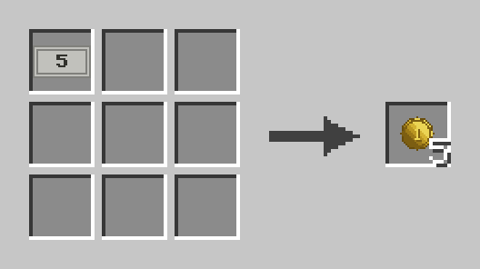{ width="350" }
  <figcaption>5 Euro → 5 × Euro</figcaption>
</figure>

Nicht jeder Schritt funktioniert in beide Richtungen, und die Mengen unterscheiden sich. Ein 100'000-Euro-Schein lässt sich zum Beispiel in 5 × 20'000 aufteilen, und ein 50-Euro-Schein lässt sich nicht in 20-Euro-Scheine aufteilen. Die Tabelle listet jedes Geldrezept. Eine Zahl allein steht für einen Euro-Schein: **2 × 500** heißt zwei 500-Euro-Scheine. **Euro** ist die Euro-Münze.

| Item | Hergestellt aus | Aufteilbar in |
|---|---|---|
| **1 Cent** | – | – |
| **5 Cent** | 5 × 1 Cent | 5 × 1 Cent |
| **10 Cent** | 2 × 5 Cent | 2 × 5 Cent, 10 × 1 Cent |
| **20 Cent** | 2 × 10 Cent; 4 × 5 Cent; 10 Cent + 2 × 5 Cent | 2 × 10 Cent, 4 × 5 Cent, 20 × 1 Cent |
| **50 Cent** | 5 × 10 Cent; 2 × 20 Cent + 10 Cent | 5 × 10 Cent, 10 × 5 Cent, 50 × 1 Cent |
| **Euro** | 2 × 50 Cent; 5 × 20 Cent; 50 Cent + 2 × 20 Cent + 10 Cent | 2 × 50 Cent, 5 × 20 Cent, 10 × 10 Cent, 20 × 5 Cent |
| **5 Euro** | 5 × Euro | 5 × Euro, 10 × 50 Cent, 25 × 20 Cent, 50 × 10 Cent |
| **10 Euro** | 2 × 5 | 2 × 5, 10 × Euro, 20 × 50 Cent, 50 × 20 Cent |
| **20 Euro** | 2 × 10; 4 × 5 | 2 × 10, 4 × 5, 20 × Euro, 40 × 50 Cent |
| **50 Euro** | 5 × 10; 2 × 20 + 10 | 5 × 10, 10 × 5, 50 × Euro |
| **100 Euro** | 2 × 50; 5 × 20 | 2 × 50, 5 × 20, 10 × 10, 20 × 5 |
| **200 Euro** | 2 × 100; 4 × 50; 100 + 2 × 50 | 2 × 100, 4 × 50, 10 × 20, 20 × 10, 40 × 5 |
| **500 Euro** | 5 × 100; 2 × 200 + 100 | 5 × 100, 10 × 50, 25 × 20, 50 × 10 |
| **1'000 Euro** | 2 × 500; 5 × 200 | 2 × 500, 5 × 200, 10 × 100, 20 × 50, 50 × 20 |
| **5'000 Euro** | 5 × 1'000 | 5 × 1'000, 10 × 500, 25 × 200, 50 × 100 |
| **10'000 Euro** | 2 × 5'000 | 2 × 5'000, 10 × 1'000, 20 × 500, 50 × 200 |
| **20'000 Euro** | 2 × 10'000 | 2 × 10'000, 4 × 5'000, 20 × 1'000, 40 × 500 |
| **50'000 Euro** | 5 × 10'000; 2 × 20'000 + 10'000 | 5 × 10'000, 10 × 5'000, 50 × 1'000 |
| **100'000 Euro** | 5 × 20'000; 2 × 50'000 | 5 × 20'000, 10 × 10'000, 20 × 5'000 |
| **500'000 Euro** | 5 × 100'000 | 5 × 100'000, 10 × 50'000, 25 × 20'000, 50 × 10'000 |
| **1'000'000 Euro** | 2 × 500'000 | 2 × 500'000, 10 × 100'000, 20 × 50'000, 50 × 20'000 |

Das Rezeptbuch, oder JEI, wenn du es hast, zeigt jedes Geldrezept. Der [Geldautomat](money.md#convert-change-money) wechselt Geld ohne Herstellen.

## Verwandte Seiten { #related-pages }

- [Bank Terminal](bank-terminal.md): den Bank Terminal Block benutzen.
- [StockMarket-Blöcke und -Rezepte](../stockmarket/blocks-and-recipes.md): die Handels Software und die Aktienmarkt-Anzeige.
- [Erste Schritte](../getting-started.md): dein erstes Terminal und deine erste Einzahlung.
