# Blocks and recipes

BankSystem's machines are built from a few parts: a **Circuit Board**, a **Display** and a **Metal Case Block**. With those you craft the **Terminal Block**, which becomes a Bank Terminal or an ATM when you program it with software.

## Blocks

| Block | What it does | Read more |
|---|---|---|
| **Terminal Block** | An empty terminal. Program it with software. | [below](#programming-a-terminal-block) |
| **Bank Terminal Block** | Put items into the bank and take them out. | [Bank Terminal](bank-terminal.md) |
| **ATM** | Take out cash and change notes. | [Money and the ATM](money.md) |
| **Bank Upload Block** | Sends items from hoppers into the bank. | [Automation](automation.md) |
| **Bank Download Block** | Refills itself from the bank. | [Automation](automation.md) |
| **Bank Display** | Shows an account on a wall. | [Bank Display](displays.md) |
| **Share Stamper** | Makes company shares. | [Shares and the Share Stamper](shares.md) |
| **Metal Case Block** | A part for the other blocks. | |
| **Money Stockpile Block** | A pile of cash. You don't craft it: right-click a block with money. | [Money and the ATM](money.md#the-money-stockpile) |

## Items

| Item | What it is for |
|---|---|
| **Circuit Board**, **Display** | Parts for blocks and modules. |
| **Empty Software** | The base for every software. |
| **Banking Software**, **ATM Software** | Program a Terminal Block. |
| **Bank Transmitter Module**, **Bank Receiver Module** | Parts for the Upload and Download Blocks. |
| **Blank Share**, **Company Share** | A share before and after the Share Stamper. |
| Money | Coins and banknotes, see [Money and the ATM](money.md). |

## Programming a Terminal Block

1. Place a **Terminal Block**.
2. Hold a software and right-click the Terminal Block.

| Software | The Terminal Block becomes |
|---|---|
| **Banking Software** | **Bank Terminal Block** |
| **ATM Software** | **ATM** |
| **Trading Software** (StockMarket) | **Stock Market Block**, see [StockMarket recipes](../stockmarket/blocks-and-recipes.md) |
| **Empty Software** | A plain **Terminal Block** again |

The software is not used up. A programmed block drops as itself when you break it, so you can move it.

!!! warning "Empty the Bank Terminal first"
    When you reprogram or break a Bank Terminal Block, items still in its slots drop on the ground, for every player.

## Recipes

### Parts

<figure markdown="span">
  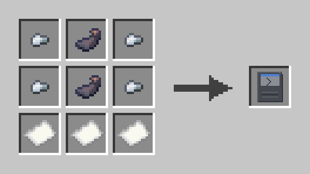{ width="350" }
  <figcaption>Empty Software (makes 5)</figcaption>
</figure>

<figure markdown="span">
  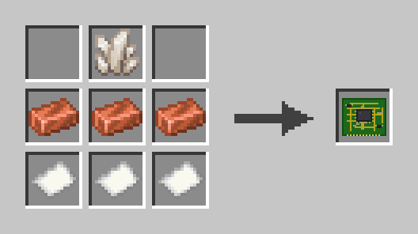{ width="350" }
  <figcaption>Circuit Board</figcaption>
</figure>

<figure markdown="span">
  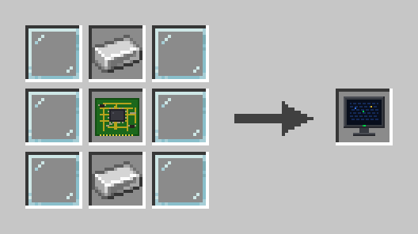{ width="350" }
  <figcaption>Display</figcaption>
</figure>

<figure markdown="span">
  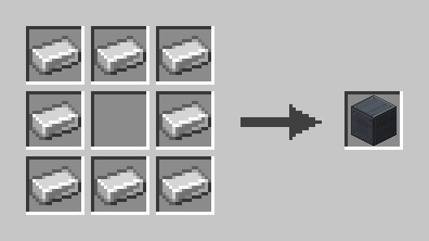{ width="350" }
  <figcaption>Metal Case Block</figcaption>
</figure>

### Software

<figure markdown="span">
  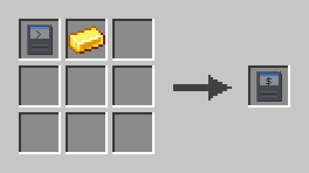{ width="350" }
  <figcaption>Banking Software</figcaption>
</figure>

<figure markdown="span">
  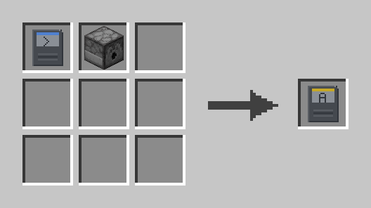{ width="350" }
  <figcaption>ATM Software</figcaption>
</figure>

### Modules

<figure markdown="span">
  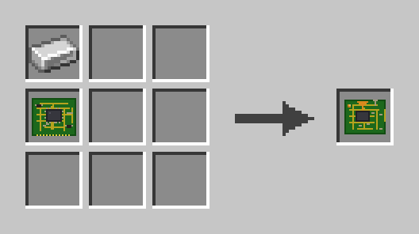{ width="350" }
  <figcaption>Bank Transmitter Module</figcaption>
</figure>

<figure markdown="span">
  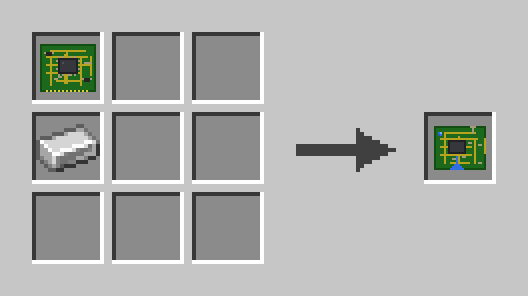{ width="350" }
  <figcaption>Bank Receiver Module</figcaption>
</figure>

### Blocks

<figure markdown="span">
  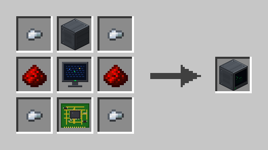{ width="350" }
  <figcaption>Terminal Block</figcaption>
</figure>

<figure markdown="span">
  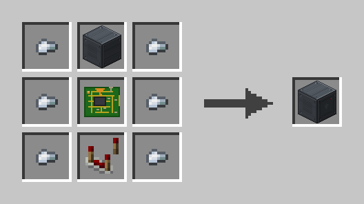{ width="350" }
  <figcaption>Bank Upload Block</figcaption>
</figure>

<figure markdown="span">
  { width="350" }
  <figcaption>Bank Download Block</figcaption>
</figure>

<figure markdown="span">
  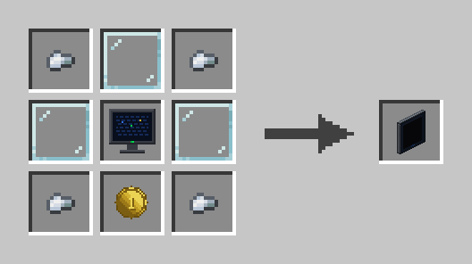{ width="350" }
  <figcaption>Bank Display</figcaption>
</figure>

### Company

<figure markdown="span">
  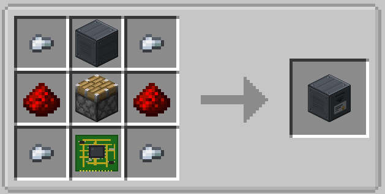{ width="350" }
  <figcaption>Share Stamper</figcaption>
</figure>

<figure markdown="span">
  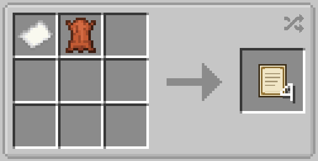{ width="350" }
  <figcaption>Blank Share (makes 4)</figcaption>
</figure>

### Changing money

You can craft coins and banknotes into larger and smaller ones, from 1 Cent to 1'000'000 Dollar. Two examples:

<figure markdown="span">
  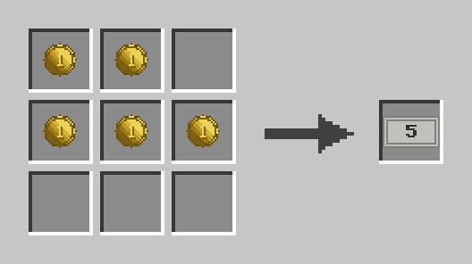{ width="350" }
  <figcaption>5 × Dollar → 5 Dollar</figcaption>
</figure>

<figure markdown="span">
  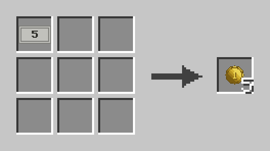{ width="350" }
  <figcaption>5 Dollar → 5 × Dollar</figcaption>
</figure>

Not every step works both ways, and the amounts differ. For example, a 100'000 Dollar note splits into 5 × 20'000, and a 50 Dollar note can't be split into 20 Dollar notes. The table lists every money recipe. A number alone means a Dollar note: **2 × 500** means two 500 Dollar notes. **Dollar** is the Dollar coin.

| Item | Crafted from | Splits into |
|---|---|---|
| **1 Cent** | – | – |
| **5 Cent** | 5 × 1 Cent | 5 × 1 Cent |
| **10 Cent** | 2 × 5 Cent | 2 × 5 Cent, 10 × 1 Cent |
| **20 Cent** | 2 × 10 Cent; 4 × 5 Cent; 10 Cent + 2 × 5 Cent | 2 × 10 Cent, 4 × 5 Cent, 20 × 1 Cent |
| **50 Cent** | 5 × 10 Cent; 2 × 20 Cent + 10 Cent | 5 × 10 Cent, 10 × 5 Cent, 50 × 1 Cent |
| **Dollar** | 2 × 50 Cent; 5 × 20 Cent; 50 Cent + 2 × 20 Cent + 10 Cent | 2 × 50 Cent, 5 × 20 Cent, 10 × 10 Cent, 20 × 5 Cent |
| **5 Dollar** | 5 × Dollar | 5 × Dollar, 10 × 50 Cent, 25 × 20 Cent, 50 × 10 Cent |
| **10 Dollar** | 2 × 5 | 2 × 5, 10 × Dollar, 20 × 50 Cent, 50 × 20 Cent |
| **20 Dollar** | 2 × 10; 4 × 5 | 2 × 10, 4 × 5, 20 × Dollar, 40 × 50 Cent |
| **50 Dollar** | 5 × 10; 2 × 20 + 10 | 5 × 10, 10 × 5, 50 × Dollar |
| **100 Dollar** | 2 × 50; 5 × 20 | 2 × 50, 5 × 20, 10 × 10, 20 × 5 |
| **200 Dollar** | 2 × 100; 4 × 50; 100 + 2 × 50 | 2 × 100, 4 × 50, 10 × 20, 20 × 10, 40 × 5 |
| **500 Dollar** | 5 × 100; 2 × 200 + 100 | 5 × 100, 10 × 50, 25 × 20, 50 × 10 |
| **1'000 Dollar** | 2 × 500; 5 × 200 | 2 × 500, 5 × 200, 10 × 100, 20 × 50, 50 × 20 |
| **5'000 Dollar** | 5 × 1'000 | 5 × 1'000, 10 × 500, 25 × 200, 50 × 100 |
| **10'000 Dollar** | 2 × 5'000 | 2 × 5'000, 10 × 1'000, 20 × 500, 50 × 200 |
| **20'000 Dollar** | 2 × 10'000 | 2 × 10'000, 4 × 5'000, 20 × 1'000, 40 × 500 |
| **50'000 Dollar** | 5 × 10'000; 2 × 20'000 + 10'000 | 5 × 10'000, 10 × 5'000, 50 × 1'000 |
| **100'000 Dollar** | 5 × 20'000; 2 × 50'000 | 5 × 20'000, 10 × 10'000, 20 × 5'000 |
| **500'000 Dollar** | 5 × 100'000 | 5 × 100'000, 10 × 50'000, 25 × 20'000, 50 × 10'000 |
| **1'000'000 Dollar** | 2 × 500'000 | 2 × 500'000, 10 × 100'000, 20 × 50'000, 50 × 20'000 |

The recipe book, or JEI if you have it, shows every money recipe. The [ATM](money.md#convert-change-money) changes money without crafting.

## Related pages

- [Bank Terminal](bank-terminal.md): using the Bank Terminal Block.
- [StockMarket blocks and recipes](../stockmarket/blocks-and-recipes.md): the Trading Software and the Stock Market Display.
- [Getting started](../getting-started.md): your first terminal and deposit.
