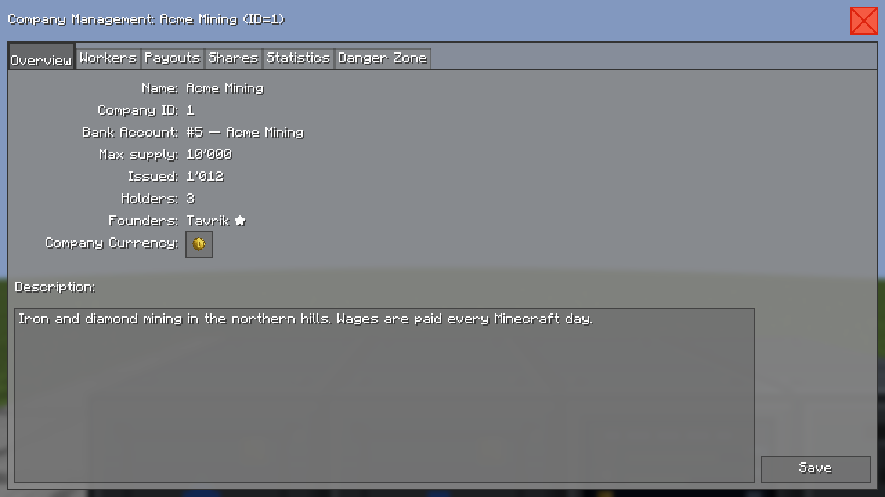
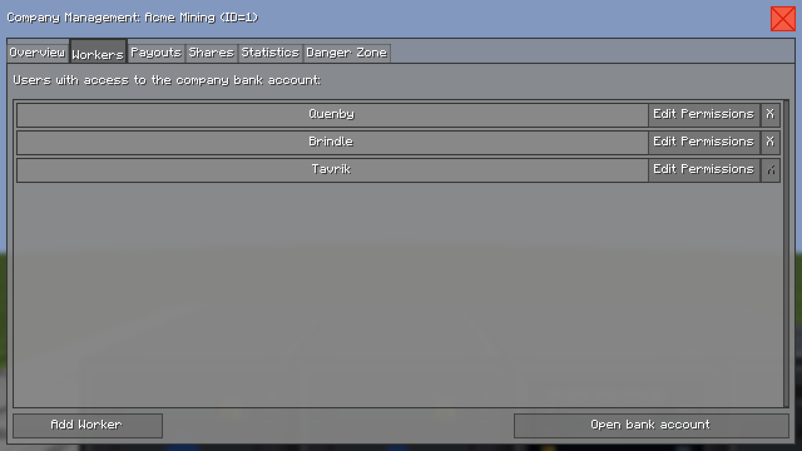
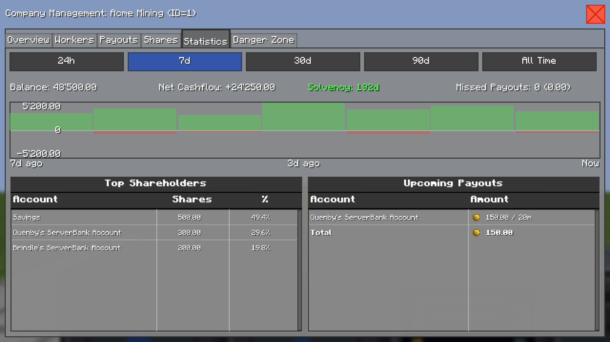

# Ein Unternehmen gründen und führen { #founding-and-running-a-company }

Ein **Unternehmen** ist ein Geschäft, das Spieler gemeinsam führen. Es hat ein eigenes Bankkonto, eigene Mitarbeiter und eigene **Aktien**. Spieler können Aktien kaufen, und das Unternehmen kann ihnen [Dividenden](payouts.md) zahlen. Ist StockMarket installiert, können die Aktien sogar [einen eigenen Markt](company-market.md) bekommen.

## Ein Unternehmen gründen { #founding-a-company }

Tippe in den Chat:

```text
/company create "<name>" <max supply>
```

- **name**: der Name des Unternehmens. Setze ihn in Anführungszeichen, wenn er Leerzeichen enthält. Jeder Name lässt sich nur einmal vergeben.
- **max supply**: die höchste Zahl an Aktien, die es je geben kann, von 1 bis 1'000'000'000.

!!! warning "Wähle die maximale Ausgabe mit Bedacht"
    Die maximale Ausgabe lässt sich später nie mehr ändern.

Die Gründung eines Unternehmens bewirkt drei Dinge:

1. Sie eröffnet ein Bankkonto mit dem Namen des Unternehmens. Alles Geld und alle Items des Unternehmens liegen dort.
2. Sie gibt dir alle drei Rechte auf diesem Konto: **Erlaubt einzuzahlen**, **Erlaubt abzuheben** und **Erlaubt zu verwalten**.
3. Sie macht dich zum **Gründer** des Unternehmens.

Standardmäßig kann jeder Spieler 3 Unternehmen gründen. Das Bankkonto des Unternehmens zählt außerdem zu deinem [Kontolimit](bank-accounts.md#creating-another-account), du brauchst dort also auch einen freien Platz.

## Gründer und Mitarbeiter { #founders-and-workers }

**Gründer** besitzen das Unternehmen. Nur ein Gründer kann das Unternehmen übergeben, es auflösen oder seinen Markt endgültig schließen. Ein Gründer behält immer **Erlaubt zu verwalten** auf dem Unternehmenskonto, damit kein Mitarbeiter den Gründer aussperren kann.

**Mitarbeiter** sind die Benutzer des Unternehmenskontos. Ihre Kontorechte bestimmen, was sie für das Unternehmen tun dürfen:

| Recht auf dem Unternehmenskonto | Der Mitarbeiter kann |
|---|---|
| **Erlaubt einzuzahlen** | Geld und Items in das Unternehmen einzahlen. Löhne aus [Auszahlungen](payouts.md) empfangen. |
| **Erlaubt abzuheben** | Das Geld des Unternehmens ausgeben und seine Items nehmen. |
| **Erlaubt zu verwalten** | Das Unternehmen führen: Mitarbeiter, Auszahlungen, Dividenden, das Aussehen der Aktien, die Aktien-Prägestation, den Markt und die Beschreibung. |

## Die Unternehmensverwaltung { #the-company-management-screen }

Du kannst sie auf zwei Wegen öffnen:

- Mit `/company manage "<name>"`, wenn du **Erlaubt zu verwalten** auf dem Unternehmenskonto hast.
- Mit einem Rechtsklick, während du eine Unternehmensaktie in der Hand hältst. Das kann jeder, aber Spieler ohne Rechte sehen nur die öffentlichen Tabs.

| Tab | Wer ihn sieht | Wofür er ist |
|---|---|---|
| **Übersicht** | Alle | Daten des Unternehmens und die Beschreibung. |
| **Mitarbeiter** | Verwalter und Gründer | Wer hier arbeitet und mit welchen Rechten. |
| **Auszahlungen** | Verwalter und Gründer | Löhne und Dividenden. Siehe [Auszahlungen und Dividenden](payouts.md). |
| **Anteile** | Alle, Bearbeiten erfordert **Erlaubt zu verwalten** | Das Aussehen der Aktien und die gebundenen Aktien-Prägestationen. Siehe [Aktien und Aktien-Prägestation](shares.md). |
| **Markt** | Alle, nur mit StockMarket | Der Aktienmarkt des Unternehmens. Siehe [Dein Unternehmen am Aktienmarkt](company-market.md). |
| **Statistiken** | Alle, Details nur für Mitglieder | Geld und Aktionäre im Zeitverlauf. |
| **Gefahrenzone** | Gründer | Das Unternehmen übergeben oder auflösen. |

Um die Daten eines beliebigen Unternehmens zu lesen, ohne ein Fenster zu öffnen, tippe `/company info "<name>"`.

### Übersicht { #overview }

<figure markdown="span">
  { width="600" }
</figure>

Der Tab listet **Name**, **Firmen-ID**, **Bankkonto**, **Maximale Ausgabe**, wie viele Aktien **Ausgegeben** sind, die Zahl der **Halter** und die **Gründer** (mit einem ★ markiert).

Verwalter können außerdem eine **Beschreibung** schreiben, die jeder Spieler lesen kann, und die **Unternehmenswährung** wählen: das Item, in dem der Kontostand des Unternehmens angezeigt wird. Standard ist Geld.

### Mitarbeiter { #workers }

<figure markdown="span">
  { width="600" }
</figure>

- **Mitarbeiter hinzufügen** wählt einen Spieler. Neue Mitarbeiter starten nur mit **Erlaubt einzuzahlen**.
- Die Rechte eines Mitarbeiters änderst du mit **Berechtigung bearbeiten** neben seinem Namen. Die Änderung wird sofort gespeichert.
- Das **X** entfernt einen Mitarbeiter. Seine Lohnauszahlungen werden ebenfalls entfernt.
- **Bankkonto öffnen** öffnet das vollständige [Verwaltungsfenster](bank-accounts.md#the-management-screen) des Unternehmenskontos.

Gründer lassen sich hier nicht entfernen. Übergib die Gründerrolle stattdessen in der Gefahrenzone.

### Statistiken { #statistics }

<figure markdown="span">
  { width="600" }
</figure>

Wähle einen Zeitraum (**24h**, **7T**, **30T**, **90T** oder **Gesamt**), und der Tab zeigt:

| Kennzahl | Bedeutung |
|---|---|
| **Kontostand** | Das Geld, das jetzt auf dem Unternehmenskonto ist. |
| **Netto-Cashflow** | Eingehendes minus ausgehendes Geld im gewählten Zeitraum. |
| **Solvenz** | Ungefähr wie viele echte Tage das Geld bei den aktuellen Ausgaben reicht. **Sicher**, wenn nichts davon abfließt. |
| **Verpasste Auszahlungen** | Wie viele Auszahlungen fehlgeschlagen sind, und ihre Summe. |

Darunter stehen ein Diagramm der Ein- und Ausgänge sowie die Listen **Top-Aktionäre** und **Anstehende Zahlungen**.

Mitarbeiter, Aktionäre und Admins sehen all das. Alle anderen sehen nur, wie viele Aktien es gibt und wie viele Spieler sie halten.

### Gefahrenzone { #danger-zone }

Nur Gründer sehen diesen Tab. Beide Aktionen lassen sich nicht rückgängig machen.

- **Gründerrolle übertragen**: Tippe den Namen des neuen Gründers ein und bestätige. Der neue Gründer muss bereits Mitarbeiter sein, füge ihn also zuerst im Tab Mitarbeiter hinzu. Du verlierst die Gründerrolle und **Erlaubt zu verwalten**, behältst aber deine anderen Rechte.
- **Unternehmen auflösen**: Tippe den genauen Namen des Unternehmens ein und bestätige. Das Unternehmen ist weg, aber sein Bankkonto bleibt als normales gemeinsames Konto mit all seinem Geld erhalten. Es zählt weiter zu deinem Kontolimit, bis du es löschst. Aktien eines aufgelösten Unternehmens bleiben als Items in der Welt, gehören aber zu keinem Unternehmen mehr.

## Wenn etwas schiefgeht { #if-something-goes-wrong }

| Meldung | Was sie bedeutet | Was du tun kannst |
|---|---|---|
| *Failed to create company '…': NAME_TAKEN* | Ein anderes Unternehmen hat diesen Namen (Groß- und Kleinschreibung zählen als gleich). | Wähle einen anderen Namen. |
| *Du hast dein Limit von N Unternehmen erreicht.* | Du hast so viele Unternehmen gegründet, wie der Server erlaubt. | Löse eines auf oder frag deinen Admin. |
| *… Eine Unternehmensgründung benötigt einen freien Bankkonto-Platz.* | Dein Kontolimit ist voll. | Lösche ein Konto, das du nicht brauchst. |
| *No such company '…'.* | Der Name ist falsch. | Prüfe die Schreibweise. Namen mit Leerzeichen brauchen Anführungszeichen. |
| *You need MANAGE on the company's bank account to manage it.* | Dir fehlt **Erlaubt zu verwalten**. | Frag einen Verwalter des Unternehmens. |
| *… ist kein Mitarbeiter dieses Unternehmens. Füge die Person zuerst im Tab Mitarbeiter hinzu.* | Du wolltest die Gründerrolle einem Spieler übergeben, der kein Mitarbeiter ist. | Füge ihn als Mitarbeiter hinzu und versuche es erneut. |
| *Der eingegebene Name stimmt nicht mit dem Firmennamen überein.* | Die Bestätigung braucht den genauen Namen, mit Groß- und Kleinschreibung. | Tippe ihn genau ein. |

## Verwandte Seiten { #related-pages }

- [Auszahlungen und Dividenden](payouts.md): Löhne zahlen und Gewinne teilen.
- [Aktien und Aktien-Prägestation](shares.md): die Aktien herstellen.
- [Dein Unternehmen am Aktienmarkt](company-market.md): Spieler mit deinen Aktien handeln lassen.
- [Bankkonten](bank-accounts.md): Das Unternehmenskonto ist ein normales gemeinsames Konto.
