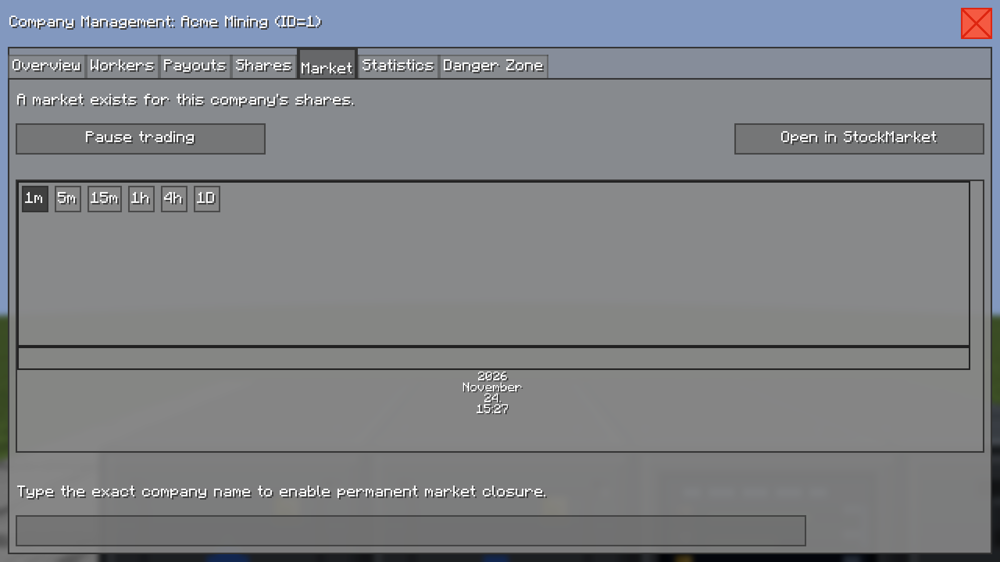

# Dein Unternehmen am Aktienmarkt { #your-company-on-the-stock-market }

Ist StockMarket installiert, können die Aktien deines Unternehmens einen eigenen Markt bekommen. Spieler kaufen und verkaufen deine Aktien dann wie jedes andere Item, zu Preisen, die sie selbst festlegen. Ohne StockMarket lassen sich Aktien trotzdem als Items weitergeben, und sie bringen weiterhin [Dividenden](payouts.md).

## Bevor du anfängst { #before-you-start }

- Es muss mindestens eine Aktie geben. Präge zuerst eine mit der [Aktien-Prägestation](shares.md).
- Du brauchst **Erlaubt zu verwalten** auf dem Unternehmenskonto oder musst Gründer sein.

## Den Markt eröffnen { #opening-the-market }

1. Öffne in der [Unternehmensverwaltung](companies.md#the-company-management-screen) den Tab **Markt**. Dort steht *Für die Anteile dieses Unternehmens existiert noch kein Markt.*
2. Gib den **Startpreis** ein: den Anfangspreis einer Aktie.
3. Klicke auf **Markt erstellen**.

Der Tab zeigt jetzt *Für die Anteile dieses Unternehmens existiert ein Markt.* und das Live-Preischart. **In StockMarket öffnen** öffnet den Markt im Handelsfenster.

<figure markdown="span">
  { width="600" }
</figure>

## Was an einem Aktienmarkt anders ist { #how-a-share-market-differs }

Ein Unternehmensmarkt hat keine Markt-Bots. Nur Spieler handeln darauf, deshalb gilt:

- Der Preis bewegt sich nur, wenn Spieler handeln. Der Startpreis ist nur der Anfang.
- Jemand muss verkaufen, bevor jemand kaufen kann. Um Aktien auf den Markt zu bringen, zahle sie an einem [Bank Terminal](bank-terminal.md) auf ein Bankkonto ein und erstelle Verkaufsorders. Siehe [Unternehmensaktien handeln](../stockmarket/company-shares.md).

## Den Handel pausieren { #pausing-trading }

**Handel pausieren** stoppt den Markt für Spieler. Alle offenen Orders der Spieler werden storniert, und das Geld und die Aktien darin gehen an ihre Besitzer zurück. Der Preisverlauf bleibt erhalten. Im Handelsfenster zeigt der Markt *In Wartung*.

**Handel fortsetzen** öffnet ihn wieder, mit einem leeren Orderbuch.

## Den Markt endgültig schließen { #closing-the-market-for-good }

Das können nur Gründer.

1. Tippe den genauen Namen des Unternehmens in das Feld unter **Markt schließen**.
2. Klicke auf **Markt schließen** und bestätige.

!!! danger "Das lässt sich nicht rückgängig machen"
    Der Markt und sein ganzer Preisverlauf werden gelöscht. Du kannst später einen neuen Markt erstellen, aber er fängt bei null an.

## Wenn etwas schiefgeht { #if-something-goes-wrong }

| Meldung | Was sie bedeutet | Was du tun kannst |
|---|---|---|
| *Kein Aktien-Item für diese Firma gefunden.* | Es wurde noch keine Aktie des Unternehmens geprägt. | Präge mindestens eine Aktie. |
| *Für dieses Anteils-Item existiert bereits ein Markt.* | Den Markt gibt es schon. | Nichts zu tun. |
| *Dieses Anteils-Item ist vom Handel ausgeschlossen.* | Der Admin erlaubt dafür keinen Markt. | Frag deinen Admin. |
| *Bitte einen gültigen positiven Preis eingeben.* | Der Startpreis ist leer, null oder keine Zahl. | Gib einen Preis über null ein. |
| *Du hast keine Berechtigung dafür.* | Dir fehlt **Erlaubt zu verwalten**, oder du wolltest den Markt schließen, ohne Gründer zu sein. | Frag einen Verwalter oder einen Gründer. |
| *Marktintegration nicht verfügbar.* | StockMarket ist nicht installiert oder antwortet nicht. | Frag deinen Admin. |

## Verwandte Seiten { #related-pages }

- [Unternehmensaktien handeln](../stockmarket/company-shares.md): die Seite der Aktionäre.
- [Aktien und Aktien-Prägestation](shares.md): die Aktien herstellen.
- [Grundlagen des Handels](../stockmarket/trading.md): wie Orders funktionieren.
