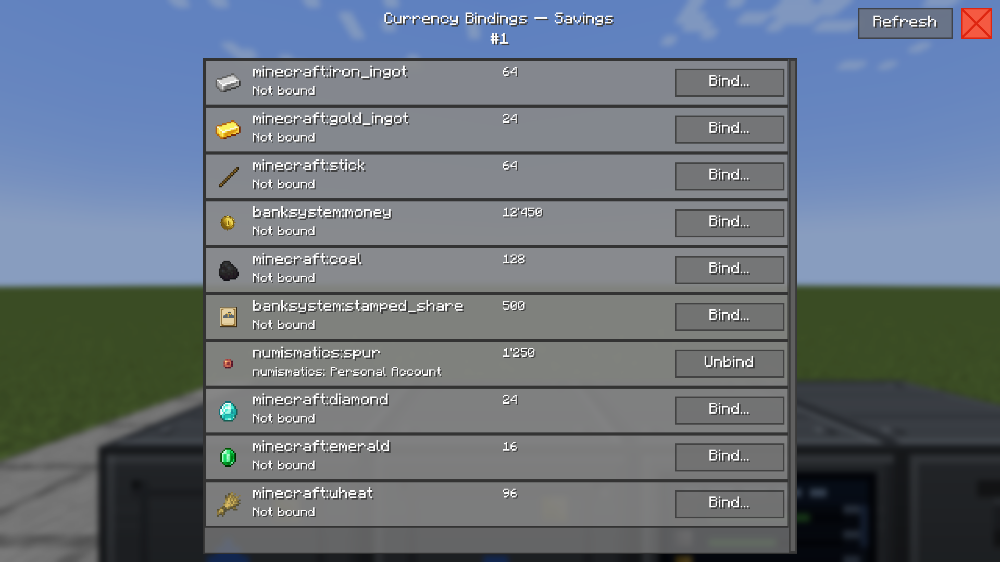
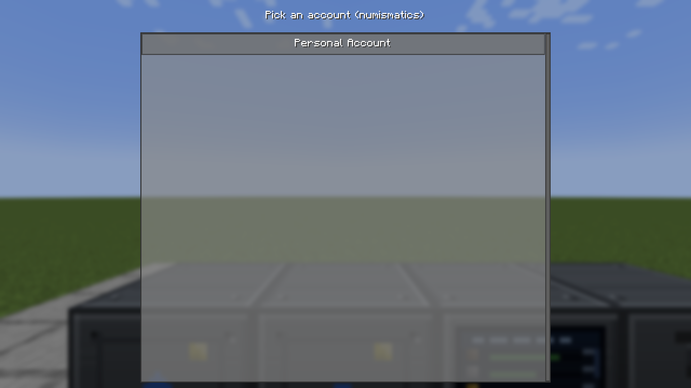

# Währungsbindungen { #currency-bindings }

Läuft auf deinem Server auch eine Währungs-Mod, kannst du sie an BankSystem binden. Eine **Währungsbindung** verbindet ein Item deines Bankkontos mit einem Konto in der anderen Mod. Ab dann nutzen beide Mods dasselbe Geld: Was du an den Automaten der Währungs-Mod einzahlst, taucht in BankSystem auf, und was du am Aktienmarkt ausgibst, geht vom Konto der Währungs-Mod ab.

BankSystem unterstützt zwei Währungs-Mods:

| Währungs-Mod | Fabric | NeoForge |
|---|:---:|:---:|
| Numismatics | ja | ja |
| Lightman's Currency | nein | ja |

Währungsbindungen sind freiwillig. Nichts ist gebunden, bis du selbst einen Slot bindest.

## Was sich nach dem Binden ändert { #what-changes-after-binding }

- Der Kontostand des gebundenen Items wird live aus der Währungs-Mod gelesen.
- Einzahlungen und Abhebungen am [Bank Terminal](bank-terminal.md), am [Geldautomaten](money.md) und über die [Automatisierungsblöcke](automation.md) bewegen Geld auf dem Konto der Währungs-Mod.
- Handel am Aktienmarkt mit diesem Bankkonto tut dasselbe.
- Deine Kontorechte bleiben so, wie sie in BankSystem sind.

## Bevor du anfängst { #before-you-start }

- Du brauchst **Erlaubt zu verwalten** auf dem Bankkonto.
- Du brauchst ein Konto in der Währungs-Mod. Bei Numismatics bekommst du eines, wenn du die Welt betrittst. Bei Lightman's Currency machst du einmal einen Rechtsklick auf einen ihrer Geldautomaten.
- Das Bankkonto hat schon einen Slot für die Grundmünze der Währungs-Mod: **Spur** bei Numismatics, die Goldmünze bei Lightman's Currency. Nur dieser Slot lässt sich binden.

## Einen Slot binden { #binding-a-slot }

1. Öffne das Verwaltungsfenster des Kontos (`/bank manage <name>`) und klicke auf **Verknüpfungen**. Das Fenster **Währungs-Verknüpfungen** listet jedes Item des Kontos mit seinem Kontostand.
2. Klicke neben dem Währungs-Slot auf **Verknüpfen...**.
3. Sind beide Währungs-Mods installiert, wähle unter **Währungs-Mod wählen** eine aus.
4. Wähle unter **Konto wählen** das Konto in der Währungs-Mod.
5. Bestätige. Ein Kontostand, der schon im Slot ist, wandert auf das Konto der Währungs-Mod.

Die Zeile zeigt jetzt das Konto der Währungs-Mod und einen Knopf **Trennen**.

<figure markdown="span">
  { width="600" }
</figure>

### Persönliche und gemeinsame Konten { #personal-and-shared-accounts }

Du kannst nur Konten derselben Art aneinander binden:

- Ein **persönliches** Bankkonto wird an ein persönliches Konto in der Währungs-Mod gebunden.
- Ein **gemeinsames** Bankkonto wird an ein gemeinsames gebunden: einen Blaze Banker, auf dem du als vertrauenswürdig eingetragen bist (Numismatics), oder ein Team-Konto, zu dem du gehörst (Lightman's Currency). Diese zeigen in der Liste ein Abzeichen **geteilt**.

Fehlt die Art, die du brauchst, erstelle sie zuerst: ein gemeinsames Bankkonto mit `/bank create <name>` oder einen Blaze Banker oder ein Team in der Währungs-Mod.

Die Benutzer des Bankkontos und die Mitglieder auf der Seite der Währungs-Mod werden nicht abgeglichen. Verwalte die Vertrauensliste des Blaze Bankers (Numismatics) oder die Team-Mitglieder (Lightman's Currency) selbst in der jeweiligen Mod.

<figure markdown="span">
  { width="600" }
</figure>

## Mit anderen Münzen einzahlen { #paying-in-other-coins }

Währungs-Mods haben Münzen mit verschiedenen Werten. An einem Bank Terminal kannst du jede Münze der gebundenen Währung einzahlen. Ihr Wert wird dem gebundenen Slot gutgeschrieben. Eine Crown aus Numismatics bringt zum Beispiel ihren Wert in Spurs ein. Hebst du Geld ab, bekommst du die Münzen der Währungs-Mod, wie an ihrem eigenen Geldautomaten.

Ohne Währungsbindung ist jede Münzsorte nur ein eigenes Item in deiner Bank.

## Bindung lösen { #unbinding }

Klicke auf **Trennen** und wähle, wohin das Geld geht:

| Auswahl | Was passiert |
|---|---|
| **Im BankSystem behalten** | Das Geld wandert aus der Währungs-Mod in den BankSystem-Slot. Wähle das, wenn die Währungs-Mod entfernt wird. |
| **Bei** *Währungs-Mod* **behalten** | Das Geld bleibt auf dem Konto der Währungs-Mod. Der BankSystem-Slot wird geleert. Beträge unter einer Einheit gehen verloren. |
| **Abbrechen** | Nichts ändert sich. |

## Gut zu wissen { #good-to-know }

- Das Fenster Währungs-Verknüpfungen aktualisiert sich nicht von selbst. Klicke nach dem Ein- oder Auszahlen an den Automaten der Währungs-Mod auf **Aktualisieren**.
- Gibst du in der Währungs-Mod Geld aus, das BankSystem für offene Orders am Aktienmarkt reserviert hatte, werden diese Orders storniert.
- Eine ausgegraute Zeile bedeutet, dass die Währungs-Mod nicht läuft oder der Admin sie abgeschaltet hat. Die Währungsbindung bleibt, aber kein Geld bewegt sich, bis die Mod wieder da ist.
- Eine Zeile mit der Markierung *Gesperrt* muss erst ein Admin prüfen. Bis dahin kann darüber nichts ein- oder ausgezahlt werden.

## Wenn etwas schiefgeht { #if-something-goes-wrong }

| Meldung | Was sie bedeutet | Was du tun kannst |
|---|---|---|
| *Das Item des Slots (…) stimmt nicht mit der Währung von … überein* | Du wolltest einen Slot binden, der nicht die Grundmünze der Währungs-Mod ist. | Binde den Slot der Grundmünze. |
| *Der bestehende Kontostand würde das externe Konto überlaufen lassen* | Konten in Numismatics fassen höchstens etwa 2.1 Milliarden Spurs. | Nimm etwas Geld aus dem Slot und binde dann. |
| *Persönliche und geteilte Konten können nicht gemischt verknüpft werden.* | Die beiden Konten sind von unterschiedlicher Art. | Wähle ein Konto derselben Art. |
| *Auf diesem Server sind keine externen Währungs-Mods installiert.* | Der Server hat keine unterstützte Währungs-Mod. | Frag deinen Admin. |
| *Die externe Währungs-Mod ist nicht verfügbar.* | Die Währungs-Mod ist abgeschaltet oder wurde entfernt. | Frag deinen Admin. |
| Der Knopf **Verknüpfen...** ist ausgegraut, *Erfordert Verwalten-Berechtigung* | Du hast kein **Erlaubt zu verwalten**. | Frag einen Verwalter des Kontos. |

## Verwandte Seiten { #related-pages }

- [Bankkonten](bank-accounts.md): persönliche und gemeinsame Konten, Rechte.
- [Geld und Geldautomat](money.md): das eigene Geld von BankSystem.
- [So arbeiten die beiden Mods zusammen](../together.md): mit deinem Bankkonto handeln.
