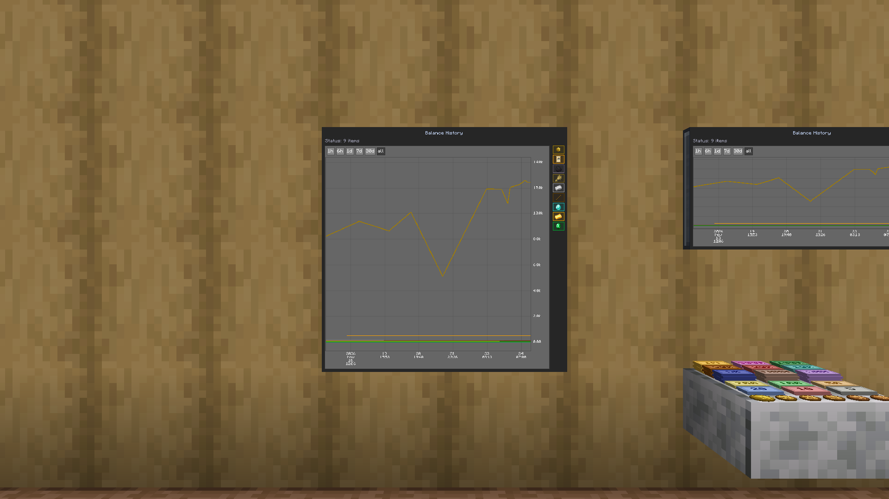
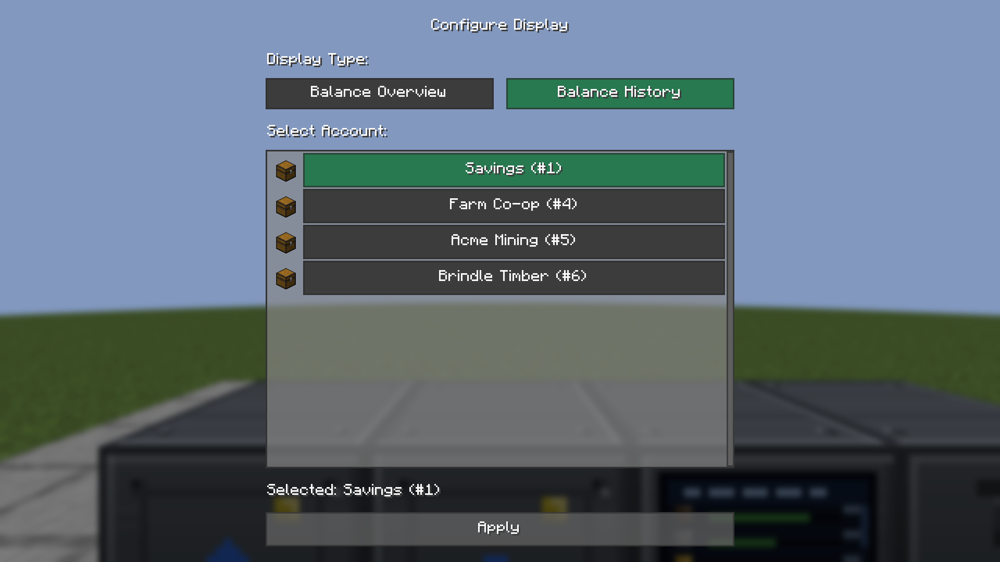

# Bank Anzeige { #bank-display }

Die **Bank Anzeige** zeigt ein Bankkonto an einer Wand: entweder seine aktuellen Kontostände oder ein Diagramm, wie sie sich verändert haben. Setze mehrere Anzeigen zusammen, um einen großen Bildschirm zu bauen. Das Rezept findest du unter [Blöcke und Rezepte](blocks-and-recipes.md).

<figure markdown="span">
  { width="600" }
</figure>

## Einen Bildschirm bauen { #building-a-screen }

1. Setze die Anzeigen an eine Wand, nebeneinander und übereinander.
2. Achte darauf, dass alle in dieselbe Richtung zeigen. Anzeigen, die in dieselbe Richtung zeigen, einander berühren und denselben Anzeigetyp zeigen, verbinden sich zu einem Bildschirm.
3. Fülle ein vollständiges Rechteck, zum Beispiel 3 breit und 2 hoch.

Eine Anzeige, die du neben einen eingerichteten Bildschirm setzt, übernimmt dessen Einstellungen, sodass der ganze Bildschirm ein Bild zeigt.

## Auswählen, was sie zeigt { #choosing-what-it-shows }

1. Mache einen Rechtsklick auf den Bildschirm. Das Fenster **Configure Display** öffnet sich.
2. Wähle unter **Display Type:** entweder **Balance Overview** oder **Balance History**.
3. Wähle unter **Select Account:** das Konto.
4. Klicke auf **Apply**.

Schließt du das Fenster ohne **Apply**, fragt ein Popup, ob du deine Änderungen **Speichern** oder **Verwerfen** willst.

<figure markdown="span">
  { width="600" }
</figure>

| Display Type | Zeigt | Aktualisierung |
|---|---|---|
| **Balance Overview** | Die Items, von denen das Konto am meisten hat, als Symbole mit ihren Mengen. | Jede Sekunde |
| **Balance History** | Ein Diagramm der Kontostände über die Zeit, eine farbige Linie pro Item, mit einer Legende rechts. | Jede Minute |

Du kannst nur Konten wählen, deren Benutzer du bist.

!!! note "Jeder kann sie sehen"
    Eine Anzeige zeigt das Konto jedem Spieler, der vorbeikommt. Richte sie nicht auf ein Konto, dessen Kontostand du für dich behalten willst.

## Verwandte Seiten { #related-pages }

- [Bank Terminal](bank-terminal.md): dasselbe Diagramm zum Kontoverlauf, aus der Nähe.
- [Bankkonten](bank-accounts.md): wer als Benutzer eines Kontos zählt.
- [Aktienmarkt-Anzeige](../stockmarket/display-block.md): ein Live-Preischart statt eines Kontostands.
