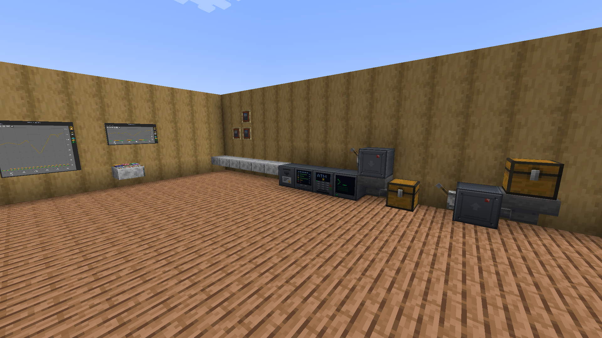

# BankSystem { #banksystem }

BankSystem gibt jedem Spieler ein Bankkonto für Geld und Items. Du zahlst Items an einem Bank Terminal ein, hebst Bargeld am Geldautomaten ab, teilst Konten mit Freunden, automatisierst deine Farmen mit Redstone und gründest sogar ein Unternehmen mit eigenen Aktien.

BankSystem ist auch die Geldbörse für [StockMarket](../stockmarket/index.md). Neu bei beiden Mods? Fang mit [Erste Schritte](../getting-started.md) an.

<figure markdown="span">
  { width="600" }
</figure>

## Was du tun kannst { #what-you-can-do }

| Ich möchte | Lies |
|---|---|
| Weitere Konten eröffnen und eines mit Freunden teilen | [Bankkonten](bank-accounts.md) |
| Items in die Bank einzahlen und wieder abheben | [Bank Terminal](bank-terminal.md) |
| Bargeld abheben, Scheine wechseln oder Geld senden | [Geld und Geldautomat](money.md) |
| Meine Farm in die Bank einspeisen oder Truhen aus ihr auffüllen | [Automatisierung](automation.md) |
| Einen Kontostand an einer Wand zeigen | [Bank Anzeige](displays.md) |
| Meine Bank an Numismatics oder Lightman's Currency binden | [Währungsbindungen](currency-bindings.md) |
| Ein Unternehmen gründen und Mitarbeiter einstellen | [Ein Unternehmen gründen und führen](companies.md) |
| Löhne und Dividenden zahlen | [Auszahlungen und Dividenden](payouts.md) |
| Aktien meines Unternehmens herstellen | [Aktien und Aktien-Prägestation](shares.md) |
| Spieler mit den Aktien meines Unternehmens handeln lassen | [Dein Unternehmen am Aktienmarkt](company-market.md) |
| Die Blöcke und Items herstellen | [Blöcke und Rezepte](blocks-and-recipes.md) |
| Einen Befehl nachschlagen | [Spielerbefehle](commands.md) |

## Gut zu wissen { #good-to-know }

- **Nicht jedes Item passt in die Bank.** Dein Server-Admin legt fest, welche Items erlaubt sind. Beschädigte oder verzauberte Items lassen sich nicht einlagern.
- **Geld in der Bank ist sicher.** Bargeld in deinem Inventar, in einer Truhe oder in einem Haufen ist nur ein Item, das andere Spieler nehmen können.
- **Ein Konto, viele Server.** In einem Netzwerk aus mehreren Servern ist dein Konto auf allen dasselbe.
- **Admins können Konten einfrieren.** Ein eingefrorenes Konto behält alles, was darin ist, aber nichts bewegt sich, bis ein Admin es wieder freigibt.

## Verwandte Seiten { #related-pages }

- [Erste Schritte](../getting-started.md): deine erste Einzahlung und dein erster Handel.
- [So arbeiten die beiden Mods zusammen](../together.md): Bank und Markt in einem Bild.
- [Glossar](../glossary.md): Begriffe rund um die Bank erklärt.
