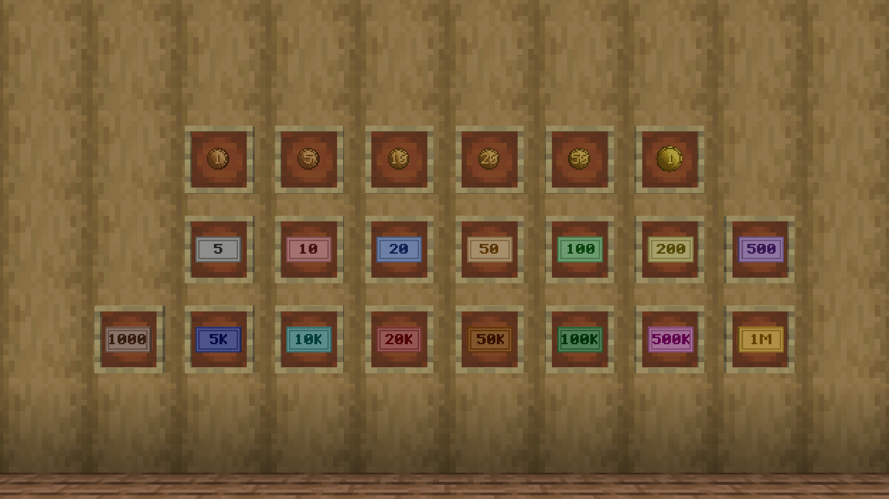
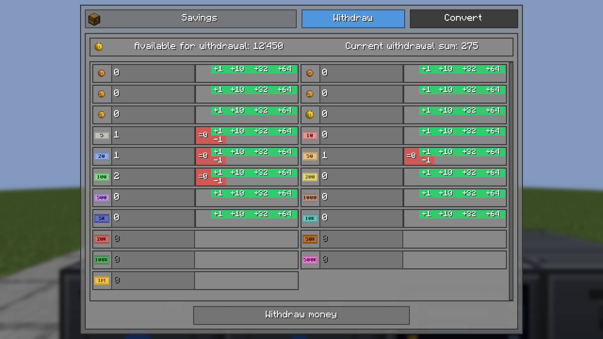
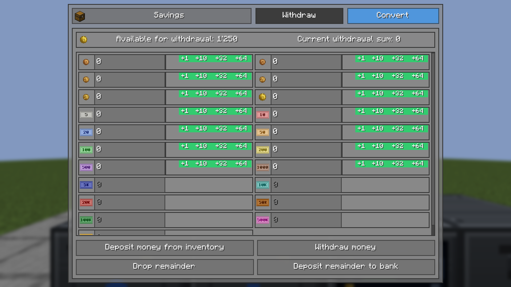
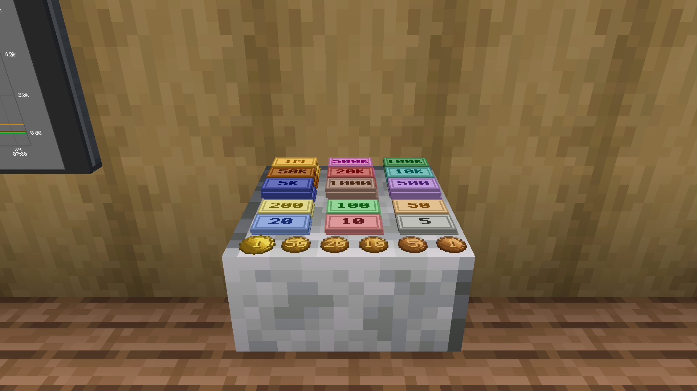

# Geld und Geldautomat { #money-and-the-atm }

BankSystem rechnet in Euro und Cent. Meist ist dein Geld nur eine Zahl auf deinem Bankkonto. Wenn du Bargeld in der Hand brauchst, zum Beispiel um [einen Dorfbewohner zu bezahlen](../stockmarket/villager-trading.md) oder es einem Freund zu geben, hebst du es am **Geldautomaten** als Banknoten und Münzen ab.

## Geld in der Bank und in der Hand { #money-in-the-bank-and-in-your-hand }

- **In der Bank** ist Geld ein Kontostand. Handel, Auszahlungen und `/money send` nutzen diesen Kontostand.
- **In der Hand** ist Geld ein Item: Münzen von **1 Cent** bis **50 Cent** und die **Euro**-Münze sowie Banknoten von **5 Euro** bis **1'000'000 Euro**.

<figure markdown="span">
  { width="600" }
</figure>

Um Bargeld zurück in die Bank zu bringen, nutzt du ein [Bank Terminal](bank-terminal.md) wie für jedes andere Item: Lege die Scheine und Münzen in die Slots und klicke auf **Sende Items zur Bank**. Sie zählen mit ihrem Nennwert. Oder du nutzt den Tab **Wechseln** des Geldautomaten, siehe unten.

## Geld prüfen und senden { #checking-and-sending-money }

| Befehl | Was er tut |
|---|---|
| `/money` | Zeigt deinen Geld-Kontostand. |
| `/money send <player> <amount>` | Sendet Geld von deinem Bankkonto auf das Bankkonto eines anderen Spielers. |

## Der Geldautomat { #the-atm }

Für einen Geldautomaten machst du mit **Bankomat Software** einen Rechtsklick auf einen **Terminal Block**. Siehe [Blöcke und Rezepte](blocks-and-recipes.md).

Öffne den Geldautomaten mit einem Rechtsklick. Er hat zwei Tabs. Der Konto-Knopf zwischen ihnen wählt das Bankkonto für beide.

### Abheben: Bargeld holen { #withdraw-take-out-cash }

<figure markdown="span">
  { width="600" }
</figure>

1. Wähle, wie viele von jeder Banknote und Münze du möchtest, mit den Knöpfen **+** und **−** oder indem du die Zahl eintippst.
2. Vergleiche **N wird ausbezahlt** mit **Zum Abheben verfügbar**.
3. Klicke auf **Geld abheben**.

Scheine, die du dir nicht leisten kannst, sind ausgegraut.

### Wechseln: Geld tauschen { #convert-change-money }

Der Tab **Wechseln** tauscht Scheine in andere Scheine mit demselben Wert, zum Beispiel einen 100-Euro-Schein in fünf 20-Euro-Scheine. Er rührt dein Bankkonto nicht an, außer du willst es.

1. Klicke auf **Geld aus Inventar einzahlen**. Alle Scheine und Münzen, die du bei dir trägst, wandern in den Zwischenspeicher des Geldautomaten. **Zum Abheben verfügbar** zeigt die Summe.
2. Wähle die Scheine und Münzen, die du möchtest, und nimm sie heraus.
3. Bleibt etwas im Zwischenspeicher, klicke auf **Restbetrag auf Bank einzahlen**, um es auf das gewählte Konto zu bringen, oder auf **Restbetrag fallen lassen**, um es in möglichst wenigen Scheinen vor deine Füße zu bekommen.

<figure markdown="span">
  { width="600" }
</figure>

Schließt du das Fenster, während noch Geld im Zwischenspeicher ist, lässt der Geldautomat es vor deine Füße fallen. Nichts geht verloren.

## Der Geldhaufen { #the-money-stockpile }

Du kannst Bargeld als Haufen in die Welt legen. Halte Banknoten oder Münzen in der Hand und mache einen Rechtsklick auf einen Block: Daneben erscheint ein **Geldhaufen Block**. Münzen und Banknoten liegen in Stapeln, ein Stapel pro Wert.

- Mache mit mehr Geld einen Rechtsklick auf den Haufen, um etwas hinzuzufügen.
- Mache mit leerer Hand einen Rechtsklick darauf, um Geld zurückzunehmen.
- Baue ihn ab, um das ganze Geld zurückzubekommen.

<figure markdown="span">
  { width="600" }
</figure>

!!! warning "Haufen liegen nicht in der Bank"
    Geld in einem Haufen oder in einer Truhe ist nur ein Item. Andere Spieler können es nehmen, und es zählt nicht für den Handel.

## Wenn etwas schiefgeht { #if-something-goes-wrong }

| Meldung | Was sie bedeutet | Was du tun kannst |
|---|---|---|
| *Du hast nicht genügend Geld auf der Bank um N abzuheben* | Das Konto enthält weniger, als du gewählt hast. | Wähle eine kleinere Summe. |
| *Bitte zuerst ein Bankkonto auswählen* | Im Geldautomaten ist kein Konto gewählt. | Klicke auf den Konto-Knopf und wähle eines. |
| Eine Chatnachricht sagt, dass das Konto eingefroren ist | Ein Admin hat das Konto eingefroren. | Frag einen Admin. |

## Verwandte Seiten { #related-pages }

- [Bankkonten](bank-accounts.md): von welchem Konto das Geld kommt.
- [Handel mit Dorfbewohnern](../stockmarket/villager-trading.md): Dorfbewohner mit Bargeld bezahlen.
- [Bank Terminal](bank-terminal.md): Bargeld zurück in die Bank bringen.
