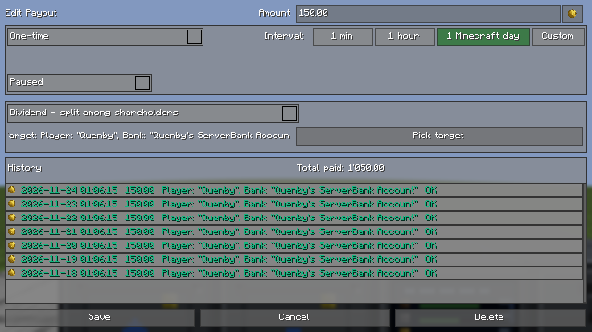
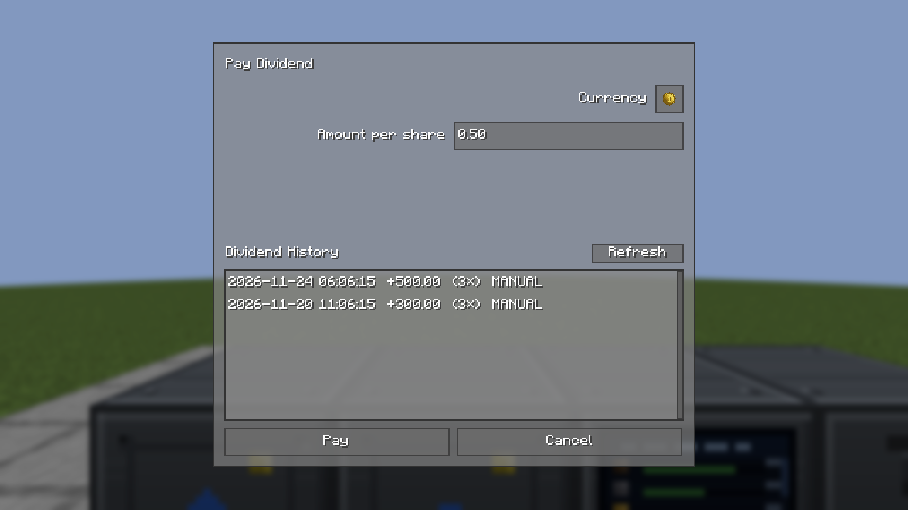

# Auszahlungen und Dividenden { #payouts-and-dividends }

Ein Unternehmen bezahlt seine Leute von seinem Bankkonto. Es gibt zwei Arten von Zahlungen:

- Eine **Auszahlung** läuft nach einem Zeitplan, zum Beispiel ein Lohn an jedem Minecraft-Tag. Sie zahlt an einen Spieler oder teilt einen Betrag unter allen Aktionären auf.
- Eine **Dividende** zahlt allen Aktionären auf einmal einen festen Betrag pro Aktie.

Du brauchst **Erlaubt zu verwalten** auf dem Unternehmenskonto. Öffne den Tab **Auszahlungen** in der [Unternehmensverwaltung](companies.md#the-company-management-screen) oder klicke im [Verwaltungsfenster](bank-accounts.md#more-buttons) des Unternehmenskontos auf **Auszahlungen**.

## Die Liste der Auszahlungen { #the-payouts-list }

Die oberste Zeile fasst alle Auszahlungen zusammen: **Gesamt / Stunde** (nur wiederkehrende Geldauszahlungen), die Zahl der **Zeitpläne** und unter **Fehlgeschlagen (24h)** die Zahl der fehlgeschlagenen Ausführungen.

Darunter hat jede Auszahlung eine Zeile mit **Ziel**, **Betrag**, **Intervall**, **Nächste** (die Zeit bis zur nächsten Ausführung) und **Status** (das Ergebnis der letzten Ausführung). Klicke auf **Bearbeiten**, um eine Auszahlung zu ändern.

## Eine Auszahlung einrichten { #setting-up-a-payout }

1. Klicke auf **Neue Auszahlung**.
2. Gib den **Betrag** ein (zwei Nachkommastellen erlaubt).
3. Wähle die **Währung**: Geld oder ein beliebiges Item, das das Unternehmenskonto hält.
4. Wähle das **Intervall**: **1 Min**, **1 Stunde**, **1 Minecraft-Tag** oder **Eigenes** für eine beliebige Zahl echter Minuten.
5. Klicke auf **Empfänger wählen** und wähle den Spieler und welches seiner Konten das Geld bekommt. Die Liste zeigt das persönliche Konto des Spielers und die Konten, auf denen der Spieler **Erlaubt einzuzahlen** hat. Das eigene Konto des Unternehmens ist nicht dabei. Wenn du kein Admin bist, siehst du nur das persönliche Konto des Spielers und die Konten, deren Benutzer du selbst bist.
6. Klicke auf **Speichern**.

<figure markdown="span">
  { width="600" }
</figure>

Weitere Optionen im selben Fenster:

- **Dividende - unter Aktionären aufteilen**: kein einzelnes Ziel. Der **Betrag** ist die Summe, die unter allen Aktionären nach der Zahl ihrer Aktien aufgeteilt wird.
- **Einmalig** mit **Ausführen in (Min.)**: zahlt einmal nach den angegebenen Minuten und entfernt sich dann selbst.
- **Pausiert**: hält die Auszahlung an. Pausierte Ausführungen werden nicht angespart. Die Auszahlung geht im nächsten Intervall weiter, nachdem du die Pause aufgehoben hast.
- **Verlauf**: die letzten Ausführungen dieser Auszahlung und **Insgesamt gezahlt**.
- **Löschen**: entfernt die Auszahlung.

Nach einem Neustart des Servers startet jede Auszahlung ein volles Intervall ab diesem Moment.

## Sofort eine Dividende zahlen { #paying-a-dividend-now }

1. Klicke auf **Dividende zahlen**.
2. Wähle die **Währung**.
3. Gib den **Betrag pro Anteil** ein.
4. Klicke auf **Auszahlen**.

Jeder Aktionär bekommt die Zahl seiner Aktien mal den Betrag. Das Ergebnis erscheint sofort, zum Beispiel *1'250 an 8 Inhaber ausgezahlt.* Die **Dividendenhistorie** darunter listet frühere Dividenden.

<figure markdown="span">
  { width="600" }
</figure>

Regeln für Dividenden:

- **Alles oder nichts.** Kann das Unternehmen nicht alle voll bezahlen, bekommt niemand etwas.
- **Nur Aktien auf einem Bankkonto zählen.** Aktien in einem Inventar oder einer Truhe bekommen nichts. Aktien, die in offenen Orders am Markt reserviert sind, zählen trotzdem.
- **Das Unternehmen zahlt nicht an sich selbst.** Aktien auf dem eigenen Konto des Unternehmens werden nicht berücksichtigt.
- **Nur freies Geld zählt.** Geld, das für offene Orders des Unternehmens am Markt reserviert ist, kann nicht verwendet werden.

## Wenn eine Auszahlung fehlschlägt { #when-a-payout-fails }

Die Spalte **Status** zeigt, warum die letzte Ausführung fehlgeschlagen ist:

| Status | Warum | Was du tun kannst |
|---|---|---|
| **OK** | Die letzte Ausführung hat normal gezahlt. | Nichts. |
| **Unzureichende Deckung** | Auf dem Unternehmenskonto war nicht genug freies Geld. | Zahle Geld auf das Unternehmenskonto ein. |
| **Itemguthaben unzureichend** | Die Auszahlung zahlt ein Item, und das Unternehmen hat nicht genug davon. | Zahle das Item ein oder ändere die Währung. |
| **Ziel nicht gefunden** | Der Spieler oder sein Konto existiert nicht mehr. | Wähle ein neues Ziel. |
| **Kein Einzahlungsrecht** | Der Spieler hat auf dem gewählten Konto kein **Erlaubt einzuzahlen** mehr. | Wähle ein anderes Konto des Spielers oder bitte einen Verwalter dieses Kontos, das Recht wieder zu vergeben. |

Eine pausierte Auszahlung zeigt in der Spalte **Nächste** den Text **PAUSIERT**. Das Fenster Auszahlung bearbeiten zeigt die letzte Ausführung genauer. Dort siehst du auch **Pausiert** und **Konto eingefroren**: Die Auszahlung wurde pausiert, oder ein Admin hat das Unternehmenskonto eingefroren.

Eine fehlgeschlagene Ausführung wird nicht wiederholt. Die Auszahlung wartet auf ihre nächste Ausführung und zählt den verpassten Betrag mit. Klicke in der Zeile auf **Verpasste zahlen**, um das Verpasste zu zahlen. Du kannst alles oder nur einen Teil zahlen.

!!! note "Dividenden pausiert"
    Tauchen auf Bankkonten mehr Aktien des Unternehmens auf, als je geprägt wurden, pausieren die Dividenden, bis das geprüft ist. Löhne an einzelne Spieler laufen weiter. Ein Verwalter oder ein Gründer kann die Anzahl mit `/company shares acknowledge "<name>"` bestätigen. Bis dahin wird keine Dividende gezahlt, und Dividendenauszahlungen lassen sich weder anlegen noch ändern.

    Hat das Unternehmen einen [Aktienmarkt](company-market.md), stoppt auch der Handel darauf, und die Verwalter des Unternehmens bekommen eine Chatnachricht. Das Bestätigen der Anzahl startet ihn nicht wieder: Klicke im Tab **Markt** auf **Handel fortsetzen**.

## Verwandte Seiten { #related-pages }

- [Ein Unternehmen gründen und führen](companies.md): Mitarbeiter und ihre Rechte.
- [Aktien und Aktien-Prägestation](shares.md): woher Aktien kommen.
- [Unternehmensaktien handeln](../stockmarket/company-shares.md): Dividenden aus Sicht der Aktionäre.
