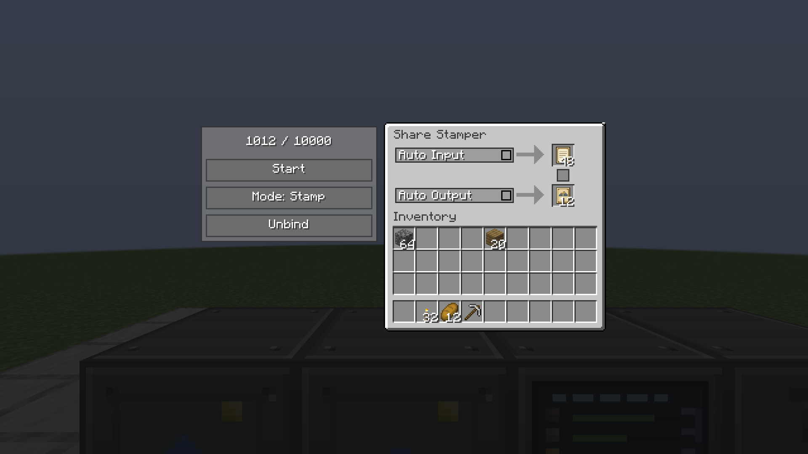
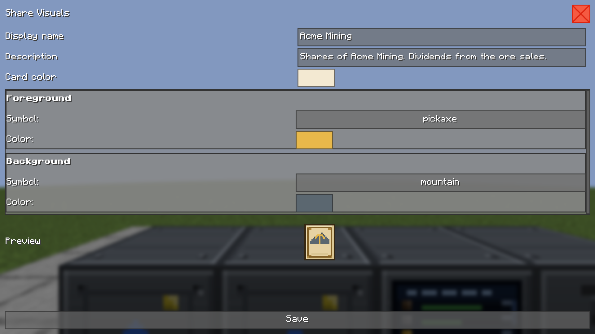
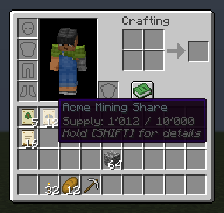

# Aktien und Aktien-Prägestation { #shares-and-the-share-stamper }

Die Aktien eines Unternehmens sind echte Items. Sie kommen nur über eine **Aktien-Prägestation** in die Welt: Sie verwandelt **Leere Aktien** in **Unternehmensaktien** eines Unternehmens. Jede Aktie zählt zum Bestand des Unternehmens. Aktionäre bekommen [Dividenden](payouts.md), und mit StockMarket können sie [die Aktien handeln](company-market.md).

## Was du brauchst { #what-you-need }

| Item | Wie du es bekommst |
|---|---|
| **Leere Aktie** | Stelle aus 1 Papier und 1 Leder 4 Leere Aktien her. |
| **Aktien-Prägestation** | Stelle sie her, siehe [Blöcke und Rezepte](blocks-and-recipes.md). |
| Ein Unternehmen | Du brauchst **Erlaubt zu verwalten** auf seinem Konto. Siehe [Ein Unternehmen gründen und führen](companies.md). |

## Die Prägestation an dein Unternehmen binden { #binding-the-stamper-to-your-company }

1. Stelle die Aktien-Prägestation auf und mache einen Rechtsklick darauf. Ihr Fenster zeigt *Nicht gebunden — Rechtsklick, um ein Unternehmen auszuwählen*.
2. Wähle dein Unternehmen aus der Liste.

Ab jetzt stellt die Prägestation nur noch Aktien dieses Unternehmens her. Nur Gründer, Spieler mit **Erlaubt zu verwalten** auf dem Unternehmen und BankSystem-Admins können sie öffnen. Alle anderen sehen *Gebunden an … — keine Berechtigung*.

Eine gebundene Prägestation ist für alle anderen schwer abzubauen: Es dauert 20-mal länger. Wird sie doch abgebaut, behält sie ihr Unternehmen, und wenn du sie wieder aufstellst, ist sie wieder daran gebunden.

Um sie an ein anderes Unternehmen zu binden, klicke zuerst auf **Trennen**. Alles darin fällt oben auf den Block.

## Aktien prägen { #stamping-shares }

<figure markdown="span">
  { width="600" }
</figure>

1. Lege Leere Aktien in den oberen Slot.
2. Achte darauf, dass der Knopf **Modus: Prägen** zeigt.
3. Klicke auf **Start**.

Die Prägestation stellt etwa alle 3.4 Sekunden eine Aktie her. Die Bestandszeile zeigt die ausgegebenen Aktien und die maximale Ausgabe, zum Beispiel **120 / 1000**.

Sie hält von selbst an, wenn der obere Slot leer ist, der untere Slot voll ist oder das Unternehmen seine maximale Ausgabe erreicht hat.

### Aktien zurückverwandeln { #turning-shares-back }

Klicke auf den Modus-Knopf, um zu **Modus: Einlösen** zu wechseln. Jetzt verwandelt die Prägestation die Aktien deines Unternehmens zurück in Leere Aktien, und die Zahl der ausgegebenen Aktien sinkt. So schaffst du Platz unter der maximalen Ausgabe.

### Automatisieren { #automating-it }

- **Auto-Eingabe**: Trichter und Rohre können den oberen Slot von oben füllen. Nur das passende Item kommt hinein: Leere Aktien im Präge-Modus, Aktien dieses Unternehmens im Einlöse-Modus.
- **Auto-Ausgabe**: Trichter und Rohre können fertige Items unten entnehmen.

Die Prägestation startet nicht von selbst wieder. Hat sie angehalten (oberer Slot leer, unterer Slot voll, maximale Ausgabe erreicht), reicht es nicht, den oberen Slot nachzufüllen: Öffne die Prägestation und klicke auf **Start**.

Nur ein Spieler auf einmal kann die Prägestation geöffnet haben.

## Die Aktie gestalten { #designing-the-share }

Öffne in der [Unternehmensverwaltung](companies.md#the-company-management-screen) den Tab **Anteile** und klicke auf **Visuelle Ebenen bearbeiten**.

<figure markdown="span">
  { width="600" }
</figure>

| Feld | Was es ändert |
|---|---|
| **Anzeigename** | Das Item heißt „*Anzeigename* Aktie“. Lass das Feld leer, um den Namen des Unternehmens zu nutzen. |
| **Beschreibung** | Text im Tooltip, wenn du ++shift++ hältst. |
| **Kartenfarbe** | Die Farbe der Karte selbst. |
| **Foreground** | Das Hauptsymbol und seine Farbe. |
| **Background** | Ein zweites Symbol dahinter und seine Farbe. |
| **Vorschau** | Zeigt das Ergebnis, bevor du speicherst. |

Klicke auf **Speichern**. Jede Aktie des Unternehmens in der Welt bekommt das neue Aussehen.

Der Tooltip der Aktie zeigt den Namen des Unternehmens, den Bestand und, mit ++shift++, die Beschreibung. Mache mit einer Aktie in der Hand einen Rechtsklick, um das Unternehmen zu sehen.

<figure markdown="span">
  { width="350" }
</figure>

Der Tab **Anteile** listet außerdem jede Aktien-Prägestation, die an das Unternehmen gebunden ist, mit ihrer Position und einem Knopf **Trennen**.

## Wenn etwas schiefgeht { #if-something-goes-wrong }

| Meldung | Was sie bedeutet | Was du tun kannst |
|---|---|---|
| *Maximaler Bestand erreicht (…/…)* | Das Unternehmen hat alle Aktien hergestellt, die es je haben darf. | Verwandle Aktien im Einlöse-Modus zurück, um Platz zu schaffen. |
| *Die Aktien-Prägestation wird bereits von einem anderen Spieler verwendet* | Jemand anderes hat sie geöffnet. | Warte, bis er sie schließt. |
| *Du hast keine Unternehmen mit MANAGE-Berechtigung* | Du kannst die Prägestation an kein Unternehmen binden. | Gründe ein Unternehmen oder bitte um **Erlaubt zu verwalten**. |
| *Der Bank-Master vertraut diesem Server nicht, daher kann die Aktien-Prägestation hier nicht benutzt werden.* | In einem Netzwerk aus mehreren Servern ist dieser Server noch nicht fertig eingerichtet. | Sag deinem Admin Bescheid. |
| Eine Aktie zeigt eine Nummer wie `company#12` statt eines Namens | Dein Spiel hat die Unternehmensdaten noch nicht geladen. | Warte eine Sekunde. Bleibt es so, verbinde dich neu. |

## Verwandte Seiten { #related-pages }

- [Auszahlungen und Dividenden](payouts.md): Aktionäre bezahlen.
- [Dein Unternehmen am Aktienmarkt](company-market.md): ein Markt für deine Aktien.
- [Unternehmensaktien handeln](../stockmarket/company-shares.md): Aktien kaufen und verkaufen.
