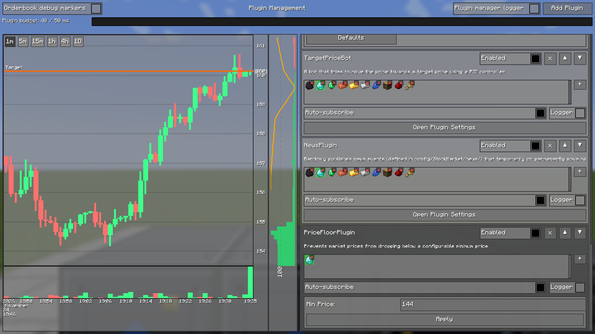

# Dein erstes Plugin { #your-first-plugin }

Auf dieser Seite baust du das **PriceFloorPlugin** aus dem Beispiel-Plugin-Projekt. Es verhindert, dass der Preis eines Markts unter einen Mindestpreis fällt, den Admins pro Markt festlegen. Dabei schreibst du ein Server-Plugin mit Einstellungen pro Markt, registrierst es und gibst ihm ein Einstellungsformular.

## Bevor du anfängst { #before-you-start }

- Ein Projekt, das von StockMarket abhängt, eingerichtet wie unter [Dein Projekt einrichten](../../setup.md). Am schnellsten startest du mit dem Beispiel-Plugin-Projekt: Es enthält das Plugin dieser Seite schon.
- Das Beispielprojekt ist ein Architectury-Projekt mit den Modulen `common`, `fabric` und `neoforge`. Der gesamte Plugin-Code liegt in `common`, im Package `com.example.stockmarketplugin.plugin`.
- Lies zuerst [Das Plugin-System im Überblick](index.md), wenn du wissen willst, wann welche Methode aufgerufen wird.

## Schritt 1: Das Server-Plugin schreiben { #step-1-write-the-server-plugin }

Das Plugin erweitert `ServerPlugin<TSettings, TRuntimeData>`. Sein Einstellungstyp ist ein Record mit einem Wert, dem Mindestpreis, und einem `StreamCodec`, der ihn schreibt. Es streamt keine Live-Daten, also ist der zweite Typ `Void`.

```java title="PriceFloorPlugin.java"
package com.example.stockmarketplugin.plugin;

import io.netty.buffer.ByteBuf;
import net.kroia.banksystem.util.ItemID;
import net.kroia.stockmarket.pluginsystem.interaction.MarketInterface;
import net.kroia.stockmarket.pluginsystem.plugin.ServerPlugin;
import net.minecraft.nbt.CompoundTag;
import net.minecraft.network.codec.StreamCodec;
import org.jetbrains.annotations.NotNull;

import java.util.List;

public class PriceFloorPlugin extends ServerPlugin<PriceFloorPlugin.Settings, Void> {

    // The settings of one market. The same codec is used on the server and the client.
    public record Settings(float minPrice) {
        public static final StreamCodec<ByteBuf, Settings> CODEC = new StreamCodec<>() {
            @Override
            public Settings decode(ByteBuf buf) {
                return new Settings(buf.readFloat());
            }

            @Override
            public void encode(ByteBuf buf, Settings s) {
                buf.writeFloat(s.minPrice());
            }
        };
    }

    public PriceFloorPlugin() {
        super();
    }

    @Override
    public void init() {}

    @Override
    public void deInit() {}

    @Override
    public void update(List<MarketInterface> markets) {
        for (MarketInterface market : markets) {
            Settings settings = getCustomSettings(market.market.getMarketID());
            if (settings == null)
                continue;
            double currentTargetPrice = market.market.getTargetPrice();
            double minimumPrice = settings.minPrice;
            if (market.market.getPrice() < minimumPrice || currentTargetPrice < minimumPrice) {
                // Steer this market back up to its floor
                market.market.setTargetPrice(settings.minPrice());
            }
            // Above the floor: do nothing, the other plugins drive the price
        }
    }

    @Override
    public void finalize(List<MarketInterface> markets) {}

    @Override
    public void onMarketSubscribed(ItemID marketID) {}

    @Override
    public void onMarketUnsubscribed(ItemID marketID) {}

    @Override
    public void onEnable() {}

    @Override
    public void onDisable() {}

    // --- Per-market settings ---

    @Override
    protected StreamCodec<ByteBuf, Settings> customSettingsCodec() {
        return Settings.CODEC;
    }

    @Override
    protected Settings provideDefaultCustomSettings() {
        return new Settings(10.0f);   // what a newly subscribed market gets
    }

    @Override
    protected void onCustomSettingsApplied(ItemID marketID, @NotNull Settings settings) {
        // Nothing to do: update() reads the settings with getCustomSettings()
    }

    // --- Saving ---

    @Override
    public boolean save(CompoundTag tag) {
        return true;   // the per-market settings are saved by the framework
    }

    @Override
    public boolean load(CompoundTag tag) {
        return true;
    }
}
```

Was die Teile tun:

- **`update`** läuft in jedem Tick. Es bekommt die abonnierten Märkte, die geöffnet sind. `getCustomSettings(marketID)` gibt die Einstellungen dieses Markts zurück.
- **`setTargetPrice`** bewegt den Preis nicht selbst. Es setzt den Preis, auf den der Zielpreis-Bot hinhandelt, sobald alle Plugins fertig sind.
- **`customSettingsCodec`** sagt dem Framework, wie es die Einstellungen schreibt. Damit hält das Framework ein `Settings` pro Markt vor, schickt es an das Einstellungsformular und speichert es mit der Welt.
- **`provideDefaultCustomSettings`** liefert die Einstellungen eines Markts, der dem Plugin gerade hinzugefügt wurde.
- **Die abstrakten Methoden**, die du nicht brauchst, bleiben leer.

!!! tip "Prüfe die Werte im Record"
    Das Framework speichert, was der Client schickt, und ruft danach `onCustomSettingsApplied` auf. Um ungültige Werte fernzuhalten, korrigiere sie im kompakten Konstruktor des Records, zum Beispiel `public Settings { if (!(minPrice >= 0)) minPrice = 0; }`. Das Einstellungsformular bekommt dann den korrigierten Wert zurück.

## Schritt 2: Das Plugin registrieren { #step-2-register-the-plugin }

Registriere den Plugin-Typ in einem statischen Feld. Die Registrierung läuft, wenn die Klasse zum ersten Mal benutzt wird. Die Setup-Methode muss die Klasse also nur ansprechen.

```java title="ExamplePlugins.java"
package com.example.stockmarketplugin.plugin;

import com.example.stockmarketplugin.plugin.screen.PriceFloorGuiElement;
import net.kroia.stockmarket.pluginsystem.registry.PluginRegistry;
import net.kroia.stockmarket.pluginsystem.registry.PluginRegistryObject;

public class ExamplePlugins {

    public static final PluginRegistryObject PRICE_FLOOR_PLUGIN = PluginRegistry.registerPlugin(
            PriceFloorPlugin.class.getName(),
            "PriceFloorPlugin",
            "Prevents market prices from dropping below a configurable minimum price.",
            PriceFloorPlugin::new
    );

    public static void serverSetup() {
        // Loading this class runs the registration above
    }

    public static void clientSetup() {
        PRICE_FLOOR_PLUGIN.setGuiElementFactory(PriceFloorGuiElement::new);
    }
}
```

- Das erste Argument ist die **Typ-ID**. Gespeicherte Plugin-Instanzen finden ihren Typ darüber, also ändere sie nie. Ist der Klassenname die Typ-ID, verschiebe die Klasse auch nicht und benenne sie nicht um.
- Das zweite Argument ist der Name in der Plugin-Liste, das dritte die Beschreibung in der Liste **Plugin hinzufügen**.
- `setGuiElementFactory` gehört in `clientSetup`, damit ein dedizierter Server nie Client-Klassen lädt.

Trotz seines Namens muss `serverSetup()` auf **beiden** Seiten laufen: Der Client braucht die Registrierung für die Liste **Plugin hinzufügen**. Die gemeinsame Klasse `ExamplePluginMod` leitet beide Methoden weiter, und die Einstiegspunkte der Loader rufen sie auf:

=== "Fabric"

    ```java title="ExamplePluginFabric.java"
    public class ExamplePluginFabric implements ModInitializer {
        @Override
        public void onInitialize() {
            ExamplePluginMod.serverSetup();
            if (FabricLoader.getInstance().getEnvironmentType() == EnvType.CLIENT) {
                ClientLifecycleEvents.CLIENT_STARTED.register(client -> {
                    ExamplePluginMod.clientSetup();
                });
            }
        }
    }
    ```

=== "NeoForge"

    ```java title="NeoForgeSetup.java"
    @EventBusSubscriber(modid = ExamplePluginMod.MOD_ID, bus = EventBusSubscriber.Bus.MOD)
    public class NeoForgeSetup {
        @SubscribeEvent
        public static void commonSetup(FMLCommonSetupEvent event) {
            ExamplePluginMod.serverSetup();
        }

        @SubscribeEvent
        public static void clientSetup(FMLClientSetupEvent event) {
            ExamplePluginMod.clientSetup();
        }
    }
    ```

## Schritt 3: Das Einstellungsformular hinzufügen { #step-3-add-the-settings-form }

Das Einstellungsformular ist ein `PluginGuiElement` mit denselben Typparametern wie das Server-Plugin. Die Plugin-Verwaltung zeigt es im Eintrag des Plugins.

```java title="PriceFloorGuiElement.java"
package com.example.stockmarketplugin.plugin.screen;

import com.example.stockmarketplugin.plugin.PriceFloorPlugin;
import io.netty.buffer.ByteBuf;
import net.kroia.banksystem.util.ItemID;
import net.kroia.modutilities.gui.elements.Button;
import net.kroia.modutilities.gui.elements.Label;
import net.kroia.modutilities.gui.elements.TextBox;
import net.kroia.stockmarket.pluginsystem.plugin.core.PluginSyncData;
import net.kroia.stockmarket.pluginsystem.screen.PluginGuiElement;
import net.minecraft.network.codec.StreamCodec;
import org.jetbrains.annotations.Nullable;

import java.util.HashMap;
import java.util.List;
import java.util.Map;

public class PriceFloorGuiElement extends PluginGuiElement<PriceFloorPlugin.Settings, Void> {

    private final Label minPriceLabel;
    private final TextBox minPriceTextBox;
    private final Button applyButton;

    // The settings of every subscribed market, as the server sent them
    private final Map<ItemID, PriceFloorPlugin.Settings> settingsMap = new HashMap<>();

    public PriceFloorGuiElement() {
        minPriceLabel = new Label("Min Price:");
        minPriceTextBox = new TextBox();
        // Positive numbers only: up to 10 digits, 6 decimal places
        minPriceTextBox.setMatchRegex(TextBox.createRegex_onlyNumerical(true, false, 10, 6));
        applyButton = new Button("Apply", this::onApply);

        addChild(minPriceLabel);
        addChild(minPriceTextBox);
        addChild(applyButton);

        // The plugin entry reserves this height. Without it the form is invisible.
        setHeight(2 * (defaultElementHeight + spacing) + padding);
    }

    @Override
    protected StreamCodec<ByteBuf, PriceFloorPlugin.Settings> customSettingsCodec() {
        return PriceFloorPlugin.Settings.CODEC;   // the same codec as on the server
    }

    @Override
    protected void onPluginSyncDataReceived(PluginSyncData data,
                                            @Nullable Map<ItemID, PriceFloorPlugin.Settings> customSettingsMap) {
        settingsMap.clear();
        if (customSettingsMap != null)
            settingsMap.putAll(customSettingsMap);

        List<ItemID> markets = data.getSubscribedMarkets();
        if (!markets.isEmpty())
            setActiveMarket(markets.get(0));   // calls onActiveMarketChanged
    }

    @Override
    protected void onActiveMarketChanged(@Nullable ItemID marketID) {
        // The admin clicked another market icon: show its value
        PriceFloorPlugin.Settings settings = marketID != null ? settingsMap.get(marketID) : null;
        if (settings != null)
            minPriceTextBox.setText(settings.minPrice());
    }

    @Override
    protected void onCustomSettingsResponse(boolean success, @Nullable ItemID marketID,
                                            @Nullable PriceFloorPlugin.Settings confirmedSettings) {
        // Remember what the server stored, so the form is right when the admin comes back
        if (success && marketID != null && confirmedSettings != null)
            settingsMap.put(marketID, confirmedSettings);
    }

    private void onApply() {
        ItemID market = getActiveMarket();
        if (market != null)
            sendCustomSettings(market, new PriceFloorPlugin.Settings((float) minPriceTextBox.getDouble()));
    }

    @Override
    protected void layoutChanged() {
        int w = getWidth();
        int eh = defaultElementHeight;
        int labelW = w / 3;

        minPriceLabel.setBounds(padding, padding, labelW, eh);
        minPriceTextBox.setBounds(labelW + spacing, padding, w - labelW - spacing, eh);
        applyButton.setBounds(padding, minPriceTextBox.getBottom() + spacing, w - 2 * padding, eh);
    }

    @Override
    protected void render() {}
}
```

Was die Teile tun:

- **`setHeight`** im Konstruktor sagt dem Plugin-Eintrag, wie viel Platz das Formular braucht.
- **`onPluginSyncDataReceived`** bekommt die Daten des Plugins vom Server, mit den Einstellungen jedes Markts schon dekodiert.
- **`onActiveMarketChanged`** läuft, wenn der Admin im Eintrag des Plugins auf ein Markt-Icon klickt. Einstellungen gelten pro Markt, also zeigt das Formular die Werte des ausgewählten Markts.
- **`sendCustomSettings`** schickt die Einstellungen eines Markts an den Server. Die Antwort kommt in **`onCustomSettingsResponse`** an, mit den Werten, die der Server gespeichert hat. Das Beispielprojekt lässt diese Methode weg. Füge sie hinzu, sonst zeigt das Formular den alten Wert, wenn der Admin zu dem Markt zurückwechselt.
- **`padding`**, **`spacing`** und **`defaultElementHeight`** sind Layout-Konstanten der Basisklasse (4, 4 und 20 Pixel).

## Schritt 4: Im Spiel ausprobieren { #step-4-try-it-in-game }

1. Baue das Projekt mit `gradlew build`. Die Jars liegen in `fabric/build/libs/` und `neoforge/build/libs/`. Nimm die Jar ohne Suffix wie `-sources`.
2. Leg die Jar für deinen Loader in den Ordner `mods/` des Servers und deines Clients, neben StockMarket, BankSystem und ModUtilities.
3. Starte das Spiel, gib `/stockmarket manage` ein und klicke auf **Plugins verwalten**.
4. Klicke auf **Plugin hinzufügen** und wähle **PriceFloorPlugin**. Die neue Instanz erscheint ausgeschaltet unten in der Liste.
5. Setze den Haken bei **Aktiviert**.
6. Klicke auf **+** und füge einen oder mehrere Märkte hinzu.
7. Klicke im Eintrag des Plugins auf ein Markt-Icon, gib einen **Min Price** ein und klicke auf **Apply**.

<figure markdown="span">
  { width="600" }
</figure>

Fällt der Preis des Markts unter die Untergrenze, setzt das Plugin den Zielpreis auf die Untergrenze, und der Zielpreis-Bot kauft den Preis wieder nach oben.

Lass das Plugin in der Liste **unter** dem VolatilityPlugin. Das Volatilitäts-Plugin setzt den Zielpreis in jedem Tick, und das letzte Plugin, das ihn setzt, gewinnt. Neue Instanzen kommen ans Ende der Liste, das ist also schon so.

## Schritt 5: Eigene Daten speichern { #step-5-save-your-own-data }

Das Framework speichert die Einstellungen pro Markt für dich. Verwende `save` und `load` nur für Daten, die dein Plugin mit der Zeit ermittelt:

```java
private long floorHits = 0;   // counted up in update() whenever a floor is enforced

@Override
public boolean save(CompoundTag tag) {
    tag.putLong("floorHits", floorHits);
    return true;
}

@Override
public boolean load(CompoundTag tag) {
    if (tag.contains("floorHits"))
        floorHits = tag.getLong("floorHits");
    return true;
}
```

- `load` läuft, nachdem die Märkte und ihre Einstellungen wiederhergestellt sind, und vor `onEnable()`.
- Prüfe `tag.contains(...)`, bevor du einen Schlüssel liest. Welten, die mit einer älteren Version deines Plugins gespeichert wurden, haben ihn nicht.
- Der Tag wird nur gespeichert, wenn du etwas hineinschreibst.

## Schritt 6: Live-Werte streamen (optional) { #step-6-stream-live-values-optional }

Ein Plugin kann Live-Werte an sein offenes Einstellungsformular schicken, zum Beispiel eine Statuszeile. Definiere einen zweiten Record mit einem Codec und verwende ihn als `TRuntimeData`:

```java
// Server plugin: ServerPlugin<Settings, Status>
public record Status(int marketsAtFloor) {
    public static final StreamCodec<ByteBuf, Status> CODEC = StreamCodec.composite(
            ByteBufCodecs.INT, Status::marketsAtFloor,
            Status::new
    );
}

@Override
protected StreamCodec<ByteBuf, Status> runtimeDataCodec() {
    return Status.CODEC;
}

@Override
protected Status provideRuntimeData() {
    return new Status(marketsAtFloor);   // a field that update() keeps current
}

@Override
public long getRuntimeDataStreamInterval() {
    return 1000;   // milliseconds; the default is 500
}
```

```java
// Settings form: PluginGuiElement<Settings, Status>
@Override
protected StreamCodec<ByteBuf, PriceFloorPlugin.Status> runtimeDataCodec() {
    return PriceFloorPlugin.Status.CODEC;
}

@Override
protected void onPluginSyncDataReceived(PluginSyncData data,
                                        @Nullable Map<ItemID, PriceFloorPlugin.Settings> customSettingsMap) {
    // ... settings as in step 3
    startDataStream();   // does nothing if the stream already runs
}

@Override
protected void onRuntimeDataReceived(PriceFloorPlugin.Status data) {
    statusLabel.setText("Markets at their floor: " + data.marketsAtFloor());
}
```

- Der Server schickt nur dann ein neues Paket, wenn sich der kodierte Wert geändert hat. Gib aus `provideRuntimeData()` `null` zurück, wenn du nichts zu senden hast.
- Starte den Stream in `onPluginSyncDataReceived`, wie es die eingebauten Plugins tun. Die Plugin-Verwaltung stoppt ihn, wenn sie geschlossen wird oder ihre Liste neu aufbaut. In einem eigenen Bildschirm rufst du beim Schließen `stopDataStream()` auf.

Das [Handelszeiten-Beispiel](examples.md#trading-hours-plugin) zeigt ein vollständiges Plugin mit Live-Werten.

## Schritt 7: Ein eigener Bildschirm und Linien im Chart (optional) { #step-7-a-screen-of-its-own-and-chart-lines-optional }

Ein Formular mit vielen Einstellungen kann einen eigenen Bildschirm bekommen. Gib im Einstellungsformular aus `needsCustomScreen()` `true` zurück. Der Eintrag des Plugins zeigt dann statt des Formulars **Plugin-Einstellungen öffnen**.

Das Formular kann auch auf den Chart und die Orderbuch-Ansicht der Plugin-Verwaltung zeichnen. Überschreibe `setCandlestickChart` und füge ein Overlay hinzu:

```java
private @Nullable CandlestickChart chart;
private final CandlestickChart.Overlay floorLine = this::drawFloorLine;

@Override
public void setCandlestickChart(@Nullable CandlestickChart chart) {
    if (this.chart != null)
        this.chart.removeOverlay(floorLine);   // called with null when the screen rebuilds
    this.chart = chart;
    if (chart != null)
        chart.addOverlay(floorLine);
}

private void drawFloorLine(CandlestickChart chart) {
    ClientMarket market = chart.getMarket();
    if (market == null) return;
    PriceFloorPlugin.Settings settings = settingsMap.get(market.getItemID());
    if (settings == null) return;
    Rectangle bounds = chart.getCanvasBounds();
    int y = chart.toCanvasSpaceY(settings.minPrice());
    chart.drawRect(bounds.x, y, bounds.width, 1, 0xFFFF6600);
}
```

Der Abschnitt [Chart-Overlays](api-reference.md#chart-overlays) der API-Referenz listet die Methoden zum Zeichnen und Umrechnen auf.

## Wenn etwas schiefgeht { #if-something-goes-wrong }

| Was du siehst | Was es bedeutet | Was du tun kannst |
|---|---|---|
| Das Plugin fehlt in der Liste **Plugin hinzufügen** | Der Client hat die Registrierung nie ausgeführt. | Rufe `serverSetup()` auch auf dem Client auf, siehe Schritt 2. |
| *Plugin-Mod nicht installiert — eigene Oberfläche nicht verfügbar* im Eintrag | Der Client kennt den Plugin-Typ nicht. | Installiere die Plugin-Mod auf dem Client und registriere das Plugin auf beiden Seiten. |
| Der Eintrag hat kein Formular | Keine Factory gesetzt, oder das Formular hat keine Höhe. | Rufe `setGuiElementFactory` in `clientSetup()` auf und `setHeight(...)` im Konstruktor des Formulars. |
| Das Plugin tut nichts | Neue Instanzen starten ausgeschaltet und ohne Märkte, und geschlossene Märkte werden übersprungen. | Setze den Haken bei **Aktiviert**, füge Märkte hinzu und prüfe die Handelszeiten des Markts. |
| Der Zielpreis ignoriert die Untergrenze | Ein Plugin unter deinem setzt das Ziel erneut. | Schieb dein Plugin unter das VolatilityPlugin. |
| **Apply** tut nichts | Das Formular hat keinen Codec oder keinen ausgewählten Markt. Das Client-Log meldet *sendCustomSettings aborted*. | Überschreibe `customSettingsCodec()` im Formular und rufe `setActiveMarket` auf. |
| Gespeicherte Instanzen sind nach einem Update deiner Mod weg | Die Typ-ID hat sich geändert. | Halte die Typ-ID (den Klassennamen) in jeder Version gleich. |

## Verwandte Seiten { #related-pages }

- [Das Plugin-System im Überblick](index.md): wann welche Methode aufgerufen wird.
- [Plugin-API-Referenz](api-reference.md): alle Methoden der Klassen, die hier vorkommen.
- [Beispiel-Plugins](examples.md): Live-Werte, Limit-Orders und Zustand pro Markt.
- [Plugins](../../../admin/stockmarket/plugins/index.md): die Plugin-Verwaltung, wie Admins sie sehen.
