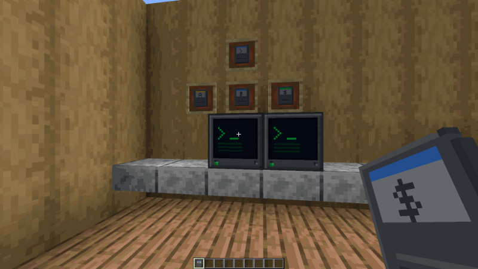
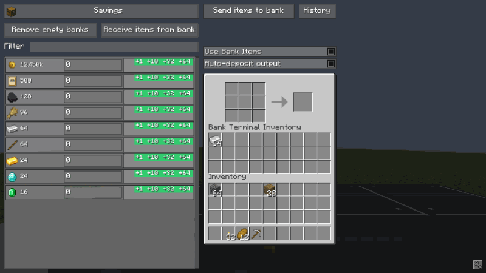
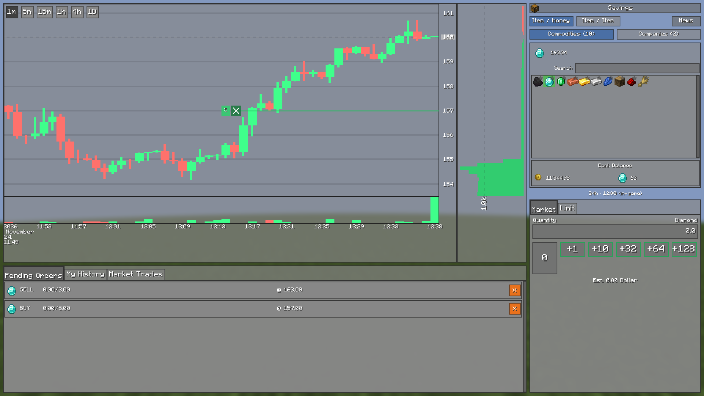

# Erste Schritte { #getting-started }

Diese Seite bringt dich vom Neuanfang bis zu deinem ersten Handel. Du prüfst dein Bankkonto, zahlst Items ein, verkaufst einige davon am Aktienmarkt, kaufst etwas zurück und holst es wieder heraus. Das dauert etwa zehn Minuten.

## Bevor du anfängst { #before-you-start }

- Auf dem Server laufen **BankSystem** und **StockMarket**.
- Du hast ein paar Eisenbarren oder ein anderes Item, für das es auf deinem Server einen Markt gibt.
- Du kannst einen **Terminal Block**, eine **Banking Software** und eine **Handels Software** herstellen. Die Rezepte stehen auf den Rezeptseiten von [BankSystem](banksystem/blocks-and-recipes.md) und [StockMarket](stockmarket/blocks-and-recipes.md).

## 1. Prüfe dein Bankkonto { #1-check-your-bank-account }

Du hast bereits ein Bankkonto. Die Mod eröffnet dir ein persönliches Konto, wenn du zum ersten Mal auf den Server kommst.

Gib das im Chat ein, um zu sehen, wie viel Geld darauf ist:

```text
/money
```

Neue Spieler starten meist ohne Geld. Manche Server geben dir einen Startbetrag. So oder so: Dein erstes Geld bekommst du, indem du Items verkaufst, wie unten gezeigt.

## 2. Baue ein Bank Terminal { #2-build-a-bank-terminal }

Am **Bank Terminal Block** kommen Items in die Bank und wieder heraus.

1. Platziere einen **Terminal Block**.
2. Halte die **Banking Software** in der Hand und klicke mit Rechts auf den Terminal Block. Er wird zu einem **Bank Terminal Block**.

Die Software wird nicht verbraucht. Behalte sie: Du kannst damit später weitere Blöcke programmieren.

<figure markdown="span">
  { width="600" }
</figure>

## 3. Bring Items in die Bank { #3-put-items-into-the-bank }

1. Klicke mit Rechts auf den Bank Terminal Block. Der Bankbildschirm öffnet sich. Rechts siehst du das **Bank Terminal Inventar**: 27 Slots, die nur du an diesem Block siehst.
2. Lege deine Eisenbarren aus deinem Inventar in diese Slots.
3. Klicke auf **Sende Items zur Bank**.

Das Eisen verschwindet aus den Slots, und sein Kontostand in der Itemliste links steigt.

<figure markdown="span">
  { width="600" }
</figure>

Nicht jedes Item kann in die Bank. Eisenbarren, Goldbarren, Diamanten, Smaragde, Kohle und jedes Item mit einem Markt gehen immer. Dein Server-Admin kann weitere erlauben. Items, die nicht in die Bank können, bleiben in den Slots, du verlierst sie also nicht.

## 4. Baue einen Aktienmarkt-Block { #4-build-a-stock-market-block }

Platziere einen zweiten **Terminal Block**. Halte die **Handels Software** in der Hand und klicke mit Rechts darauf. Er wird zu einem **Aktienmarkt-Block**.

!!! tip "Eine Blockfamilie"
    Das Bank Terminal, der Geldautomat und der Aktienmarkt-Block sind alle derselbe Terminal Block mit unterschiedlicher Software. Klicke einen davon mit einer anderen Software mit Rechts an, um ihn umzuprogrammieren. Siehe [So arbeiten die beiden Mods zusammen](together.md).

## 5. Verkaufe deine ersten Items { #5-sell-your-first-items }

1. Klicke mit Rechts auf den Aktienmarkt-Block. Der Handelsbildschirm öffnet sich.
2. Wähle den Eisenmarkt in der oberen Leiste oder suche ihn über **Markt auswählen**.
3. Öffne den Tab **Markt**.
4. Gib eine **Menge** ein, zum Beispiel `10`.
5. Klicke auf **Verkaufen**.

Der Markt verkauft das Eisen sofort von deinem Bankkonto. Das Geld landet auf demselben Konto. Dein **Kontostand** im Handelsbildschirm steigt.

<figure markdown="span">
  { width="600" }
</figure>

## 6. Kaufe etwas { #6-buy-something }

Jetzt setzt du das Geld ein. Wähle einen anderen Markt, gib eine **Menge** ein und klicke auf **Kaufen**. Die Items landen auf deinem Bankkonto, nicht in deinem Inventar.

Eine Market-Order wie diese wird sofort ausgeführt, zum besten angebotenen Preis. Um zu einem Preis deiner Wahl zu handeln, nimm stattdessen eine Limit-Order. [Grundlagen des Handels](stockmarket/trading.md) erklärt beide.

## 7. Hol deine Items heraus { #7-take-your-items-out }

1. Geh zurück zum Bank Terminal Block und öffne ihn.
2. Such das Item in der Liste links. Stell die Menge mit den Knöpfen **+1**, **+10**, **+32** und **+64** ein oder tippe sie ein.
3. Klicke auf **Empfange Items von der Bank**.

Die Items erscheinen in den Slots des Bank Terminal Inventars. Leg sie in dein Inventar.

## Wenn etwas schiefgeht { #if-something-goes-wrong }

| Meldung | Bedeutung | Was du tun kannst |
|---|---|---|
| *… ist nicht für das Lagern in der Bank zugelassen* | Der Server erlaubt dieses Item nicht in der Bank. | Frag deinen Admin oder prüfe, ob das Item einen Markt hat. |
| *Der Zustand von … verhindert das Einlagern in der Bank* | Das Item ist in einem Zustand, den die Bank nicht speichern kann, zum Beispiel verdorbenes Essen aus einer anderen Mod. | Behalte es in deinem Inventar. |
| Beschädigte oder verzauberte Items bleiben in den Slots | Die Bank speichert Items nur in ihrem einfachen Zustand. | Nimm sie zurück in dein Inventar. |
| Der gewünschte Markt ist nicht in der Liste | Niemand hat für dieses Item einen Markt erstellt. | Frag deinen Admin. Nur Admins erstellen Märkte. |

## Verwandte Seiten { #related-pages }

- [So arbeiten die beiden Mods zusammen](together.md): wie sich die Bank und der Aktienmarkt dein Konto teilen.
- [Bank Terminal](banksystem/bank-terminal.md): der Bankbildschirm im Detail, auch das Herstellen direkt aus der Bank.
- [Grundlagen des Handels](stockmarket/trading.md): Market- und Limit-Orders und was jeder Teil des Handelsbildschirms macht.
- [Bankkonten](banksystem/bank-accounts.md): gemeinsame Konten und wer sie nutzen darf.
