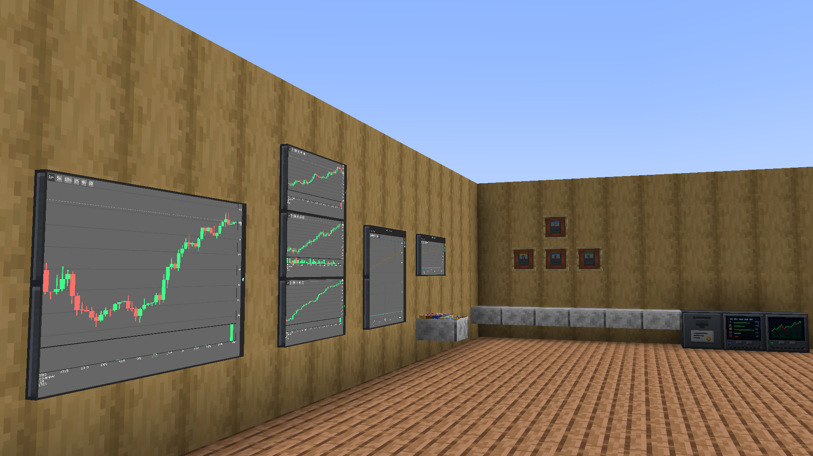
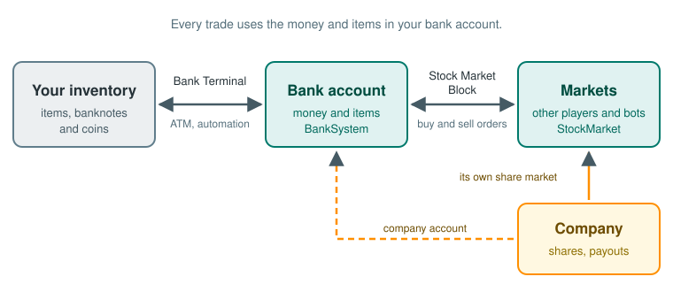

# BankSystem & StockMarket { #banksystem-stockmarket }

Deine Diamanten haben Besseres verdient als eine Truhe im Keller. Bring sie zur Bank, handle sie an einem echten Aktienmarkt, gründe ein Unternehmen und verkaufe seine Aktien. Dann sieh zu, wie die Preise verrückt spielen, sobald die Zeitung „Diamantenrausch!“ ruft. Kapitalismus, Block für Block.

[:simple-curseforge: BankSystem auf CurseForge](https://www.curseforge.com/minecraft/mc-mods/banksystem){ .md-button .md-button--primary }
[:simple-modrinth: BankSystem auf Modrinth](https://modrinth.com/mod/kroia_banksystem){ .md-button .md-button--primary }

[:simple-curseforge: StockMarket auf CurseForge](https://www.curseforge.com/minecraft/mc-mods/stockmarket){ .md-button .md-button--primary }
[:simple-modrinth: StockMarket auf Modrinth](https://modrinth.com/mod/kroia_stockmarket){ .md-button .md-button--primary }

[:simple-discord: Discord beitreten](https://discord.gg/qHNVaDGAyB){ .md-button .discord-button }
[{ .coffee-banner .no-zoom }](https://buymeacoffee.com/alexkrieg)

<figure markdown="span">
  { .hero width="800" }
</figure>

-   :material-bank:{ .lg .middle } **BankSystem**

    ---

    - Ein [Bankkonto](banksystem/bank-accounts.md) für jeden Spieler, dazu gemeinsame Konten mit den Rechten **Einzahlen**, **Abheben** und **Verwalten**.
    - Lagere Items, nicht nur Geld: Das [Bank Terminal](banksystem/bank-terminal.md) zahlt ein, hebt ab und stellt sogar direkt aus deiner Bank her.
    - Bargeld zum Anfassen: Banknoten und Münzen aus dem [Geldautomaten](banksystem/money.md).
    - [Redstone-Automatisierung](banksystem/automation.md) mit dem Bank Upload Block und dem Bank Download Block.
    - [Unternehmen](banksystem/companies.md) mit Mitarbeitern, Löhnen, Dividenden und geprägten Aktien.
    - Arbeitet über [Währungsbindungen](banksystem/currency-bindings.md) mit Create: Numismatics und Lightman's Currency zusammen.

    [:octicons-arrow-right-24: BankSystem-Handbuch](banksystem/index.md)

-   :material-chart-line:{ .lg .middle } **StockMarket**

    ---

    - Ein Markt für jedes Item, mit einem echten Orderbuch: [Market- und Limit-Orders](stockmarket/trading.md), die zwischen Spielern zusammengeführt werden.
    - Tausche im Modus [Item / Item](stockmarket/pair-trading.md) ein Item gegen ein anderes.
    - [Kerzencharts](stockmarket/price-chart.md) im Handelsbildschirm, auf der [Aktienmarkt-Anzeige](stockmarket/display-block.md) und auf einer optionalen Webseite.
    - Märkte bleiben auch ohne Spieler lebendig: Plugins sorgen für Volumen, Preisbewegung und einen Handelsbot.
    - [Marktnachrichten](stockmarket/newspaper.md), die Preise bewegen.
    - [Unternehmensaktien](stockmarket/company-shares.md) werden wie jedes Item gehandelt, und [Dorfbewohner-Preise](stockmarket/villager-trading.md) folgen dem Markt.

    [:octicons-arrow-right-24: StockMarket-Handbuch](stockmarket/index.md)

## Wie sie zusammenpassen { #how-they-fit-together }

Dein BankSystem-Konto ist deine Geldbörse für alles. Am Bank Terminal bewegst du Items und Geld zwischen deinem Inventar und der Bank, und am Aktienmarkt-Block handelst du direkt aus der Bank. Ein Unternehmen kann seinen Aktien einen eigenen Markt geben. Siehe [So arbeiten die beiden Mods zusammen](together.md).

<figure markdown="span">
  { width="700" }
</figure>

**Für Server gebaut:** eine Wirtschaft über [mehrere Server](admin/multi-server.md) · [Admin-Rollen und LuckPerms](admin/permissions.md) · [Audit-Protokoll, Verdachtsalarme und das Audit Tool](admin/audit/index.md) · [Platzhalter](admin/placeholders.md), [Discord-Feed](admin/discord.md) und eine [Web-Ansicht](admin/web-interface.md).

## Finde deinen Einstieg { #find-your-guide }

-   :material-account:{ .lg .middle } **Ich spiele**

    ---

    Deine ersten zehn Minuten: Bankkonto, erste Einzahlung, erster Handel.

    [:octicons-arrow-right-24: Erste Schritte](getting-started.md)

-   :material-server:{ .lg .middle } **Ich betreibe einen Server**

    ---

    Installiere beide Mods, mach dich zum Admin, erstelle die ersten Märkte.

    [:octicons-arrow-right-24: Server-Admin](admin/index.md)

-   :material-code-braces:{ .lg .middle } **Ich schreibe Mods**

    ---

    Nutze die Bank- und Markt-APIs oder schreibe dein eigenes Markt-Plugin.

    [:octicons-arrow-right-24: Entwickler](developers/index.md)

**Voraussetzungen:** Minecraft 1.21.1 bis 26.3 · Fabric oder NeoForge · StockMarket braucht BankSystem; BankSystem funktioniert auch allein. Die vollständige Liste der benötigten Mods steht auf der Seite [Installation](admin/install.md).
