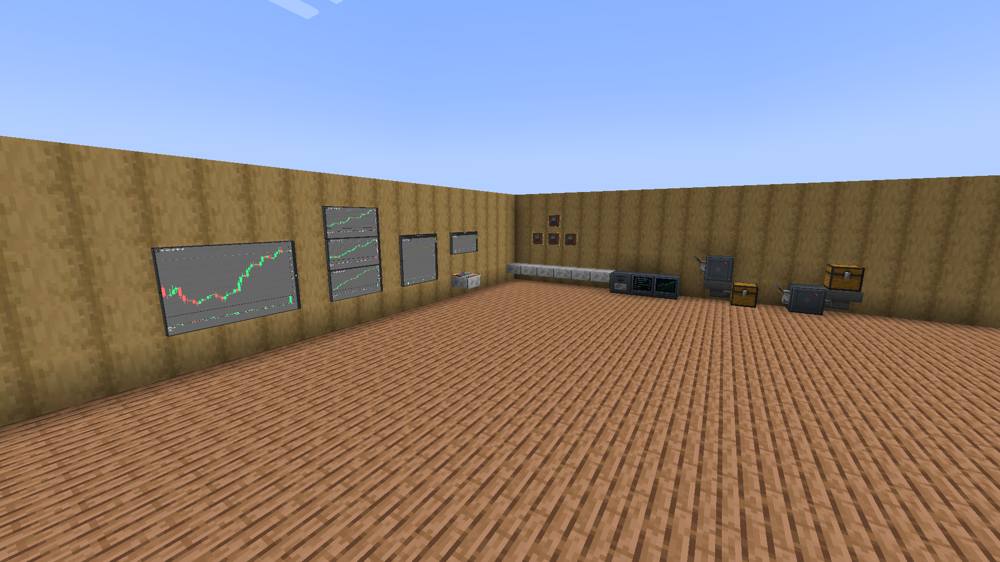
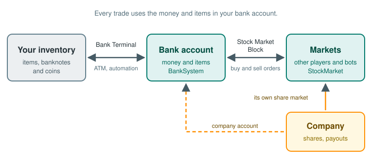

# BankSystem & StockMarket

A bank and a stock market for your Minecraft server: one shared economy, played with real items.

[:simple-curseforge: BankSystem on CurseForge](https://www.curseforge.com/minecraft/mc-mods/banksystem){ .md-button .md-button--primary }
[:simple-modrinth: BankSystem on Modrinth](https://modrinth.com/mod/kroia_banksystem){ .md-button .md-button--primary }

[:simple-curseforge: StockMarket on CurseForge](https://www.curseforge.com/minecraft/mc-mods/stockmarket){ .md-button .md-button--primary }
[:simple-modrinth: StockMarket on Modrinth](https://modrinth.com/mod/kroia_stockmarket){ .md-button .md-button--primary }

<figure markdown="span">
  { width="800" }
</figure>

-   :material-bank:{ .lg .middle } **BankSystem**

    ---

    - A [bank account](banksystem/bank-accounts.md) for every player, plus shared accounts with **Deposit**, **Withdraw** and **Manage** rights.
    - Store items, not only money: the [Bank Terminal](banksystem/bank-terminal.md) deposits, withdraws and even crafts from your bank.
    - Cash you can hold: banknotes and coins from the [ATM](banksystem/money.md).
    - [Redstone automation](banksystem/automation.md) with the Bank Upload Block and Bank Download Block.
    - [Companies](banksystem/companies.md) with workers, wages, dividends and printed shares.
    - Works with Create: Numismatics and Lightman's Currency through [currency bindings](banksystem/currency-bindings.md).

    [:octicons-arrow-right-24: BankSystem guide](banksystem/index.md)

-   :material-chart-line:{ .lg .middle } **StockMarket**

    ---

    - A market for any item, with a real order book: [market and limit orders](stockmarket/trading.md), matched between players.
    - Swap one item for another in [Item / Item](stockmarket/pair-trading.md) mode.
    - [Candlestick charts](stockmarket/price-chart.md) in the trading screen, on the [Stock Market Display](stockmarket/display-block.md) and on an optional web page.
    - Markets stay alive without players: plugins add volume, price movement and a trading bot.
    - [Market news](stockmarket/newspaper.md) that moves prices.
    - [Company shares](stockmarket/company-shares.md) trade like any item, and [villager prices](stockmarket/villager-trading.md) follow the market.

    [:octicons-arrow-right-24: StockMarket guide](stockmarket/index.md)

## How they fit together

Your BankSystem account is your wallet for everything. You move items and money between your inventory and the bank at the Bank Terminal, and you trade from the bank at the Stock Market Block. A company can give its shares their own market. See [How the two mods work together](together.md).

<figure markdown="span">
  { width="700" }
</figure>

**Built for servers:** one economy across [several servers](admin/multi-server.md) · [admin roles and LuckPerms](admin/permissions.md) · [audit trail, suspicion alerts and the Audit Tool](admin/audit/index.md) · [placeholders](admin/placeholders.md), [Discord feed](admin/discord.md) and a [web view](admin/web-interface.md).

## Find your guide

-   :material-account:{ .lg .middle } **I play**

    ---

    Your first ten minutes: bank account, first deposit, first trade.

    [:octicons-arrow-right-24: Getting started](getting-started.md)

-   :material-server:{ .lg .middle } **I run a server**

    ---

    Install both mods, make yourself admin, create the first markets.

    [:octicons-arrow-right-24: Server Admin](admin/index.md)

-   :material-code-braces:{ .lg .middle } **I write mods**

    ---

    Use the bank and market APIs, or write your own market plugin.

    [:octicons-arrow-right-24: Developers](developers/index.md)

**Requirements:** Minecraft 1.21.1 to 26.3 · Fabric or NeoForge · StockMarket needs BankSystem; BankSystem also works on its own. The full list of required mods is on the [Installation](admin/install.md) page.
